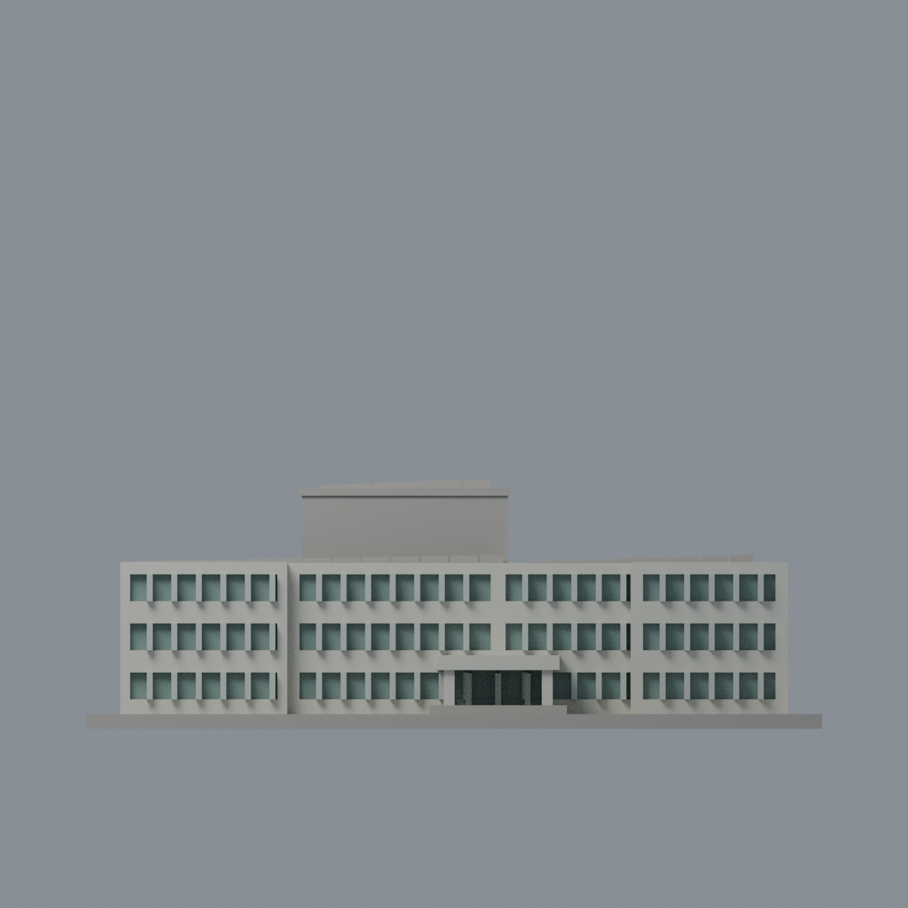
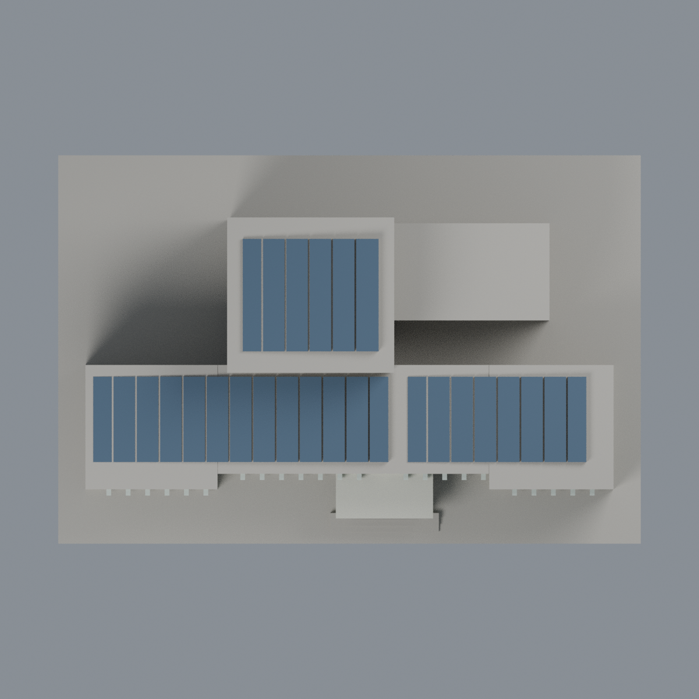

# 清華第一綜合大樓：五材質外觀版

沿用原 **3,112 三角面／1,416 頂點**，不改原 STL 位元、座標、面序或幾何；這是既有模型外觀改版，不增加模型包數。

| 模型預覽 | 模型預覽 | 模型預覽 |
| :---: | :---: | :---: |
| 正面  | 未知背牆中性／來源確認 PV 板頂  |  |
|  |  |  |

[表面色 3MF](nthugeneral-appearance.3mf) · [可編輯 Blender](scene.blend) · [材質色表](palette.json) · [逐面指派與依據](face-materials.json) · [原 STL](../model.stl)

## 來源與配色邊界

親看清華[第一綜合大樓介紹](https://attractions.site.nthu.edu.tw/p/406-1515-186982,r8697.php?Lang=zh-tw)的地面及空拍原照，對應原單色網格與生成器。[逐照 URL、雜湊、完整解碼與日期](qa/source-review.json)。地面照無 EXIF 原始日；空拍 nested EXIF 原始時間記 2019-06-08 09:31:27（相機自報、時區未核定），修改欄 2021-01-29 不是拍攝日，不稱 2026 現況。照片不入包。

- 已見前／右結構象牙白、原窗格淺銀、離散窗背灰綠；不增空調、旗幟、題字或植栽。前門廊柱與厚棚板同系統白色有界延伸。
- 空拍直接證明屋頂為 PV 陣列；只有原三片分條斜板的上向斜表面深藍，凹刻縫底與厚化側邊中性，不全屋染藍。原分格是簡化代理，不是精確模組數、配線或發電設備設計。
- 後高盒實景有大灰內嵌板而原牆未分面，整牆中性，不假染整盒灰。未註冊背面、一般屋頂平面與底板中性；無分界底板不當草坪。

[原幾何與歷史來源限制](../README.zh-TW.md)

## 重建與核驗

安裝 [依賴](source/requirements.txt)，Blender 使用 4.3.2。由本資料夾上層提供原 model.stl：

1. `python appearance/source/build_appearance.py`
2. `python appearance/source/verify_exchange.py`
3. `blender -b -t 3 --python-exit-code 1 -P appearance/source/render_appearance.py`
4. `blender -b -t 3 --python-exit-code 1 -P appearance/source/verify_scene.py`

[獨立重建 ZIP](rebuild-source.zip)含原 STL、四支程式及依賴，不含第三方照片；不取代原建模腳本。[逐檔 SHA256](SHA256SUMS)

[交換／拓撲 QA](qa/exchange-validation.json)核對原座標與面序、全部面材質、單連通、有向水密邊、頂點 link 單環、正體積與零退化／重複面；lib3mf 嚴格讀取零警告，實際編輯單材質再存讀，其他材質及面指派不變。SDK 六位小數量化誤差另列。

[Blender 存讀與編輯](qa/scene-validation.json) · [渲染記錄](qa/render-manifest.json) · [獨立重建](qa/rebuild-validation.json)

## 製造限制照舊

尺寸仍為 150 × 100 × 51 mm；原 STL、建模程式、場景及歷史 QA 保留。原層檢與薄特徵檢查本次未重跑，不能由材質 QA 代替。

3MF 是同一網格的表面色，不是各材質各自封閉的分色實體、切片專案、噴頭映射或 G-code。切片 GUI、多材料路徑與實體列印未測；柱頭、屋簷、窗框及薄邊仍須評估材料、支撐及拆除風險，沒有保證可印或免支撐。
