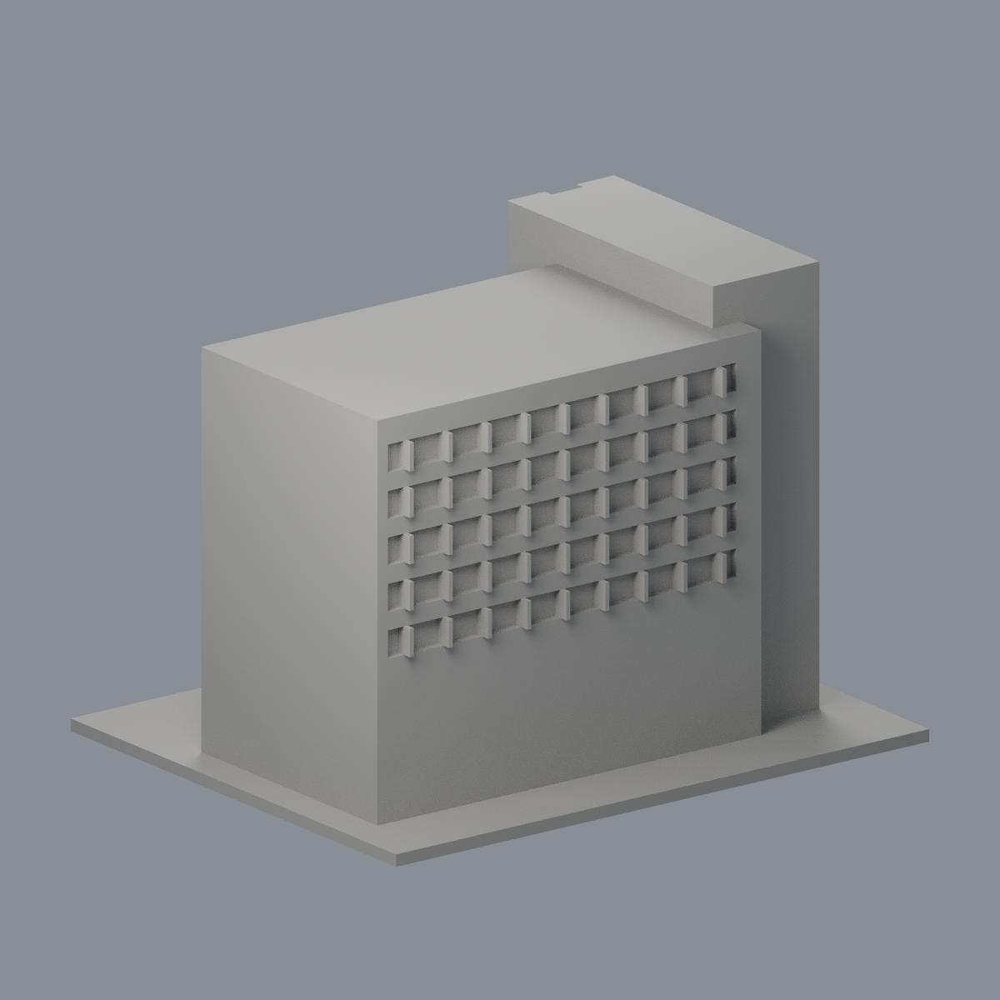
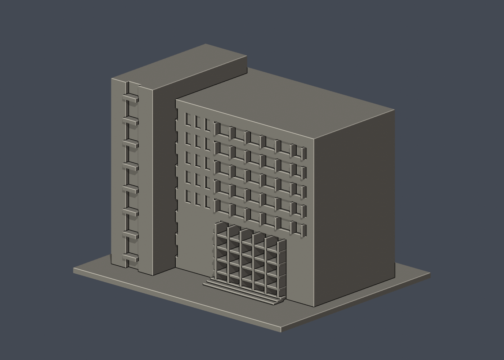
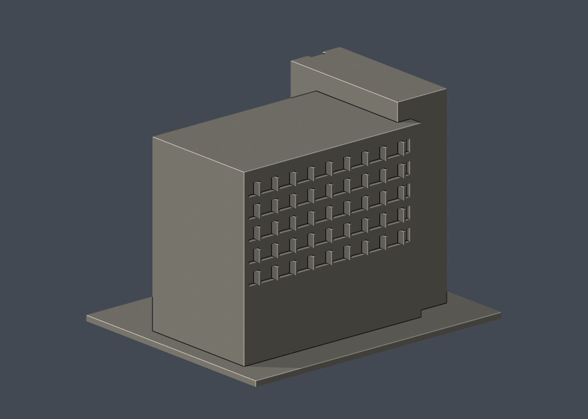

# 國立清華大學｜第二綜合大樓

## 6 材質外觀版（2026-10-21）

| 正面與來源支持區域 | 未見外側背面中性 |
|---|---|
|  |  |

[來源界線與四視角](appearance/README.md) · [表面色 3MF](appearance/nthugeneral2-appearance.3mf) · [可編輯場景](appearance/scene.blend)

來源註冊正面象牙白牆、淺灰窗梃與灰綠窗背、深灰入口格框、灰石階；未證實反側定位，後窗及後牆中性。 原 STL 與歷史 QA 不變；這是外觀改善，不是新增幾何。[原單色正面](previews/front.png)／[原單色背面](previews/rear.png)


第五批公開外觀近似模型，並非測繪成果。每件獨立比例，150.00 × 122.00 × 109.00mm，最長150mm含底座。全校尚未完成。

## 來源與觀察
[官方建築導覽](https://attractions.site.nthu.edu.tw/p/406-1515-186990,r8697.php?Lang=zh-tw)；2026-10-13檢視來源實際像素。

已實看官方道路面、草坪面及外部玻璃入口照片。建築1985年完成，八層白色量體、端部突出高塔、塔面通高凹入窗縫、三層入口玻璃面及上方水平長窗是主要特徵。

來源照片僅列連結，不放入成果、不重新發布：
- https://attractions.site.nthu.edu.tw/var/file/515/1515/pictures/615/m/mczh-tw700x700_large38323_837962160107.jpg
- https://attractions.site.nthu.edu.tw/var/file/515/1515/pictures/615/m/mczh-tw700x700_large38324_846450660108.jpg
- https://attractions.site.nthu.edu.tw/var/file/515/1515/pictures/615/m/mczh-tw700x700_large38325_308965960108.jpg
- https://attractions.site.nthu.edu.tw/var/file/515/1515/pictures/615/m/mczh-tw700x700_large38327_389394860108.jpg

## 近似與缺口
照片無拍攝日期，本件代表導覽照片所見外觀，不保證所有細部於2026年未變。樓高、深度、突出塔比例、窗距為估計。大面玻璃為有實心背襯的凹面，不復原室內大廳。右端與屋頂遮擋部位素面；樹木、候車亭、屋頂格架、設備及細標誌省略。

僅公開訪客可見外觀，無室內、地下、敏感設備或安全配置。未下載、擷取或反編譯官方Unity或任何原始3D模型。官方3D場景沒有逐面檢視，不能視為未見部位已獲證實。

## 檔案
- `build_model.py`：可攜參數化來源。
- `model.stl` / `model.obj`：單一連通、封閉實體，單位mm；不預挖內腔。
- `scene.blend`：實際STL的可編輯三角網格與相機，不是BIM或保留布林歷史的場景。
- `previews/front.png`、`rear.png`、`elevation.png`：實際STL預覽，已看像素。正背為顯示方向，不是實測方位。
- `validation.json`：原檔法線、邊與頂點流形、正體積、單一表面、重建及Blend/STL一致等18項通過。
- `check_layers.py` / `layer-check.json`：0.2mm幾何截面與0.8mm XY薄特徵篩查。

## 列印起點與支撐
底座向下，保持150mm尺寸。可從0.4mm噴嘴、0.2mm層高、3道外牆、15–20%填充起始，但不是測試完成的參數。

塔部橫梁、入口凹口上緣、窗洞上緣需依機台評估局部支撐；有背襯凹窗，不是透明玻璃。細窗框1.1–1.3mm，底座3mm。

薄特徵：修正細窗與長窗交會0.6mm殘條，改為約2.6mm間柱；最終0.8mm XY薄特徵篩查零警戒。

## 驗證範圍
18項網格驗證通過；原始STL法線與繞向相符，所有邊連接兩面、頂點環流形、單一連通表面且沒有分離內腔殼，正體積、z=0底面與150mm最大尺寸通過。乾淨暫存目錄重建STL的SHA-256相符，Blender幾何與STL一致；驗證不自動修原檔。

0.2mm間距共545個抽樣高度，所有輪廓閉合。端點數值聚合容差0.0001mm；首層0.100013mm以避共面。0.8mm XY形態開運算標示0層超過0.2mm²警戒，最大差異面積0.03691mm²，含義見薄特徵說明。

**未正式切片、未生成G-code、未實體試印。** 抽樣幾何截面不等於刀路、擠出、支撐或橋接驗證，亦不能證明全面三維壁厚或自相交完全不存在。

## 重建
Python 3.12與Blender 4.3.2+；所有程式從本檔目錄讀寫，不依賴製作端絕對路徑。

```sh
python -m pip install -r requirements.txt
python build_model.py
blender -b -t 2 -P render_preview.py
python validate_model.py
python check_layers.py
```


## 實際STL正背並排

| 正面 | 背面（未見部分按詳頁明示簡化） |
|---|---|
|  |  |
