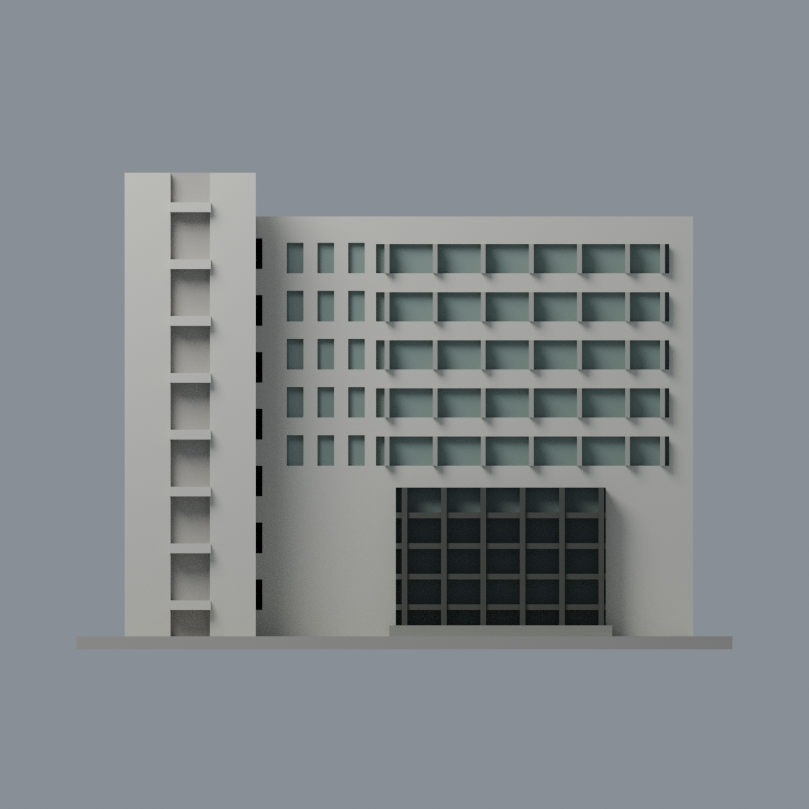
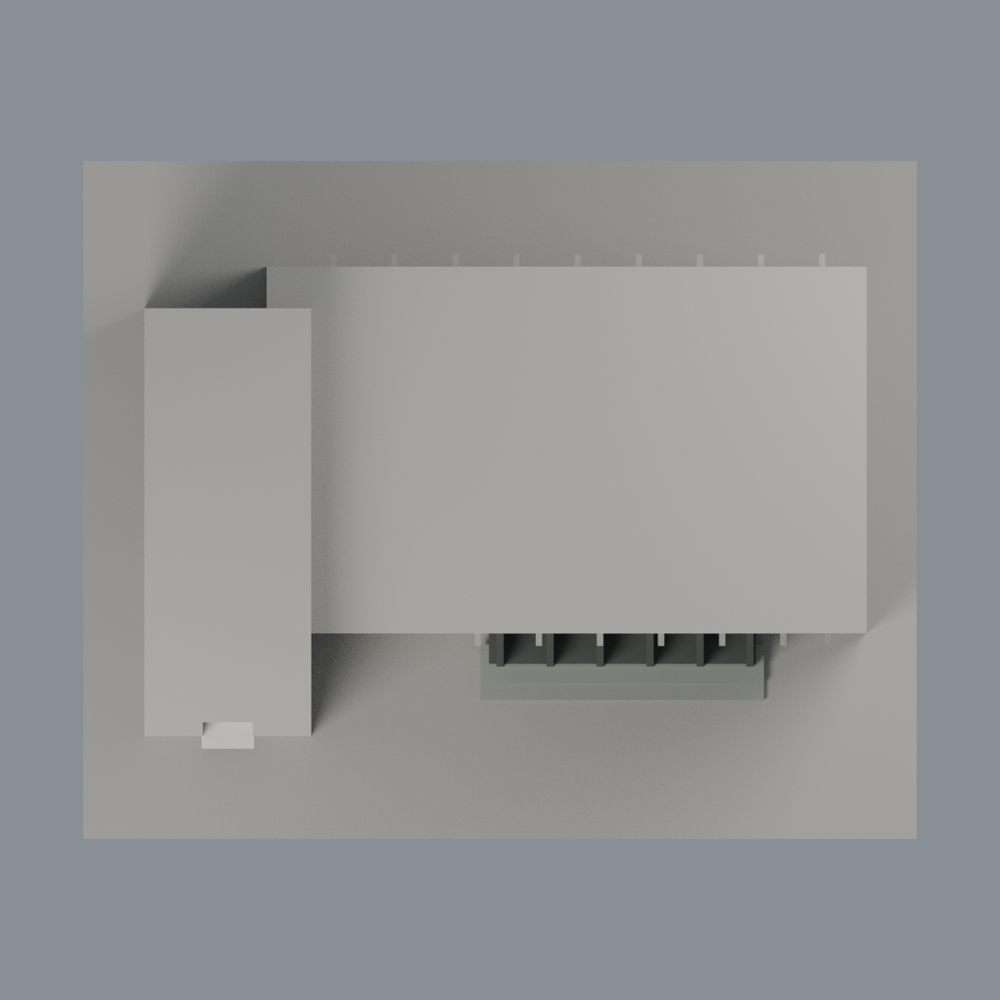

# 清華第二綜合大樓：六材質外觀版

沿用原 **3,694 三角面／1,793 頂點**，不改原 STL 位元、座標、面序或幾何；這是既有模型外觀改版，不增加模型包數。

| 正面 | 背面保持中性 |
|---|---|
|  |  |
|  |  |

[表面色 3MF](nthugeneral2-appearance.3mf) · [可編輯 Blender](scene.blend) · [材質色表](palette.json) · [逐面指派與依據](face-materials.json) · [原 STL](../model.stl)

## 來源與配色邊界

親看清華官方第二綜合大樓四張街景／入口／塔樓完整照，對應原網格與生成器。[精確來源、雜湊與日期](qa/source-review.json)。第 4 照 nested EXIF 原始時間自報 2021-02-09 13:22:00，其餘無原始拍攝日；相機時間未獨立認證，不當 2026 現況。原歷史 sources 日期摘要不覆寫，新證據記於本外觀包。照片不入公開檔。

- 僅已註冊主正面及塔正面象牙白牆、上部離散窗背灰綠與淺灰窗梃、入口深灰銅色格框及不透明玻璃代理、入口石階灰色。
- 塔樓連續長槽含走廊／窗／設備等混合內容，凹背整面中性；原跨槽橫桿同白色，不將整槽染成玻璃。
- 四照的街景與草坪視角不足以獨立證明模型相反 y=42 面的定位，不能僅沿原生成器的 opposite street 註釋聲稱已觀察後側。因此後牆及後窗、未知短端和屋頂保持中性。
- 不增樹影、空調、旗幟、外部玻璃電梯盒、內部中庭或標字；原簡化窗格與樓層比例不因配色改動。

[原幾何與歷史來源限制](../README.zh-TW.md)

## 重建與核驗

安裝 [依賴](source/requirements.txt)，Blender 使用 4.3.2。由本資料夾上層提供原 model.stl：

1. `python appearance/source/build_appearance.py`
2. `python appearance/source/verify_exchange.py`
3. `blender -b -t 3 --python-exit-code 1 -P appearance/source/render_appearance.py`
4. `blender -b -t 3 --python-exit-code 1 -P appearance/source/verify_scene.py`

[獨立重建 ZIP](rebuild-source.zip)含原 STL、四支程式及依賴，不含第三方照片；不取代原建模腳本。[逐檔 SHA256](SHA256SUMS)

[交換／拓撲 QA](qa/exchange-validation.json)核對原座標與面序、全部面材質、單連通、有向水密邊、頂點 link 單環、正體積與零退化／重複面；lib3mf 嚴格讀取零警告，實際編輯單材質再存讀，其他材質及面指派不變。SDK 六位小數量化誤差另列。

[Blender 存讀與編輯](qa/scene-validation.json) · [渲染記錄](qa/render-manifest.json) · [獨立重建](qa/rebuild-validation.json)

## 製造限制照舊

尺寸仍為 150 × 122 × 109 mm；原 STL、建模程式、場景及歷史 QA 保留。原層檢與薄特徵檢查本次未重跑，不能由材質 QA 代替。

3MF 是同一網格的表面色，不是各材質各自封閉的分色實體、切片專案、噴頭映射或 G-code。切片 GUI、多材料路徑與實體列印未測；柱頭、屋簷、窗框及薄邊仍須評估材料、支撐及拆除風險，沒有保證可印或免支撐。
