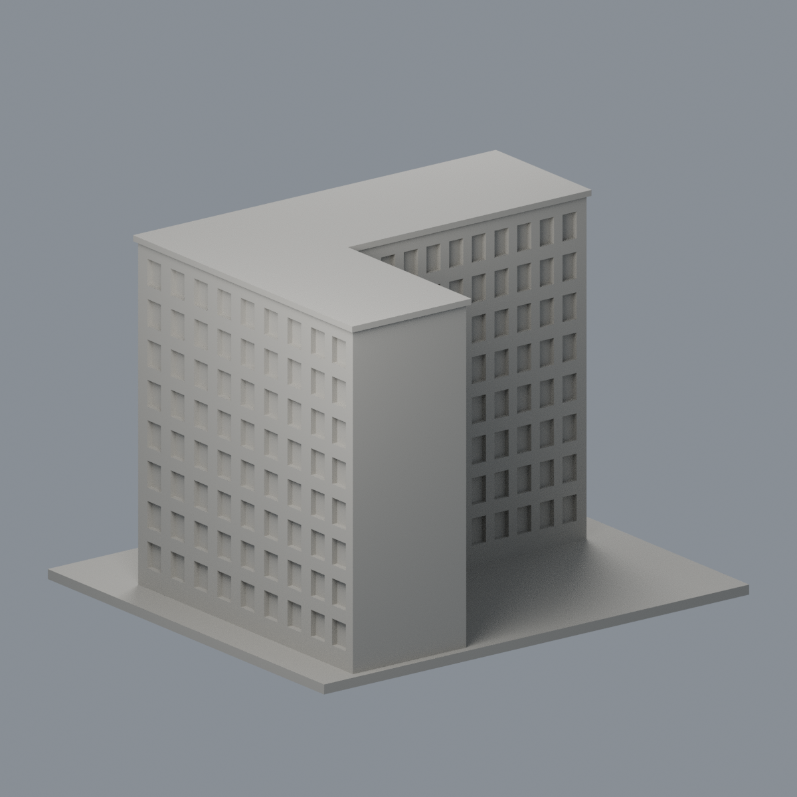

# 國立清華大學｜第三綜合大樓

## 模型預覽


| 模型預覽 | 模型預覽 | 模型預覽 |
| :---: | :---: | :---: |
| 正面與來源支持區域<br> | 未見外側背面中性<br> |  |

## 5 材質外觀版（2026-10-21）


[來源界線與四視角](appearance/README.md) · [表面色 3MF](appearance/nthugeneral3-appearance.3mf) · [可編輯場景](appearance/scene.blend)

僅主正面白結構與大型入口深框玻璃及灰階梯；上層混合窗裙凹背、未註冊湖側回翼與屋頂保持中性，不當整棟全彩還原。 原 STL 與歷史 QA 不變；這是外觀改善，不是新增幾何。原單色正面（歷史檔案留存，不作本頁預覽）／原單色背面（歷史檔案留存，不作本頁預覽）


第八批公開外觀近似模型，並非測繪成果。每件獨立比例，150.00 × 130.00 × 106.80mm，最長150mm含底座。全校尚未完成。

## 來源與觀察
[官方建築導覽](https://attractions.site.nthu.edu.tw/p/406-1515-187003,r8697.php?Lang=en)；2026-10-13檢視來源實際像素。

已看官方3張正門、湖側轉角與步道外觀。保留L形高樓回翼、正門跨多層的深玻璃凹口、上部中央五段水平凹窗、兩側密列直窗、厚白色直立框以及廣台階。湖側照片提供回翼與密窗格的外觀依據。

來源照片僅列連結，不放入成果、不重新發布：
- https://attractions.site.nthu.edu.tw/var/file/515/1515/pictures/949/m/mcen700x700_large38592_846787736194.jpg
- https://attractions.site.nthu.edu.tw/var/file/515/1515/pictures/949/m/mcen700x700_large38593_474440536194.jpg
- https://attractions.site.nthu.edu.tw/var/file/515/1515/pictures/949/m/mcen700x700_large38594_514170736194.jpg

## 近似與缺口
完整L形平面長寬比例、回翼方向與深度按照片近似，沒有實測平面。窗格適度減量及規律化；樹木遮擋的底層與無完整照片的回翼端面採素面；屋頂僅低實心平蓋，不添加設備。地形整平、台階縮短，水池、樹木、藝術品和坡道細欄杆省略。

僅公開訪客可見外觀，無室內、地下、敏感設備或安全配置。未下載、擷取或反編譯官方Unity或任何原始3D模型。官方3D場景沒有逐面檢視，不能視為未見部位已獲證實。

## 檔案
- `build_model.py`：可攜參數化來源。
- `model.stl` / `model.obj`：單一連通、封閉實體，單位mm；不預挖內腔。
- `scene.blend`：實際STL的可編輯三角網格與相機，不是BIM或保留布林歷史的場景。
- `previews/front.png`、`rear.png`、`elevation.png`：實際STL預覽，已看像素。正背為顯示方向，不是實測方位。
- `validation.json`：原檔法線、邊與頂點流形、正體積、單一表面、重建及Blend/STL一致等16項通過。
- `check_layers.py` / `layer-check.json`：0.2mm幾何截面與0.8mm XY薄特徵篩查。

## 列印起點與支撐
底座向下，保持150mm尺寸。可從0.4mm噴嘴、0.2mm層高、3道外牆、15–20%填充起始，但不是測試完成的參數。

入口大框玻璃凹口深約3.5mm、上部窗凹口約2.5mm，入口梁底/窗口上緣應在切片器檢視局部支撐。玻璃分格為有背襯的厚杆，名義1.1–1.5mm；樓體實心不製作室內。

薄特徵：534個0.2mm截面閉合，0.8mm XY薄篩零警戒，仍不能代替正式切片或三維最小壁厚測試。

## 驗證範圍
16項網格驗證通過；原始STL法線與繞向相符，所有邊連接兩面、頂點環流形、單一連通表面且沒有分離內腔殼，正體積、z=0底面與150mm最大尺寸通過。乾淨暫存目錄重建STL的SHA-256相符，Blender幾何與STL一致；驗證不自動修原檔。

0.2mm間距共534個抽樣高度，所有輪廓閉合。端點數值聚合容差0.0001mm；首層0.100013mm以避共面。0.8mm XY形態開運算標示0層超過0.2mm²警戒，最大差異面積0.00200mm²，含義見薄特徵說明。

**未正式切片、未生成G-code、未實體試印。** 抽樣幾何截面不等於刀路、擠出、支撐或橋接驗證，亦不能證明全面三維壁厚或自相交完全不存在。

## 重建
Python 3.12與Blender 4.3.2+；所有程式從本檔目錄讀寫，不依賴製作端絕對路徑。

```sh
python -m pip install -r requirements.txt
python build_model.py
blender -b -t 2 -P render_preview.py
python validate_model.py
python check_layers.py
```


## 實際STL正背並排

