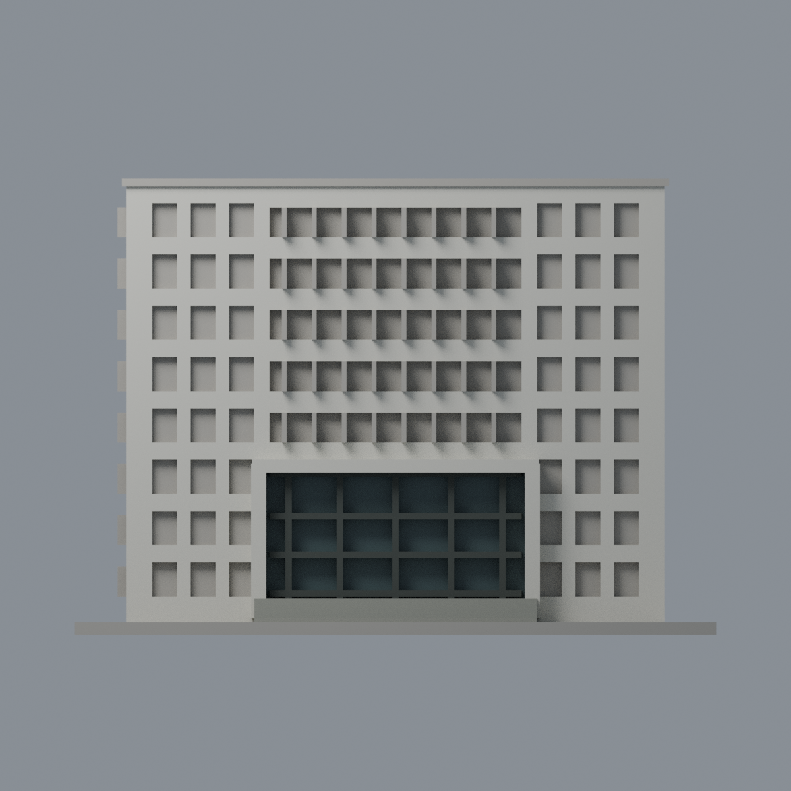
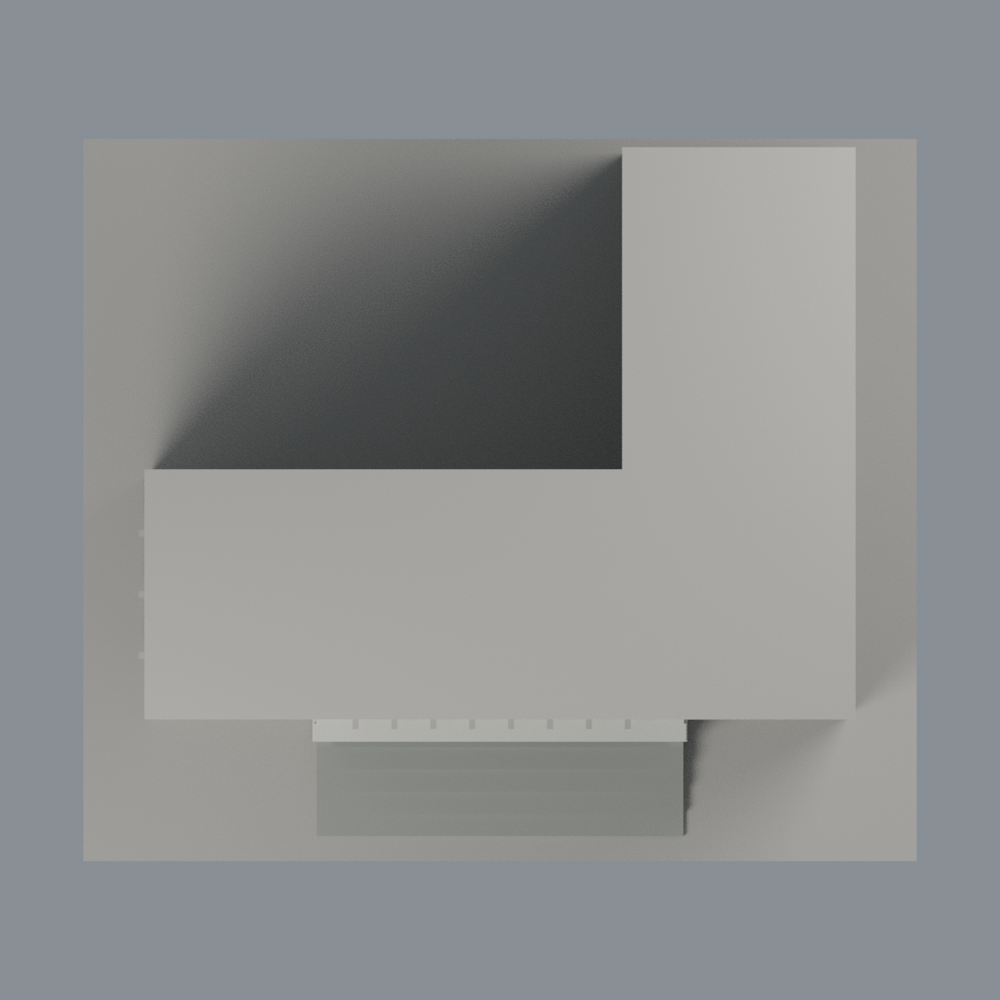

# 清華第三綜合大樓正門有限配色：五材質外觀版

沿用原 **6,344 三角面／3,170 頂點**，不改原 STL 位元、座標、面序或幾何；這是既有模型外觀改版，不增加模型包數。

| 模型預覽 | 模型預覽 | 模型預覽 |
| :---: | :---: | :---: |
| 正面  | 背面保持中性  |  |
|  |  |  |

[表面色 3MF](nthugeneral3-appearance.3mf) · [可編輯 Blender](scene.blend) · [材質色表](palette.json) · [逐面指派與依據](face-materials.json) · [原 STL](../model.stl)

## 來源與配色邊界

本件是**正門與主正面有限配色**，不是整棟實景全彩還原。親看清華官方綜三三張完整外觀照片，核對原單色網格與生成器。[精確 URL、雜湊與日期欄](qa/source-review.json)。nested EXIF 原始日各為 2014-06-27、2011-04-25、2020-07-02，相機自報、時區與日期未獨立認證，不稱 2026 現況；修改欄分列，不以修改日替代原始日。照片只供研究，不入包。

- 主正面已註冊象牙白結構，門廊柱與橫楣同系統白色有限延伸；大型入口的原 76 面完整凹背對應玻璃，採不透明深灰藍代理，原門窗格深灰、短縮階梯灰石色。
- 上部五條長窗凹背及兩側窄窗實景內含實牆窗裙、窗框與玻璃，而原凹背未分界，全部中性，不能整片深玻璃。此差異不靠更換中性色來宣稱已還原。
- 湖畔 L 型視角有照片，但與原簡化回翼各面位置未充分獨立註冊，所以側面／背面窗與牆不延伸染色；屋頂與底板亦中性。
- 不新增窗簾、空調、招牌橫幅、內部房間、橋廊或植栽。原粗框與樓層節奏均保留，不宣稱玻璃透明度、室內或整棟精確對應。

[原幾何與歷史來源限制](../README.zh-TW.md)

## 重建與核驗

安裝 [依賴](source/requirements.txt)，Blender 使用 4.3.2。由本資料夾上層提供原 model.stl：

1. `python appearance/source/build_appearance.py`
2. `python appearance/source/verify_exchange.py`
3. `blender -b -t 3 --python-exit-code 1 -P appearance/source/render_appearance.py`
4. `blender -b -t 3 --python-exit-code 1 -P appearance/source/verify_scene.py`

[獨立重建 ZIP](rebuild-source.zip)含原 STL、四支程式及依賴，不含第三方照片；不取代原建模腳本。[逐檔 SHA256](SHA256SUMS)

[交換／拓撲 QA](qa/exchange-validation.json)核對原座標與面序、全部面材質、單連通、有向水密邊、頂點 link 單環、正體積與零退化／重複面；lib3mf 嚴格讀取零警告，實際編輯單材質再存讀，其他材質及面指派不變。SDK 六位小數量化誤差另列。

[Blender 存讀與編輯](qa/scene-validation.json) · [渲染記錄](qa/render-manifest.json) · [獨立重建](qa/rebuild-validation.json)

## 製造限制照舊

尺寸仍為 150 × 130 × 106.8 mm；原 STL、建模程式、場景及歷史 QA 保留。原層檢與薄特徵檢查本次未重跑，不能由材質 QA 代替。

3MF 是同一網格的表面色，不是各材質各自封閉的分色實體、切片專案、噴頭映射或 G-code。切片 GUI、多材料路徑與實體列印未測；柱頭、屋簷、窗框及薄邊仍須評估材料、支撐及拆除風險，沒有保證可印或免支撐。
