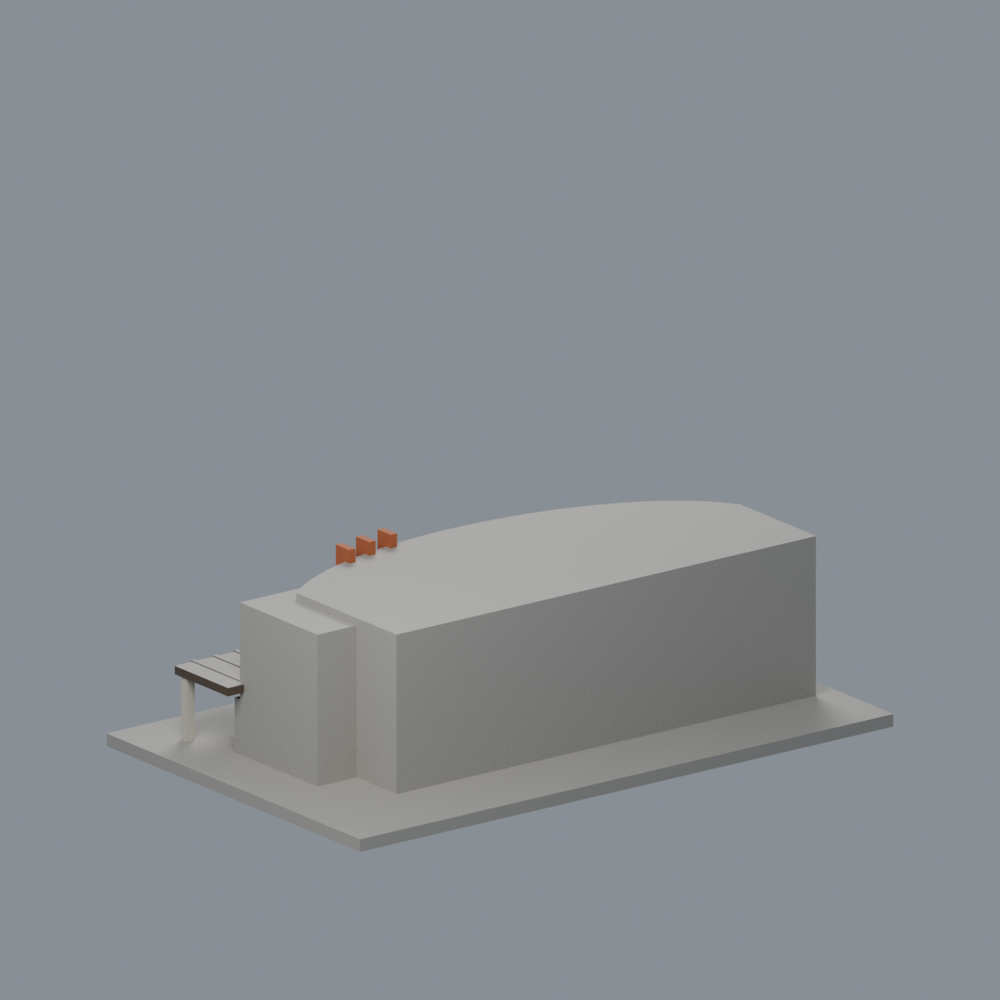

# 國立清華大學｜清華名人堂

## 模型預覽


| 模型預覽 | 模型預覽 | 模型預覽 |
| :---: | :---: | :---: |
| 正面與來源支持區域<br> | 未知背牆屋頂中性／構件有限延伸<br> |  |

## 7 材質外觀版（2026-10-21）


[來源界線與四視角](appearance/README.md) · [表面色 3MF](appearance/nthufame-appearance.3mf) · [可編輯場景](appearance/scene.blend)

橘三高肋、上簷奶油灰、原銀梃與離散窗、深褐棚底百葉及空白灰浮雕牆；混合下弧牆和上陽台背不強染，原屋頂與背牆中性。 原 STL 與歷史 QA 不變；這是外觀改善，不是新增幾何。原單色正面（歷史檔案留存，不作本頁預覽）／原單色背面（歷史檔案留存，不作本頁預覽）


第二批外觀近似建築模型，並非測繪模型。獨立比例、最長150mm含底座；全校尚未完成。

## 交付與尺寸
150.00 × 95.00 × 44.00 mm，原始STL單位為毫米。

- `model.stl`：單一封閉列印實體，沒有預挖內腔。
- `scene.blend`：由實際STL匯入的可編輯三角網格與預覽相機，不是BIM或布林歷史。
- `model.obj`：輔助交換網格。
- `build_model.py`：參數化原始碼，可獨立重建。
- `previews/front.png`、`rear.png`、`elevation.png`：實際STL的正／背／立面渲染，已逐張看像素。正背是顯示方向，不是測量方位。
- `validation.json`：原始法線、流形與乾淨重建等18項驗證。
- `check_layers.py`、`layer-check.json`：0.2mm幾何截面與薄特徵篩查。

## 來源
查閱與像素檢視：2026-10-13。[校方來源頁](https://alumni.site.nthu.edu.tw/p/405-1346-212719,c18846.php?Lang=zh-tw)。

實際檢視校友中心完整前立面及入口雨棚照片，可見雙層弧形立面、上層退縮深陽台、三支橙色高肋與右側寬雨棚。模型保留弧形量體與陰影深度。

照片只列URL，未包含在交付或重新發布：
- https://alumni.site.nthu.edu.tw/var/file/346/1346/img/2109/532035152.jpg
- https://alumni.site.nthu.edu.tw/var/file/346/1346/img/2181/3.jpg

## 近似範圍
未有完整俯視／背立面，弧率、整體深度和後包絡估計；周圍百齡堂其他棟不包括在本件。玻璃欄杆改成實體厚邊；細窗框、百葉和屋簷已加粗。入口人物浮雕與文字省略，不宣稱複刻藝術品。

僅研究公開訪客可見外觀；沒有室內、地下、安全／進出控制或隱藏系統配置。未擷取官方Unity或其他3D資產；沒有聲稱逐面檢視官方3D場景。

## 列印與支撐
正立、底座朝下。可從0.4mm噴嘴、0.2mm層高、3道外牆、15–20%填充起始評估，但未驗證此設定。

大面積雨棚下方及上層曲面陽台天花可能需支撐；柱已連到底座與屋簷，避免浮動殼。

薄特徵人工對照：0.8mm XY開運算未超過0.2mm²警戒面積。源碼三支高肋1.8mm寬，雨棚柱2.2mm，細窗肋1.2mm。這是抽樣截面篩查，不代表三維所有最薄處均已測得。

## 驗證結果與限制
18項原始STL幾何檢查全過：單位法線且與繞向一致、無退化三角面、封閉邊、頂點連結單環、單一連通表面／無分離內腔殼、正體積、z=0平底、150mm最大邊、乾淨目錄重建STL雜湊一致、Blender／STL三角幾何一致。檢查不會修復原STL。

以0.2mm間距抽樣220個高度（首層0.100013mm，微偏移避免與三角面共面），所有截面輪廓閉合。交點採0.0001mm數值容差聚合，不修改STL。0.8mm XY形態開運算篩查標記0層，最大差異面積0.00116mm²；標記解釋如上。

**這不是正式切片，不產生G-code，沒有驗證刀路、擠出或支撐生成；沒有實體試印。** 抽樣截面不涵蓋每個高度，也不能代替全面三維最小壁厚或自相交證明。

## 乾淨重建
Python 3.12、Blender 4.3.2+；檔案只用自身目錄，不依賴製作機器絕對路徑。

```sh
python -m pip install -r requirements.txt
python build_model.py
blender -b -t 2 -P render_preview.py
python validate_model.py
python check_layers.py
```


## 實際STL正背並排

