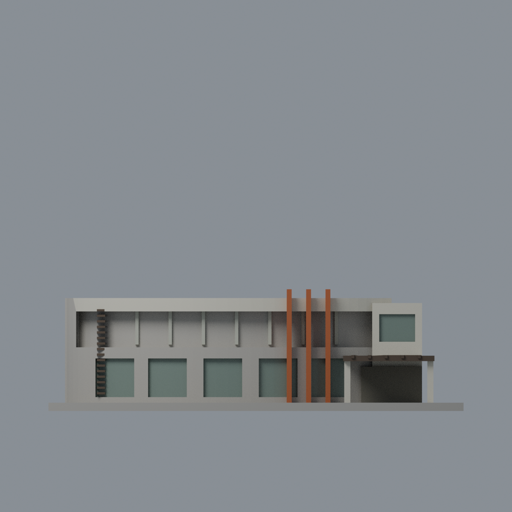
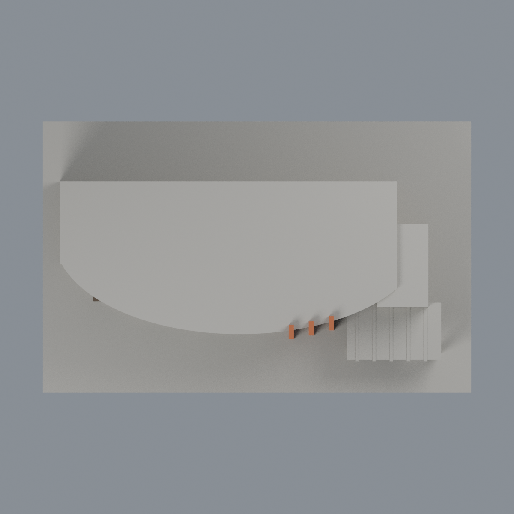

# 清華名人堂：七材質外觀版

沿用原 **1,592 三角面／786 頂點**，不改原 STL 位元、座標、面序或幾何；這是既有模型外觀改版，不增加模型包數。

| 模型預覽 | 模型預覽 | 模型預覽 |
| :---: | :---: | :---: |
| 正面  | 未知背牆屋頂中性／構件有限延伸  |  |
|  |  |  |

[表面色 3MF](nthufame-appearance.3mf) · [可編輯 Blender](scene.blend) · [材質色表](palette.json) · [逐面指派與依據](face-materials.json) · [原 STL](../model.stl)

## 來源與配色邊界

親看[清華校友中心名人堂介紹](https://alumni.site.nthu.edu.tw/p/405-1346-212719,c18846.php?Lang=zh-tw)所列兩張完整正面／入口照，核對原網格與生成器。[逐照 URL、SHA 與完整解碼核對](qa/source-review.json)。正面照無原始拍攝日；入口照 nested EXIF 原始時間自報 2014-02-26 15:30:59，修改時間 2014-03-11 11:25:58 並非拍攝日，時區未核定。介紹頁的 2013-12-19 為啟用日，不當照片日期，不稱 2026 現況。照片不入公開包。

- 弧形正面上簷已註冊奶油灰牆、三支橘色高肋、原上層窗梃銀灰，下層離散凹窗背灰綠；未新增照片中的細窗框或玻璃欄杆。
- 上層深陽台背板在現有簡化幾何中跨窗與實柱，整個混合凹背中性，不一律染玻璃。原厚實欄邊不是透明欄杆的精確還原。
- 左百葉與入口棚可見邊／底深褐金屬，構件側面有限同材質延伸；棚頂未見保守中性。入口原支柱象牙白，原空白浮雕牆正面暗灰，不增肖像、文字或藝術品。
- 原下層弧牆三角面跨石腳與上牆，整段下層弧牆均中性，避免沿三角對角線產生假色界；未知背牆、屋頂上表面、無分界底板中性，不把植栽／光影烘焙成材質。

[原幾何與歷史來源限制](../README.zh-TW.md)

## 重建與核驗

安裝 [依賴](source/requirements.txt)，Blender 使用 4.3.2。由本資料夾上層提供原 model.stl：

1. `python appearance/source/build_appearance.py`
2. `python appearance/source/verify_exchange.py`
3. `blender -b -t 3 --python-exit-code 1 -P appearance/source/render_appearance.py`
4. `blender -b -t 3 --python-exit-code 1 -P appearance/source/verify_scene.py`

[獨立重建 ZIP](rebuild-source.zip)含原 STL、四支程式及依賴，不含第三方照片；不取代原建模腳本。[逐檔 SHA256](SHA256SUMS)

[交換／拓撲 QA](qa/exchange-validation.json)核對原座標與面序、全部面材質、單連通、有向水密邊、頂點 link 單環、正體積與零退化／重複面；lib3mf 嚴格讀取零警告，實際編輯單材質再存讀，其他材質及面指派不變。SDK 六位小數量化誤差另列。

[Blender 存讀與編輯](qa/scene-validation.json) · [渲染記錄](qa/render-manifest.json) · [獨立重建](qa/rebuild-validation.json)

## 製造限制照舊

尺寸仍為 150 × 95 × 44 mm；原 STL、建模程式、場景及歷史 QA 保留。原層檢與薄特徵檢查本次未重跑，不能由材質 QA 代替。

3MF 是同一網格的表面色，不是各材質各自封閉的分色實體、切片專案、噴頭映射或 G-code。切片 GUI、多材料路徑與實體列印未測；柱頭、屋簷、窗框及薄邊仍須評估材料、支撐及拆除風險，沒有保證可印或免支撐。
