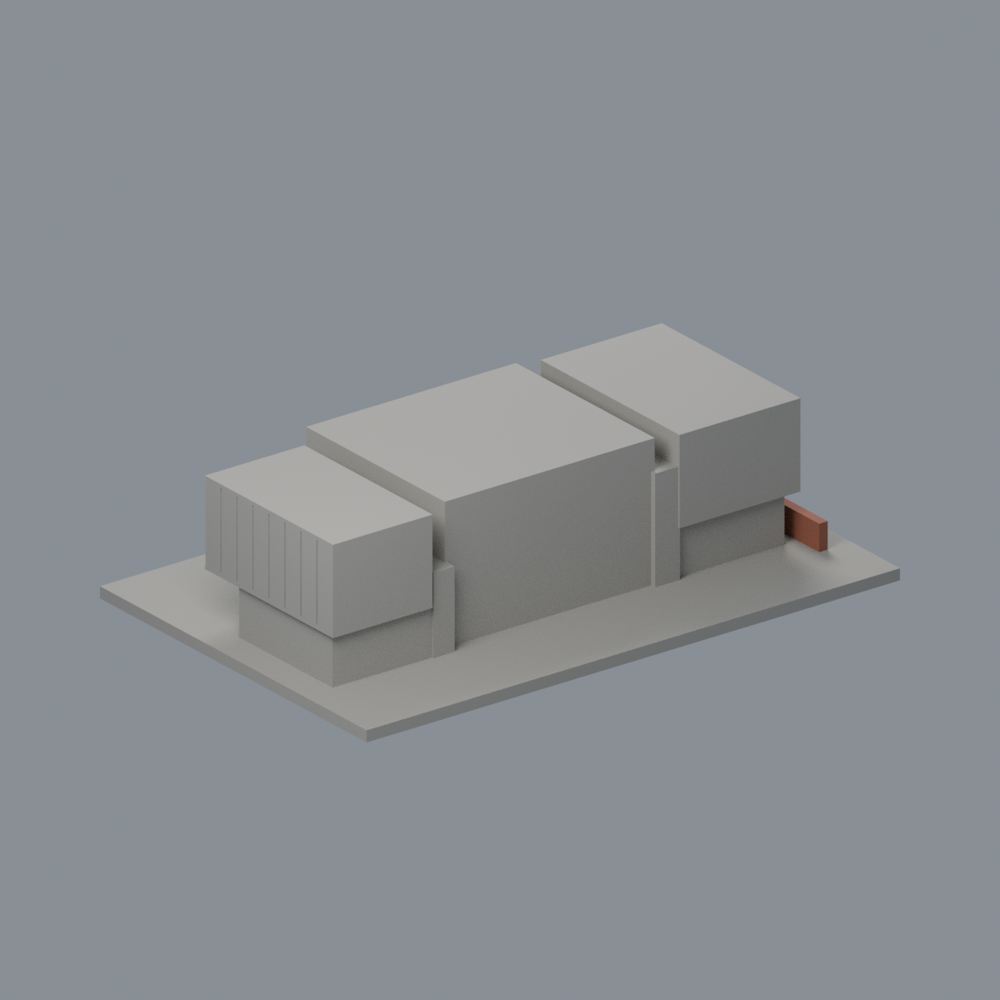

# 國立清華大學｜宏亮美術館

## 模型預覽


| 模型預覽 | 模型預覽 | 模型預覽 |
| :---: | :---: | :---: |
| 正面與來源支持區域<br> | 未知後牆屋頂中性／左側來源構件<br> |  |

## 6 材質外觀版（2026-10-21）


[來源界線與四視角](appearance/README.md) · [表面色 3MF](appearance/nthuhong-appearance.3mf) · [可編輯場景](appearance/scene.blend)

官方照片支持銀灰金屬盒、暖混凝土中段、離散玻璃與原窗梃及左端低磚牆；未知右端、屋頂和後面中性，低磚頂和圓柱周面僅同構件有界延伸。 原 STL 與歷史 QA 不變；這是外觀改善，不是新增幾何。原單色正面（歷史檔案留存，不作本頁預覽）／原單色背面（歷史檔案留存，不作本頁預覽）


第四批公開外觀近似模型，並非測繪成果。每件獨立比例，150.00 × 100.00 × 39.00mm，最長150mm含底座。全校尚未完成。

## 來源與觀察
[官方建築導覽](https://attractions.site.nthu.edu.tw/p/406-1515-301460,r8697.php?Lang=zh-tw)；2026-10-13檢視來源實際像素。

已實看官方草坪正面、端面高角度與營繕組竣工報告兩張外觀照片。主體於2025年2月5日竣工。保留三個分離感上層盒體、中央外凸混凝土面、兩側金屬垂直板縫、窄退縮連接面、底層退縮玻璃及明顯粗支柱。

來源照片僅列連結，不放入成果、不重新發布：
- https://attractions.site.nthu.edu.tw/var/file/515/1515/pictures/836/m/mczh-tw700x700_large56157_505174882110.jpg
- https://attractions.site.nthu.edu.tw/var/file/515/1515/pictures/836/m/mczh-tw700x700_large56158_139048982110.jpg
- https://construc.site.nthu.edu.tw/var/file/167/1167/img/449174070.pdf

## 近似與缺口
整體寬深高、三盒錯位及玻璃分格依照片估計；山坡整平為共同底座，玻璃以不透明實心背襯替代。背面完整立面未見，素面處理；屋頂未有完整俯視證據，採平蓋，不虛構屋頂設備。左端低矮磚牆僅概括可見轉角。

僅公開訪客可見外觀，無室內、地下、敏感設備或安全配置。未下載、擷取或反編譯官方Unity或任何原始3D模型。官方3D場景沒有逐面檢視，不能視為未見部位已獲證實。

## 檔案
- `build_model.py`：可攜參數化來源。
- `model.stl` / `model.obj`：單一連通、封閉實體，單位mm；不預挖內腔。
- `scene.blend`：實際STL的可編輯三角網格與相機，不是BIM或保留布林歷史的場景。
- `previews/front.png`、`rear.png`、`elevation.png`：實際STL預覽，已看像素。正背為顯示方向，不是實測方位。
- `validation.json`：原檔法線、邊與頂點流形、正體積、單一表面、重建及Blend/STL一致等18項通過。
- `check_layers.py` / `layer-check.json`：0.2mm幾何截面與0.8mm XY薄特徵篩查。

## 列印起點與支撐
底座向下，保持150mm尺寸。可從0.4mm噴嘴、0.2mm層高、3道外牆、15–20%填充起始，但不是測試完成的參數。

浮盒底面懸挑、中央入口柱上方、左右端部簷下須評估支撐，局部懸挑約8–12mm；窗凹具有背襯但不能保證免支撐。立柱直徑2.8mm，窗框1.1mm。

薄特徵：修正端部磚牆與凹窗交會的0.2mm殘條，磚牆轉角加厚。0.8mm XY篩查結果見下，不是全面三維壁厚證明。

## 驗證範圍
18項網格驗證通過；原始STL法線與繞向相符，所有邊連接兩面、頂點環流形、單一連通表面且沒有分離內腔殼，正體積、z=0底面與150mm最大尺寸通過。乾淨暫存目錄重建STL的SHA-256相符，Blender幾何與STL一致；驗證不自動修原檔。

0.2mm間距共195個抽樣高度，所有輪廓閉合。端點數值聚合容差0.0001mm；首層0.100013mm以避共面。0.8mm XY形態開運算標示0層超過0.2mm²警戒，最大差異面積0.17875mm²，含義見薄特徵說明。

**未正式切片、未生成G-code、未實體試印。** 抽樣幾何截面不等於刀路、擠出、支撐或橋接驗證，亦不能證明全面三維壁厚或自相交完全不存在。

## 重建
Python 3.12與Blender 4.3.2+；所有程式從本檔目錄讀寫，不依賴製作端絕對路徑。

```sh
python -m pip install -r requirements.txt
python build_model.py
blender -b -t 2 -P render_preview.py
python validate_model.py
python check_layers.py
```


## 實際STL正背並排

