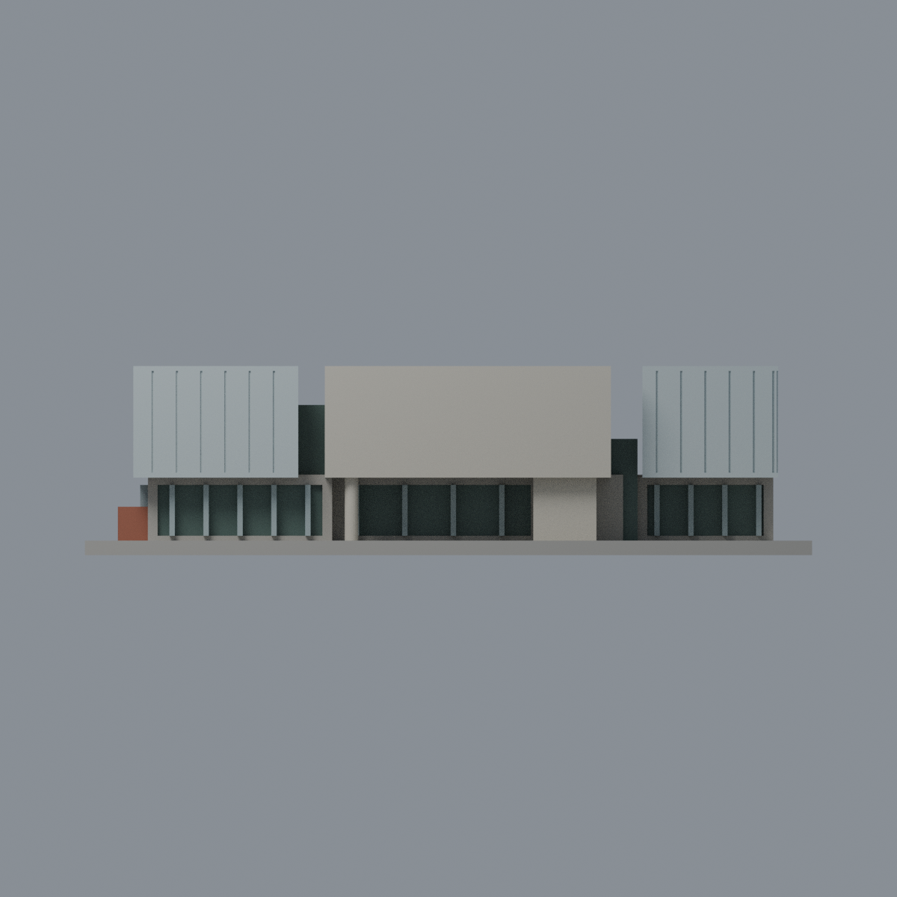
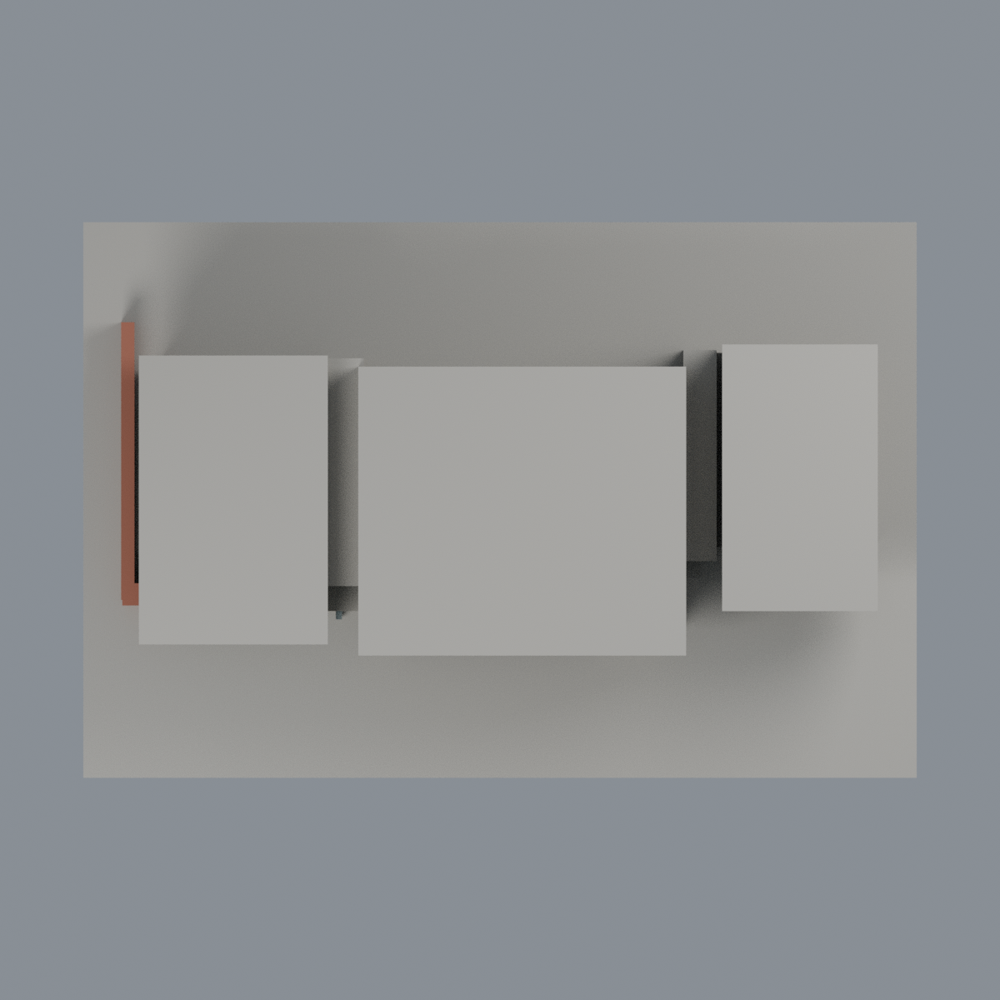

# 清華宏亮美術館：六材質外觀版

沿用原 **1,278 三角面／639 頂點**，不改原 STL 位元、座標、面序或幾何；這是既有模型外觀改版，不增加模型包數。

| 正面 | 未知後牆屋頂中性／左側來源構件 |
|---|---|
|  |  |
|  |  |

[表面色 3MF](nthuhong-appearance.3mf) · [可編輯 Blender](scene.blend) · [材質色表](palette.json) · [逐面指派與依據](face-materials.json) · [原 STL](../model.stl)

## 來源與配色邊界

親自核對清華官方[景點介紹](https://attractions.site.nthu.edu.tw/p/406-1515-301460,r8697.php?Lang=zh-tw)、[草坪正面照](https://attractions.site.nthu.edu.tw/var/file/515/1515/pictures/836/m/mczh-tw700x700_large56157_505174882110.jpg)及[左端高位照](https://attractions.site.nthu.edu.tw/var/file/515/1515/pictures/836/m/mczh-tw700x700_large56158_139048982110.jpg)。照片無 EXIF 拍攝日，不把工程完工日期或網站路徑當拍攝日期，也不宣稱 2026 即時外觀。[來源覆核與雜湊](qa/source-review.json)，原照不入公開包。

- 兩側上盒**正面**及可核對左盒端面採冷銀灰金屬，既有板縫同系統低差異，不塗成黑玻璃。中央正面淺暖混凝土，未註冊回折面保守中性。
- 下層各離散窗背與左端凹背暗灰綠玻璃，原窗梃銀灰；樹影與草地反射不烘成綠牆。兩段凹連接盒只賦來源可見前面，不把隱藏整盒全部塗黑。
- 原主支柱與細圓柱混凝土代理，圓周及短回折面為同構件有界材料延伸；左端原低磚牆紅褐，包括短頂面按同一磚構件有界延伸，不聲稱每面皆有特寫。
- 上盒屋頂、右端、後面及其他未註冊面中性。底板沒有草坪界線，不整片塗綠；不增屋頂設備、字牌、管線或室內。
- 原 STL 位元、座標、面序、原腳本／場景／歷史 QA 保持，不新增面或棟數，不宣稱實體列印成功。

[原幾何與歷史來源限制](../README.zh-TW.md)

## 重建與核驗

安裝 [依賴](source/requirements.txt)，Blender 使用 4.3.2。由本資料夾上層提供原 model.stl：

1. `python appearance/source/build_appearance.py`
2. `python appearance/source/verify_exchange.py`
3. `blender -b -t 3 --python-exit-code 1 -P appearance/source/render_appearance.py`
4. `blender -b -t 3 --python-exit-code 1 -P appearance/source/verify_scene.py`

[獨立重建 ZIP](rebuild-source.zip)含原 STL、四支程式及依賴，不含第三方照片；不取代原建模腳本。[逐檔 SHA256](SHA256SUMS)

[交換／拓撲 QA](qa/exchange-validation.json)核對原座標與面序、全部面材質、單連通、有向水密邊、頂點 link 單環、正體積與零退化／重複面；lib3mf 嚴格讀取零警告，實際編輯單材質再存讀，其他材質及面指派不變。SDK 六位小數量化誤差另列。

[Blender 存讀與編輯](qa/scene-validation.json) · [渲染記錄](qa/render-manifest.json) · [獨立重建](qa/rebuild-validation.json)

## 製造限制照舊

尺寸仍為 150 × 100 × 39 mm；原 STL、建模程式、場景及歷史 QA 保留。原層檢與薄特徵檢查本次未重跑，不能由材質 QA 代替。

3MF 是同一網格的表面色，不是各材質各自封閉的分色實體、切片專案、噴頭映射或 G-code。切片 GUI、多材料路徑與實體列印未測；柱頭、屋簷、窗框及薄邊仍須評估材料、支撐及拆除風險，沒有保證可印或免支撐。
