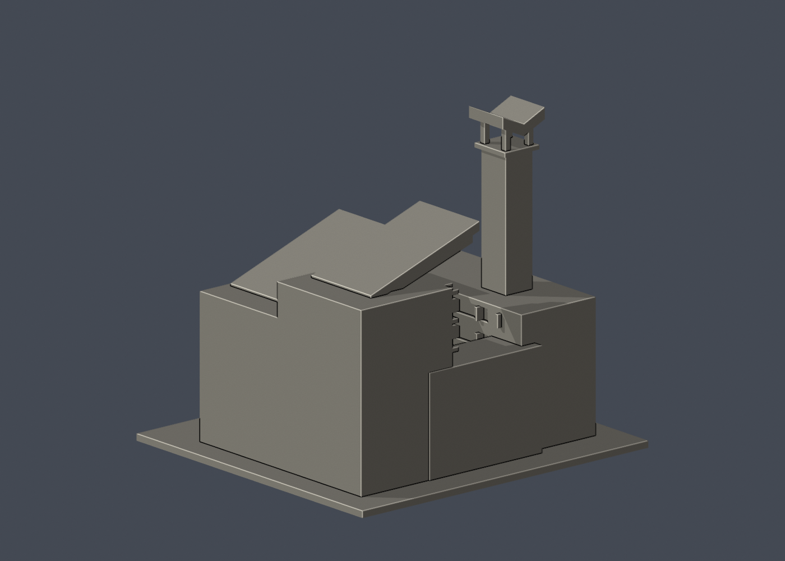

# 國立清華大學｜人文社會學院大樓

第六批公開外觀近似模型，並非測繪成果。每件獨立比例，150.00 × 140.00 × 137.00mm，最長150mm含底座。全校尚未完成。

## 來源與觀察
[官方建築導覽](https://www.nthu.edu.tw/units/education)；2026-10-13檢視來源實際像素。

已實看校方教學單位照片、2020校史展中的原貌照片、校友中心遠景，以及鴻聖水電工程有限公司作品照片。校史記載1990年落成。保留雙翼院落、高鐘塔、鏤空塔冠、右翼兩段向院落挑出的斜檐與高低樓層。

來源照片僅列連結，不放入成果、不重新發布：
- https://www.nthu.edu.tw/public/images/img07.jpg
- https://www.lib.nthu.edu.tw/events/2020/GoodTimes/image/8.jpg
- https://alumni.site.nthu.edu.tw/var/file/346/1346/img/507572817.jpg
- https://www.houngsheng.com.tw/image/cache/data/20160224165522-825x619.jpg

## 近似與缺口
雙翼完整平面深度、夾角、連接部位、樓高及山坡地形均為外觀估計，不宣稱完整精確院館群。地形整平、公開院落階梯縮短；立面窗口規律化。鐘塔冠部的立體雕塑簡化成厚鞍形，細格和雕刻省略。背側無完整像素證據，素面；鐘面、空調、植栽與欄杆不重建。照片年代不同，保留主要辨識輪廓，不宣稱2026全貌逐項一致。

僅公開訪客可見外觀，無室內、地下、敏感設備或安全配置。未下載、擷取或反編譯官方Unity或任何原始3D模型。官方3D場景沒有逐面檢視，不能視為未見部位已獲證實。

## 檔案
- `build_model.py`：可攜參數化來源。
- `model.stl` / `model.obj`：單一連通、封閉實體，單位mm；不預挖內腔。
- `scene.blend`：實際STL的可編輯三角網格與相機，不是BIM或保留布林歷史的場景。
- `previews/front.png`、`rear.png`、`elevation.png`：實際STL預覽，已看像素。正背為顯示方向，不是實測方位。
- `validation.json`：原檔法線、邊與頂點流形、正體積、單一表面、重建及Blend/STL一致等18項通過。
- `check_layers.py` / `layer-check.json`：0.2mm幾何截面與0.8mm XY薄特徵篩查。

## 列印起點與支撐
底座向下，保持150mm尺寸。可從0.4mm噴嘴、0.2mm層高、3道外牆、15–20%填充起始，但不是測試完成的參數。

兩片大型斜挑檐伸入院落約23mm，檐下及肋條必須評估支撐；塔冠下方最低尖端懸於四柱中間，也需要支撐，不可視為免支撐模型。塔冠柱2.6mm、窗框1.2–1.3mm、底座3mm。高塔搬運應扶底座避免折損。

薄特徵：修正高窗切割斜檐造成的0.7mm殘條後，剩5個抽樣高度警戒：兩挑檐最上沿z=86.90001/101.90001，塔冠最低鞍尖z=127.10001及頂緣z=136.70001/136.90001mm。均為厚件尖端截面；切片器可能鈍化尖端，塔冠最低尖還涉及支撐起始，須確認刀路。

## 驗證範圍
18項網格驗證通過；原始STL法線與繞向相符，所有邊連接兩面、頂點環流形、單一連通表面且沒有分離內腔殼，正體積、z=0底面與150mm最大尺寸通過。乾淨暫存目錄重建STL的SHA-256相符，Blender幾何與STL一致；驗證不自動修原檔。

0.2mm間距共685個抽樣高度，所有輪廓閉合。端點數值聚合容差0.0001mm；首層0.100013mm以避共面。0.8mm XY形態開運算標示5層超過0.2mm²警戒，最大差異面積27.71880mm²，含義見薄特徵說明。

**未正式切片、未生成G-code、未實體試印。** 抽樣幾何截面不等於刀路、擠出、支撐或橋接驗證，亦不能證明全面三維壁厚或自相交完全不存在。

## 重建
Python 3.12與Blender 4.3.2+；所有程式從本檔目錄讀寫，不依賴製作端絕對路徑。

```sh
python -m pip install -r requirements.txt
python build_model.py
blender -b -t 2 -P render_preview.py
python validate_model.py
python check_layers.py
```

補充來源：[鴻聖水電工程有限公司作品](https://www.houngsheng.com.tw/index.php?engineer_id=24&route=engineer%2Fengineer_detail)、[清華校史影像展](https://www.lib.nthu.edu.tw/events/2020/GoodTimes/)。


## 實際STL正背並排

| 正面 | 背面（未見部分按詳頁明示簡化） |
|---|---|
|  |  |
