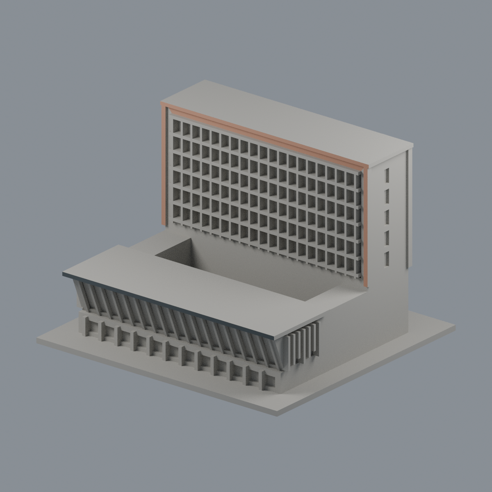
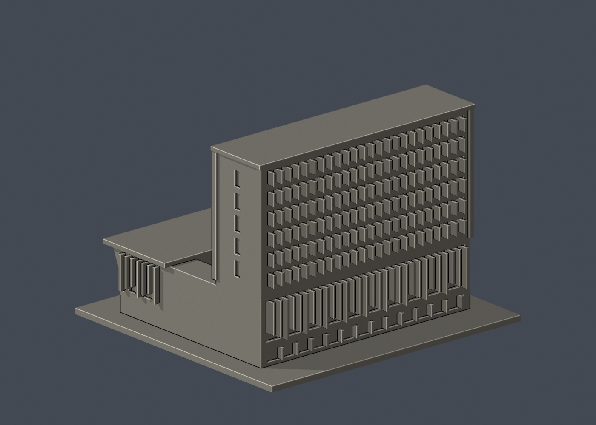

# 國立清華大學｜創新育成中心

## 湖側磚框與低翼簷前臉限域配色（2026-10-22）

[五視角、來源與限制](appearance/README.md) · [彩色3MF](appearance/nthu-innovation-incubation-appearance.3mf) · [可編輯Blender](appearance/scene.blend)



僅高棟湖側暖磚框前臉12個完整原面及低翼深灰簷前臉2面，合計1263.87546mm²；其他8652面中性。全頂點有限平面域、前向法向選面，不切面、不為填補磚框缺口擴染。內側窄框、玻璃、彩色葉片、草頂、水平簷面、側背與未知區均中性；不是全棟材質復原。九典三張完工照拍攝日期未知：EXIF三日期空，XMP2012為工具版本，作品2011–2016與URL2024/11均非拍攝日，不稱2026現況。未校準目視代理，原8666面座標／面序／STL與歷史QA不變、不增套。兩翼深度與低層邊界等原近似仍保留；鄰棟不納入，未實體試印，照片不分發。


第七批公開外觀近似模型，並非測繪成果。每件獨立比例，150.00 × 140.00 × 103.00mm，最長150mm含底座。全校尚未完成。

## 來源與觀察
[官方建築導覽](https://www.bioarch.com.tw/work/清華大學創新育成中心/)；2026-10-13檢視來源實際像素。

已實看九典聯合建築師事務所6張完工外觀及公開院落/屋頂景觀照片。2011–2016作品。保留後側9層主樓、前側3層低翼、院落間距、低翼外斜玻璃及深檐、主樓湖側大凹框、路側逐格直立遮陽與下層錯落長葉片。

來源照片僅列連結，不放入成果、不重新發布：
- https://www.bioarch.com.tw/storage/2024/11/%E6%8A%95%E5%BD%B1%E7%89%871-18.jpg
- https://www.bioarch.com.tw/storage/2024/11/%E6%8A%95%E5%BD%B1%E7%89%872-17.jpg
- https://www.bioarch.com.tw/storage/2024/11/%E6%8A%95%E5%BD%B1%E7%89%873-15.jpg
- https://www.bioarch.com.tw/storage/2024/11/%E6%8A%95%E5%BD%B1%E7%89%874-14.jpg
- https://www.bioarch.com.tw/storage/2024/11/%E6%8A%95%E5%BD%B1%E7%89%875-13.jpg
- https://www.bioarch.com.tw/storage/2024/11/%E6%8A%95%E5%BD%B1%E7%89%876-11.jpg

## 近似與缺口
本件僅創新育成中心，鄰棟清華實驗室與台積館、跨棟空橋不納入。兩翼與連接邊完整深度按外觀估計，非精確平面。院落中局部細薄跨頂架省略；兩端低層邊界、植栽遮住的地面層簡化，屋頂以實心平蓋替代植栽及設備。原遮陽片具有局部L形、顏色及更密分格，本件減量加粗成矩形片，無透明材質。

僅公開訪客可見外觀，無室內、地下、敏感設備或安全配置。未下載、擷取或反編譯官方Unity或任何原始3D模型。官方3D場景沒有逐面檢視，不能視為未見部位已獲證實。

## 檔案
- `build_model.py`：可攜參數化來源。
- `model.stl` / `model.obj`：單一連通、封閉實體，單位mm；不預挖內腔。
- `scene.blend`：實際STL的可編輯三角網格與相機，不是BIM或保留布林歷史的場景。
- `previews/front.png`、`rear.png`、`elevation.png`：實際STL預覽，已看像素。正背為顯示方向，不是實測方位。
- `validation.json`：原檔法線、邊與頂點流形、正體積、單一表面、重建及Blend/STL一致等16項通過。
- `check_layers.py` / `layer-check.json`：0.2mm幾何截面與0.8mm XY薄特徵篩查。

## 列印起點與支撐
底座向下，保持150mm尺寸。可從0.4mm噴嘴、0.2mm層高、3道外牆、15–20%填充起始，但不是測試完成的參數。

前低翼外斜幕牆、屋簷約數mm懸挑與每列遮陽片底部，需在切片器評估局部支撐；不保證0.4mm噴嘴可直接無支撐完成。斜窗格1.4mm、上層葉片1.4mm、低層葉片1.3mm，皆與背面實體融合。

薄特徵：修正側窗切割斜面轉角造成的窄尖條後，515個0.2mm截面全閉合，0.8mm XY篩查零警戒；葉片下緣與斜檐的橋接不由此篩查保證。

## 驗證範圍
16項網格驗證通過；原始STL法線與繞向相符，所有邊連接兩面、頂點環流形、單一連通表面且沒有分離內腔殼，正體積、z=0底面與150mm最大尺寸通過。乾淨暫存目錄重建STL的SHA-256相符，Blender幾何與STL一致；驗證不自動修原檔。

0.2mm間距共515個抽樣高度，所有輪廓閉合。端點數值聚合容差0.0001mm；首層0.100013mm以避共面。0.8mm XY形態開運算標示0層超過0.2mm²警戒，最大差異面積0.00594mm²，含義見薄特徵說明。

**未正式切片、未生成G-code、未實體試印。** 抽樣幾何截面不等於刀路、擠出、支撐或橋接驗證，亦不能證明全面三維壁厚或自相交完全不存在。

## 重建
Python 3.12與Blender 4.3.2+；所有程式從本檔目錄讀寫，不依賴製作端絕對路徑。

```sh
python -m pip install -r requirements.txt
python build_model.py
blender -b -t 2 -P render_preview.py
python validate_model.py
python check_layers.py
```


## 實際STL正背並排

| 正面 | 背面（未見部分按詳頁明示簡化） |
|---|---|
|  |  |
