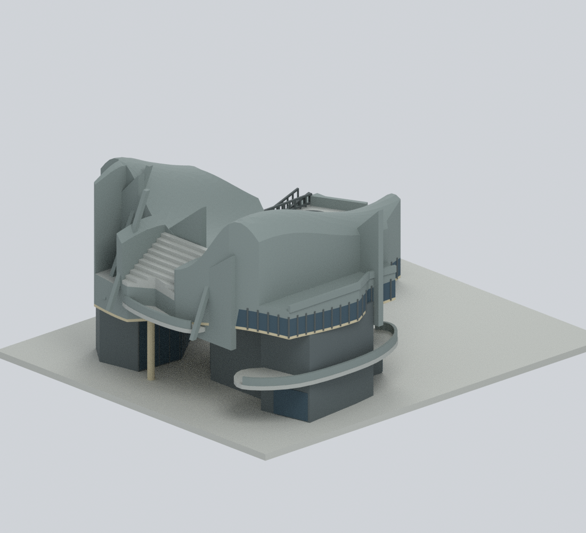
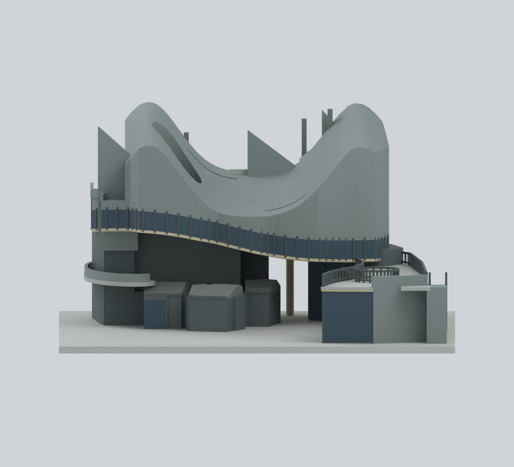
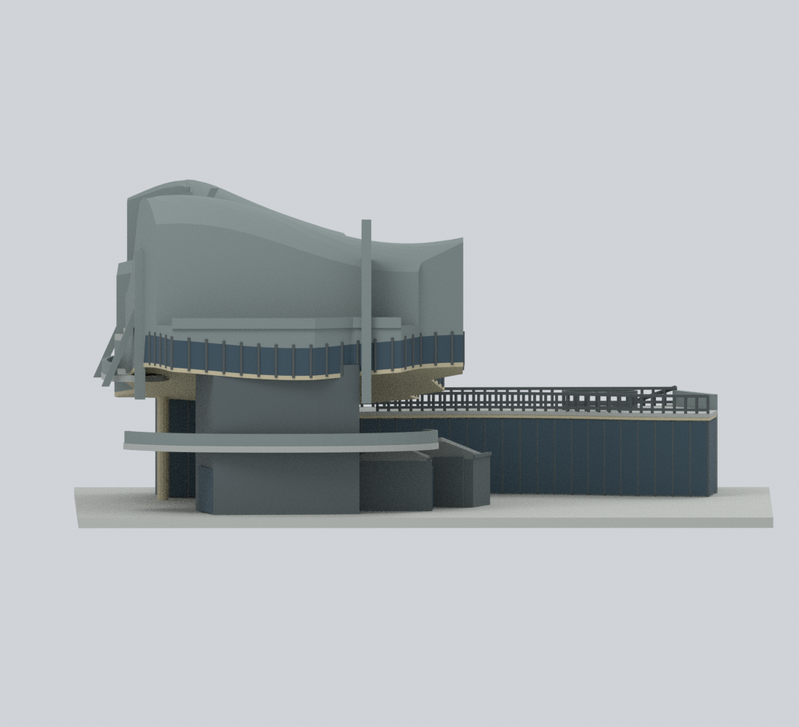
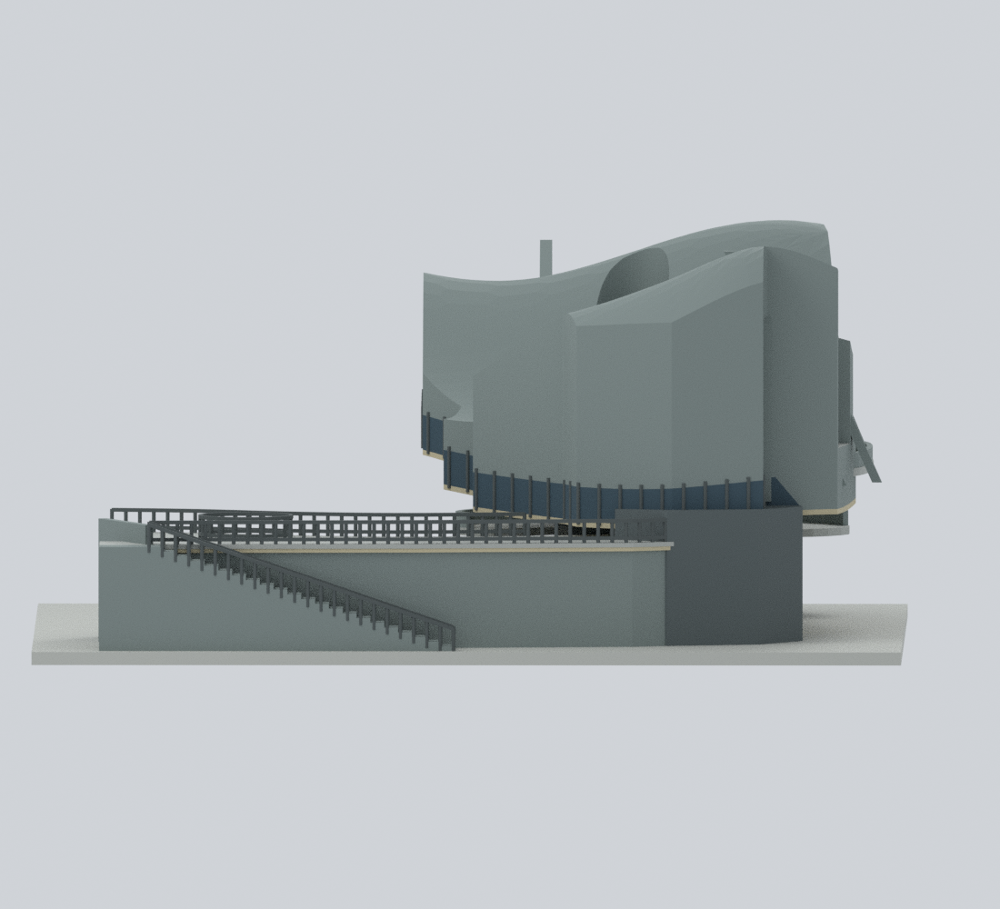
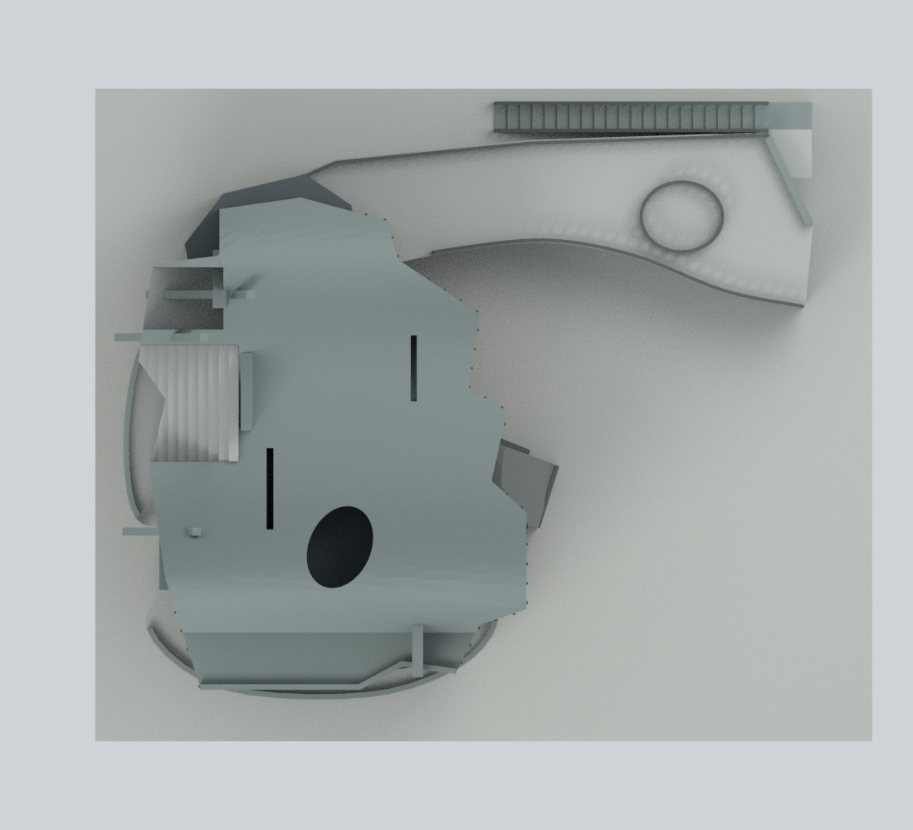
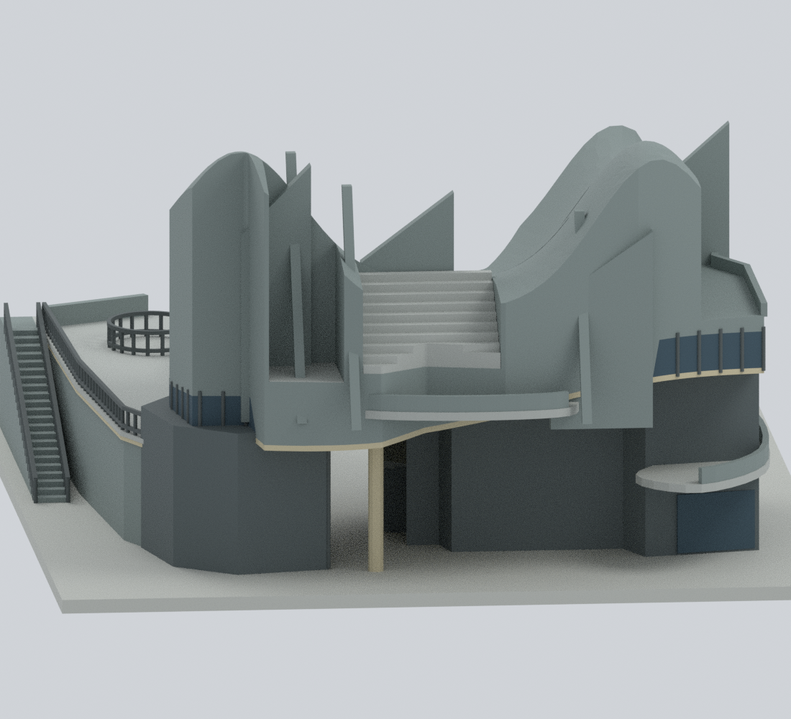
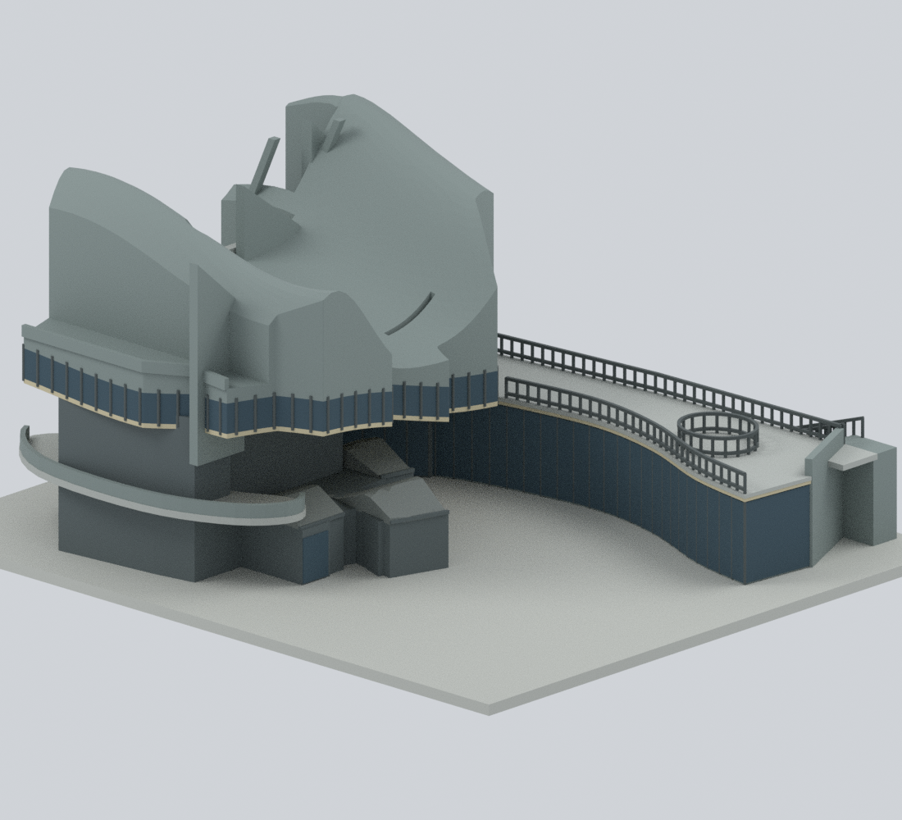
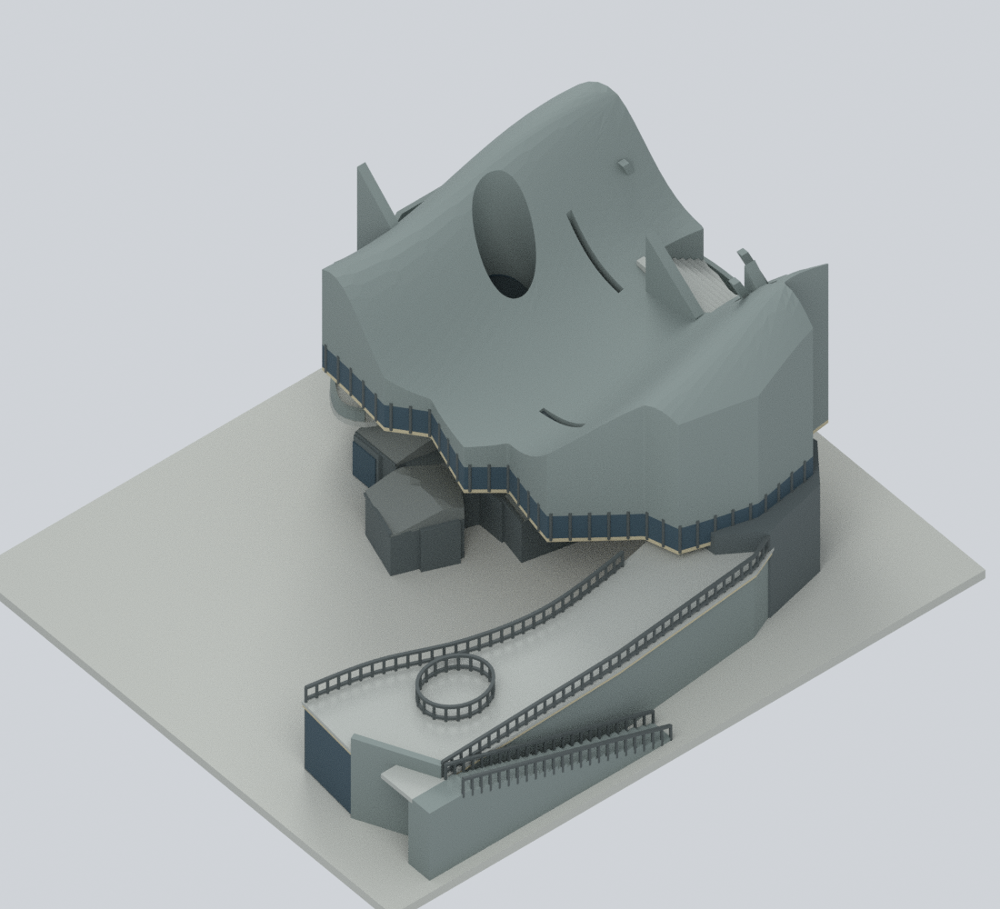
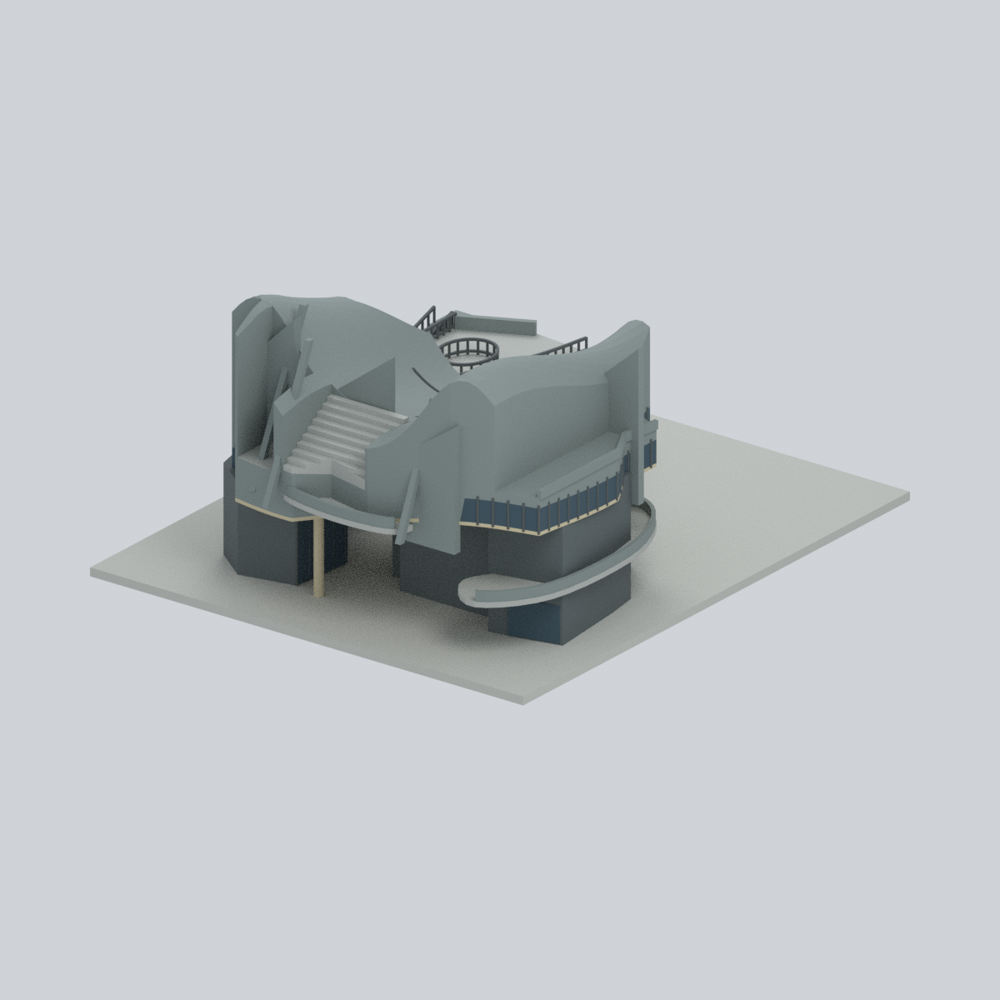

# 國立清華大學捷英文物館 — 彩色整棟外觀近似模型

## 模型預覽

| 道路側 | 道路端斜視 | 庭院側／末端 |
|---|---|---|
|  |  |  |
| 主館端部 | 展廊外側 | 俯視 |
|  |  |  |
| 穿越通道近景 | 庭院及展廊斜視 | 屋頂與露臺斜視 |
|  |  |  |

保留**完整相連新館**的起伏主體、不規則低層、簷下低矮山牆／保留牆形體、連續彎曲展廊、露臺、末端室外樓梯與真正穿越通道。隔著戶外空間的舊農舍是獨立背景，未收入模型；新館簷下相連的灰色低矮形體並未因此省略。

**這是有限細節的原創比例近似，不是測繪、施工圖、室內模型或精確縮尺。** 表現的是公開照片可見的 **2024–2025 年已建外殼**，並以 2026 年現況樹木調查底圖核對低層相連關係；該底圖不是經認證的竣工建築圖。模型不代表已確認的 2026 年最終裝修或開放營運狀態。

## 九張實際模型預覽

全部從交付網格和原創純色材質渲染；不含照片貼圖。視角採建物局部座標，不聲稱精確方位。


## 首頁與圖鑑代表角度



首頁與校級／校區圖鑑仍選用**同一座捷英文物館**，只改用獨立的代表視角。以聯大八甲北大門代表圖為基準：相對建築正面偏轉約 **36.87°**、俯視 **23.43°**，採正交投影與 1200 × 1200 畫布，完整保留底座。清大模型的道路側正面朝局部 −X，因此相機基底須轉換，不能直接照抄其他模型的 XYZ 座標。上述局部方向不是地理方位。

原本九張建築檢視圖（含 `previews/front.png` 道路側近立面）、STL、彩色 3MF、原生 Blender、網格、9 種材質、照明與背景均不變。此代表圖只調整相機、置中與取景；不新增模型件數，也不增加列印或實體驗證聲明。

使用原交付場景與網格重渲染：

```bash
blender --disable-autoexec --background --factory-startup --python render_homepage_preview.py
```

可在命令末尾加 `-- --out /path/to/output`，輸出到另一目錄。腳本先逐元素核對場景頂點、三角面與材質索引，再渲染 `previews/homepage-three-quarter.png`，不儲存或覆寫原 `.blend`。實際相機、幾何比對、完整入框與兩次獨立啟動渲染的像素／位元組一致性，見 [`qa/homepage-camera-validation.json`](qa/homepage-camera-validation.json) 與 [`qa/homepage-cover-verification.json`](qa/homepage-cover-verification.json)。`reproduce.py` 已串接此獨立 renderer，乾淨重建與 PNG 檢查涵蓋全部十張圖；原九視角的相機與產圖程式不變。

## 可下載與可編輯檔

- [`nthu-jieying-museum.blend`](nthu-jieying-museum.blend)：Blender 原生檔；可見的是布林合併後、逐面指定材質的完整網格。隱藏 `EDITABLE authored components` 集合保留建模分件，方便個別頂點編輯。**分件是合併前重疊構件，不是另一份可直接列印的組件套件**；編輯分件不會自動更新合併網格，程序性修改請重建。隱藏的主體上部是單一灰色整合構件；交付可見網格的玻璃／簷底色帶由程式逐面指定，不是隱藏分件的逐面材質副本。
- [`nthu-jieying-museum.3mf`](nthu-jieying-museum.3mf)：實際逐三角面指定 9 種基礎材質的彩色 3MF；不是 STL 改副檔名，也不含印表機線材設定。
- [`nthu-jieying-museum.stl`](nthu-jieying-museum.stl)：無色、單一封閉的列印幾何；STL 不保存色彩。
- [`build_model.py`](build_model.py)、[`parameters.json`](parameters.json)：幾何和比例參數。其他 Python、[`requirements-model.txt`](requirements-model.txt) 與 `qa/` 提供重建和實際驗證。
- [`sources.json`](sources.json)、[`evidence-map.json`](evidence-map.json)：來源連結、時期、權利、保留形體及近似限制。`manifest.json` 和 `SHA256SUMS` 列出交付檔案。

## 模型邊界與誠實簡化

1. 含展示底座約 **200 × 168 × 94.00 模型毫米**。這些是代表性建模尺寸，不是實體建築毫米或經測量的縮尺。出版物所列三層及 18.05 公尺只是整體參考；1,536／1,552 平方公尺樓地板面積差異未解決，沒有用來反推每個尺寸。
2. 主屋頂用不規則邊界、起伏高度曲面及幾片厚化刀片狀構件概括雕塑性形體。保留橢圓孔、長縫、主要高低變化、端部較低玻璃／屋面邊緣、後退高起主體，以及道路側獨立的階梯露臺與較低肩部；**精確曲率、斜率、凹口、刀片位置、各段標高及深度均為近似**，不是逐面測繪複製。橢圓孔和長縫底部有深置中性封閉面，以避免臆造館內空間。
3. 下層不是屋頂輪廓的整片落地實心擠出。保留不規則退縮房間、低矮山牆形體、玻璃樓梯核心、支柱與穿越空隙；玻璃用不透明外表面表現，不建立家具、展品、內部樓層或公共通行模型。
4. 低展廊接續主體，庭院側玻璃與露臺連續。被樹木遮擋的後面採中性無細節表面，沒有把庭院窗格鏡像過去。圓形露臺設施、欄杆及窗框數量為概括。
5. 末端樓梯沿展廊外側升上遠端平台；**22 級是模型代表值，非現場數級結果**。為列印穩固，梯下填實到展示底座；不是實際樓梯結構板／淨空重建。欄杆厚化為約 0.85–0.88 mm，仍須切片評估。
6. 材質來自實際照片可辨的灰／灰綠洗石子、深色下部、深色金屬與玻璃、淡暖色簷底。玻璃的藍綠反射不當成精確玻璃本色；沒有把小塊陶片擴張成整面彩牆，也未將細刻縫誇張成結構裂縫。
7. 平底座只作展示／連接支撐，**不是館舍原有基座、測量地形或完整景觀**。省略鄰棟、獨立農舍、樹木、臨時工程物件、管線、小五金及文字標誌。
8. 早期「服務建議書／3D 示意圖」方案的平面及量體與落成外殼不同，已排除，不用於建築形狀、樓層、剖面或比例。

## 重建

需要 Python 3.12、Blender 4.3.2 及列出的依賴。所有必需輸入均在本目錄，**不需要網路、參考照片或 Blender 外掛**。

```bash
python -m venv .venv
. .venv/bin/activate
pip install -r requirements-model.txt
python reproduce.py --out ./rebuild --blender blender
```

若 `lib3mf` 位於另一個 Python，加入 `--export-python /path/to/python`。`parameters.json` 可調整主要邊界、起伏屋頂、低層、展廊、樓梯和厚度；色盤位於 `build_model.py`。修改後應重新執行完整檢查。

```bash
python verify_reproducibility.py --out . --blender blender
```

此命令只複製公開程式與參數到乾淨目錄重建，再比較幾何、STL、分件資料及十張 PNG（九張建築檢視＋一張代表圖）。`reproduce.py --skip-slow-checks` 只供開發時略過較慢的自交測試與控制組，不能視為完整驗證。

## 已執行的技術驗證

本版為 **17,595 頂點／36,074 三角面、319 個可編輯原始分件、9 種基礎材質**。已確認 470 個有效水平截面、16 組空隙／實體射線及主屋頂階梯向內上升剖面；非流形邊／頂點、退化面、重複面和禁止自交均為 0。

詳見 `qa/` 的實際輸出：單一封閉正體積網格、非流形邊／頂點、退化／重複面、逐層幾何截面、空隙及實體對照射線、自交測試和正負控制組；3MF 嚴格讀回、逐面材質及 round-trip；Blender 原生頂點／材質／分件修改後實際儲存與重開；公開輸入乾淨重建、預覽比對和隱私欄位檢查。

公開輸入的乾淨目錄重建已完成：頂點／面／材質陣列、STL 位元組及分件資料一致，**10 張 PNG（原九張建築檢視與一張新增代表圖）的像素與位元組也全部一致**；實際重開交付 Blender 場景的正面渲染一致，原生頂點／材質／分件修改後儲存重開驗證通過。

**檔案與幾何驗證不等於實體列印成功。** 未聲稱已經切片器產生可靠路徑、測試支撐設定或實際列印。穿越通道和懸挑簷底尤其需要支撐／橋接；細欄杆可能受縮放、噴嘴、材料與後處理影響。不可為免支撐而把真正通道填成建築牆。彩色 3MF 基礎材質不會自動映射到多材料機台。

## 來源與時期

主要來源：[Manlai Studio 建築與照片](https://manlai-studio.com/projects/o2n_2s79l3-a)、[清大營繕組建築完工與實際照片](https://construc.site.nthu.edu.tw/p/406-1167-285158%2Cr11208.php?Lang=zh-tw)、[Architecture+Tectonics 反向航照](https://archi-tec.com.tw/2025/02/清大文物館/)、[建築師雜誌](https://www.twarchitect.org.tw/works/清華大學捷英文物館/)、[清大 2026 年樹木調查公告及現況底圖](https://construc.site.nthu.edu.tw/p/406-1167-309351%2Cr7703.php?Lang=zh-tw)、[文物館 2025 年報](https://museum.site.nthu.edu.tw/p/404-1153-305088.php?Lang=zh-tw)、[參觀資訊](https://museum.site.nthu.edu.tw/p/404-1153-149191.php?Lang=zh-tw)。完整 URL 和個別圖片時間限制列於 `sources.json`。

2024 年典禮／主體完工、2025 年工程記載及後續消防／室內優化屬不同階段；不能由典禮照片推定完全營運。2026 年取讀的參觀資訊仍表示工程維護未開放，因此本模型不冠以「已確認最終 2026 現況」。

公開可瀏覽不等於影像有自由再散布授權。照片、圖面及網站內容的權利仍屬清華大學、田中央、攝影者及各出版單位；來源連結不授予重製權。本交付僅含獨立建模的幾何、原創純色材質、重建程式、技術 QA 和實際模型渲染，**不含來源照片、地圖像素、PDF 頁面、裁切或衍生貼圖**。
