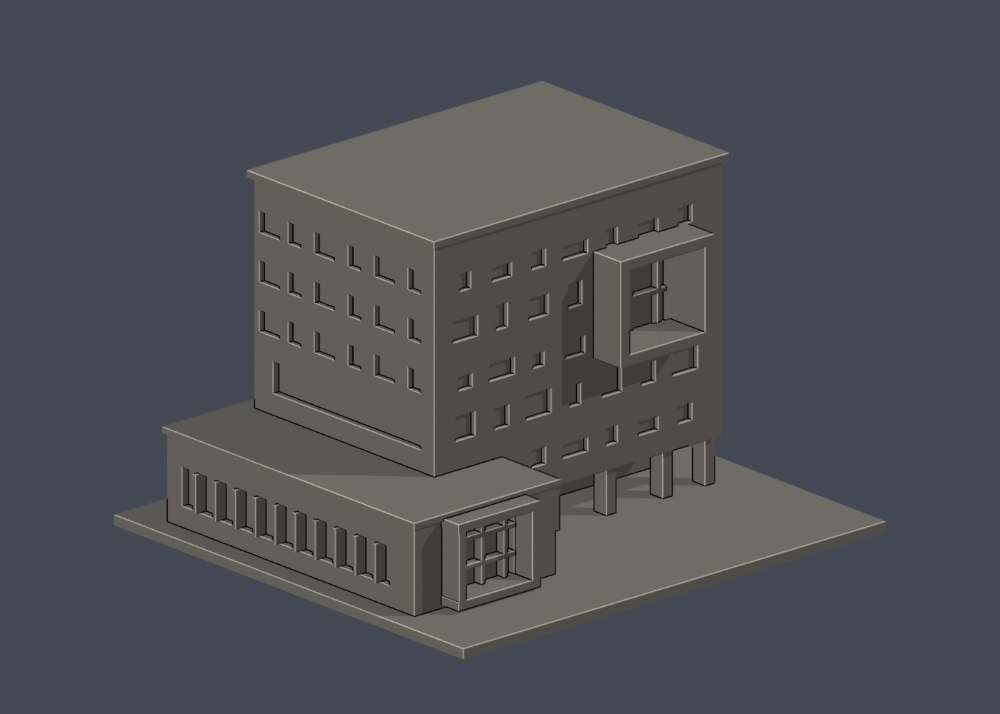
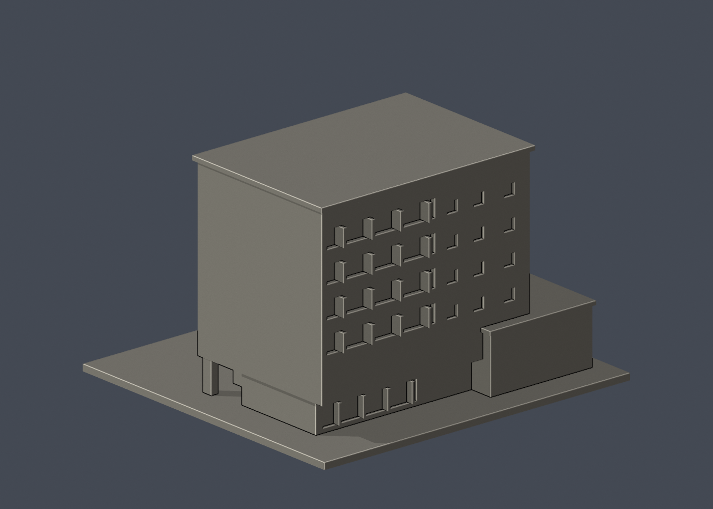

# 國立清華大學｜李存敏館（綠色低碳能源教學研究大樓）

第九批公開外觀近似模型，並非測繪成果。每件獨立比例，150.00 × 140.00 × 97.00mm，最長150mm含底座。全校尚未完成。

## 來源與觀察
[官方建築導覽](https://attractions.site.nthu.edu.tw/p/406-1515-187056,r8697.php?Lang=zh-tw)；2026-10-13檢視來源實際像素。

已實看建築師攝影2張前後外觀，以及校方全景、公開入口與穿堂3張。2016年完工啟用。保留抬高主棟、地面退縮柱廊、前上部深橙框/地面小橙框、低附翼與大小不一的外皮孔口，花園側橫向陽台帶。

來源照片僅列連結，不放入成果、不重新發布：
- https://www.twarchitect.org.tw/web2015/wp-content/uploads/2016/05/201606a4-1.jpg
- https://www.twarchitect.org.tw/web2015/wp-content/uploads/2016/05/201606a4-2.jpg
- https://attractions.site.nthu.edu.tw/var/file/515/1515/pictures/545/m/mczh-tw700x700_large38226_331002177530.jpg
- https://attractions.site.nthu.edu.tw/var/file/515/1515/pictures/545/m/mczh-tw700x700_large38227_21937777531.jpg
- https://attractions.site.nthu.edu.tw/var/file/515/1515/pictures/545/m/mczh-tw700x700_large38228_695268177531.jpg

## 近似與缺口
白色擴張網微細網眼不製成獨立薄網，改以實心外皮及減量方孔概括；橙色在單材STL不呈色，只保留框深度。低附翼深度與邊界、各孔位置/尺寸、主棟比例皆按照片近似，無完整屋頂與未見側面採素面；屋頂不放設備，地形整平，植栽遮蔽部分不虛構細節。建築師第3張室內挑空照片沒有用來重建室內。

僅公開訪客可見外觀，無室內、地下、敏感設備或安全配置。未下載、擷取或反編譯官方Unity或任何原始3D模型。官方3D場景沒有逐面檢視，不能視為未見部位已獲證實。

## 檔案
- `build_model.py`：可攜參數化來源。
- `model.stl` / `model.obj`：單一連通、封閉實體，單位mm；不預挖內腔。
- `scene.blend`：實際STL的可編輯三角網格與相機，不是BIM或保留布林歷史的場景。
- `previews/front.png`、`rear.png`、`elevation.png`：實際STL預覽，已看像素。正背為顯示方向，不是實測方位。
- `validation.json`：原檔法線、邊與頂點流形、正體積、單一表面、重建及Blend/STL一致等16項通過。
- `check_layers.py` / `layer-check.json`：0.2mm幾何截面與0.8mm XY薄特徵篩查。

## 列印起點與支撐
底座向下，保持150mm尺寸。可從0.4mm噴嘴、0.2mm層高、3道外牆、15–20%填充起始，但不是測試完成的參數。

地面柱廊約20mm深的上方懸空區、突出前框及窗口頂邊需支撐評估；不得視為免支撐件。柱3.4×5mm，前框厚約3mm，玻璃格1.2–1.3mm；深框內支撐應注意拆除可達性。

薄特徵：485個0.2mm截面均閉合，0.8mm XY篩查零警戒；不等於可免支撐或已正式切片。

## 驗證範圍
16項網格驗證通過；原始STL法線與繞向相符，所有邊連接兩面、頂點環流形、單一連通表面且沒有分離內腔殼，正體積、z=0底面與150mm最大尺寸通過。乾淨暫存目錄重建STL的SHA-256相符，Blender幾何與STL一致；驗證不自動修原檔。

0.2mm間距共485個抽樣高度，所有輪廓閉合。端點數值聚合容差0.0001mm；首層0.100013mm以避共面。0.8mm XY形態開運算標示0層超過0.2mm²警戒，最大差異面積0.00192mm²，含義見薄特徵說明。

**未正式切片、未生成G-code、未實體試印。** 抽樣幾何截面不等於刀路、擠出、支撐或橋接驗證，亦不能證明全面三維壁厚或自相交完全不存在。

## 重建
Python 3.12與Blender 4.3.2+；所有程式從本檔目錄讀寫，不依賴製作端絕對路徑。

```sh
python -m pip install -r requirements.txt
python build_model.py
blender -b -t 2 -P render_preview.py
python validate_model.py
python check_layers.py
```

建築師攝影來源：[建築師雜誌2016年6月作品](https://www.twarchitect.org.tw/works/清華大學李存敏館/)。只用外觀攝影，不使用室內或技術配置。


## 實際STL正背並排

| 正面 | 背面（未見部分按詳頁明示簡化） |
|---|---|
|  |  |
