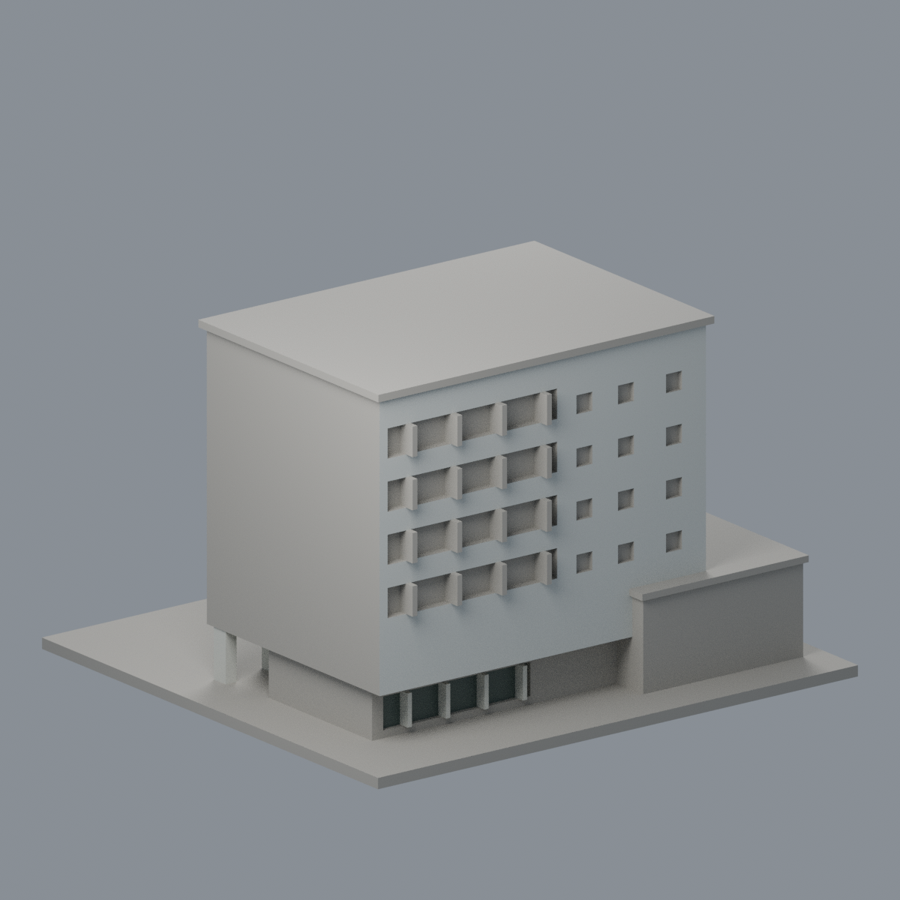
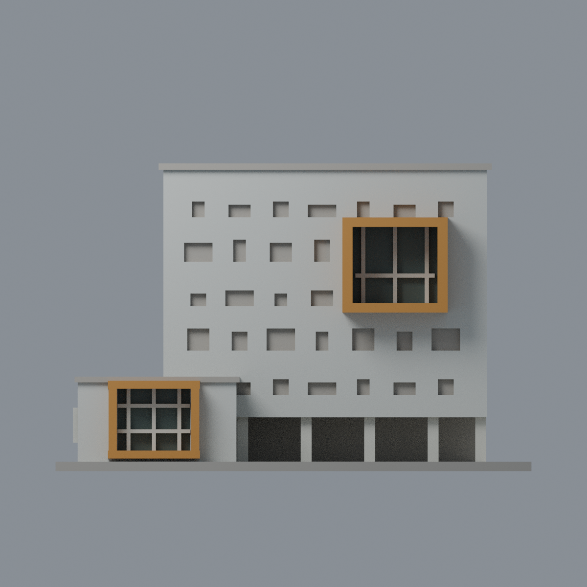
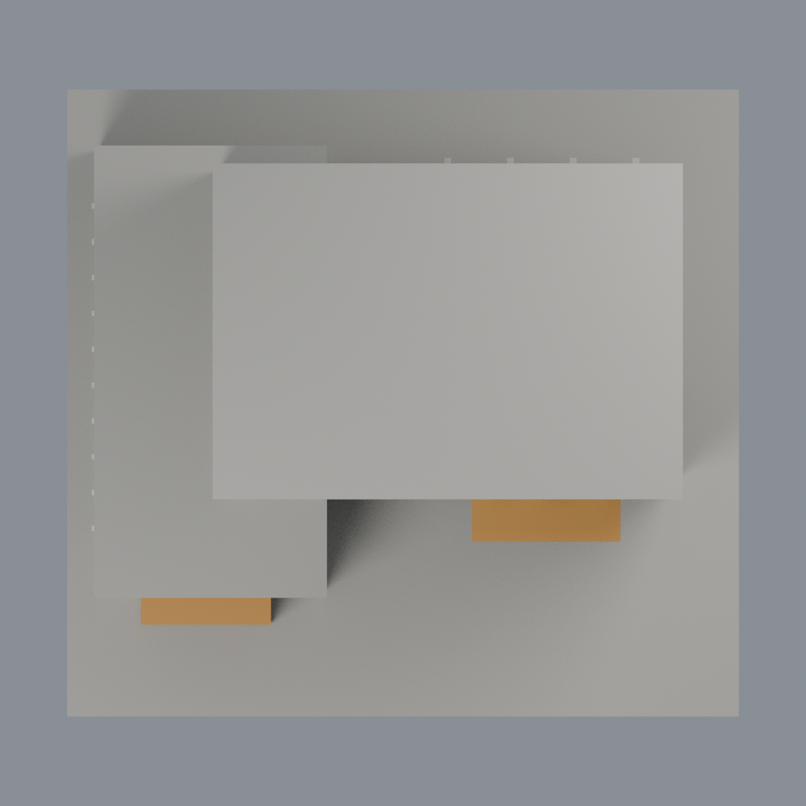

# 清華李存敏館：五材質外觀版

沿用原 **2,508 三角面／1,246 頂點**，不改原 STL 位元、座標、面序或幾何；這是既有模型外觀改版，不增加模型包數。

| 模型預覽 | 模型預覽 | 模型預覽 |
| :---: | :---: | :---: |
| 正面  | 有來源花園側／廊背中性  |  |
|  |  |  |

[表面色 3MF](nthulee-appearance.3mf) · [可編輯 Blender](scene.blend) · [材質色表](palette.json) · [逐面指派與依據](face-materials.json) · [原 STL](../model.stl)

## 來源與配色邊界

親自核對建築師雜誌[前側照](https://www.twarchitect.org.tw/web2015/wp-content/uploads/2016/05/201606a4-1.jpg)、[花園側照](https://www.twarchitect.org.tw/web2015/wp-content/uploads/2016/05/201606a4-2.jpg)，及清華[景點介紹](https://attractions.site.nthu.edu.tw/p/406-1515-187056,r8697.php?Lang=zh-tw)的側景與近入口照片。四照皆無 EXIF 拍攝日；2016 路徑不是拍攝日，也不稱 2026 現況。[逐張來源、完整解碼與雜湊](qa/source-review.json)，照片不入包。

- 原實心外皮的前／左側／花園側已見外表面採銀白代理；微細擴張網不是原網格構件，不增假網眼或照片貼圖。原大小孔的深凹是外廊及遮蔽區，不全染玻璃。
- 上部及前左下部原深框採橙色；框深度內外面同系統材料有界延伸。原框內窗格白銀，僅明確離散窗背深灰綠，不增加實景缺失的細門框或文字。
- 已見左低翼長窗條、花園側地面窗及原白柱／窗格配色；花園上層陽台凹背中性，不把開放走廊封成玻璃。
- 屋頂、未註冊右側與遮蔽區保持中性；原低翼和主體比例、孔口簡化完全照舊。無分界底板不作草坪，沒有增樹或機電設備。

[原幾何與歷史來源限制](../README.zh-TW.md)

## 重建與核驗

安裝 [依賴](source/requirements.txt)，Blender 使用 4.3.2。由本資料夾上層提供原 model.stl：

1. `python appearance/source/build_appearance.py`
2. `python appearance/source/verify_exchange.py`
3. `blender -b -t 3 --python-exit-code 1 -P appearance/source/render_appearance.py`
4. `blender -b -t 3 --python-exit-code 1 -P appearance/source/verify_scene.py`

[獨立重建 ZIP](rebuild-source.zip)含原 STL、四支程式及依賴，不含第三方照片；不取代原建模腳本。[逐檔 SHA256](SHA256SUMS)

[交換／拓撲 QA](qa/exchange-validation.json)核對原座標與面序、全部面材質、單連通、有向水密邊、頂點 link 單環、正體積與零退化／重複面；lib3mf 嚴格讀取零警告，實際編輯單材質再存讀，其他材質及面指派不變。SDK 六位小數量化誤差另列。

[Blender 存讀與編輯](qa/scene-validation.json) · [渲染記錄](qa/render-manifest.json) · [獨立重建](qa/rebuild-validation.json)

## 製造限制照舊

尺寸仍為 150 × 140 × 97 mm；原 STL、建模程式、場景及歷史 QA 保留。原層檢與薄特徵檢查本次未重跑，不能由材質 QA 代替。

3MF 是同一網格的表面色，不是各材質各自封閉的分色實體、切片專案、噴頭映射或 G-code。切片 GUI、多材料路徑與實體列印未測；柱頭、屋簷、窗框及薄邊仍須評估材料、支撐及拆除風險，沒有保證可印或免支撐。
