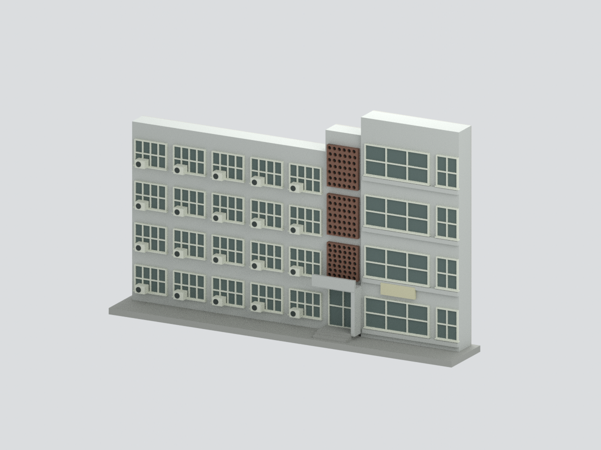
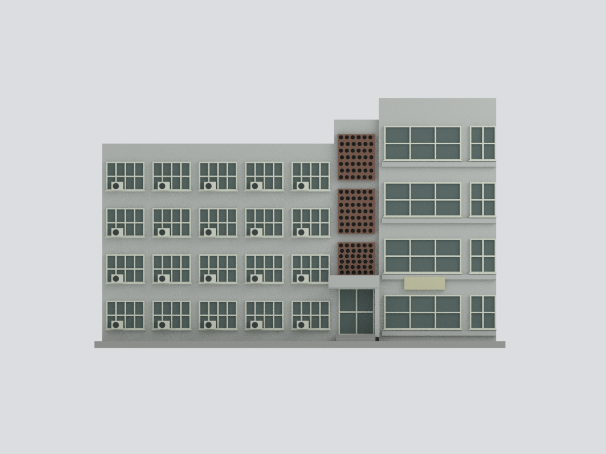
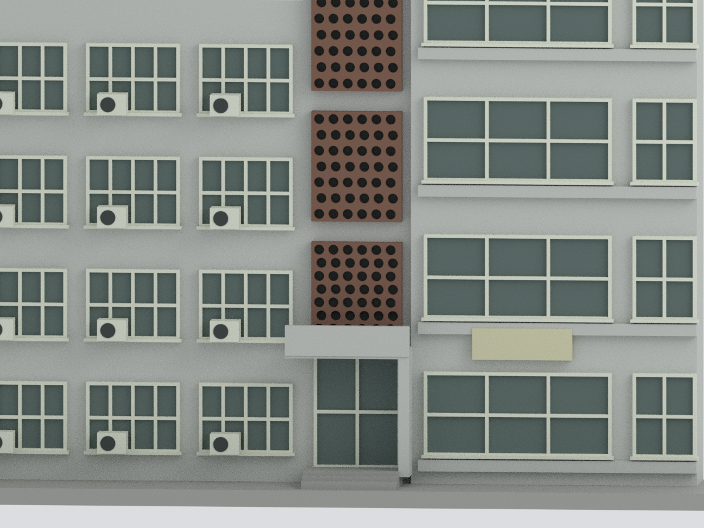

# 國立清華大學禮齋｜正門與兩側可見立面截段

依住宿組公開外觀及正門照片建立的**淺立面截段，不是完整宿舍**。包含左側四層五窗跨、中央入口與三段褐色圓孔屏、右側較高四層窗塔。無寢室、室內、安全設備或未見背部的重建。

## 實際交付網格預覽
| 主視角 | 正立面 | 圓孔屏及正門 |
|---|---|---|
|  |  |  |

[人工背截面](previews/rear.png) · [左端切面](previews/left_end.png) · [人工截深俯視](previews/top.png)

## 來源支持與近似
- 左四層五窗跨、右較高四層塔、中央三段**圓孔**屏、方棚與門，均可於兩張官方照片辨認。
- 層高、跨距、窗大小依透視照片規律化，不是實測。右塔仍保持顯著較高；不把透視投影當平面或測量。
- 孔屏保留圓形及錯列特徵，**每段6列×7排是作者減量，不是實物孔數**。屏後深灰背板只是陰影抽象，不推論內部空間。
- 窗格減量，窗簾/反光統一深灰綠；灰白磁磚不逐塊雕刻，色彩非校色。所見20個左翼空調外機簡化為方體與圓形風扇印象，不建管線、機械內構或品牌。
- 入口方棚、右側支柱和三道階梯印象是近似。未納入完整無障礙坡道與地形，不能據此判定真實通行尺度或安全。
- **左延伸、右外翼、屋頂平面與完整背面未見，全部不建。淺厚度、頂部封口、素色背面為人工截面支承，不是真實屋頂/背立面。**
- 標牌留空白版面；不複製字體、告示、車牌、人像、讀卡器、電線、室內陳設。
- 照片頁面標示Update 2026.06；EXIF標示2026-06-02，時區未驗證。不保證後續現況無變動。

## 數位實體
135.66 × 21.42 × 82.62 mm；18362三角面、單一封閉連通網格。名義單位以5.1mm換算，不是實物比例尺。

[STL](model.stl) · [彩色3MF](model.3mf) · [Blender](scene.blend) · [來源](SOURCES.md) · [重建](REBUILD.md) · [QA](QA.md)

Blender可見網格與STL/3MF一致；隱藏集合保存布林前部件，含重疊，不作另一可直接列印實體。原始照片未包含於公開包。未試印、未正式切片；窗框、風扇、孔屏與雨棚挑出處需要設備相關支撐/細節評估。
