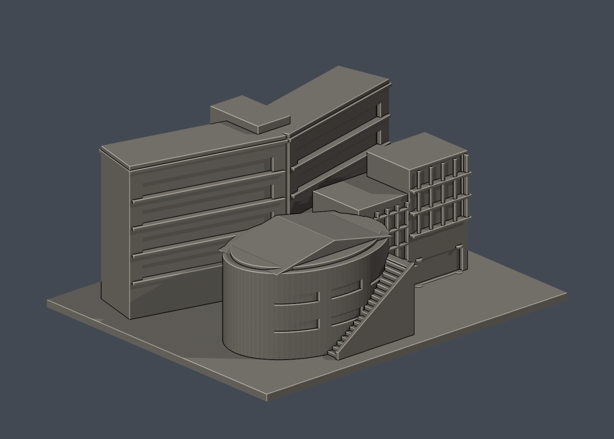
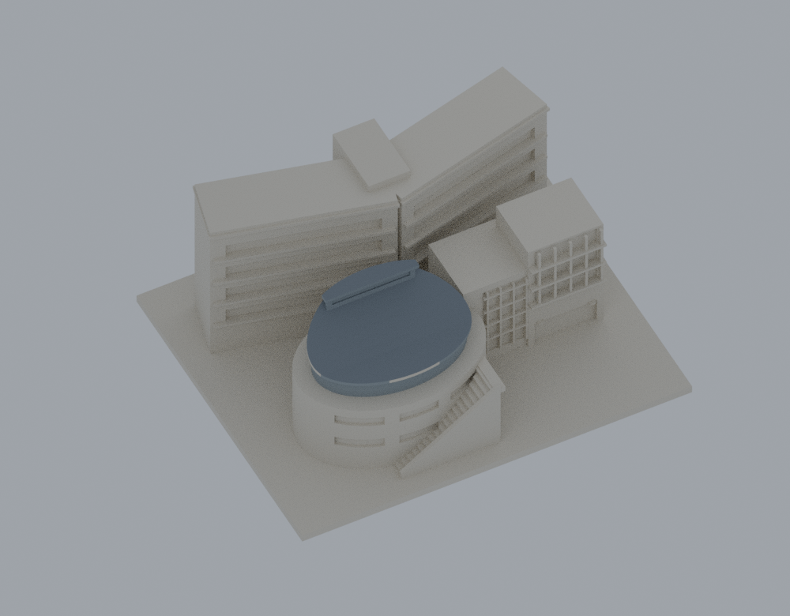
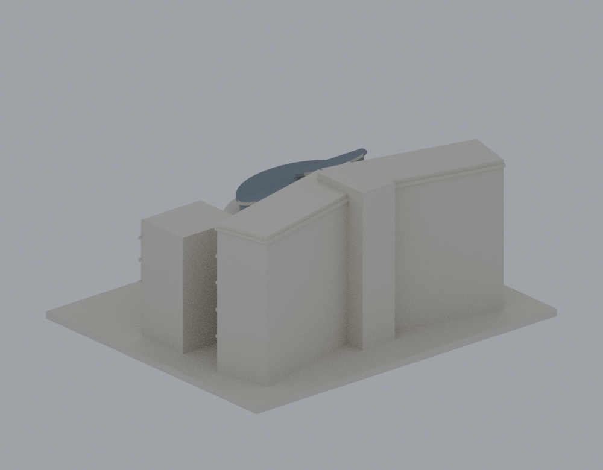
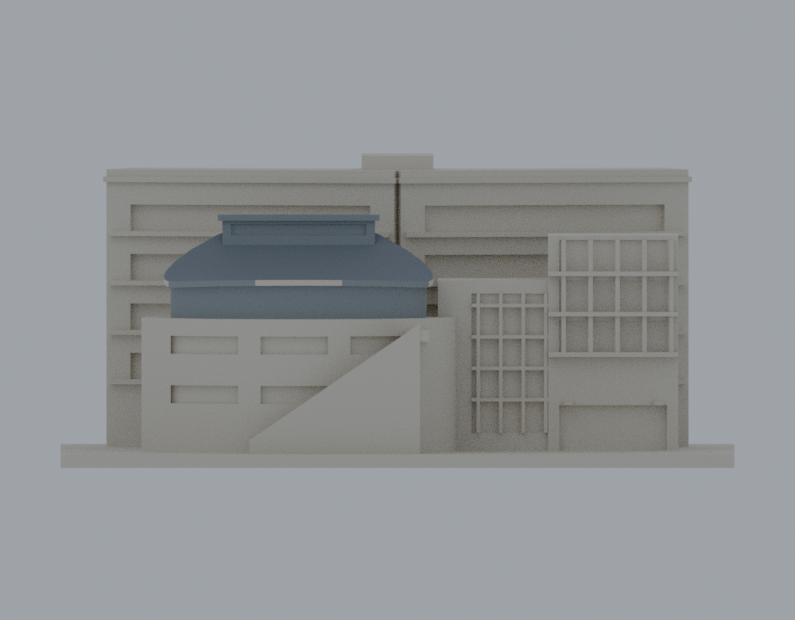

# 國立清華大學｜學習資源中心（旺宏館）

## 模型預覽

| 模型預覽 | 模型預覽 | 模型預覽 |
| :---: | :---: | :---: |
| 正面<br> | 屋面高視角<br> |  |

2026-10-18 改版。依公開來源改善前棟屋頂、退縮頂層與露台；涵蓋前後主要量體、入口翼與外梯，屬外觀近似的建築代表模型，非測繪模型。這是同一既有套件的改版，建築套數不增加；後棟尚未全面深化。

保留根目錄 **R2 建築外觀對照**，另提供 **局部填縫製造檢查選項**。填縫版已完成一套 PrusaSlicer 2.9.6 真實參考切片及[最終獨立增量覆核](publication/independent-review-8758/FINAL-INCREMENTAL-REVIEW.zh-TW.md)，結論為**有條件 GO，可附製造條件交付代表模型**。這不是全棟支撐移除或真機列印放行；參考 G-code 為 **NOT-MACHINE-READY**，未試印。

| 選擇與下載 | STL 身分／預覽／檢查 |
|---|---|
| [R2 外觀對照 STL](model.stl) · [場景](scene.blend) | SHA-256 `00f6bbdd09196fba873d843bb9d50a1c3aad4e19e760978333dce6f49740627c`；下方四張根目錄預覽均對應此檔。原 R2 的幾何 QA 保留；未對此檔執行本次參考切片。 |
| [填縫版 STL](manufacturing/fill-hidden-gaps/model.stl) · [場景](manufacturing/fill-hidden-gaps/scene.blend) · [實際預覽](manufacturing/fill-hidden-gaps/previews/front.png) | SHA-256 `6801f9c41c9fd986df4167523ec36195e715d6a38a680c09aff002cba1351b2a`；本次唯一參考切片輸入。請配讀[製造入口](manufacturing/README.zh-TW.md)、[實際切片設定與支撐限制](manufacturing/slice-reference-2.9.6/README.zh-TW.md)。 |

完整版本角色、原始失敗與補證及備份回條見[公開證據說明](publication/PUBLIC-EVIDENCE.zh-TW.md)。兩版均為 150 × 124 × 68 mm；填縫版改變格柵背／側凹槽及窗台背微縫，不能稱所有可見表面不變。

## 本次實際改變

- 前棟原有左右兩坡三角屋蓋改成沿模型後方 +Y 到前方 −Y 曲降的分段屋面，前端另有較低屋段。模型座標不代表地理北向。
- 下部橢圓體頂面改至 Z31.8 mm、露台頂 Z32.8 mm；第四層退縮到半徑 28.5 × 18.5 mm，下部半徑仍是 35 × 25 mm。外露弧形帶代表照片可見露台，不宣稱露台全圈連通。
- 1.3 mm 屋面皮及高側窗帶輪廓代表照片的大形狀；高側窗帶不是設備或新增樓層。其曲率、尺寸與進深均為桌上模型估計；端點與後棟交接仍有限制。R2 為消除實際尖薄端，加寬窗帶的連續材料、截平兩端並把窗槽縮淺至 0.5 mm；這是明示的製造簡化，不是新實測尺寸。
- 後棟、入口翼、外梯與底座保留。官方 6F 證實該層更深的 L 形轉折及內凹弧，但 1F 與 6F 不同；本次未全面深化後棟，跨層輪廓與既有座標對應仍是缺口。

## 檔案與尺寸

- 根目錄 `model.stl`（R2／`00f6…`）：含 3 mm 底座；3,926 三角面、單一連通表面、正體積 407,420.6873 mm³。
- 根目錄 `scene.blend`：從 R2／`00f6…` STL 匯入的一個三角網格，單位 mm，可編輯；參數化重建使用 `build_model.py`。無 BIM 或室內構造。
- `model.obj`：輔助交換網格。
- `previews/front.png`、`rear.png`、`elevation.png`、`roof.png`：R2／`00f6…` STL 的四個渲染視角。填縫版／`6801…` 的單張實際渲染位於 `manufacturing/fill-hidden-gaps/previews/front.png`；各自場景與檢查分開保存。配色僅供讀形，不證明玻璃分格或實際材質。
- `sources.json`、[獨立來源覆核](qa/INDEPENDENT-SOURCE-REVIEW.md)：來源對應、年代與限制；只附 URL 與雜湊，不散布原照片或圖面。
- `validation.json`、`layer-check.json`、`qa/`：候選實跑記錄，原始失敗與精確補證分檔保留。`hash-manifest.json` 涵蓋本套件檔案，排除自身與 Python 快取。

## 來源及不確定性

實際查看建築師 R-03、B-02 照片及官方 1F／6F 像素。兩側照片均支持後高前低屋面、前端低屋段、退縮頂層及弧形露台。[建築師項目頁](https://www.archasia.asia/projects/nthu-learningcenter)列 2005–2011，正文另記 2013 啟用；照片 EXIF/XMP 自述 R-03 為 2012-02-13、B-02 為 2012-04-11，未驗相機原檔。2025 修訂日期不等於拍攝日期。

[官方 6F 圖](https://www.lib.nthu.edu.tw/library/image/6F.jpg)只約束該樓層。[導覽頁](https://www.lib.nthu.edu.tw/library/libtour.html)的 2026-07-23 更新日不是製圖日期。本件不宣稱 2026 全棟現況、逐層精確輪廓或實測尺寸。原校方照片來源保留於 `sources.json`。

後棟 ±14° 淺開書形仍為估計；未知背面素面、穿廊實心、設備省略均沿用原件已揭露的簡化。未取得可定位證據的屋頂設備不補造；沒有室內、地下、設備系統或校方原始 3D 資產。

## 真實檢查與剩餘風險

目前製造檢查請讀[填縫版實際切片](manufacturing/slice-reference-2.9.6/README.zh-TW.md)及[最終獨立覆核](publication/independent-review-8758/FINAL-INCREMENTAL-REVIEW.zh-TW.md)。B／C／G 只有已分離小片的有限退出候選；A／D／E、C0門廊／D0平台全部支撐的工具可達、分片和移除尚未驗證。未辨認出已證明完全封閉不可達的實際支撐，不代表全域無困料或整棟可拆。不能僅按幾何疑點數一律要求可溶；若實際硬支撐工法不可行，替代方案仍須驗證雙／多材料設備、整個可能困住骨架與介面可溶及逐區進出液路。未驗液路，不保證可洗淨。

以下是 **2026-10-18 原 R2／`00f6…` 幾何階段**的量測與限制，不能當填縫版切片的通過項目。[R2 薄特徵／支撐覆核入口](qa/risk-followup-e45f8d6/RISK-FOLLOWUP.md)含固定座標截面、原198筆短弦與156層追溯。原候選及初報均保留；舊37筆與R2 35筆浮點自交初篩的false未改寫，另有精確補證。

`validation.json` 的 `passed=true` 僅涵蓋列明的原始 STL 法線／非退化面、流形、封閉、單殼、正體積、尺寸、乾淨重建同 SHA 與場景幾何一致，不是可列印通過。R2 精確自交補證查 45,341 面對，0 非法交會，12 控制符合。

- 原 0.006247692 mm 確為直立尖薄端，已局部製造修正；同一原點／方向的出口距離為 3.609191019 mm。實際 Z=52 截面最小連續 Y 材料為 1.339701653 mm，窗槽範圍為 1.718732162 mm。
- 原 0.030722650／0.084816922 mm 屋緣短弦仍保留；同原中點有約 1.3 mm Z 向材料。R2 全面中心掃描為 180 筆，最短 0.181054107 mm，是靠近端面的厚板短切弦；固定端面 Z 厚 1.299999237 mm。沒有用新三角化的較大最短值掩蓋原短弦。
- 340 個原 0.2 mm 水平截面均封閉；同一 0.8 mm／0.2 mm² opening 門檻仍有 143 層警示。139 個格柵高度、低屋段 1 層及主屋面 3 層已量化；0.8 mm 貼背浮雕、角緣再現及原／新微殘片仍有製造或未逐個判讀限制。
- R2 朝下面積 2693.694403 mm²、585 面，位置與可拆路徑另列支撐報告。帽板軸向出挑 1 mm、角點斜距 1.414214 mm；淺槽 30×2.5×0.5 mm 向外開。後棟既有 0.05×0.10 mm 微縫不得宣稱支撐可拆；入口格柵後方支撐需拆小側移。49 個中間高度點未見測試直線出口，未轉成通過。

兩個共平面固定 YZ 截面失敗保留；額外支承截面造成的18個null另有同一Z的補證，沒有移平面改成通過。原R2沒有實際切片；後續唯一切片使用填縫版／`6801…`，不能將其結果移稱原R2通過。兩版均未試印；工具、拆除力、實際下垂及細節存活仍未驗證，參考配置也不是使用者真機參數。

## 乾淨重建

本輪實際使用 CPython 3.13.9、`requirements.txt` 所列版本及 bpy 5.2.2 LTS。於新的虛擬環境執行：

```sh
python -m pip install -r requirements-render.txt
python build_model.py
python render_preview.py
python validate_model.py --bpy-module
python check_layers.py
```

額外檢查的實際命令及初報／補證關係請見 [EXTENDED-QA.md](qa/EXTENDED-QA.md)。安裝 Blender 應用程式的使用者也可用 `blender -b -t 4 -P render_preview.py`，並將驗證改為 `python validate_model.py --blender <path>`。來源程式不依賴製作機器的絕對路徑。

## 原 R2 實際模型預覽

以下四圖均來自根目錄 STL／SHA-256 `00f6bbdd09196fba873d843bb9d50a1c3aad4e19e760978333dce6f49740627c`。


| 模型預覽 | 模型預覽 | 模型預覽 |
| :---: | :---: | :---: |
| 背面<br> | 正投影<br> |  |

填縫製造檢查選項的實際預覽（僅對應 `6801f9c41c9fd986df4167523ec36195e715d6a38a680c09aff002cba1351b2a`）：

| 模型預覽 | 模型預覽 | 模型預覽 |
| :---: | :---: | :---: |
| [](manufacturing/fill-hidden-gaps/model.stl) |  |  |
