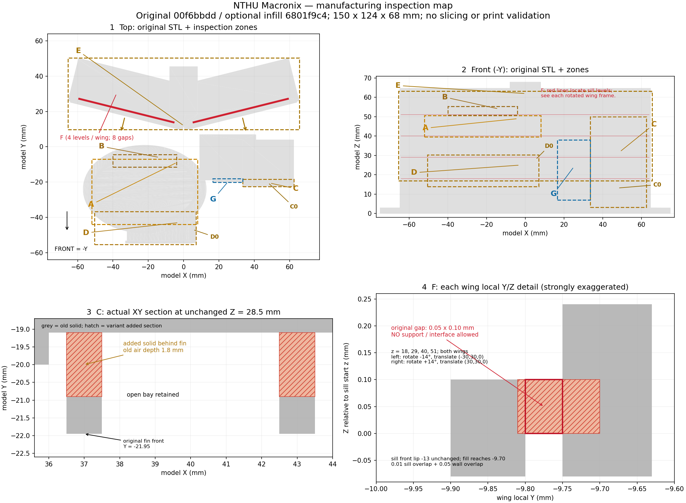

# 旺宏館：列印前操作條件（待製程覆核）

後續一套真實參考切片已完成，實際命中支撐及有限退路見 [增量切片覆核](slice-reference-2.9.6/README.zh-TW.md)。原文「未切片」是原幾何交接階段的紀錄；本操作條件尚未全部轉為真機放行，未試印。

2026-10-18。這份說明把固定候選的幾何風險轉為切片時的操作與停止條件。模型為公開照片導出的外觀代表；毫米數是模型製造估計，後棟跨層輪廓仍未修。**本次未實際切片、未產生已驗證 G-code、未試印；幾何有條件 GO 不等於製造驗證通過。**

## 1. 先選檔案、固定尺寸與方向

- **原候選 R2**：提交 `f15ccb3c0283fb302616a68146fb41f02b203d07`，`model.stl` SHA-256 `00f6bbdd09196fba873d843bb9d50a1c3aad4e19e760978333dce6f49740627c`。保留原 1.8 mm 格柵背槽及後棟微縫，只適合能履行以下全部局部條件的製造方案。
- **局部填背槽變體**：套件內 `manufacturing/fill-hidden-gaps/model.stl`，SHA-256 `6801f9c41c9fd986df4167523ec36195e715d6a38a680c09aff002cba1351b2a`，198,784 bytes。只填入口右翼四條格柵的背槽，以及後棟窗台背微縫；仍是同棟模型的製造變體，原候選留作對照。原 R2 的獨立有條件 GO 不自動延伸至本變體；本變體尚待範圍覆核。數位檢查與嚴格比較未通過項見 [製造交接](README.zh-TW.md) 及 [變體 QA](fill-hidden-gaps/qa/VARIANT-QA.zh-TW.md)。填實只減少特定困料位置，沒有替其他區域取得單材料支撐可拆保證。格柵正面平面與 bay 邊界保留，但格柵側／背面及斜視凹槽外觀會改變，屬明示製造簡化。
- 兩者以 **100%／150 × 124 × 68 mm、底座朝下** 作本說明的起點。不要縮小；若改朝向或尺寸，重新檢查所有區域，不能沿用固定座標的製程判讀。

本文座標均為 STL 原始全域 mm：底座 X=−75…75、Y=−62…62、Z=0…3，+Z 向上；前棟／入口在 −Y，後棟在 +Y。切片器通常會把模型平移到平台中央；記下平移量 `t`，以「平台點 = 本文點 + t」定位。若旋轉，記下 `R`，改用 `平台點 = R × 本文點 + t`；本文區域圖不再能直接當平台座標。不要把本文負座標當機器移動指令。

先儲存一份 3MF 工作檔，記錄切片器版本、模型 SHA、原／變體、尺寸、方向、設備、噴嘴、主材料、支撐材料與所用設定檔。從實際設備及材料已校準設定出發；本文沒有經驗證的通用溫度、速度、層高、橋接長度或支撐間隙。



圖中琥珀色外框是待檢視區，藍色 G 是連續路徑檢查區；紅色 F 是各路線均禁支撐的微縫。C 細部圖的紅斜線代表新增實心填料，不代表整個 C 區禁止支撐。原版 C 只有背槽受上述硬支撐限制。

## 2. 區域定位與每區要做的事

圖號 A–G 與 `regions.json` 一致。下列「49 點」bbox 只包圍該群受旗標三角面，不是整個構件／內腔邊界。面 ID 僅適用原 R2 STL；不可拿到重三角化的變體找同一面。

| 圖號／區域 | 原始座標／層高（mm） | 實際操作與停止條件 |
|---|---|---|
| **A 前曲屋簷** | 全簷檢視框 (−52,−44,39.55)…(8,−7,50.55)。11 點框 (−10.781495,−10.918525,47.107033)…(0.555194,−7,50.549999)。 | 逐層看屋皮開始、曲降段轉折與右後端，先判斷下層實體承托或可校準的短出挑。若需支撐，只從能看見／拿到的露台外沿分段接觸；支撐轉入右後端、窗帶後方或前後棟夾處而不能給出有限尺寸退出路線時停止，轉第 5 節。 |
| **B 高側窗帶上蓋／淺槽** | 上蓋 X=−40…−4、Y=−11.5…−4.5、Z=54.1…55.4；淺槽 X=−37…−7、Y=−10.5…−10、Z=50.8…53.3，向 −Y 開。8 點框 (−18.280003,−7.112504,54.099998)…(−7.25,−5.164446,54.099998)。 | 上蓋軸向出挑約 1 mm，角斜距 1.414214 mm；槽寬 30 mm 不是橋跨 30 mm。逐層檢查 0.5 mm 深槽及上蓋的實際路徑。槽高僅 2.5 mm；若支撐接觸面需伸入後側或工具連裕度放不進開口，不可硬拔，停止並轉第 5 節。 |
| **C 入口右翼格柵／窗簷及地面穿廊** | 完整檢視框 (33.5,−22.5,3.2)…(62.5,−18.4,50)。三窗槽 Z=25…32、34…41、43…50；fin 中心 X=37、43、49、55、61。9 點框 (36.5,−20.9,32)…(55.5,−20,41)。C0 穿廊底為 (36,−21.5,13.2)…(60,−18.4,13.2)。 | 原版：四條 fin 後的 1.8 mm 深槽不允許未驗證硬支撐進入。主 bay 高 7 mm，通常寬 5 mm，末格 4.5 mm；這些尺寸不證明鉗具及支撐碎塊可出。變體：只填四條背槽，仍逐層查外露 bay；只能在已給出向 −Y 外側退出路線的可達處放支撐。另查地面穿廊 Z=13.2 底面及兩柱周圍，支撐不可繞柱鎖住。若仍要進入窄處／背槽／fin 側後方，或穿廊支撐不能給出退出路線，停止，轉第 5 節。 |
| **D 前棟橢圓窗帶及外梯平台** | 完整檢視框 (−50.5,−54.5,14)…(7,−36.774,30.3)。18 點框 (−10.5,−48.122684,18)…(4.5,−38.759087,29)；窗槽 Z=14…18、25…29。D0 外梯平台底 (4.1,−54.5,28)…(7,−37.990,28)。 | 從橢圓立面外側檢查每段窗槽底／頂的成形及支撐，另查外梯平台 Z=28 底面。拆料方向是對應曲面外方，不能一律假設 −Y 直拔。若支撐跨過窗槽轉角、相鄰實心窗柱或平台外梯夾處，且不能以實際碎塊／工具外形證明退出，停止，轉第 5 節。 |
| **E 後棟窗帶／頂簷** | 後窗帶 Z=18…24、29…35、40…46、51…57；用下節後翼 local 座標。頂簷 Z=62…63.2；3 點框 (−0.762343,10.858176,62)…(0.762343,13.915767,62)。 | 逐翼從 local −Y 外側檢查。主槽淨寬 55 mm、淨高約 5.9 mm、壁面深 1.75 mm；前景阻擋使低層代表直線工作距僅 11.95…21.13 mm。頂簷約 1 mm 出挑／端部 0.5 mm。59 mm 是垂直空氣柱，不能當橫橋跨或必需支撐高。支撐若進中央脊柱夾處或不能向外側退出，停止，轉第 5 節。 |
| **F 後窗台背微縫：支撐禁入** | 各翼 local X=−27.5…27.5，Y=−9.80…−9.75；Z=18.0…18.1、29.0…29.1、40.0…40.1、51.0…51.1。實際空隙受既有幾何相交裁切。 | 原版須禁止任何支撐／介面進入。使用剖切視圖覆蓋所有四層及兩翼，重新切片後確認禁入；微小 paint blocker 未必精確遵守，不能只看塗色。若不能確認，選已核實填縫變體，或停止該製造方案。可溶支撐也不能豁免此禁入。 |
| **G 0.8 mm 貼背格柵浮雕** | 連接段 X=16.5…33.5、Y=−20.1…−18.1、Z=7…38。豎條中心 X=18、23、28、33，寬 0.8 mm；橫條 Z=14…14.8、21…21.8、28…28.8、35…35.8。 | 按第 4 節核對實際路徑連續及與牆體附著。支撐接觸不得把這些細條當施力拆料把手；若接觸點／工具必須壓過細條，改位置或轉第 5 節。 |

**49 點的意義**：原 R2 585 個向下面中心，536 個在原垂直 gap 中間高度找到所測水平點路徑，49 個沒有。這是零半徑直線測試；49 個不是已證明密閉腔，也不是已證明完全不可拆。本文採取的限制是：**該區若實際需要支撐，必須另證明有限尺寸拆除或可溶去除，否則停止。** 填槽變體的新面 ID／新旗標以變體檢查為準，保留原 49 點及原報告。

### 後翼 local 座標怎麼找到

左翼原點 `(−30,30,0)`、角度 `−14°`；右翼原點 `(30,30,0)`、角度 `+14°`。令 local 點為 `(u,v,z)`，翼原點 X 為 `x0`、角度為 `a`：

```text
X = x0 + u cos(a) − v sin(a)
Y = 30 + u sin(a) + v cos(a)
Z = z
```

`cos14°=0.970295726`、`sin14°=0.241921896`。外側為 local −Y：左翼全域方向 `(−0.241922,−0.970296,0)`，右翼 `(+0.241922,−0.970296,0)`。後窗槽 local 約 `u=−27.5…27.5、v=−13.25…−9.75`。原窗台外唇 `v=−13`，背緣 `v=−9.8`；填縫變體僅把背緣延到 `v=−9.70`，跨過背壁 `−9.75` 留 0.05 mm 重疊，不外推後棟建築輪廓。

變體的精確填料：C 共 12 塊，四個 X 區間 `36.5…37.5、42.5…43.5、48.5…49.5、54.5…55.5` × Y=`−20.95…−19.05` × 三個 Z 區間 `25…32、34…41、43…50`，前／後各留 0.05 mm 重疊。F 共 8 塊，各翼 local `u=−32…32、v=−9.81…−9.70` × 四個 Z 區間 `18…18.1、29…29.1、40…40.1、51…51.1`，再按上式旋轉／平移。填料的 64 mm 寬度不是微縫全長的量測；真正狹縫仍由既有窗槽與實體相交裁切。變體檢查須證明實際填料只作用於指定區域。

## 3. 支撐控制的實際操作順序

1. 在副本 3MF 中載入選定檔案及設備／材料設定，先切片；從底到頂巡查所有區域，開啟「路徑類型／支撐」顯示並輪流隱藏主體／支撐，勿僅看實體預覽或總支撐量。
2. **硬支撐路線**：以本圖及座標找到 F 全部微縫、原版 C fin 後槽，在支撐接觸的模型表面放 blocker；必要時用支撐塗繪的 clipping plane 看進內側。重新切片後檢查實際支撐線：F 在任何路線都禁止支撐與介面（包括可溶材料）；原版 C 背槽在此硬支撐路線禁止未驗證可拆的支撐與介面。C 僅可依第 5 節另走全骨架可溶、雙材料設備及已驗證液路的例外，不適用 F。原版 F 的 0.05 × 0.10 mm 尺度不能靠視覺上塗了一小點就認定成功。
3. 對確認需要支撐的外露位置，逐區建立 enforcer。若用「For support enforcers only」，未標區域不會自動得到支撐，必須重查每個出挑；若同時使用自動支撐與 blocker，選定模式後重查禁入區和新出現的支撐。支撐由平台長出不代表上端能拆出。
4. 每一塊硬支撐都要在 3MF 截圖標示：接觸面、預計斷開處、最大碎塊尺寸、工具最寬／最厚外形、向外退出箭頭。用最窄通道扣除實際工具／碎塊尺寸及本設備已驗證的間隙；路線有轉彎時也須容納轉動。僅有中心線或鉗尖能進去不夠。不能核實時不要生成那塊硬支撐，轉第 5 節。
5. 重新切片；從最初支撐／主體接觸層到最後一層逐層確認支撐沒有跨接細格柵、把多個 bay 黏成一塊、堵住溶液交換開口，或被模型後續層包住。記錄問題層的實際 Z，不能用「關掉警告」代替處理。

Prusa 官方提供 enforcer／blocker 及支撐模式；塗繪支撐可用剖切平面進入遮蔽區，且小塗繪區可能受內部網格解析度限制。因此本件以切片後路徑核對禁入，不把塗色當結果。［[Support material](https://help.prusa3d.com/article/support-material_1698)、[Paint-on supports](https://help.prusa3d.com/article/paint-on-supports_168584)；2026-10-18 查閱］

## 4. 0.8 mm 細節及屋緣的逐層判準

### 0.8 mm 浮雕（G）

在 `Z=7…38` 全段檢視各條豎向格柵及四道橫條；特別存下每條開始、交叉及結束層。使用所選切片器的路徑類型／線寬顯示，再以移動時間滑桿逐段看材料如何放下：

- 每條預期保留的細節在對應層有**非零、連續的材料擠出路徑**；其寬度落在該設備／材料已校準可用範圍。不能只在 STL 實體視圖看見細條，或只用噴嘴名目直徑判定。
- 擠出的細節路徑要與背牆材料相接，有上一層承托／已核實支撐；不能只剩空移、孤立短點、彼此不連的碎線，或無錨定的空中起線。
- 窄處由單道可變寬路徑填入並非自動失敗；是否可用以實際寬度與設備校準為準。本文不要求把 0.8 mm 固定塞成兩條任意寬度的線。
- 若細條消失、斷成點、被支撐替代，或只有超出設備校準範圍的線寬：**停止該方案**。先調整設備可用的切片設定；仍無法保留時，只對該浮雕加粗／改貼背紋理，另立變體及 QA。不要縮整棟，也不要把 150 個真實細節旗標改成數值例外。

### 前屋皮、上蓋、後簷（A、B、E）

R2 新屋緣 19 筆短弦在固定點有約 1.3 mm 垂直實體，屋面法向厚約 0.95037…1.06501 mm；原 0.030723／0.084817 mm 短弦仍保留。這些是厚板端面／曲邊切弦的量化證據，不是該短數值厚度的獨立牆，也沒有證明尖緣能完整成形。既有橢圓槽角 11 筆在原中點有 Y 向 13.4064…32.3304 mm、Z 向 30.3…32.8 mm 實體；同樣仍需檢查角緣再現。

在每處屋皮／簷口的**第一個成形層、各曲降轉折、最後一層及原旗標附近**逐層檢查：

1. 新一條線從已放下的材料／支撐起步，或是**兩端有實際錨定**、長度在本設備／材料已校準能力內的橋接。單端出挑須按出挑條件評估，不能因切片器標成 bridge 就當兩端受托。
2. 記錄該處切片的真正橋跨／逐層偏移，不能用 30 mm 窗寬、59 mm 垂直空氣柱或原「半 gap」當橋跨。1 mm／0.5 mm 出挑也不是無需切片的免支撐通行證。
3. 屋緣路徑保持連續、與屋板重疊附著；不應出現孤立空中小島、無承托起線、屋緣完全漏印或被不可拆支撐鎖住。任一情況即**停止該區方案**；先用可取外沿支撐，否則轉第 5 節。
4. 不以整體「watertight／正體積」或沒有切片警告代替上述判讀。751 個微 opening 殘片尚未逐個作物理解釋；切片若出現對應孤立碎線／小島仍須處理，不能因其面積小直接放行。

Prusa 的 G-code Viewer 可按層及時間查看擠出／移動、按特徵顯示；從外部 G-code 推定線寬等資訊可能不全。保存本次切片專案及原生輸出，以該輸出和設定核對；本說明沒有代替這個操作。［[PrusaSlicer G-code viewer](https://help.prusa3d.com/article/prusaslicer-g-code-viewer_193152)；2026-10-18 查閱］

## 5. 困支撐時只能選能核實的製造路線

### 路線一：局部填背槽變體，配合外側可達支撐

優先用本次最小填槽變體消除 C 四條 fin 後槽及 F 微縫的特定困料位置；fin 正面平面、bay 邊界、窗台外唇與建築主要輪廓保留，fin 側／背面及斜視凹槽外觀會變淺／填平。變體仍須履行 A、B、D、E、G 的路徑與支撐條件；C 外露 bay、地面穿廊若需要深入窄處，亦停止。**不接受「填過一些槽，所以任意單材料 FDM 都能拆」的推論。**

### 路線二：雙材料可溶支撐（原候選或變體的剩餘困料區）

若 A、B、C、D、E 需要支撐、又未核實硬支撐取出，必須使用**能在同一列印中切換主體與支撐材料的雙材料／多材料設備**（雙噴頭／雙擠出機，或相容多材料切換裝置），以及與設備和主材相容、已校準的可溶材料。可考慮 PLA 主體配 BVOH／PVA；按材料供應商與設備的乾燥、換料、清料及用水要求操作，不將本文當設定檔。Prusa 官方指出水溶材料需保持乾燥，主／支撐料切換造成的殘留主料會妨礙完全溶解。［[Water soluble (BVOH/PVA)](https://help.prusa3d.com/article/water-soluble-bvoh-pva_167012)；2026-10-18 查閱］

對困在內側的支撐，**整個可能困住的支撐骨架與介面必須都是可溶料**；只把接觸層設可溶、內部仍用不可溶骨架，不能解除困料。重新切片後以材料顏色逐層確認，並為每區畫出以下候選液路：

| 區域 | 溶液接觸／交換候選路線 | 未證事項與停止條件 |
|---|---|---|
| A | 前／側露台外沿進入屋簷下方；須在實際支撐網路中保留可見、可換水的開口。 | 右後 11 點不是已證實有可用通液截面。支撐或後續模型層堵住交換路線時停止。 |
| B | 淺槽向 −Y 的 30 × 2.5 mm 前口；上蓋前沿／左右外沿。 | 淺槽是盲槽，前口不能證明右後弧洗得乾淨；後側被後棟限制。需局部同材料／同支撐試件核實浸入、換液及殘料可確認性，否則改分件。 |
| C 原版 | 由 fin 兩側開放 bay 進入 1.8 mm 背槽，再由相鄰 bay 交換／排出；變體已填四條背槽不再用這條路線。 | 支撐會占據原開口，名目 5／4.5 mm 格縫不是切片後淨液路。未核實背槽末端與每層均可交換時停止。 |
| D | 從橢圓立面每段窗槽外口接觸支撐；左右轉角須各有開口／可確認殘料的位置。 | 外口通到一段槽不代表可沖洗到全部轉角。支撐跨窗柱或盲端不可查時停止。 |
| E | 每翼 local −Y 窗槽外口、簷外沿／端部。 | 中央脊柱附近 3 點未證明換液；有開口也沒有流量／清除證據。堵塞或看不見殘料又不能驗證去除時停止。 |

F 微縫即使連主槽也**不准進支撐**，不得指定為溶液通道。本次沒有驗證任何區域的通液、溶解時間或清除完成；不能保證盲槽洗出。實際用此路線前，將所有須溶除區域、材料體積、液體進出口／換液方式及可確認清除的方法記入 3MF／製造記錄。若缺少上述路線，改分件；不要靠浸泡時間猜測已清完。

### 路線三：只分對應局部

若支撐不能避開、硬支撐取出無法核實、也無法核實可溶去除，就只分 A 屋蓋、B 高側小帽板或 C 局部格柵面板等問題小件，讓支撐面朝外／朝平台後分別列印再組裝；切口、接合、間隙與裝配強度須另行設計及檢查。本次**未交付已核驗分件檔**。不要自行把整個後棟重做，也不要以官方 Cut 工具存在就聲稱接合已驗證。官方工具可選分離區與接合形式，但本件需保留原檔並另存變體。［[Cut tool](https://help.prusa3d.com/article/cut-tool_1779)；2026-10-18 查閱］

## 6. 列印前應保存的最小記錄

以下均是**實際操作者待完成**，不是本次已通過的項目：

| 操作與證據 | 完成時應保存 |
|---|---|
| 確認原／變體、雜湊、100% 尺寸及方向 | 檔案 SHA、尺寸／朝向畫面、座標轉換、設備材料設定 |
| F 禁入；原版 C 背槽禁入或選定可溶／分件 | 剖面與實際支撐線畫面，所有相關層 Z；不能只存 blocker 塗色 |
| A–E 每區支撐處理 | 無支撐成形依據，或支撐接觸／碎塊／工具退出路線，或全可溶材料與液路證據 |
| G 0.8 mm 與 A/B/E 屋緣連續路徑 | 起始／轉折／交叉／末層畫面，實際線寬、承托／錨定、問題是否修正 |
| 重新切片後輸出與追溯 | 3MF、原生 G-code 與 SHA、切片器版本；主／支撐材料分配 |
| 成形與清除結果 | 若尚未列印，寫「未試印／未驗證拆除」；做過後才記實際結果與照片 |

原 R2 的 180 短弦／143 層、751 殘片、固定 X=−50.5 的兩個 `closed=false` 剖面，以及原 null／原失敗輸出均保留。變體檢查另立結果，不能覆寫原數據或放寬門檻取得「可印通過」。

資料依據：`task-7/INDEPENDENT-REVIEW.zh-TW.md`、原 R2 `qa/risk-followup-e45f8d6/support_summary.md`、`r2-support_analysis.json`、`thin_chord_trace.json` 及 `backup-handoff/R2-REVIEW-HANDOFF.md`。本圖座標為原候選定位與製程指引，不是建築實測尺寸。
