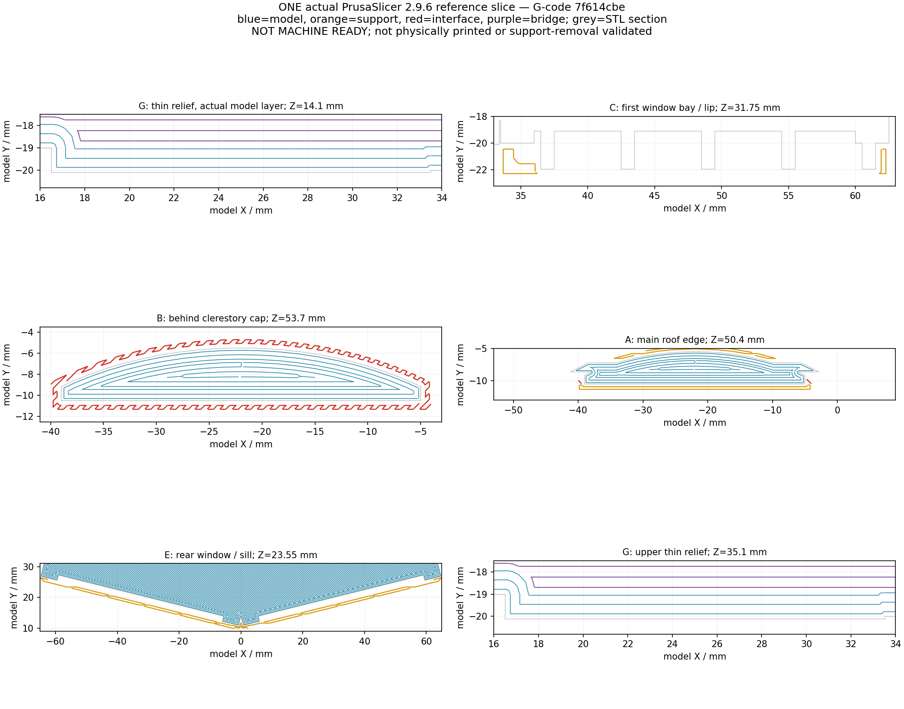

# 唯一一套實際參考切片：設定、證據與限制

2026-10-18已實際使用PrusaSlicer 2.9.6完成一次G-code切片，exit 0；另一次動作只是3MF匯出。固定輸入為[填縫版STL](../fill-hidden-gaps/model.stl)，SHA-256 `6801f9c41c9fd986df4167523ec36195e715d6a38a680c09aff002cba1351b2a`，沒有增加變體或另選參數。其生成器、STL、場景與[實際預覽](../fill-hidden-gaps/previews/front.png)保持`ad7023e`身分。根目錄原R2／`00f6bbdd…`只作外觀和幾何對照，未接受本次切片。

[最終獨立覆核](../../publication/independent-review-8758/FINAL-INCREMENTAL-REVIEW.zh-TW.md)對固定`8758edad`給予**有條件GO：可附製造條件交付代表模型**。這是generic Marlin2配置檢查，**NOT-MACHINE-READY**；未連印表機、未試印，也未驗證全棟硬支撐移除。版本與證據身分見[公開證據說明](../../publication/PUBLIC-EVIDENCE.zh-TW.md)。

「40 個沒有已測無限直線出口的幾何點」不是 40 個真實困支撐，也不是 40 個必須可溶的區域。此處改看實際生成的支撐／介面、其位置及有限退出路線。

子報告標題中的「可分片外拆」指已分離小片的候選運動路線；原始子報告與其雜湊保持原樣，不能把標題讀成已證明實物可拆。

## 固定輸入與設定

- 輸入填縫 STL：`6801f9c41c9fd986df4167523ec36195e715d6a38a680c09aff002cba1351b2a`；150 × 124 × 68 mm，底座朝下，100%，只平移 X／Y 各 +110 mm。
- 已存在的 PrusaSlicer console 2.9.6：exe SHA `7fd50b52d1cc3da87dbcb71e45e764412dd45688bea028f351333e86d9769704`。原西子樓 INI 僅複製，未修改；來源／派生設定與精確命令在 [執行記錄](slicer-run-summary.json)。
- [派生 INI](derived-single-material-snug-REFERENCE.ini)：220 × 220 床、0.4 mm 噴嘴、0.15 mm 模型層高、0.45 mm 名義線寬、Arachne、3 壁、上下各 4 層、100% rectilinear、3 mm brim；PLA 200°C／床 0°C 是沿用的參考值，沒有對使用者真機校準。
- 單材料硬支撐：自動、45°、snug、無 sheath、closing radius 0.5 mm；允許從模型底座／階台開始。整片 3 mm 底座會遮住純平台支撐，因此 `buildplate_only=0`。接觸 0.2 mm、XY 間隔 50%、介面 3 層、介面 spacing 0、支撐 spacing 2.5 mm。`dont_support_bridges=1`，略過橋接仍須看實際橋跨與成形。未用手繪 blocker／enforcer，這一次用來核實自動配置實際生成在哪裡。

G-code：20,642,153 bytes；SHA `7f614cbe4a31e59cfed5e843f90b797f1032984c173da044284fc36ab18219de`。完整檔以`reference-NOT-MACHINE-READY.gcode`保存在自足備份的`slicing-work/`，只作QA證據。它沒有經真機起停碼、溫度、回抽、冷卻、韌體與碰撞檢查，**不可直接送印**。

[3MF](reference-NOT-MACHINE-READY.3mf)的CLI匯出只保存`6801…`幾何／姿態，沒有完整print-profile；必須配套載入INI，不可稱單檔完整專案。609個G-code layer-change事件混合模型與未同步支撐層；獨立解析為453個模型沉積Z、231個支撐沉積Z，不能當609個模型層。時間／用料為切片器估計；來源密度為0所產生的0 g不是實際重量。

## 真正支撐及可操作路線

解析正 E、非零 XY 沉積，共 **29,675 段支撐＋25,019 段介面＝54,694 段**；另 608 段 Bridge infill。段數不是支撐件數，更不是困支撐數；各檢查包絡可重疊，不可把各區計數相加。[詳細支撐審查](qa/ACTUAL-SUPPORT-AUDIT.zh-TW.md) 與 [有限退路 JSON](qa/actual-support-routes.json) 保留原 G-code 行號、層高、線寬及範圍。

| 實際位置 | 本配置觀察／操作意義 |
|---|---|
| F 八個後窗微縫、C 十二個填實背槽 | 沒有支撐或介面進入；C 三帶深 bay `Y=-20.9…-19.1` 也沒有支撐。不能再把原測線點直接當這次已困住的支撐。 |
| C 開放 bay 前唇 | 低兩帶有淺前唇小片，最深到 Y=-21.454，約 fin 正面內 0.496 mm；最高 43–50 帶無。分離後的小片沿 −Y 外退 8 mm，在每沉積層下／中／上三個 STL 截面有有限無碰撞證據。先從前口切開，再逐 bay 外退；不可硬拖跨多 bay 的連續架或以 fin 作槓桿。切碎／工具／拆力未實證。 |
| B 上蓋後檐 | 實際有支撐。86 個沉積層的截片可先 +Y 8 mm 移到前後棟間，再上提超過 55.4 mm；平移後包絡與上方模型的保守 XY 投影不相交。這是分離後小片的候選路線，沒有證明整個架已能在原位安全剪開。前 0.5 mm 槽也有 306 條命中線，另有 −Y 外退證據。 |
| G 0.8 mm 浮雕 | 包絡命中 507 段；真正進三個 bay 的只有 3／5／3 條介面線，集中 Z=36.45。上端開口高 2.2 mm。逐 bay 的小片可向 −Y 外退；工具不得跨 0.8 mm 肋作支點。工具實際進不去、剪不開或需要肋條承力即停止。 |
| A前簷、D窗／梯、E後翼窗簷、C0門廊／D0平台 | 本配置確有支撐。A按外露邊緣、D按曲面局部法向、E按各翼local−Y從外向內分段處理；門廊另核不包柱。這些區域全部支撐的工具可達、分片及移除尚未完成實物或全面有限掃掠驗證，不能據此放行整棟硬支撐拆除。 |

有限退路試驗使用實際線寬的截片，在各沉積層下／中／上三個 STL 真截面檢查，未模擬線材形變、黏連、工具或分離力。不是對沉積層內每一個 Z 的連續證明。原凸包掃掠把 U 形中央空間填掉所產生的假碰撞 JSON 已保留，另立保留凹口的線性掃掠與正反控制，沒有覆寫成全綠。

## 浮雕與屋緣的實際路徑

此圖僅對應`6801f9c41c9fd986df4167523ec36195e715d6a38a680c09aff002cba1351b2a` STL與本頁固定G-code：藍色為模型、橘色為支撐、紅色為介面、紫色為橋接；灰色為同一STL截面。圖顯示選定的真實Z，沒有重新切片或改幾何。另見[切片前區域定位圖](../region-map.png)；舊圖的未切片註記只屬幾何交接階段。

0.8 mm 豎肋在 206 個實際模型層都有非零路徑，四道橫條共 22 層也有跨條連續足跡。最初的「同層窄走廊直連背牆」測試保留 12／824 個 false，恰位於四道橫條首層的三個 fin；其實際前部路徑均與前一模型層連牆的 fin 沉積相交，不能解讀為 12 處缺絲。見 [原同層量測](qa/model-path-audit.json) 及 [前層依附補證](qa/model-path-layer-supplement.json)。線寬足跡是數位近似，不是實際擠出、層間強度或拆支撐後存活的證明。

屋頂各層的路徑與橋接資料完整保留。原包絡列表含邊界前一層作定位，不能把列表首 Z 當作新屋頂實際起層。上蓋 Z=54.3 的外環是 0.4 mm HEIGHT 的 Overhang perimeter，宣告沉積底 Z=53.9；其下實際介面 Z=53.7，對應 0.2 mm 接觸間距。[上蓋補證](qa/cap-support-link.json) 說明它不是只因同層分件就可判作懸空缺線；仍須驗證實際下垂與分離。

## 有條件交付及真機停止條件

獨立覆核未發現可具體定位、已證明完全封閉不可達的實際支撐；也沒有證明全域無困料、連體骨架可原位剪開或整棟支撐容易拆。本配置的B／C／G只有**先分離小片**的有限退路候選；工具、抓取、黏連及拆力未驗，A／D／E及C0／D0全面清除仍待操作者核實。已知剪不開、抓不到、不能安全退出或需薄肋／薄簷承力時，停止該硬拆工法；不能把缺物理驗證改寫成模型全通過，也不必因此無限增加幾何變體。

原「40點」不支持一律要求可溶。若真機硬支撐工法無法履行，替代方案須是經驗證的雙／多材料設備、整個可能困住骨架與介面皆可溶、逐區實際進液／交換／排出及殘料清除確認；本次單材料配置未驗液路，前口或浸泡時間不能保證盲槽可洗淨。必要時才處理對應局部分件。0.8 mm細節、屋緣下垂與拆後存活仍待真機確認，未試印。

檢查依據和原始程式保存在 `qa/`、原始命令與日誌在 `raw-runs/`。`replay_checks.py` 可在自足備份根目錄用新輸出資料夾重做解析，避免覆寫原結果。完整 G-code 不重複加入 Git；其大小／SHA 與備份全檔清單固定它的身分。
