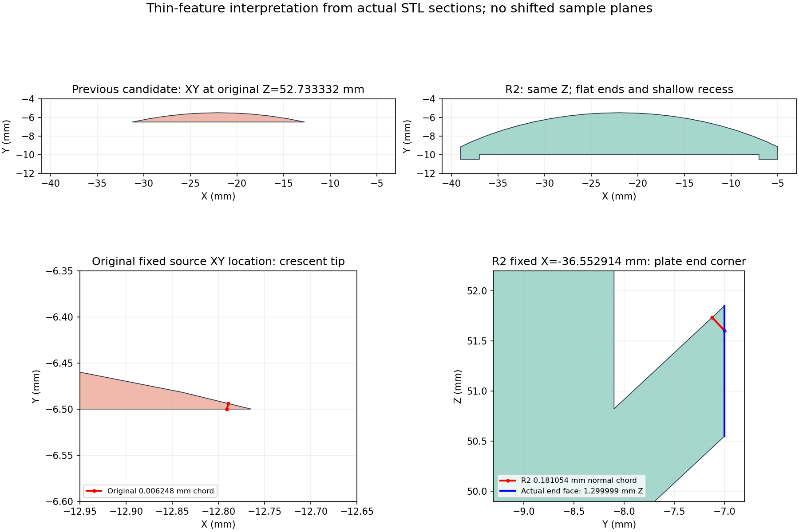

# R2 薄特徵與支撐追溯覆核入口

R2 STL SHA-256：`00f6bbdd09196fba873d843bb9d50a1c3aad4e19e760978333dce6f49740627c`。原候選為 `e45f8d65989cedca7fec439ce5b6a212323c4d2b`／STL `9c90c8b6…e24b8`。本次沒有推送、改公開計數、改後棟，亦沒有新 Library 備份。既有 Library v0 仍對應原候選。

**原 198 筆短弦、156 層、573 面懸垂均保留；沒有移動原旗標或放寬門檻。** 另以同方法重跑 R2，所有新記錄與原記錄分檔。這是可追溯幾何判讀，沒有可列印通過結論。

## 原旗標的實體意義

| 原類別 | 原數量 | 同位置實體證據 | 處理／仍有風險 |
|---|---:|---|---|
| 貼背格柵浮雕 | 150 短弦；139 個層高度 | 名目 0.8 mm，STL 約 0.799999237 mm；層 lost 片與主體核心連接，背後 Y 實體弦約 27.1 mm。 | 是真實細節，不是浮點理由即可豁免；保留擠出路徑與破損風險，未任意加粗既有外觀。 |
| 橢圓窗槽端角 | 11 短弦 | 同原中點 Y 實體弦 13.4064–32.3304 mm、Z 30.3–32.8 mm；3.2 mm 鄰域含 9.17445–16.12403 mm³ 材料。 | 槽端切入實心曲面的短切弦，並非該厚度的獨立薄牆；角緣再現仍待切片。 |
| 高側窗帶／帽板尖端 | 13 短弦 | 最短原點 `(-12.7892917,-6.4939308,52.7333323)`，0.006247692 mm；同中點 Y 材料僅 0.006250318 mm，形成 13.7293° 直立尖端。 | **確為真薄端，已作下述局部製造修正。** |
| 主屋面邊界／接點 | 24 短弦 | 19 筆為厚屋板邊界；另 5 筆逐一同點補證，含新增支承及原點已成內點的情況。 | 原 0.030722650／0.084816922 mm 短弦仍完整存在；同中點有約 1.3 mm Z 向材料。未用新 centroid 數字遮蔽它們。 |

逐筆原面 ID、原起終點、面法線、594 個固定源點 XY/XZ/YZ 截面 WKT、鄰近實體體積，以及分類方法在 [THIN-FLAG-INTERPRETATION.md](THIN-FLAG-INTERPRETATION.md) 和 `thin_chord_trace.json`。原 156 層及所有 opening lost 片在 [LAYER-FLAG-INTERPRETATION.md](LAYER-FLAG-INTERPRETATION.md)。兩個原源點 YZ 截面共平面退化 `closed=false` 保留，未移平面補成通過。

## 只修真正薄端，明示製造簡化

高側窗帶改成 X=-39 至 -5 的平直厚端，前緣 Y=-10.5；浮雕槽 X=-37 至 -7、Z50.8–53.3、實際進深 0.5 mm，兩端各留 2 mm 柱。帽板仍厚 1.3 mm，範圍 X=-40 至 -4、Y=-11.5 至 -4.5。主屋面曲降節點、露台、入口、外梯與後棟參數不變。這些是製造尺寸，不是來源新增的實測建築資料。

原 13 個窗帶／帽板源點全部仍在新表面，使用原點、原方向和同一內移量重投，新出口距離 3.541145850–4.531960909 mm。最短原點同射線為 **3.609191019 mm**。實際 R2 STL 的 Z=52 固定截面按所有頂點 X 分段求最小連續 Y 材料：整段 **1.339701653 mm**，槽範圍 **1.718732162 mm**；不是挑較厚點重採樣。方向性厚度仍不等同全域最小壁厚證明。

布林對照實際增加約 605.225582 mm³、移除約 0.0000255 mm³，後者為浮點運算量級；後棟、入口、外梯 crop 對稱差均為 0。完整操作狀態、原嚴格比較門檻與數值殘差保留於 `r2-delta/geometry-delta.json`。沒有重做建築量體。

圖中 XY 使用原最短源點的 Z=52.7333323161；右下 YZ 使用新最短源點 X=-36.5529136658，均未移動源點平面。`thin_r2_fixed_sections.json` 的製造尺寸另在明示的 Z=52.0 求全分段截面最小值。

## R2 還有哪些旗標

R2 同門檻全掃為 **180 個短弦（150 格柵＋11 槽角＋19 屋緣）**、**143 個層警示**，不以數量較少推定改善。143 為 139 個格柵高度、低前屋 1 層及主屋面 3 層；外梯斜頂 3 層包含於格柵高度，不能重複相加。詳見 [R2-LAYER-FLAG-INTERPRETATION.md](R2-LAYER-FLAG-INTERPRETATION.md)。

新最短 0.181054107 mm 位於 `(-36.5529137,-7.1235360,51.7346992)`，沿斜面內法線到 Y=-7 端面即退出。固定 X 全剖面在該端面有 **1.299999237 mm 完整 Z 材料**；附近 3.2 mm 立方區含 9.495258149 mm³ 單連通實體。19 筆屋緣的平行上下屋面法向距 0.950370454–1.065005152 mm。這些是厚板靠端面的短切弦，並非 0.181 mm 獨立薄片；角緣尖角、翹曲及切片磨失仍未驗證。

## 懸垂位置與支撐可移除性

R2 585 個朝下面、總面積 2693.694403 mm²，按 11 群逐面定位於 [support_summary.md](support_summary.md)。保留原面 bbox、中心座標、下方 first-hit 面、垂直 gap、橫向承托距，以及拆除路徑限制。代表幾何如下：

| 位置 | 量測 | 支撐接近／拆除限制 |
|---|---|---|
| 前棟屋簷 | bbox X[-52,8]、Y[-44,-7]、Z39.55–50.55；原中心橫向承托距 0.154–1.442 mm。 | 外露弧邊，可考慮分段向外取出；未證明工具覆蓋所有弧段。 |
| 高側帽板／淺槽 | 帽板軸向出挑 1 mm，角點斜距 1.414214 mm；槽淨口 30×2.5 mm、深 0.5 mm。 | 槽向 −Y 外露、有實心背；工具垂直外形須小於 2.5 mm 且留裕度。帽板後方受後棟阻擋，須側向轉出，未作實際拆除。 |
| 後棟頂簷／窗槽 | 頂簷出挑 1 mm、端部 0.5 mm；窗槽淨寬 55、高約 5.9、深 1.75 mm。 | 59 mm 垂直空氣柱不是 59 mm 橫跨。開口朝各翼 local −Y；前景棟體限制直線操作距約 11.95–21.13 mm。 |
| 入口格柵後方 | 主槽淨高 7 mm、bay 寬約 5 mm、條後空槽深 1.8 mm。 | 條後支撐不能直接朝 −Y 抽出，需拆小、側移到 bay 再退出。未證明完整支撐塊或特定工具可拆。 |
| 後棟窗台背微縫 | 約 0.05 mm 深 × 0.10 mm 高，向上通主槽。 | 無實用工具淨空；支撐規劃須禁止侵入，實際切片尚未驗證，不能宣稱縫中材料可拆。本版不改後棟。 |

中間高度水平點路徑兩版各有 49 個未找到測試直線出口，未轉成通過。額外 Z=31.999987 的截面失敗造成 18 個承托距離 null，均保留；同一 Z 的獨立 slice 及 72 條 raw-STL 線另證明距離約 0.167–0.600 mm，沒有移平面或覆寫 null。

## 可解釋與未解項

- 原 198 筆與原／新超門檻層形態均有可追溯的構件和固定剖面判讀；真薄窗帶端已有實際材料修正。主屋面短弦與實體厚度的差別已量化。
- 原 851／R2 751 個微 opening 殘片仍保留，未逐個證明物理意義；原兩個共平面 YZ 截面數值退化未解。不能宣稱所有局部截面成功或全域最小壁厚已證明。
- 0.8 mm 浮雕、角緣再現、屋簷與淺槽的實際支撐需求、格柵背方支撐拆小側移、49 個未見直線出口及微縫禁入策略，仍需實際切片與工具／試印驗證。沒有可列印通過結論。

## 受影響檢查

原始 STL 流形／正體積／單殼通過，乾淨重建 SHA 一致，已保存 Blender 場景與 STL 幾何一致。340 個原 0.2 mm 採樣輪廓均封閉。R2 浮點自交初報 35 筆及 `hard_geometry_checks_passed=false` 保留；另立精確補證查 45,341 對，0 非法交會，12 控制符合。場景與四張既有視角只在幾何固定後更新一次；沒有新備份、切片、G-code 或試印。
