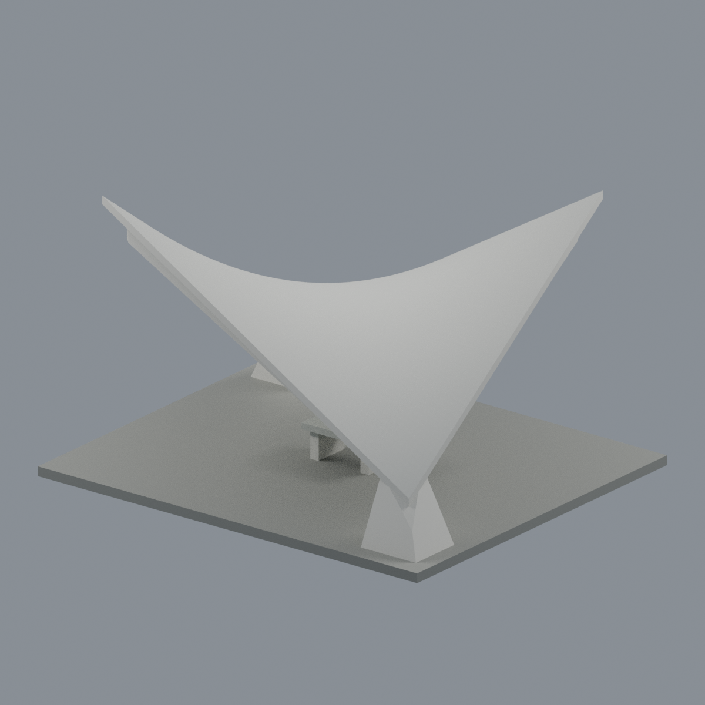
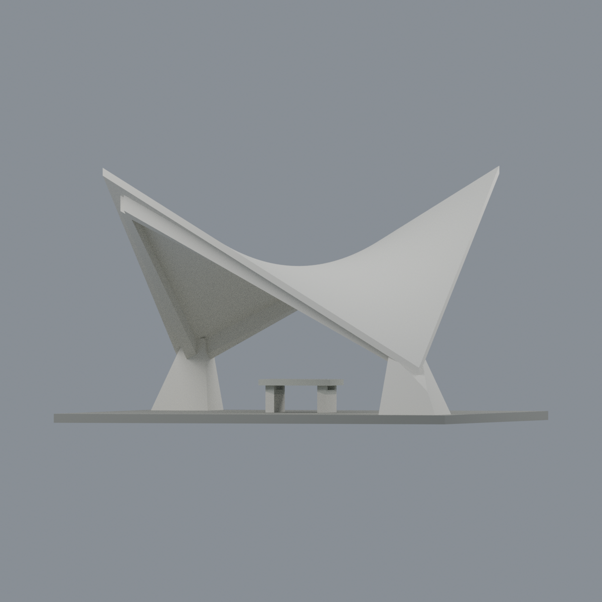
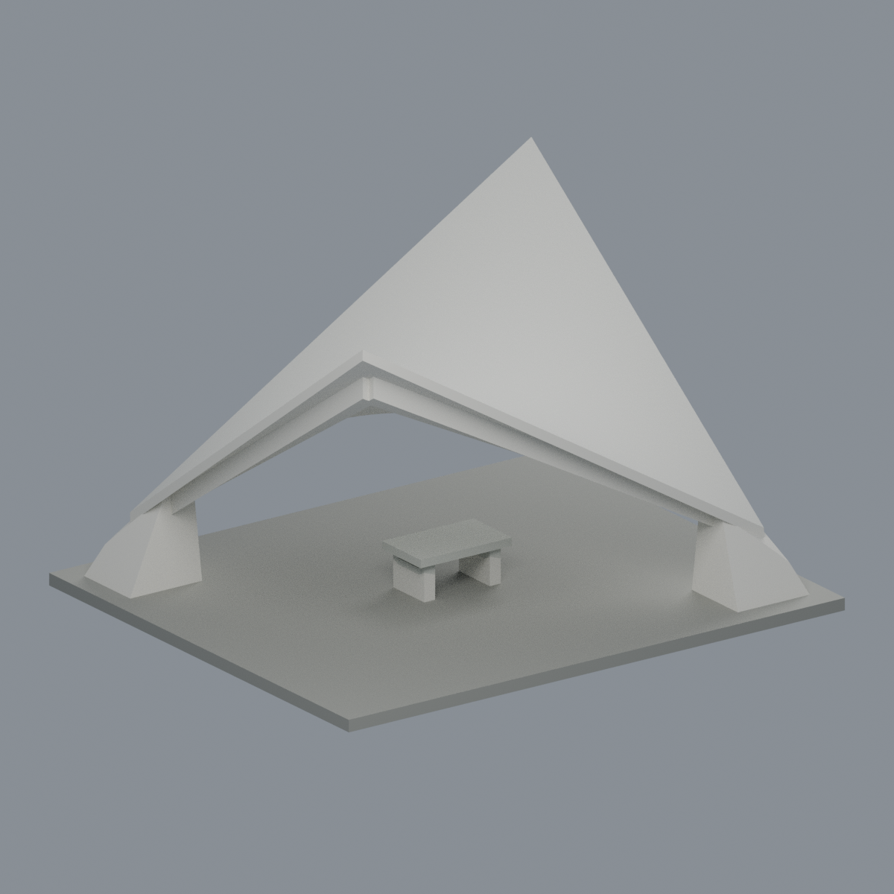

# 國立清華大學 梅亭／機亭

| 模型預覽 | 模型預覽 | 模型預覽 |
| :---: | :---: | :---: |
|  |  |  |

**新增幾何｜完整建築主體外觀近似，不是測繪復原。** 清華校本部梅園梅亭，亦稱機亭；不是月涵亭、月涵堂或寄梅亭。

單片連續雙曲拋物面混凝土薄殼，兩個對角低角由短外張墩支撐，另外兩個對角高角為自由端；四道內縮深肋、簡化石桌和接合兩支點的人工展示底座。沒有額外高柱或後牆。官方記載設計者張昌華（華泰），1969-04-27落成啟用；桌凳1970-05-03啟用。這些不是照片拍攝日期。

## 檔案與使用
- [可編輯 Blender 場景](scene.blend)：與 STL 相同三角面，一物件四種可逐面編輯材質；材質改色另存重開已檢查。
- [彩色3MF](model.3mf)：逐三角面顯示材質，不是印表機噴頭／AMS配置。
- [STL](model.stl)：同一連通水密網格，STL格式本身不含顏色。
- [生成器](build_model.py)、[完整 QA](QA.md)、[來源](SOURCES.md)。

模型設計尺寸136×116×84.6 mm；殼平面110×90 mm、低／高角16／82 mm、垂直厚2.6 mm、內縮肋寬3.4 mm／深5.2 mm。這些是加厚展示與可操作建模尺寸，**不是現場測量值**。殼厚為垂直偏移，不代表全表面最小法向厚度。規則矩形、對稱雙角高度及曲率均為近似。

## 來源界限
親看2016官方4000×3000前景／室內、2020與2025 Commons完整畫面及官方書PDF第18頁上方屋面互補照。上方屋面照片僅421×286，遠端高角貼邊／裁切，拍攝年不明；足以支持雙低支點／雙高角連續鞍面拓樸，**不是完整高解析360度調查**。無現場尺寸、精確屋面方程、完整背頂細節或2026現況調查。石桌結構簡化；省略凳子、題字、燈具攝影機管線、樹木、坡地與整座梅園。人工底座不是原鋪地邊界或地基。

## 列印警告
水密與單連通≠可直接列印。0.2mm水平切層中，自由高角頂端有0.8mm侵蝕測試失敗，局部薄特徵失敗亦照實保留。大面積鞍面底部、自由角懸挑、桌面槽口需切片器支撐／方向規劃；可能須加厚尖端。**未做實體試印，未認證免支撐、強度或逐點壁厚。**

## 五個實際交付網格視角

| 模型預覽 | 模型預覽 | 模型預覽 |
| :---: | :---: | :---: |
|  |  |  |
|  |  |  |

## 重建與驗證
Python依賴見requirements.txt；lib3mf官方SDK另裝於執行驗證的Python環境，Blender4.3.2。
```sh
python build_model.py
python qa_model.py
PYTHONDONTWRITEBYTECODE=1 python check_features.py
BUILD_PYTHON=/path/to/model/python /path/to/lib3mf/python verify_exchange.py
blender -b --python-exit-code 1 --python render_model.py
blender -b --python-exit-code 1 --python verify_scene.py
blender -b --python-exit-code 1 --python verify_render.py
python verify_package.py
```
重建後的對照文件可能需重新生成，不能把舊QA視為新改動已驗證。獨立目錄重建比較STL、3MF、mesh／palette及全部五張PNG；原始照片不包含於交付。
