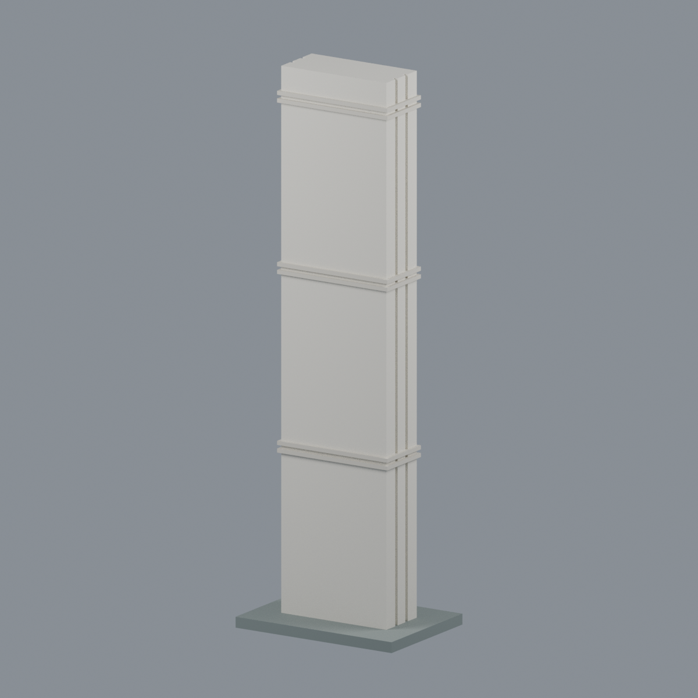
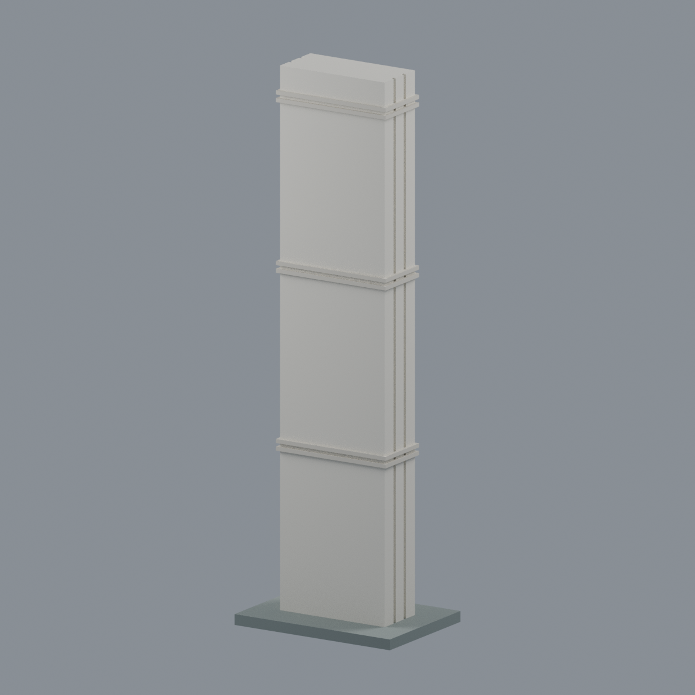
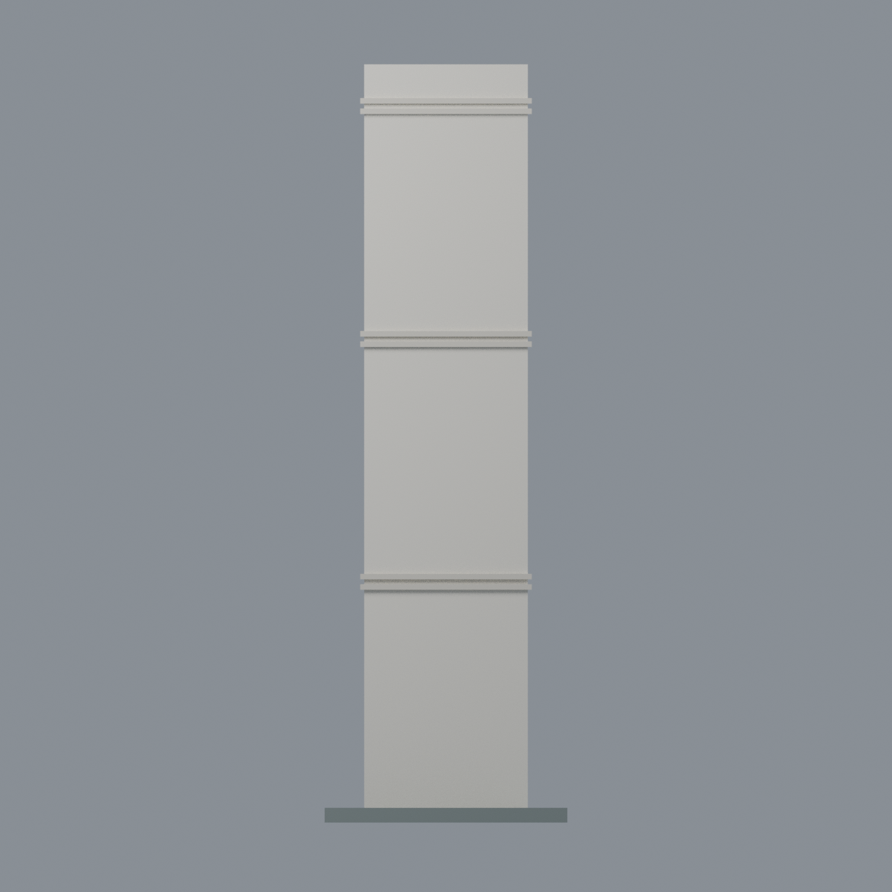
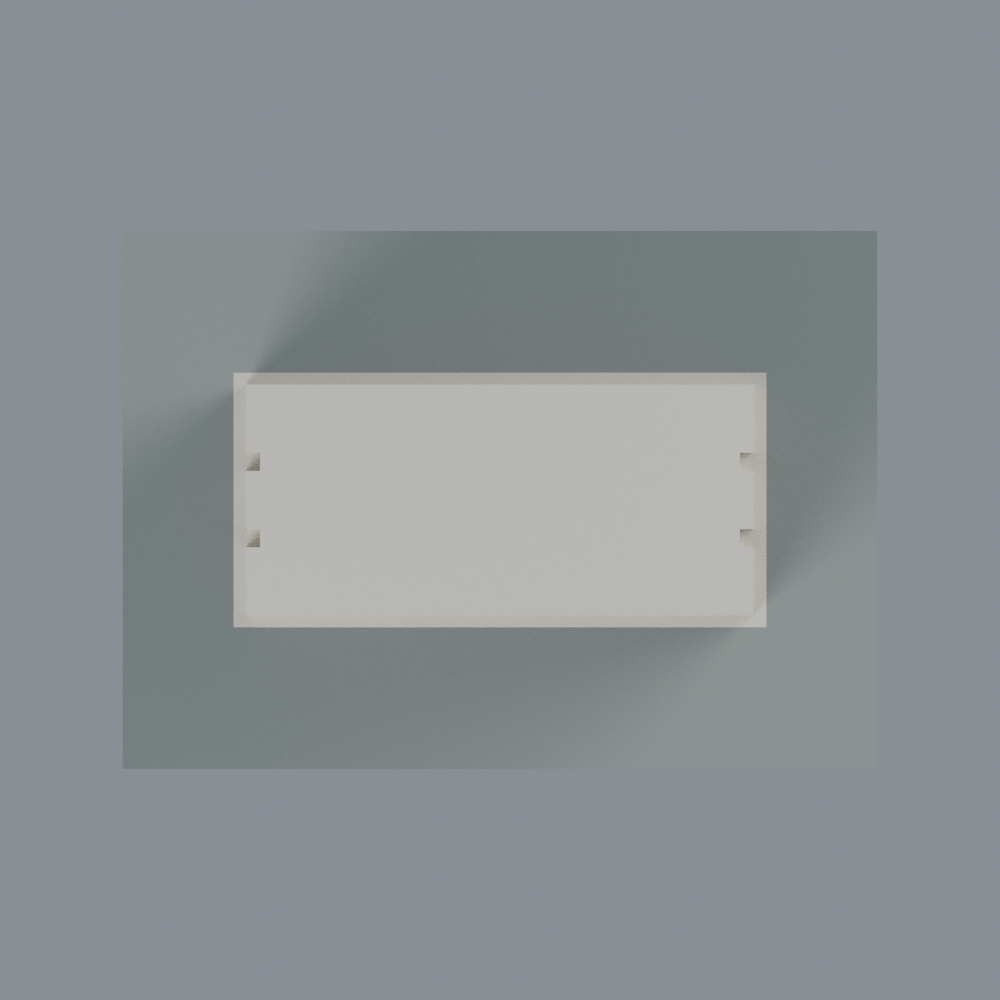
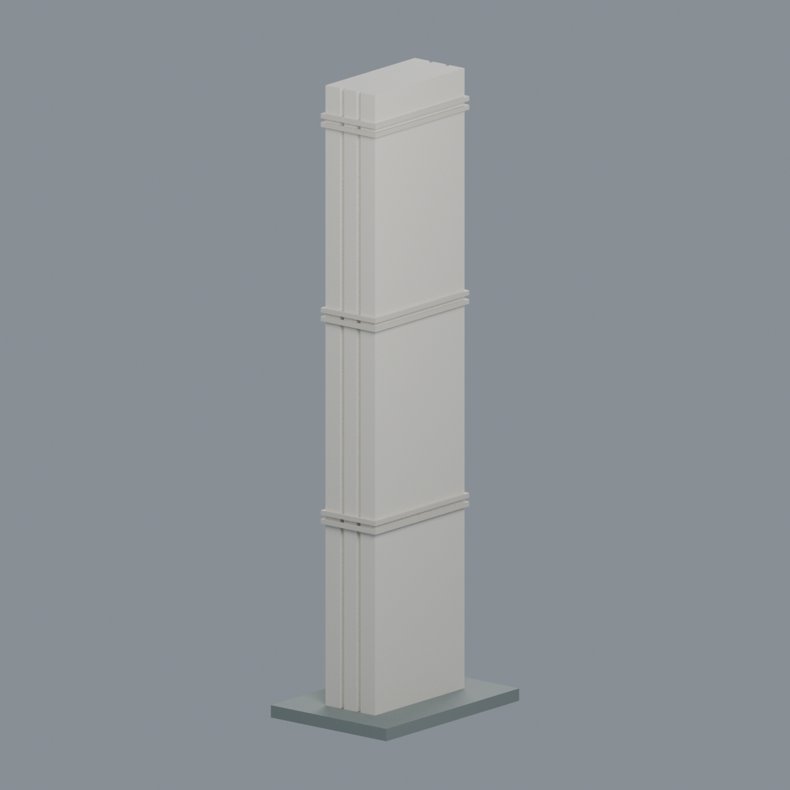

# 國立清華大學北校門簡冊立柱｜三片牆體外觀近似

## 模型預覽

| 模型預覽 | 模型預覽 | 模型預覽 |
| :---: | :---: | :---: |
|  |  |  |

1977 年楊英風設計北校門地標的獨立外觀近似，**不是整座北校門、清華門或新光廊重建**。

## 可編輯檔與實際模型視圖
- [Blender 可編輯場景](scene.blend) · [彩色 3MF](model.3mf) · [單色 STL](model.stl)
- [生成器](build_model.py) · [渲染器](render_model.py) · [材質表](palette.json)
- [正面斜視](previews/front.png) · [背面](previews/rear.png) · [正立面](previews/elevation.png) · [俯視](previews/top.png) · [左斜視](previews/left_oblique.png)
- [來源與取捨](SOURCES.md) · [列印限制與 QA](QA.md)

| 模型預覽 | 模型預覽 | 模型預覽 |
| :---: | :---: | :---: |
| 背面<br> | 正立面<br> | 俯視<br> |
| 左斜視<br> |  |  |

三種獨立命名展示材質可換色，3MF 顏色不是列印機料槽指派。保留三片**等高**平行牆體的外形、兩道側面淺凹縫，以及照片中三組雙橫飾。凹縫有實心背板，並非貫通孔；內部採加厚實體，不聲稱重建真實結構。正面校名字體刻意省略，以避免臆造書法與細碎凸字。背面平整簡化，沒有鏡像文字。

總尺寸 **49 × 35 × 153 mm**，其中柱體寬 33、深 15、高 150 mm，另加 3 mm 展示穩定底板。底板不代表歷史基礎。官方僅給約 15 m 高；本模型其餘尺寸為照片比例與列印取向推估，**不是精確 1:100 測繪縮尺**。溝槽寬 1.2、深 0.9 mm；橫飾高 1.1、出挑 0.8 mm，為可見性及穩固性調整。

排除警衛亭、伸縮門、2023 光廊、天線、樹木、道路與地下基礎。原照片不隨包發行。

## 重建
幾何環境依 requirements.txt；交換測試另需 lib3mf。
```sh
python build_model.py
python qa_model.py
python check_features.py
python verify_exchange.py
blender -b -t 4 --python-exit-code 1 --python render_model.py
blender -b -t 4 --python-exit-code 1 --python verify_scene.py
blender -b -t 4 --python-exit-code 1 --python verify_render.py
python verify_package.py
```
若 SDK 與幾何 Python 分開，設 BUILD_PYTHON 指定幾何環境。CPU Cycles seed 0、48 samples；跨平台與版本不保證渲染位元組相同。

**未做實體列印，不保證免支撐或直接可印。** 高瘦柱體有晃動、翹曲風險，橫飾下緣有水平懸挑；須依材料、線寬、切片及黏床條件試印。全局截面通過不代表所有局部細節合格。
