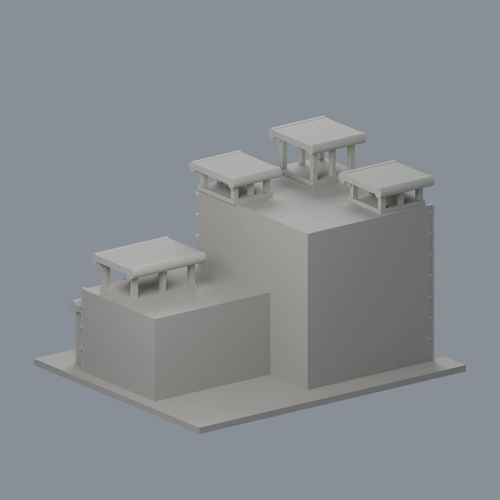
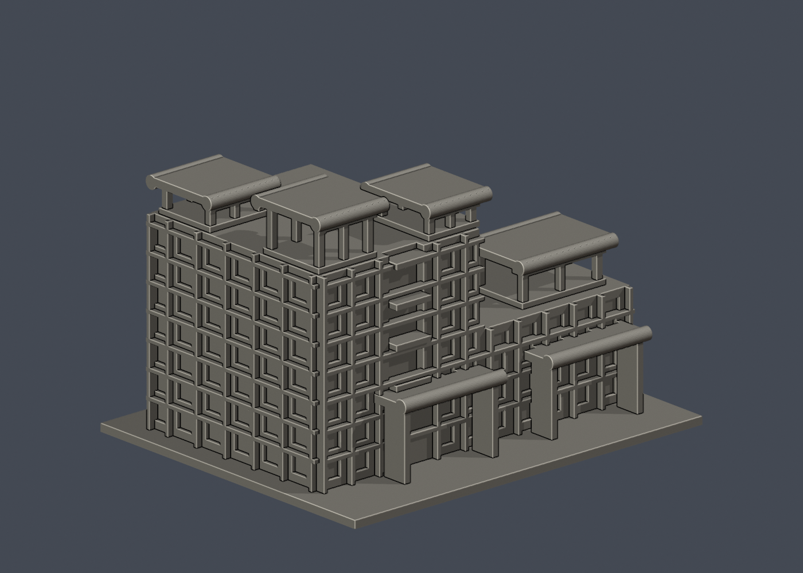
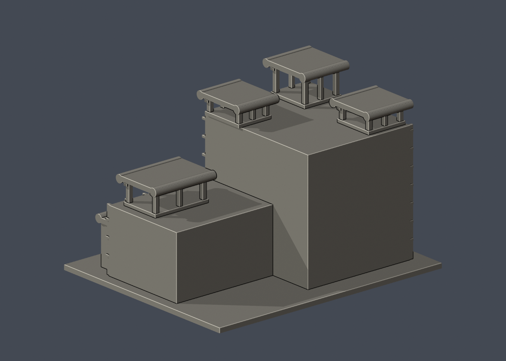

# 國立清華大學｜物理館

## 4 材質外觀版（2026-10-21）

| 正面與來源支持區域 | 未知背牆中性／亭構件有界延伸 |
|---|---|
|  |  |

[來源界線與四視角](appearance/README.md) · [表面色 3MF](appearance/nthuphysics-appearance.3mf) · [可編輯場景](appearance/scene.blend)

來源支持的淺灰結構、白色填牆與深色離散窗；未知背牆與屋頂面中性，亭構件有限延伸。 原 STL 與歷史 QA 不變；這是外觀改善，不是新增幾何。[原單色正面](previews/front.png)／[原單色背面](previews/rear.png)


第六批公開外觀近似模型，並非測繪成果。每件獨立比例，150.00 × 124.00 × 97.50mm，最長150mm含底座。全校尚未完成。

## 來源與觀察
[官方建築導覽](https://www.onenessarchitects.com/project/Department-of-Physics-nthu?lang=tw)；2026-10-13檢視來源實際像素。

已實看建築師四張外部/公開院落照片、理學院官網外觀及2026研討會對外入口照片。1988年完工。保留高低棟、四個不同高程屋頂柱亭、厚圓弧簷口、立面框格和低層柱廊。

來源照片僅列連結，不放入成果、不重新發布：
- https://www.onenessarchitects.com/uploads/default/NS_project_relates/raw/663b820a694dbdec844bc8a053fb8465.jpg
- https://www.onenessarchitects.com/uploads/default/NS_project_relates/raw/7bcfae8446fed6509417efc767abfb7c.jpg
- https://www.onenessarchitects.com/uploads/default/NS_project_relates/raw/57a28b9c8d74d0e3ebb4617639c03d0b.jpg
- https://www.onenessarchitects.com/uploads/default/NS_project_relates/raw/fbbd9657b3a24b76bec956e617844bf7.jpg
- https://science.site.nthu.edu.tw/var/file/69/1069/randimg/mobileadv_8997_4945802_05826.png
- https://indico.phys.nthu.edu.tw/event/173/attachments/283/546/Physics_Building_1.jpg

## 近似與缺口
四亭的相對高度、位置、平面尺寸及中間退縮層高依照片近似，非精密測繪。實際簷口有更細緻的上翻端部與梁格，本件用厚平蓋及圓柱弧緣概括，不宣稱復原原結構。窗框與柱加粗，拱窗部分簡化。屋頂沒有完整俯視證據，其餘採實心平蓋；後側素面，院落不重建室內。新舊照片日期不同，代表照片共同可見的外部主特徵，不保證2026每一細節不變。

僅公開訪客可見外觀，無室內、地下、敏感設備或安全配置。未下載、擷取或反編譯官方Unity或任何原始3D模型。官方3D場景沒有逐面檢視，不能視為未見部位已獲證實。

## 檔案
- `build_model.py`：可攜參數化來源。
- `model.stl` / `model.obj`：單一連通、封閉實體，單位mm；不預挖內腔。
- `scene.blend`：實際STL的可編輯三角網格與相機，不是BIM或保留布林歷史的場景。
- `previews/front.png`、`rear.png`、`elevation.png`：實際STL預覽，已看像素。正背為顯示方向，不是實測方位。
- `validation.json`：原檔法線、邊與頂點流形、正體積、單一表面、重建及Blend/STL一致等18項通過。
- `check_layers.py` / `layer-check.json`：0.2mm幾何截面與0.8mm XY薄特徵篩查。

## 列印起點與支撐
底座向下，保持150mm尺寸。可從0.4mm噴嘴、0.2mm層高、3道外牆、15–20%填充起始，但不是測試完成的參數。

四亭頂蓋下方跨度與低層柱廊、圓弧檐底需要支撐評估，可能需要大量局部支撐。柱亭支柱2.1–2.5mm，圓弧簷口直徑5mm，窗框1.4mm。支撐拆除不可硬扭頂柱。

薄特徵：487層0.2mm輪廓檢查閉合，0.8mm XY篩查零警戒，不能代替正式切片的橋接/懸垂檢查。

## 驗證範圍
18項網格驗證通過；原始STL法線與繞向相符，所有邊連接兩面、頂點環流形、單一連通表面且沒有分離內腔殼，正體積、z=0底面與150mm最大尺寸通過。乾淨暫存目錄重建STL的SHA-256相符，Blender幾何與STL一致；驗證不自動修原檔。

0.2mm間距共487個抽樣高度，所有輪廓閉合。端點數值聚合容差0.0001mm；首層0.100013mm以避共面。0.8mm XY形態開運算標示0層超過0.2mm²警戒，最大差異面積0.03010mm²，含義見薄特徵說明。

**未正式切片、未生成G-code、未實體試印。** 抽樣幾何截面不等於刀路、擠出、支撐或橋接驗證，亦不能證明全面三維壁厚或自相交完全不存在。

## 重建
Python 3.12與Blender 4.3.2+；所有程式從本檔目錄讀寫，不依賴製作端絕對路徑。

```sh
python -m pip install -r requirements.txt
python build_model.py
blender -b -t 2 -P render_preview.py
python validate_model.py
python check_layers.py
```


## 實際STL正背並排

| 正面 | 背面（未見部分按詳頁明示簡化） |
|---|---|
|  |  |
