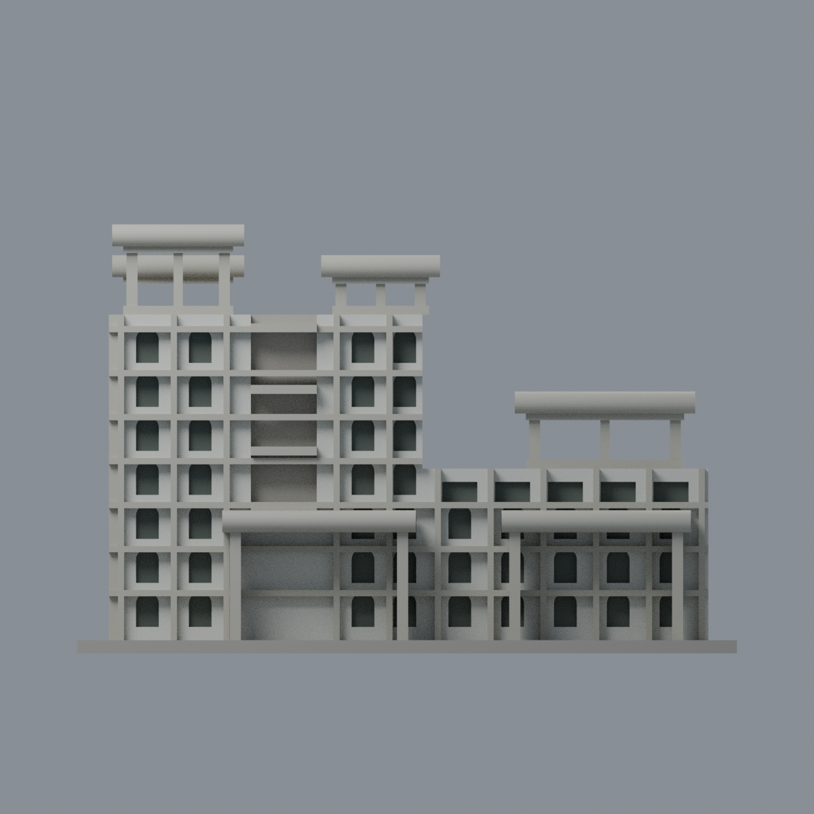
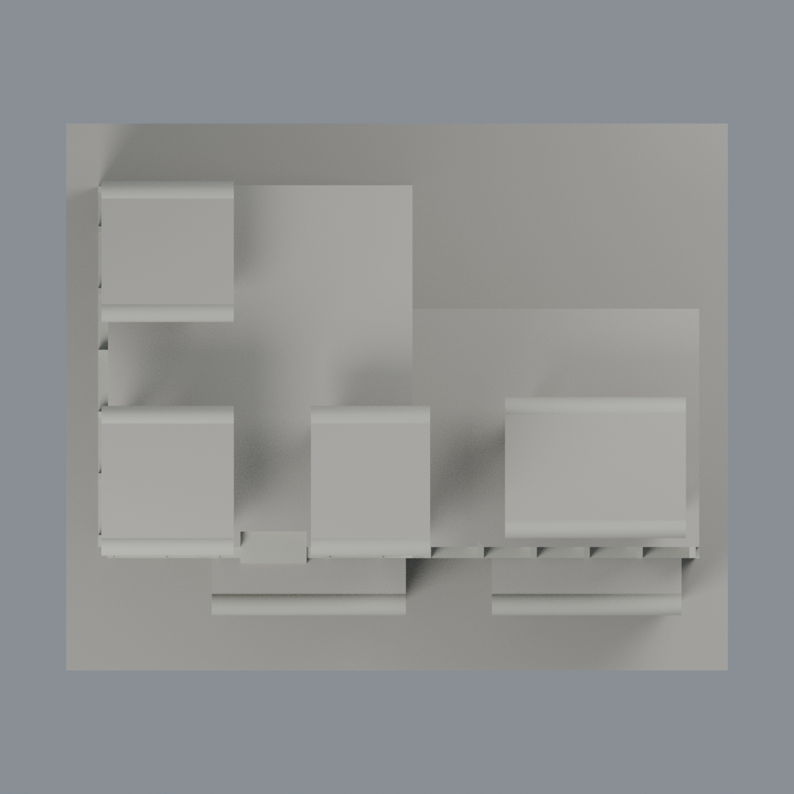

# 清華物理館：四材質外觀版

沿用原 **7,856 三角面／3,852 頂點**，不改原 STL 位元、座標、面序或幾何；這是既有模型外觀改版，不增加模型包數。

| 正面 | 未知背牆中性／亭構件有界延伸 |
|---|---|
|  |  |
|  |  |

[表面色 3MF](nthuphysics-appearance.3mf) · [可編輯 Blender](scene.blend) · [材質色表](palette.json) · [逐面指派與依據](face-materials.json) · [原 STL](../model.stl)

## 來源與配色邊界

親看[建築師作品頁](https://www.onenessarchitects.com/project/Department-of-Physics-nthu?lang=tw)四張完整外觀／公開院落照片，對應原生成器和單色網格。前兩張為彩色，用於材質代理；後兩張黑白**只核對形體、不作色彩證據**。[逐照用途、URL、完整解碼與雜湊](qa/source-review.json)。來源為建築師而非清華官方攝影；1988 為完工年，不是照片日期。照片無可得 EXIF 原始日，不稱 2026 實測現況。原照不入包。

- 前／左側磁磚填面冷白，原外突格柱、橫梁、亭柱與圓簷暖淡灰；不加實景細磚縫、污漬或表面斑駁。
- 原拱窗／矩形窗的離散凹背深灰代理，缺失的細深框不另畫出。中央凹通道與亭空隙不是玻璃，保持中性／原透空。
- 亭柱、梁及滾圓簷作同構件材料有界延伸；平屋頂上表面、未知後／右外牆中性。不把原厚平蓋與圓柱簷代理說成實景精確上翻簷口，四亭比例與位置仍是原近似。
- 原前門廊柱／簷暖灰，原底板不染成游泳池或草地；不新增內部格局、門牌、微型欄杆或設備。

[原幾何與歷史來源限制](../README.zh-TW.md)

## 重建與核驗

安裝 [依賴](source/requirements.txt)，Blender 使用 4.3.2。由本資料夾上層提供原 model.stl：

1. `python appearance/source/build_appearance.py`
2. `python appearance/source/verify_exchange.py`
3. `blender -b -t 3 --python-exit-code 1 -P appearance/source/render_appearance.py`
4. `blender -b -t 3 --python-exit-code 1 -P appearance/source/verify_scene.py`

[獨立重建 ZIP](rebuild-source.zip)含原 STL、四支程式及依賴，不含第三方照片；不取代原建模腳本。[逐檔 SHA256](SHA256SUMS)

[交換／拓撲 QA](qa/exchange-validation.json)核對原座標與面序、全部面材質、單連通、有向水密邊、頂點 link 單環、正體積與零退化／重複面；lib3mf 嚴格讀取零警告，實際編輯單材質再存讀，其他材質及面指派不變。SDK 六位小數量化誤差另列。

[Blender 存讀與編輯](qa/scene-validation.json) · [渲染記錄](qa/render-manifest.json) · [獨立重建](qa/rebuild-validation.json)

## 製造限制照舊

尺寸仍為 150 × 124 × 97.5 mm；原 STL、建模程式、場景及歷史 QA 保留。原層檢與薄特徵檢查本次未重跑，不能由材質 QA 代替。

3MF 是同一網格的表面色，不是各材質各自封閉的分色實體、切片專案、噴頭映射或 G-code。切片 GUI、多材料路徑與實體列印未測；柱頭、屋簷、窗框及薄邊仍須評估材料、支撐及拆除風險，沒有保證可印或免支撐。
