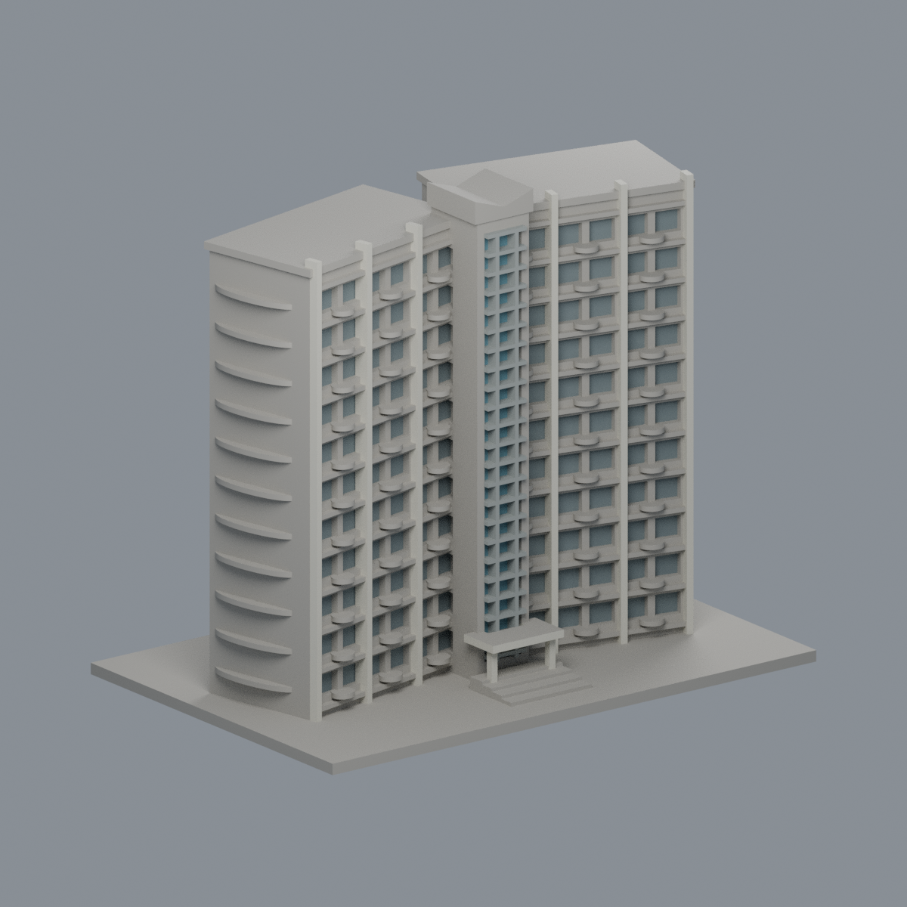
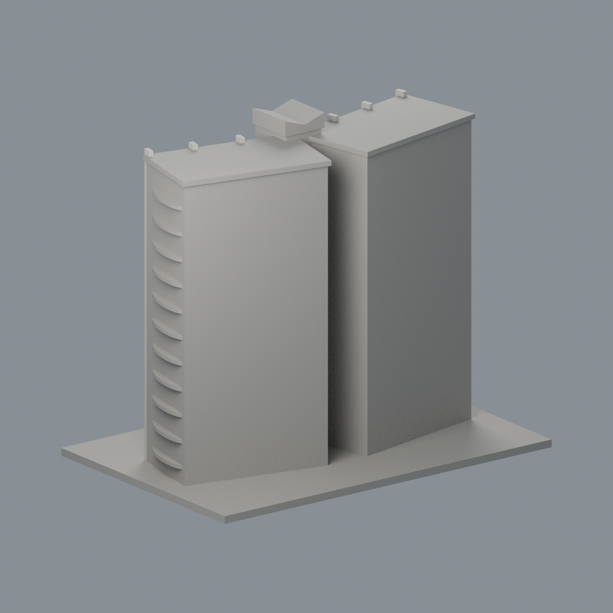
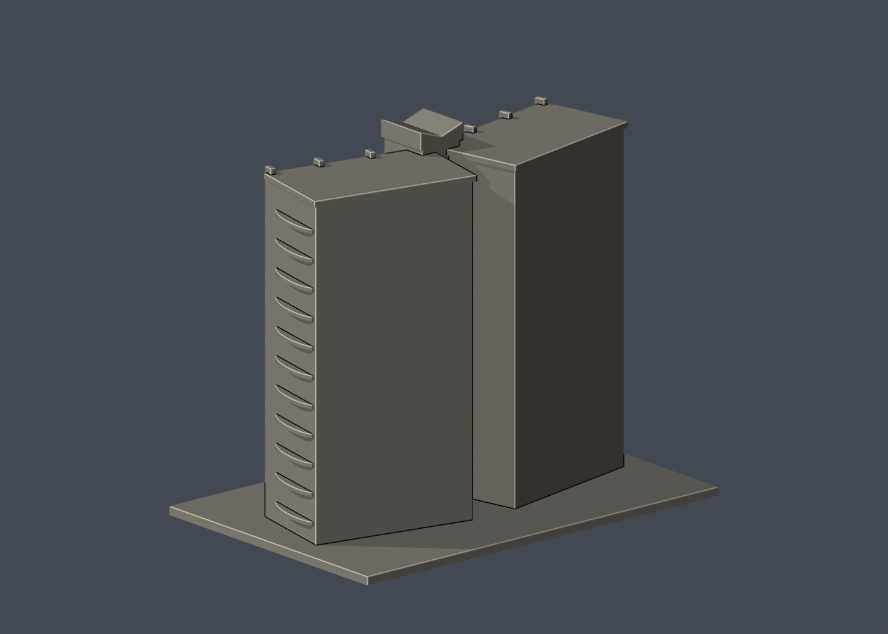

# 國立清華大學｜清齋 AB 雙翼外觀群（非整個清齋）

## 5 材質外觀版（2026-10-21）

| 正面與來源支持區域 | 未見外側背面中性 |
|---|---|
|  |  |

[來源界線與四視角](appearance/README.md) · [表面色 3MF](appearance/nthuqing-appearance.3mf) · [可編輯場景](appearance/scene.blend)

僅第三張 A/B 正面來源註冊的中央藍玻璃、銀梃、淡色大柱與離散窗；大片灰窗裙／米白混牆及圓弧平台保守中性，不假造黑欄杆。 原 STL 與歷史 QA 不變；這是外觀改善，不是新增幾何。[原單色正面](previews/front.png)／[原單色背面](previews/rear.png)


第十批公開外觀近似模型，並非測繪成果。每件獨立比例，150.00 × 100.00 × 129.00mm，最長150mm含底座。全校尚未完成。

## 來源與觀察
[官方建築導覽](https://sthousing.site.nthu.edu.tw/p/404-1254-43329.php?Lang=zh-tw)；2026-10-13檢視來源實際像素。

已實看住宿組清齋 AB 入口正面與周邊全景，以及洪清安建築師事務所公開外觀攝影。保留 AB 兩翼折角、中間狹長玻璃縫、上方折冠、粗直柱、水平帶與圓弧小陽台。住宿組頁面標記2026年7月更新，並非每張照片拍攝日期。

來源照片僅列連結，不放入成果、不重新發布：
- https://sthousing.site.nthu.edu.tw/var/file/254/1254/img/1333/IMG_2047.jpg
- https://sthousing.site.nthu.edu.tw/var/file/254/1254/img/1333/IMG_2188.jpg
- https://sthousing.site.nthu.edu.tw/var/file/254/1254/img/1333/IMG_2180.jpg

## 近似與缺口
本件只取官方標為 AB 棟入口的雙翼外觀群，清齋其他 C/DE 棟不在模型內。兩翼深度、夾角、樓層間距、平台外挑與屋頂尺度依照片近似；完整背面未見，採素面，不照正面複製。圓弧陽台欄杆合併為厚實平台，密集窗框減量。端面弧形平台為可見端部輪廓概括，不代表精確樓梯構造。

僅公開訪客可見外觀，無室內、地下、敏感設備或安全配置。未下載、擷取或反編譯官方Unity或任何原始3D模型。官方3D場景沒有逐面檢視，不能視為未見部位已獲證實。

## 檔案
- `build_model.py`：可攜參數化來源。
- `model.stl` / `model.obj`：單一連通、封閉實體，單位mm；不預挖內腔。
- `scene.blend`：實際STL的可編輯三角網格與相機，不是BIM或保留布林歷史的場景。
- `previews/front.png`、`rear.png`、`elevation.png`：實際STL預覽，已看像素。正背為顯示方向，不是實測方位。
- `validation.json`：原檔法線、邊與頂點流形、正體積、單一表面、重建及Blend/STL一致等16項通過。
- `check_layers.py` / `layer-check.json`：0.2mm幾何截面與0.8mm XY薄特徵篩查。

## 列印起點與支撐
底座向下，保持150mm尺寸。可從0.4mm噴嘴、0.2mm層高、3道外牆、15–20%填充起始，但不是測試完成的參數。

11層圓弧外挑平台、上簷、中央折冠與入口雨棚需要局部支撐評估；入口雨棚跨距約18mm。直肋厚1.8mm，中縫格條最細1–1.1mm，平台厚1.3–1.4mm；不可抓細格條拆支撐。

薄特徵：645個0.2mm截面均閉合；2層警戒在z=118.90001mm的傾斜翼端屋簷交界及z=128.90001mm的中央折冠頂端。為局部尖緣，切片時可能鈍化或省略，需逐層預覽。

## 驗證範圍
16項網格驗證通過；原始STL法線與繞向相符，所有邊連接兩面、頂點環流形、單一連通表面且沒有分離內腔殼，正體積、z=0底面與150mm最大尺寸通過。乾淨暫存目錄重建STL的SHA-256相符，Blender幾何與STL一致；驗證不自動修原檔。

0.2mm間距共645個抽樣高度，所有輪廓閉合。端點數值聚合容差0.0001mm；首層0.100013mm以避共面。0.8mm XY形態開運算標示2層超過0.2mm²警戒，最大差異面積11.99844mm²，含義見薄特徵說明。

**未正式切片、未生成G-code、未實體試印。** 抽樣幾何截面不等於刀路、擠出、支撐或橋接驗證，亦不能證明全面三維壁厚或自相交完全不存在。

## 重建
Python 3.12與Blender 4.3.2+；所有程式從本檔目錄讀寫，不依賴製作端絕對路徑。

```sh
python -m pip install -r requirements.txt
python build_model.py
blender -b -t 2 -P render_preview.py
python validate_model.py
python check_layers.py
```

補充公開外觀：[洪清安建築師事務所清齋改建工程](https://aha0.webnode.tw/國立清華大學清齋改建工程/)。全群照片只協助理解外觀，本件限 AB 雙翼，不將其他棟合併冒稱完整。


## 實際STL正背並排

| 正面 | 背面（未見部分按詳頁明示簡化） |
|---|---|
|  |  |
