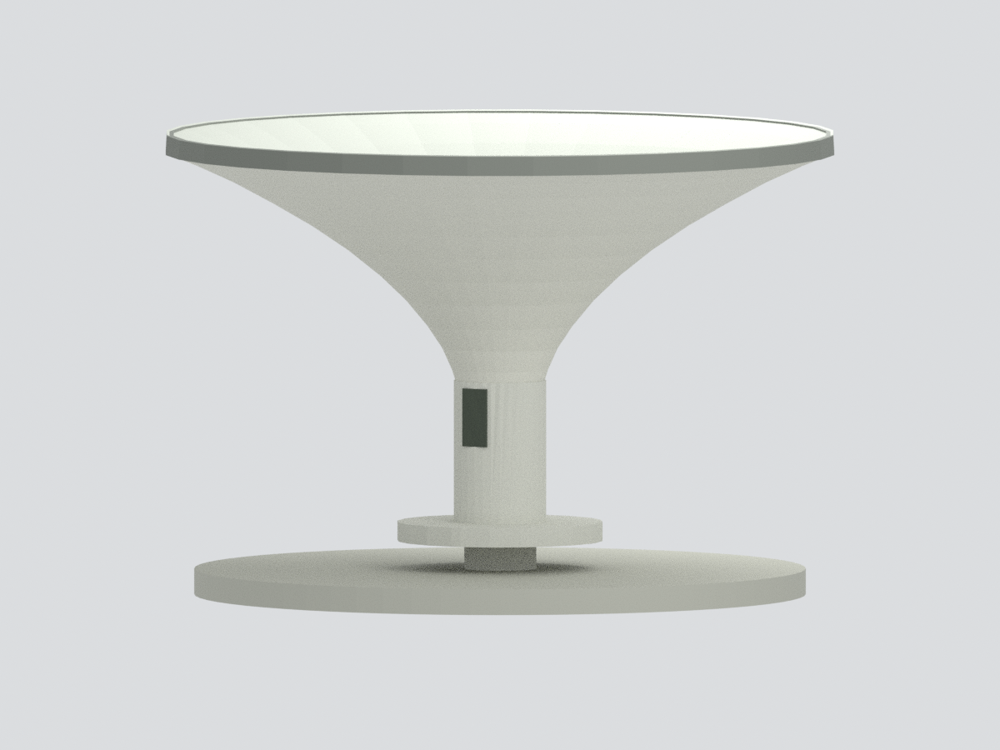

# 國立清華大學壬戌亭

**2016官方照片所見單柱倒傘亭主體簡化近似**：圓平台、柱周圓凳、中央白柱、向上擴展的曲面傘狀屋蓋與灰色周緣。位於電資館與昆明湖之間；不是梅亭、奕亭、月涵亭、成功湖八角亭或昱寧島亭。

## 來源邊界
- 四張官方4000×3000圖均已目視。圖印與EXIF標2016-08-23，**不宣稱已核對2026現況**。兩張全景為同方向遠近，另外兩張僅柱嵌片，沒有全向測繪。
- 下表面從柱頸彎曲擴展至外緣，以多段曲面近似；不是一直線圓錐。精確曲率、分瓣數、厚度均未知。
- **頂面未見**。模型上面僅以下表面偏移厚度並封閉中心，材質用中性灰；不是已證實的屋頂坡度、防水層或實際排水。沒有自行加入排水孔或管。
- 背向曲面/柱採旋轉規律化推估；柱嵌片用兩個相對深色空白矩形近似，角度與書法不復原。
- 圓凳下面支塊可見，但配置不完整，簡化中央連接支承不是實際支塊數。底部厚度、圓台半徑都為近似，不是地下基礎證據。
- 不建照片周邊椅子、樹木、地形、湖岸、字體與天候污漬。來源照片不收入公開包。
- **無實測尺寸**。模型約137×137×95mm為設計尺寸，不代表確定縮尺；顏色未校正。

## 檔案
model.3mf六種逐面材質，model.stl為相同單色三角面，scene.blend含可見實網格與隱藏可編輯構件。Python生成/驗證腳本、6個實網格渲染視角與來源說明隨包附上。

**未實體試印。** 曲面傘蓋底側與圓凳下方懸垂需要切片器支撐/方向評估；水密不代表免支撐、強度或最小壁厚認證。
