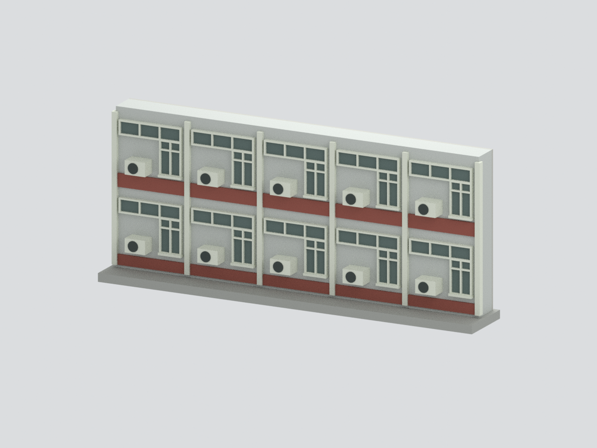
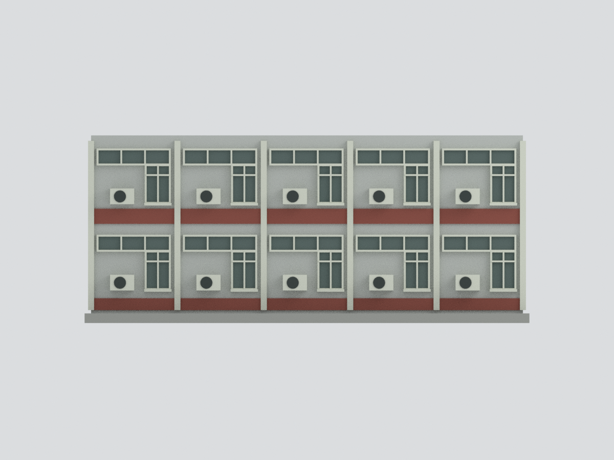

# 國立清華大學 實齋｜兩層長立面五跨截段

以住宿組公開外觀照片為依據的可列印彩色建築片段；**不是整棟實齋、不是測量復原或完整樓層紀錄**。

照片中的長立面只截取五個重複窗跨、兩個可見樓層；左右端與背面為作者裁切封口，底座為製作支撐。屋頂平面、其他樓層、背翼、樹遮入口與下方綠色雨棚均不補造。

## 模型預覽

以下為本套件模型的實際渲染，非建築現場照片；建模範圍與限制仍以本文說明為準。

## 檔案
- `model.stl`：單一封閉幾何，無色。
- `model.3mf`：同一幾何，逐面基礎材質色。
- `scene.blend`：實際輸出網格、相機、燈光及隱藏的可編輯前布林構件。
- `previews/`：六張由模型實際渲染的 PNG；`entry_detail.png` 為共用流程檔名，內容為窗跨細節，**不是入口**。
- 程式、來源說明與 QA 均隨包提供；參考照片不嵌入、不再散布。

## 規格與限制
約105.06×15.81×44.37模型毫米；3,756三角。比例是照片歸一化後的製作比例，非實測比例尺。磚縫、窗格、外機與帷幕做簡化；顏色未校色。全模型幾何封閉不代表真實建築資料完整。未試印，不保證特定機器/材料一次成功；列印前應另行切片檢查。

官方外觀頁標示 Update 2026.06，不把更新標籤當拍攝日期。詳見 SOURCES.md。

白磚縫省略為整面，外機與窗分格為名義近似。底部平台是作者支撐，不是綠棚或實際地坪；頂部封面是切口，不是推斷屋頂。
