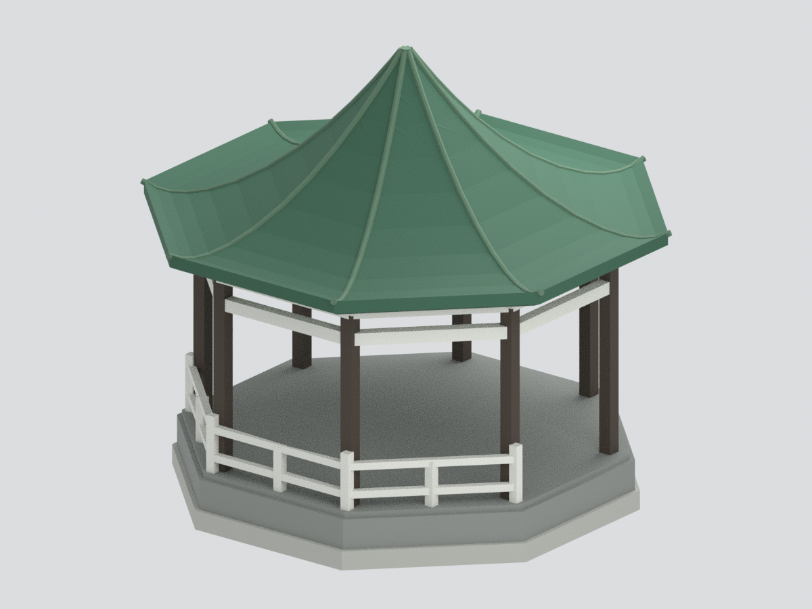

# 國立清華大學成功湖八角亭

**官方照片引導的完整簡化開放亭主體，不是全細節測繪復原。** 單層八角攢尖綠頂、深色細柱、兩層白環梁、灰色平台及湖側白欄。不是梅亭／機亭、奕亭、寄梅亭或2023昱寧島涼亭。

## 證據與限制
- 已實看官方2026校史展現況/舊照與官方校友刊圖七。2026為展覽年份，並非已查證拍攝日。
- **無實測尺寸**，模型約126×126×116mm，只是設計尺寸，不代表已知比例尺。
- 規則八邊形、八柱重複、背面屋頂對稱及隱藏環梁是明示規律化推估；原圖看不到所有背側構造。曲面屋頂不是直線八角錐，曲率、厚度、瓦壟均為簡化。
- 只建湖側三段白欄，其餘欄與陸側入口未充分看清，**刻意省略；模型空白處不是宣稱真實入口**。桌椅、題字、接頭、精確瓦片、排水件、地形與湖岸均省略。
- 深灰平台和八角外形近似；下方淺灰支撐是作者連接底，並非真實地基。白梁支承與細柱截面依照片簡化，未考證材料與榫接。
- 顏色為未校色照片估色。來源原圖只私人參考，不隨公開包分發。

## 檔案
- model.3mf：六種逐面材質色，不是多色列印機噴頭配置。
- model.stl：同一主網格，格式本身沒有顏色。
- scene.blend：可見統一網格與隱藏可編輯原始構件。
- build_model.py、render_model.py、validate_model.py、verify_scene.py：可重建與檢查。
- [來源](SOURCES.md)、[重建](REBUILD.md)、[品質限制](QA.md)。

預覽都從實際交付網格渲染。數位網格水密不等於可直接列印；未實際試印。曲面簷底、細柱與欄、懸空梁需支撐/方向與壁厚檢查。
