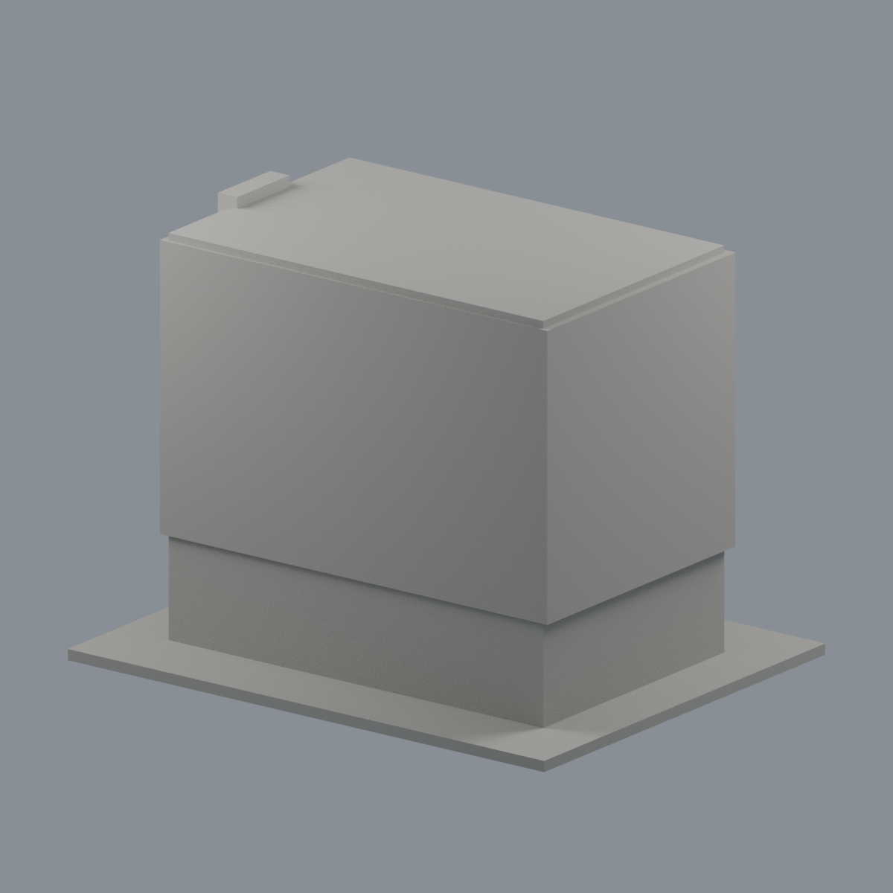
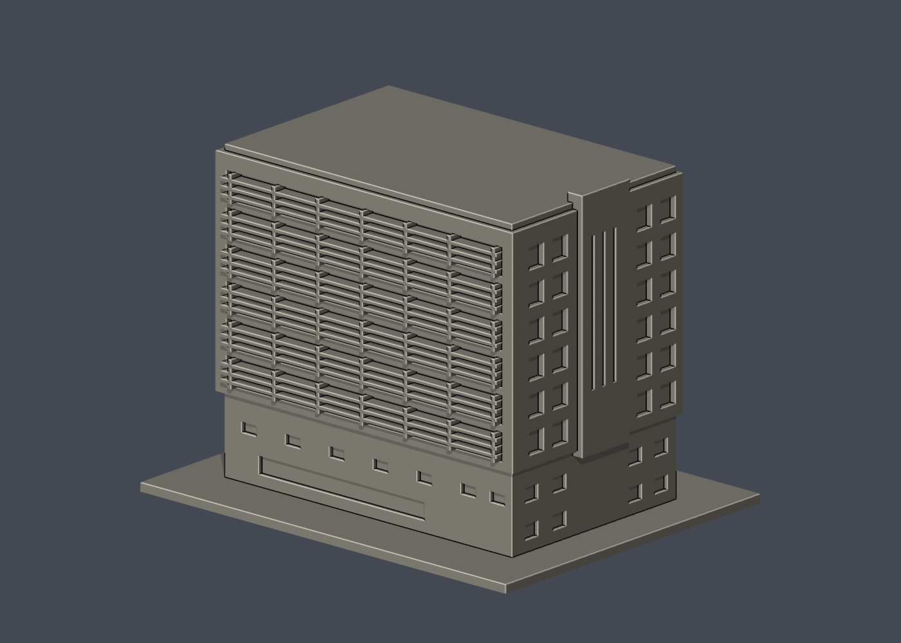
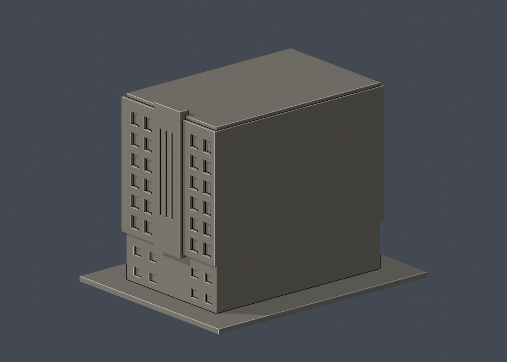

# 國立清華大學｜清華實驗室

## 6 材質外觀版（2026-10-21）

| 正面與來源支持區域 | 未見外側背面中性 |
|---|---|
|  |  |

[來源界線與四視角](appearance/README.md) · [表面色 3MF](appearance/nthulab-appearance.3mf) · [可編輯場景](appearance/scene.blend)

已註冊前右側深褐基座、白窗翼、灰粉褐核心、淺鋁遮陽及離散窗背；混合粉磚白帶與未建紅窗框保守省略，原幾何與未知背頂不改。 原 STL 與歷史 QA 不變；這是外觀改善，不是新增幾何。[原單色正面](previews/front.png)／[原單色背面](previews/rear.png)


第五批公開外觀近似模型，並非測繪成果。每件獨立比例，150.00 × 118.00 × 114.00mm，最長150mm含底座。全校尚未完成。

## 來源與觀察
[官方建築導覽](https://www.twarchitect.org.tw/works/清華大學清華實驗室/)；2026-10-13檢視來源實際像素。

已實看建築師提供之2019年外觀高角度與道路照片，並以清華圖書館2020年校史外觀照及官方營繕綠建築資料核對身分；2018年5月啟用。保留上層白框、下層深色基座退縮、長面水平遮陽片、端面兩側方窗與凸出高核心量體。

來源照片僅列連結，不放入成果、不重新發布：
- https://www.twarchitect.org.tw/web2015/wp-content/uploads/2019/05/201906a4-1.jpg
- https://www.twarchitect.org.tw/web2015/wp-content/uploads/2019/05/201906a4-2.jpg
- https://www.lib.nthu.edu.tw/events/2020/GoodTimes/image/15-2.jpg

## 近似與缺口
範圍限照片前側主棟之外部量體，不代表含鄰棟、空橋、完整院落的建築群。
此件以2019–2020年可見外觀為依據，不宣稱現況逐項一致。屋頂設備全部省略為平蓋；院落與相鄰育成中心空橋不製作，與鄰棟分開。背面未見完整外觀，素面處理；遮陽片數目減少並加厚，窗距與量體尺寸估計。公共外部量體之外，不收集或重建實驗室內部、設備、安全或服務配置。

僅公開訪客可見外觀，無室內、地下、敏感設備或安全配置。未下載、擷取或反編譯官方Unity或任何原始3D模型。官方3D場景沒有逐面檢視，不能視為未見部位已獲證實。

## 檔案
- `build_model.py`：可攜參數化來源。
- `model.stl` / `model.obj`：單一連通、封閉實體，單位mm；不預挖內腔。
- `scene.blend`：實際STL的可編輯三角網格與相機，不是BIM或保留布林歷史的場景。
- `previews/front.png`、`rear.png`、`elevation.png`：實際STL預覽，已看像素。正背為顯示方向，不是實測方位。
- `validation.json`：原檔法線、邊與頂點流形、正體積、單一表面、重建及Blend/STL一致等18項通過。
- `check_layers.py` / `layer-check.json`：0.2mm幾何截面與0.8mm XY薄特徵篩查。

## 列印起點與支撐
底座向下，保持150mm尺寸。可從0.4mm噴嘴、0.2mm層高、3道外牆、15–20%填充起始，但不是測試完成的參數。

遮陽片底緣、上框和端部凸出量體需評估局部支撐。遮陽片厚1.2mm，連接直框與實心背牆；不製作游離百葉。0.8mm XY篩查不能保證所有懸挑可印。

薄特徵：最終0.8mm XY薄特徵篩查零警戒，遮陽片厚1.2mm、直框1.3mm。

## 驗證範圍
18項網格驗證通過；原始STL法線與繞向相符，所有邊連接兩面、頂點環流形、單一連通表面且沒有分離內腔殼，正體積、z=0底面與150mm最大尺寸通過。乾淨暫存目錄重建STL的SHA-256相符，Blender幾何與STL一致；驗證不自動修原檔。

0.2mm間距共570個抽樣高度，所有輪廓閉合。端點數值聚合容差0.0001mm；首層0.100013mm以避共面。0.8mm XY形態開運算標示0層超過0.2mm²警戒，最大差異面積0.00000mm²，含義見薄特徵說明。

**未正式切片、未生成G-code、未實體試印。** 抽樣幾何截面不等於刀路、擠出、支撐或橋接驗證，亦不能證明全面三維壁厚或自相交完全不存在。

## 重建
Python 3.12與Blender 4.3.2+；所有程式從本檔目錄讀寫，不依賴製作端絕對路徑。

```sh
python -m pip install -r requirements.txt
python build_model.py
blender -b -t 2 -P render_preview.py
python validate_model.py
python check_layers.py
```


## 實際STL正背並排

| 正面 | 背面（未見部分按詳頁明示簡化） |
|---|---|
|  |  |
