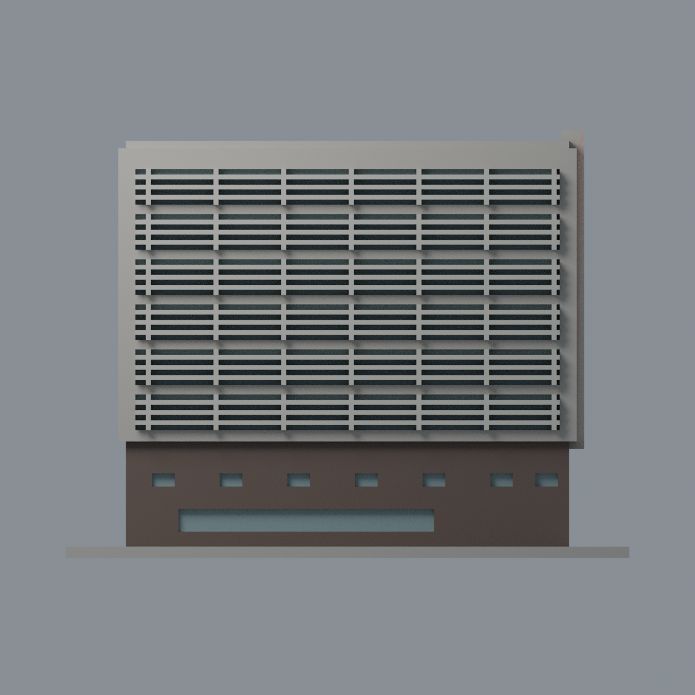
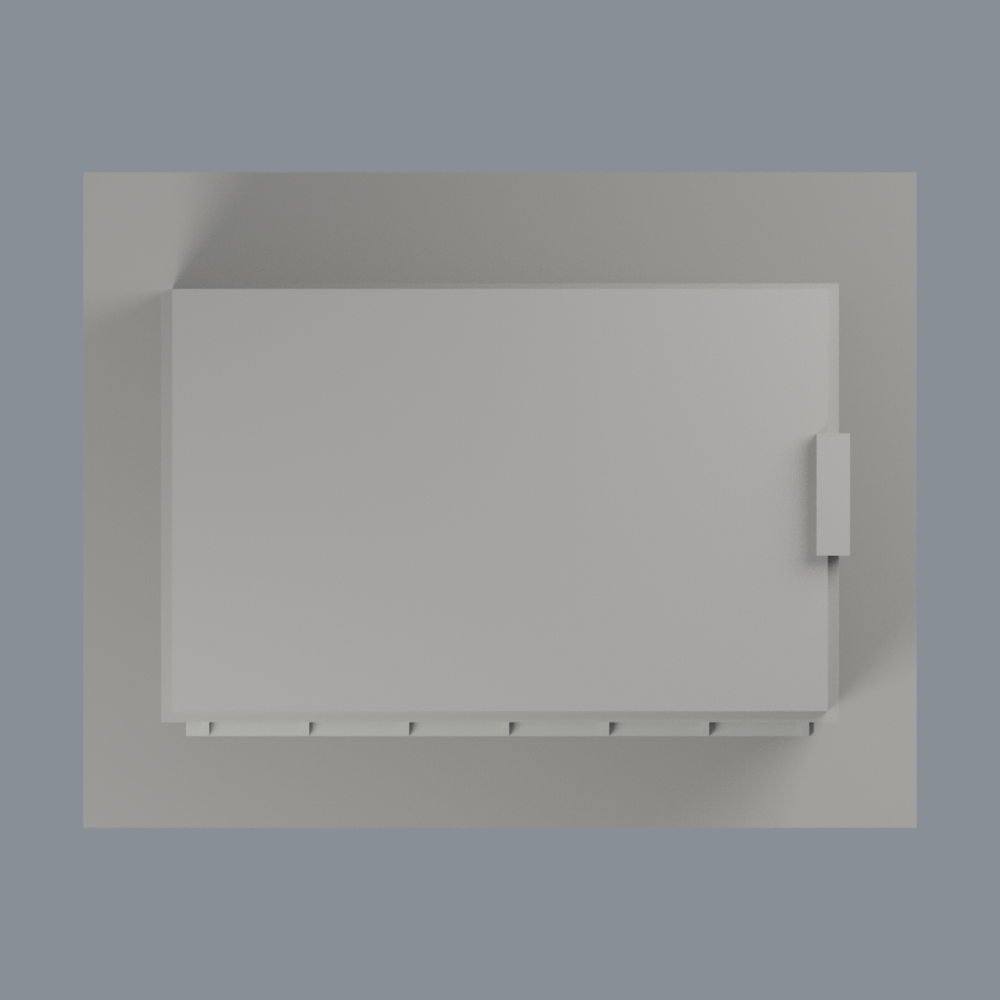

# 清華實驗室外觀：六材質外觀版

沿用原 **4,340 三角面／2,172 頂點**，不改原 STL 位元、座標、面序或幾何；這是既有模型外觀改版，不增加模型包數。

| 模型預覽 | 模型預覽 | 模型預覽 |
| :---: | :---: | :---: |
| 正面  | 背面保持中性  |  |
|  |  |  |

[表面色 3MF](nthulab-appearance.3mf) · [可編輯 Blender](scene.blend) · [材質色表](palette.json) · [逐面指派與依據](face-materials.json) · [原 STL](../model.stl)

## 來源與配色邊界

親看建築師雜誌所刊建築師提供的兩張外觀照及清華圖書館外觀照，核對原模型。[精確原始 URL、SHA 與日期欄](qa/source-review.json)。前兩照上傳路徑 2019/05 是刊登脈絡，並無 EXIF 原始拍攝日；圖書館照只有修改欄 2020-11-13 10:21:22，不能當拍攝日。原 sources 的 2019–2020 記述保留為歷史快照，本外觀包不將刊登年當拍攝年、不稱 2026 現況。照片私人研究，不入包。

- 以第一張高位照註冊前長面／右端：下層深褐砌牆、右端白色窗翼、凸核心灰粉褐、原遮陽片及支撐淺鋁灰、離散窗背灰藍。
- 長面上部粉磚與細白樓層線並未完整分面，整個混合表面中性，不製造斜色界。原端窗沒有照片中的小紅窗框分面，因此省略紅色，不把窗洞或玻璃整片染紅。
- 三條核心細槽保留中性，不臆測為玻璃；側面同核心材質僅有限延伸。另一方向的玻璃端面／空橋不在現有網格裡，不為配色增造。
- 未知背／左、所有屋頂上表面與底板中性。只做公開外觀，不重建內部實驗室、設備、服務配置或屋頂機電。

[原幾何與歷史來源限制](../README.zh-TW.md)

## 重建與核驗

安裝 [依賴](source/requirements.txt)，Blender 使用 4.3.2。由本資料夾上層提供原 model.stl：

1. `python appearance/source/build_appearance.py`
2. `python appearance/source/verify_exchange.py`
3. `blender -b -t 3 --python-exit-code 1 -P appearance/source/render_appearance.py`
4. `blender -b -t 3 --python-exit-code 1 -P appearance/source/verify_scene.py`

[獨立重建 ZIP](rebuild-source.zip)含原 STL、四支程式及依賴，不含第三方照片；不取代原建模腳本。[逐檔 SHA256](SHA256SUMS)

[交換／拓撲 QA](qa/exchange-validation.json)核對原座標與面序、全部面材質、單連通、有向水密邊、頂點 link 單環、正體積與零退化／重複面；lib3mf 嚴格讀取零警告，實際編輯單材質再存讀，其他材質及面指派不變。SDK 六位小數量化誤差另列。

[Blender 存讀與編輯](qa/scene-validation.json) · [渲染記錄](qa/render-manifest.json) · [獨立重建](qa/rebuild-validation.json)

## 製造限制照舊

尺寸仍為 150 × 118 × 114 mm；原 STL、建模程式、場景及歷史 QA 保留。原層檢與薄特徵檢查本次未重跑，不能由材質 QA 代替。

3MF 是同一網格的表面色，不是各材質各自封閉的分色實體、切片專案、噴頭映射或 G-code。切片 GUI、多材料路徑與實體列印未測；柱頭、屋簷、窗框及薄邊仍須評估材料、支撐及拆除風險，沒有保證可印或免支撐。
