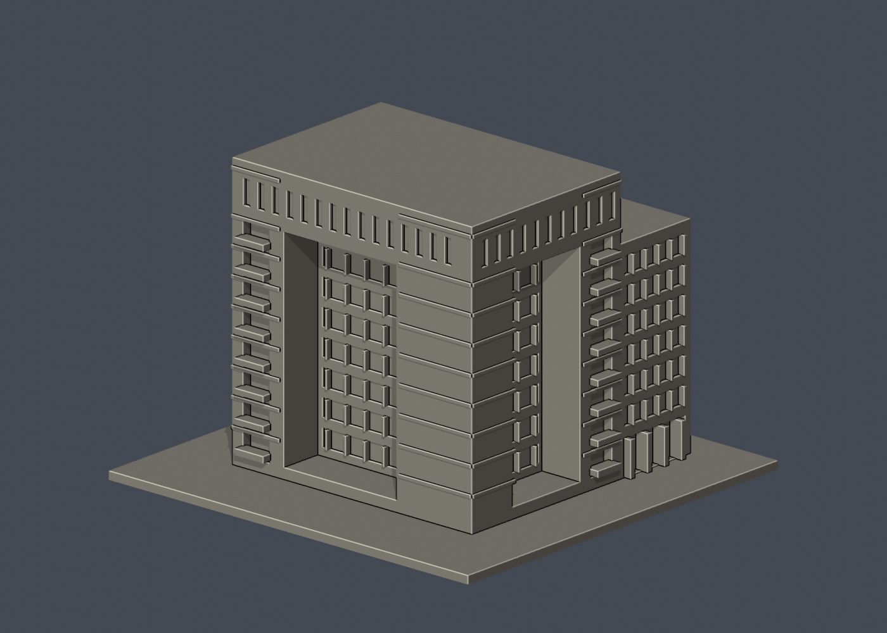
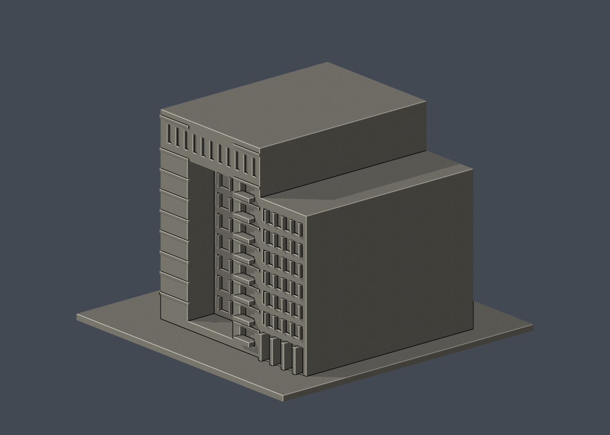

# 國立清華大學｜台積館

第二批外觀近似建築模型，並非測繪模型。獨立比例、最長150mm含底座；全校尚未完成。

## 交付與尺寸
150.00 × 146.00 × 104.80 mm，原始STL單位為毫米。

- `model.stl`：單一封閉列印實體，沒有預挖內腔。
- `scene.blend`：由實際STL匯入的可編輯三角網格與預覽相機，不是BIM或布林歷史。
- `model.obj`：輔助交換網格。
- `build_model.py`：參數化原始碼，可獨立重建。
- `previews/front.png`、`rear.png`、`elevation.png`：實際STL的正／背／立面渲染，已逐張看像素。正背是顯示方向，不是測量方位。
- `validation.json`：原始法線、流形與乾淨重建等18項驗證。
- `check_layers.py`、`layer-check.json`：0.2mm幾何截面與薄特徵篩查。

## 來源
查閱與像素檢視：2026-10-13。[校方來源頁](https://mba.site.nthu.edu.tw/p/404-1370-160569.php?Lang=zh-tw)。

實際檢視MBA官方外觀及跨領域研究辦公室全景空拍：兩面通高深凹廊、粗角柱、頂部連續窄窗梁、兩側陽台槽、後方較矮的長窗翼清楚可見。模型以立體深凹廊和退縮窗面建立識別。

照片只列URL，未包含在交付或重新發布：
- https://mba.site.nthu.edu.tw/var/file/370/1370/img/540/11.jpg
- https://oir.site.nthu.edu.tw/var/file/487/1487/img/DJI_0367.jpg

## 近似範圍
建物尺寸、深凹廊深度及後翼比例依照片估計，沒有室內格局。背立面未見，採素面。懸掛金屬公共藝術、細欄杆、字牌及屋頂設備省略，不以無證據設備位置冒充完整模型。水平飾帶增厚為1.2mm，陽台欄板實體化。

僅研究公開訪客可見外觀；沒有室內、地下、安全／進出控制或隱藏系統配置。未擷取官方Unity或其他3D資產；沒有聲稱逐面檢視官方3D場景。

## 列印與支撐
正立、底座朝下。可從0.4mm噴嘴、0.2mm層高、3道外牆、15–20%填充起始評估，但未驗證此設定。

通高深凹廊約16mm深，頂梁下方和連續陽台板強烈建議在切片器啟用局部支撐並檢查橋接；不可宣稱免支撐。

薄特徵人工對照：0.8mm XY開運算未超過0.2mm²警戒面積。已把跨陽台槽的0.7mm細條增厚至1.2mm；窗格0.9mm、上部窄窗間實牆約3.4mm。仍不能以截面篩查代替全面三維壁厚或實體測試。

## 驗證結果與限制
18項原始STL幾何檢查全過：單位法線且與繞向一致、無退化三角面、封閉邊、頂點連結單環、單一連通表面／無分離內腔殼、正體積、z=0平底、150mm最大邊、乾淨目錄重建STL雜湊一致、Blender／STL三角幾何一致。檢查不會修復原STL。

以0.2mm間距抽樣524個高度（首層0.100013mm，微偏移避免與三角面共面），所有截面輪廓閉合。交點採0.0001mm數值容差聚合，不修改STL。0.8mm XY形態開運算篩查標記0層，最大差異面積0.00000mm²；標記解釋如上。

**這不是正式切片，不產生G-code，沒有驗證刀路、擠出或支撐生成；沒有實體試印。** 抽樣截面不涵蓋每個高度，也不能代替全面三維最小壁厚或自相交證明。

## 乾淨重建
Python 3.12、Blender 4.3.2+；檔案只用自身目錄，不依賴製作機器絕對路徑。

```sh
python -m pip install -r requirements.txt
python build_model.py
blender -b -t 2 -P render_preview.py
python validate_model.py
python check_layers.py
```


## 實際STL正背並排

| 正面 | 背面（未見部分按詳頁明示簡化） |
|---|---|
|  |  |
