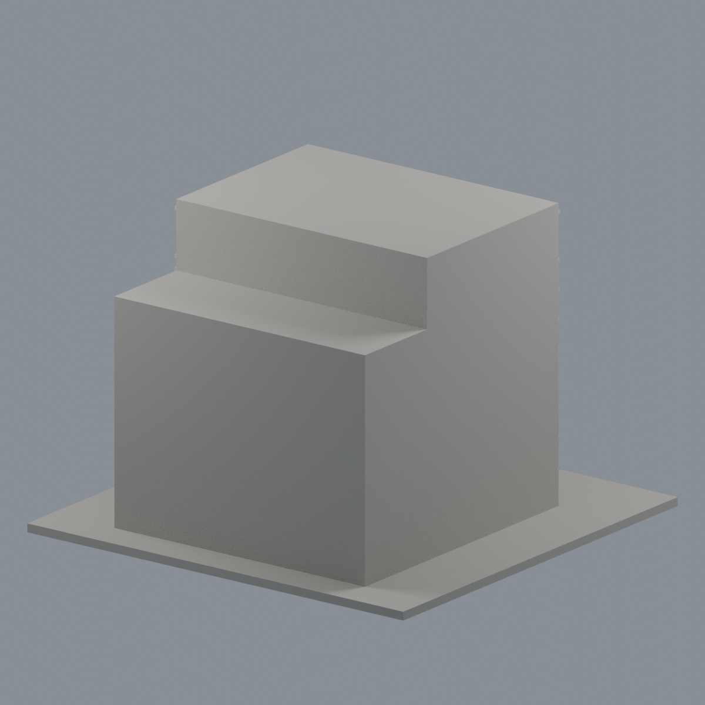
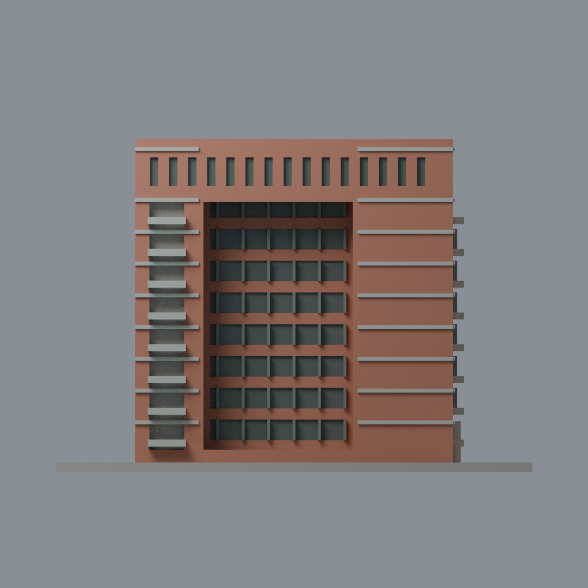
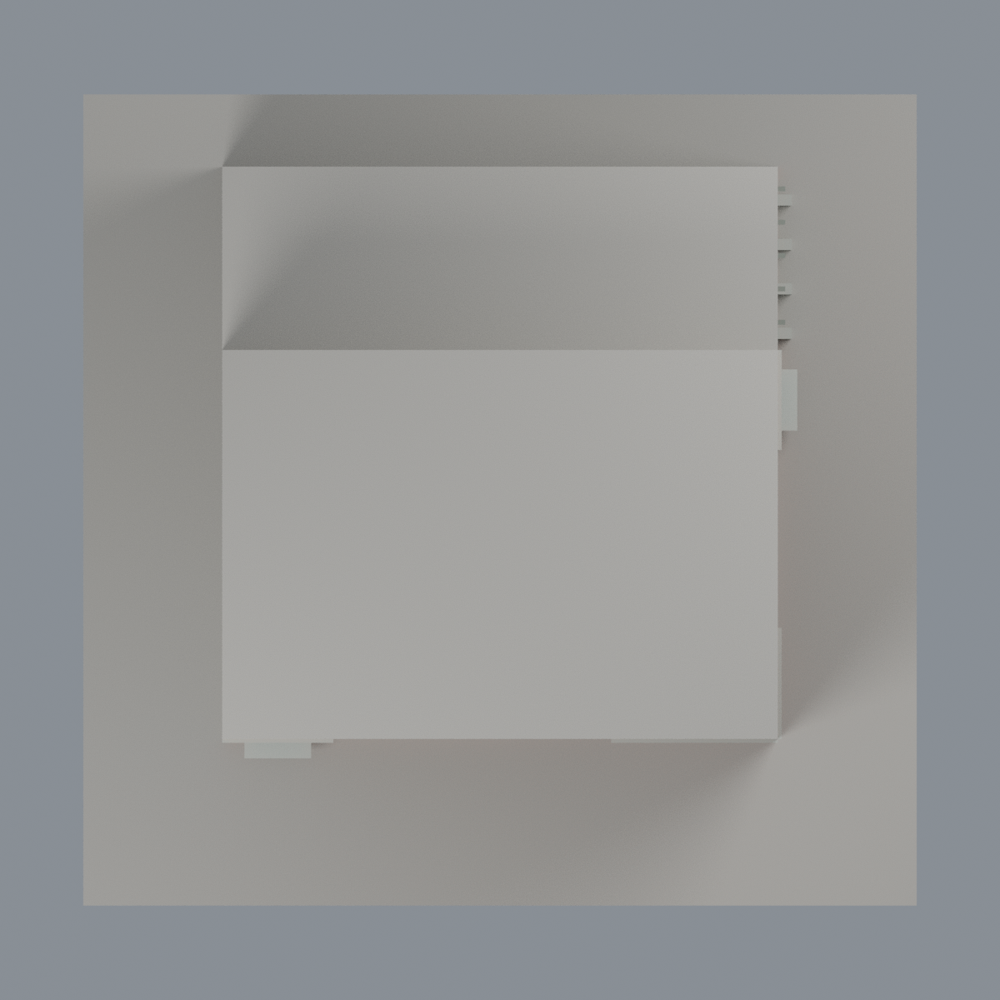

# 清華台積館：六材質外觀版

沿用原 **5,334 三角面／2,549 頂點**，不改原 STL 位元、座標、面序或幾何；這是既有模型外觀改版，不增加模型包數。

| 正面 | 未知背牆及左側中性 |
|---|---|
|  |  |
|  |  |

[表面色 3MF](nthutsmc-appearance.3mf) · [可編輯 Blender](scene.blend) · [材質色表](palette.json) · [逐面指派與依據](face-materials.json) · [原 STL](../model.stl)

## 來源與配色邊界

親自核對清華 [MBA 正面照](https://mba.site.nthu.edu.tw/var/file/370/1370/img/540/11.jpg)與[跨領域研究辦公室空拍](https://oir.site.nthu.edu.tw/var/file/487/1487/img/DJI_0367.jpg)，對應原單色預覽及生成器。[來源覆核、完整解碼及雜湊](qa/source-review.json)。EXIF 原始時間分別記 2007-10-12 15:52:58 與 2021-08-24 10:14:38，僅相機自報、時區未獨立核定；空拍一般修改欄 2022-03-21 不是拍攝日；不同時點來源整合不稱 2026 現況。參考照片不入包。

- 已見前／右外牆與凹廊內磚柱回折、窗間實牆為赭紅磚代理；原凸水平飾帶、厚陽台板與低翼地面柱淡灰。原 1.2mm 飾帶和實體欄板保持厚化，沒有補細磚紋或欄杆。
- 凹廊上方原天花底面奶油色，不把投影當黑牆；僅離散窗內背深灰綠、原直窗格深灰。廊內窗間實牆不是全片玻璃帷幕。
- 兩側陽台深背缺乏完整門窗分界，保守中性；未知左側、背面、屋頂中性。原階梯和展示底板中性，不硬加草地或鋪面分界。
- 原省略的公共藝術金屬線管、球與色塊不新增，字牌與屋頂設備也不補；維持原幾何／面序／原 STL 位元及歷史 QA。

[原幾何與歷史來源限制](../README.zh-TW.md)

## 重建與核驗

安裝 [依賴](source/requirements.txt)，Blender 使用 4.3.2。由本資料夾上層提供原 model.stl：

1. `python appearance/source/build_appearance.py`
2. `python appearance/source/verify_exchange.py`
3. `blender -b -t 3 --python-exit-code 1 -P appearance/source/render_appearance.py`
4. `blender -b -t 3 --python-exit-code 1 -P appearance/source/verify_scene.py`

[獨立重建 ZIP](rebuild-source.zip)含原 STL、四支程式及依賴，不含第三方照片；不取代原建模腳本。[逐檔 SHA256](SHA256SUMS)

[交換／拓撲 QA](qa/exchange-validation.json)核對原座標與面序、全部面材質、單連通、有向水密邊、頂點 link 單環、正體積與零退化／重複面；lib3mf 嚴格讀取零警告，實際編輯單材質再存讀，其他材質及面指派不變。SDK 六位小數量化誤差另列。

[Blender 存讀與編輯](qa/scene-validation.json) · [渲染記錄](qa/render-manifest.json) · [獨立重建](qa/rebuild-validation.json)

## 製造限制照舊

尺寸仍為 150 × 146 × 104.8 mm；原 STL、建模程式、場景及歷史 QA 保留。原層檢與薄特徵檢查本次未重跑，不能由材質 QA 代替。

3MF 是同一網格的表面色，不是各材質各自封閉的分色實體、切片專案、噴頭映射或 G-code。切片 GUI、多材料路徑與實體列印未測；柱頭、屋簷、窗框及薄邊仍須評估材料、支撐及拆除風險，沒有保證可印或免支撐。
