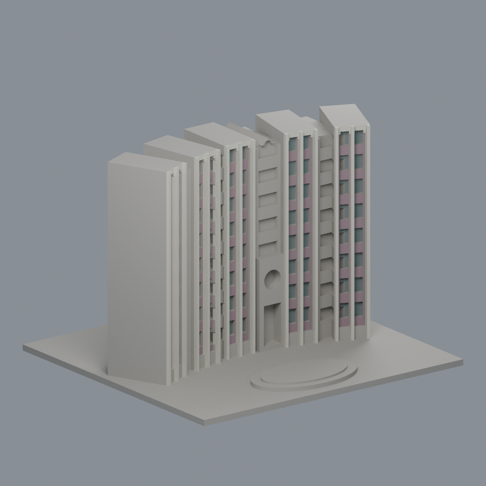
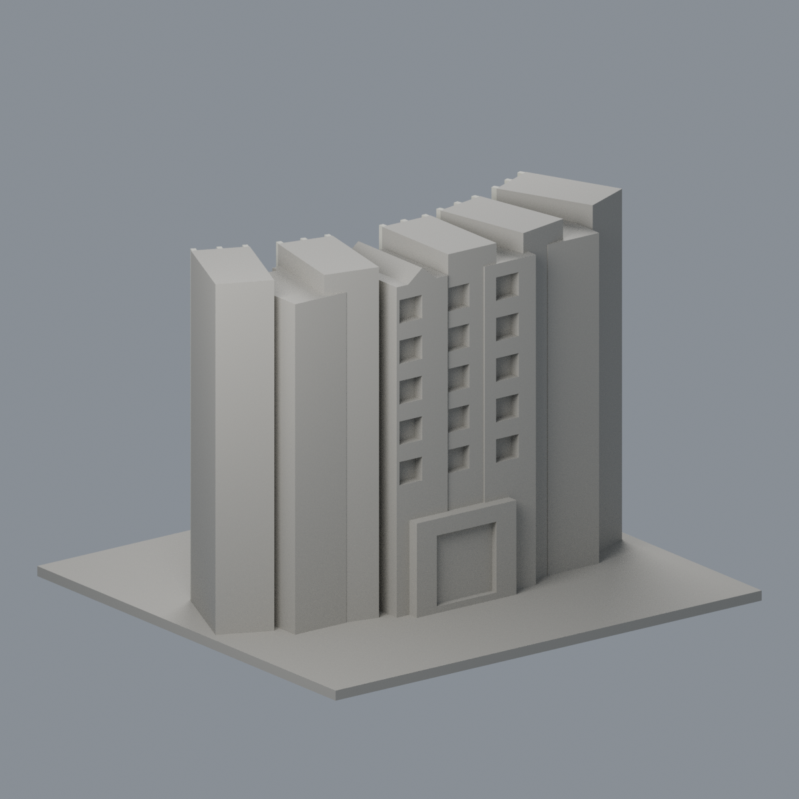
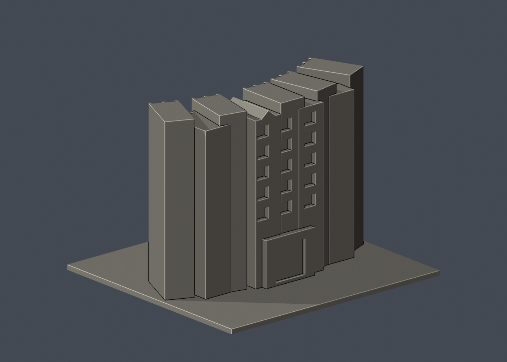

# 國立清華大學｜新齋

## 模型預覽

| 模型預覽 | 模型預覽 | 模型預覽 |
| :---: | :---: | :---: |
| 正面與來源支持區域<br> | 未見外側背面中性<br> |  |

## 4 材質外觀版（2026-10-21）


[來源界線與四視角](appearance/README.md) · [表面色 3MF](appearance/nthuxin-appearance.3mf) · [可編輯場景](appearance/scene.blend)

僅來源支持的五折前面灰紫褐磚凹背、淡象牙直肋與離散窗背配色；混合圓孔入口、開放廊背、屋頂與反側中性。 原 STL 與歷史 QA 不變；這是外觀改善，不是新增幾何。[原單色正面](previews/front.png)／[原單色背面](previews/rear.png)


第十批公開外觀近似模型，並非測繪成果。每件獨立比例，150.00 × 140.00 × 107.00mm，最長150mm含底座。全校尚未完成。

## 來源與觀察
[官方建築導覽](https://sthousing.site.nthu.edu.tw/p/404-1254-13727.php?Lang=zh-tw)；2026-10-13檢視來源實際像素。

已實看住宿組兩張公開外觀正反入口實景。正面保留五段折轉高立面、各段雙窗列與直肋、段間退縮陽台帶、右中段入口圓孔及上方小山牆圓孔、圓形前庭台階；相反入口保留矩形深框。頁面2026年6月更新，不等於照片拍攝日期。

來源照片僅列連結，不放入成果、不重新發布：
- https://sthousing.site.nthu.edu.tw/var/file/254/1254/img/449/IMG_1111.jpg
- https://sthousing.site.nthu.edu.tw/var/file/254/1254/img/449/IMG_0976.jpg

## 近似與缺口
折面角度、各翼深度、背向量體與屋頂按外觀估計，不是量測平面。窗與陽台數量/間距減量規則化，細欄杆合併為厚實橫帶。山牆後方屋頂無清楚俯視，採厚實簡化坡體；反面僅入口框及可辨識窗組，其餘素面。前庭整平並以低平台概括，不做植栽/家具。

僅公開訪客可見外觀，無室內、地下、敏感設備或安全配置。未下載、擷取或反編譯官方Unity或任何原始3D模型。官方3D場景沒有逐面檢視，不能視為未見部位已獲證實。

## 檔案
- `build_model.py`：可攜參數化來源。
- `model.stl` / `model.obj`：單一連通、封閉實體，單位mm；不預挖內腔。
- `scene.blend`：實際STL的可編輯三角網格與相機，不是BIM或保留布林歷史的場景。
- `previews/front.png`、`rear.png`、`elevation.png`：實際STL預覽，已看像素。正背為顯示方向，不是實測方位。
- `validation.json`：原檔法線、邊與頂點流形、正體積、單一表面、重建及Blend/STL一致等16項通過。
- `check_layers.py` / `layer-check.json`：0.2mm幾何截面與0.8mm XY薄特徵篩查。

## 列印起點與支撐
底座向下，保持150mm尺寸。可從0.4mm噴嘴、0.2mm層高、3道外牆、15–20%填充起始，但不是測試完成的參數。

凹陽台窗口上緣、圓孔上半部、入口深框及山牆檐部需局部支撐評估；窗柱1.5mm、圓孔直徑9.6mm，細圓孔4.2mm。支撐請避免封死凹槽且保留拆除空間。

薄特徵：0.2mm所有抽樣截面閉合；0.8mm XY篩查標記小山牆圓孔周邊和坡頂收尖處，詳layer-check.json。這些局部尖緣可能被切片器鈍化，不代表全面壁厚或橋接品質已通過。

## 驗證範圍
16項網格驗證通過；原始STL法線與繞向相符，所有邊連接兩面、頂點環流形、單一連通表面且沒有分離內腔殼，正體積、z=0底面與150mm最大尺寸通過。乾淨暫存目錄重建STL的SHA-256相符，Blender幾何與STL一致；驗證不自動修原檔。

0.2mm間距共535個抽樣高度，所有輪廓閉合。端點數值聚合容差0.0001mm；首層0.100013mm以避共面。0.8mm XY形態開運算標示6層超過0.2mm²警戒，最大差異面積22.49903mm²，含義見薄特徵說明。

**未正式切片、未生成G-code、未實體試印。** 抽樣幾何截面不等於刀路、擠出、支撐或橋接驗證，亦不能證明全面三維壁厚或自相交完全不存在。

## 重建
Python 3.12與Blender 4.3.2+；所有程式從本檔目錄讀寫，不依賴製作端絕對路徑。

```sh
python -m pip install -r requirements.txt
python build_model.py
blender -b -t 2 -P render_preview.py
python validate_model.py
python check_layers.py
```


## 實際STL正背並排

| 模型預覽 | 模型預覽 | 模型預覽 |
| :---: | :---: | :---: |
| 正面<br> | 背面（未見部分按詳頁明示簡化）<br> |  |
