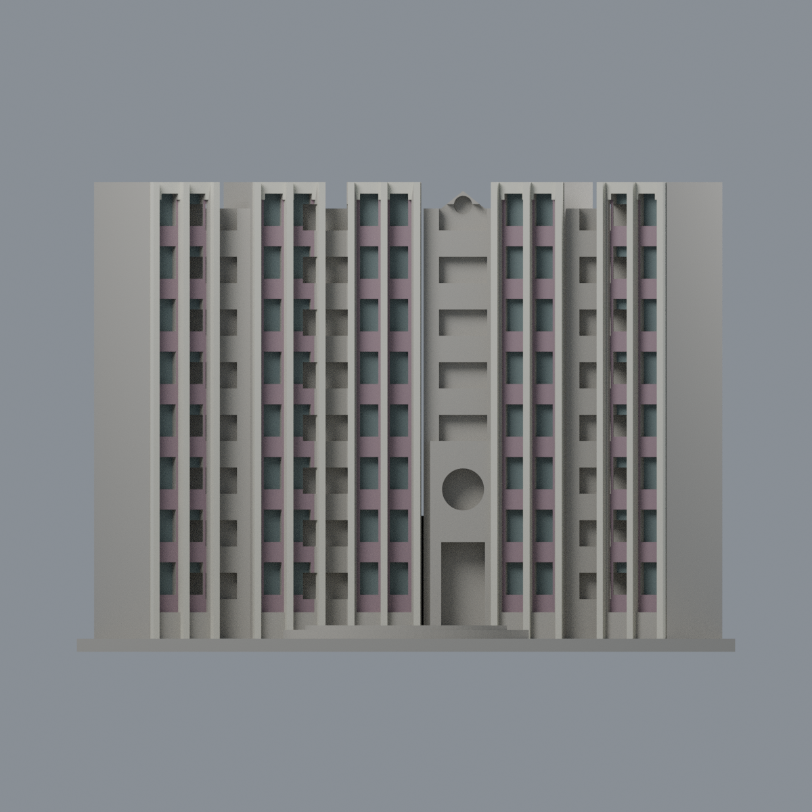
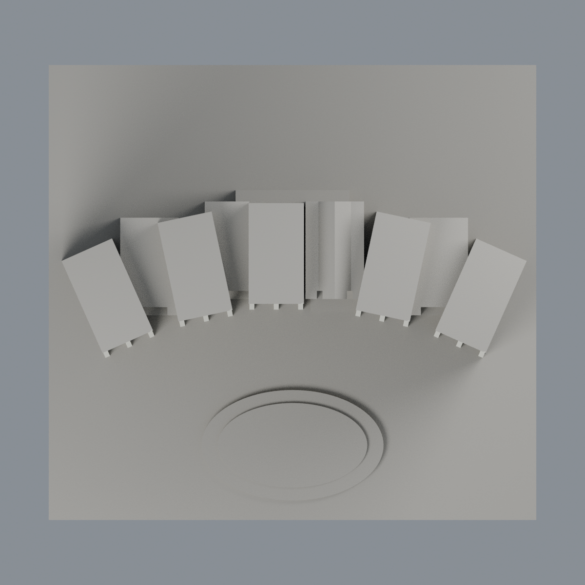

# 清華新齋五折前立面有限配色：四材質外觀版

沿用原 **5,270 三角面／2,557 頂點**，不改原 STL 位元、座標、面序或幾何；這是既有模型外觀改版，不增加模型包數。

| 正面 | 背面保持中性 |
|---|---|
|  |  |
|  |  |

[表面色 3MF](nthuxin-appearance.3mf) · [可編輯 Blender](scene.blend) · [材質色表](palette.json) · [逐面指派與依據](face-materials.json) · [原 STL](../model.stl)

## 來源與配色邊界

本件是新齋五折前立面的有限配色，不是全棟實景還原。親看住宿組兩張完整正反入口照片與原單色網格、生成器；[來源 URL、雜湊及分列日期](qa/source-review.json)。兩照 nested EXIF Original 為 2026-06-03，相機自報且未獨立認證；官方網頁更新日不是拍攝日。照片私有研究，不入包。

- 五段原折面各自逆轉座標註冊：長凹背採灰紫褐磚色，三條已分直肋採淡象牙磁磚色，完整上緣前面同系統有限延伸；僅離散雙列窗洞背面採低飽和灰藍代理，不增加細框、窗簾或空調。
- 原模型窗數／層高／折角簡化；玻璃代理不表示每扇窗的實際簾色或透明性。未分的窗框不以整個窗洞染銀代替。
- 段間陽台背是開放廊，不當玻璃；側回牆與窗裙缺足夠一對一邊界，保持中性。中央圓孔入口牆跨淡色與褐色橫帶，原面未分，不整片染白。山牆、屋面與未知側後面亦中性。
- 反入口照片僅確認身份與色系，底部實景磚腳未分界，因此背面不全染磚色。前庭原連續平台混實景鋪面／植栽，保持中性；不新增文字、個人物品、設備或室內。

[原幾何與歷史來源限制](../README.zh-TW.md)

## 重建與核驗

安裝 [依賴](source/requirements.txt)，Blender 使用 4.3.2。由本資料夾上層提供原 model.stl：

1. `python appearance/source/build_appearance.py`
2. `python appearance/source/verify_exchange.py`
3. `blender -b -t 3 --python-exit-code 1 -P appearance/source/render_appearance.py`
4. `blender -b -t 3 --python-exit-code 1 -P appearance/source/verify_scene.py`

[獨立重建 ZIP](rebuild-source.zip)含原 STL、四支程式及依賴，不含第三方照片；不取代原建模腳本。[逐檔 SHA256](SHA256SUMS)

[交換／拓撲 QA](qa/exchange-validation.json)核對原座標與面序、全部面材質、單連通、有向水密邊、頂點 link 單環、正體積與零退化／重複面；lib3mf 嚴格讀取零警告，實際編輯單材質再存讀，其他材質及面指派不變。SDK 六位小數量化誤差另列。

[Blender 存讀與編輯](qa/scene-validation.json) · [渲染記錄](qa/render-manifest.json) · [獨立重建](qa/rebuild-validation.json)

## 製造限制照舊

尺寸仍為 150 × 140 × 107 mm；原 STL、建模程式、場景及歷史 QA 保留。原層檢與薄特徵檢查本次未重跑，不能由材質 QA 代替。

3MF 是同一網格的表面色，不是各材質各自封閉的分色實體、切片專案、噴頭映射或 G-code。切片 GUI、多材料路徑與實體列印未測；柱頭、屋簷、窗框及薄邊仍須評估材料、支撐及拆除風險，沒有保證可印或免支撐。
