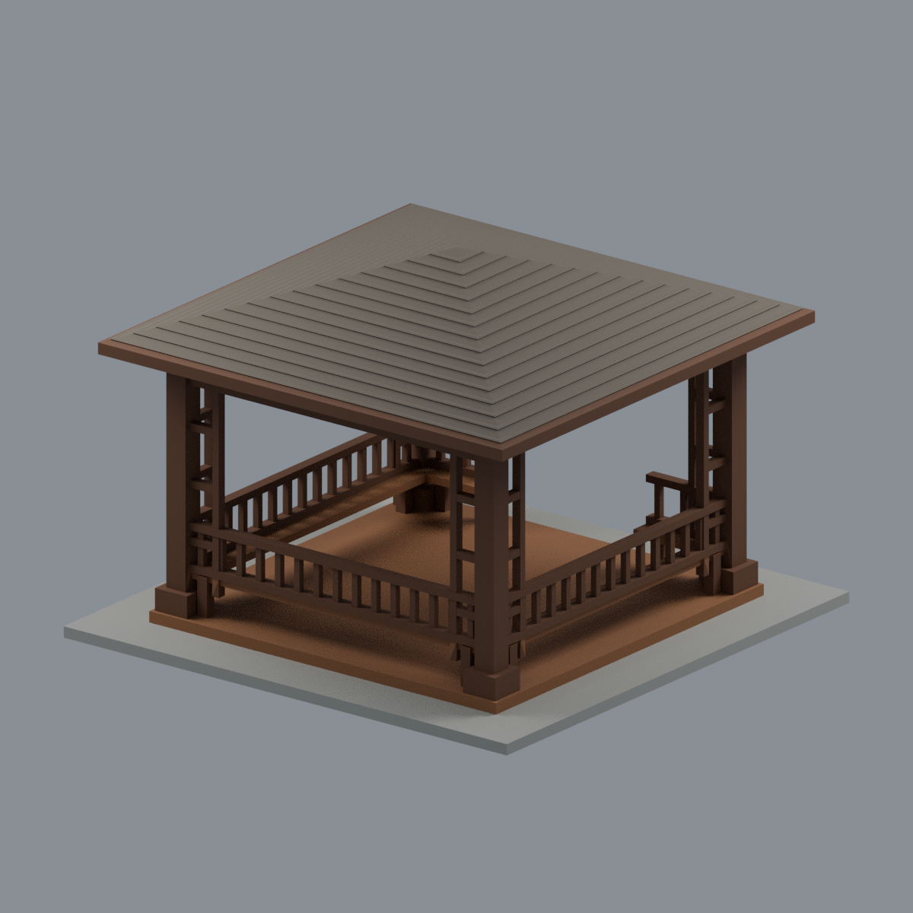
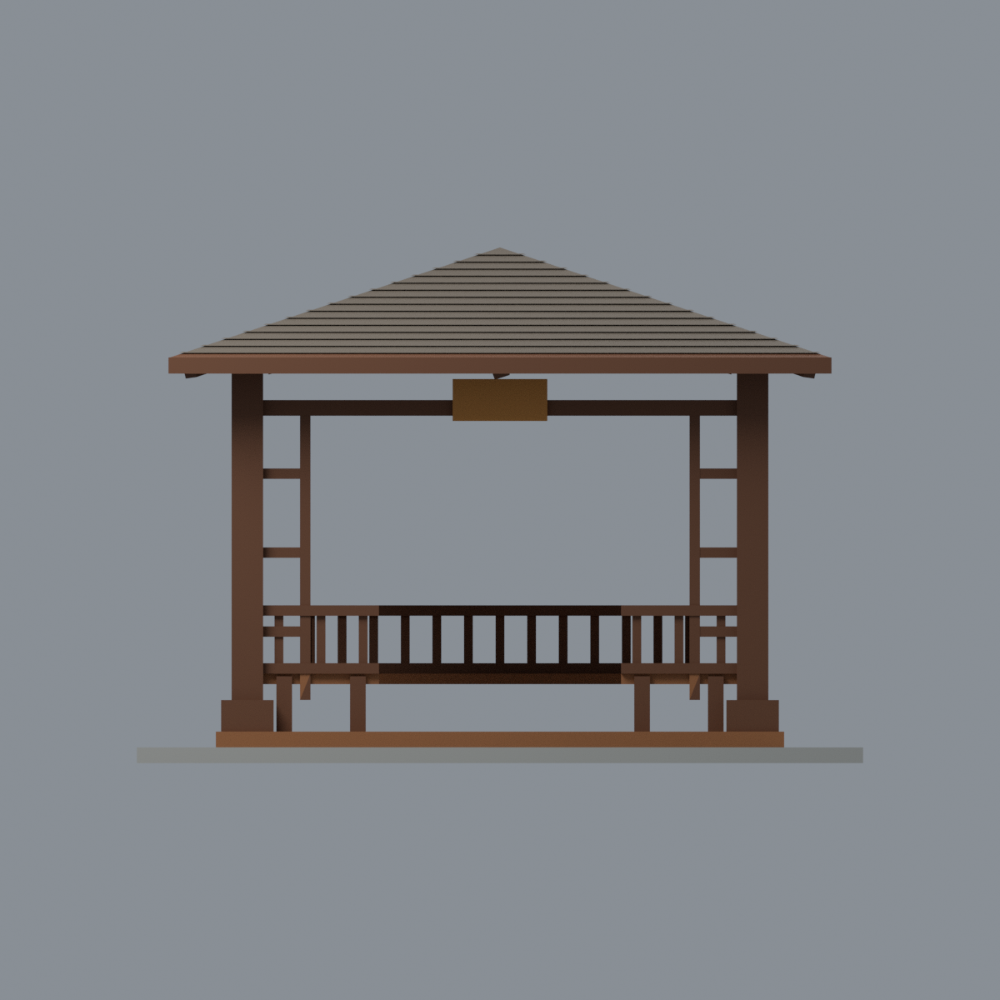
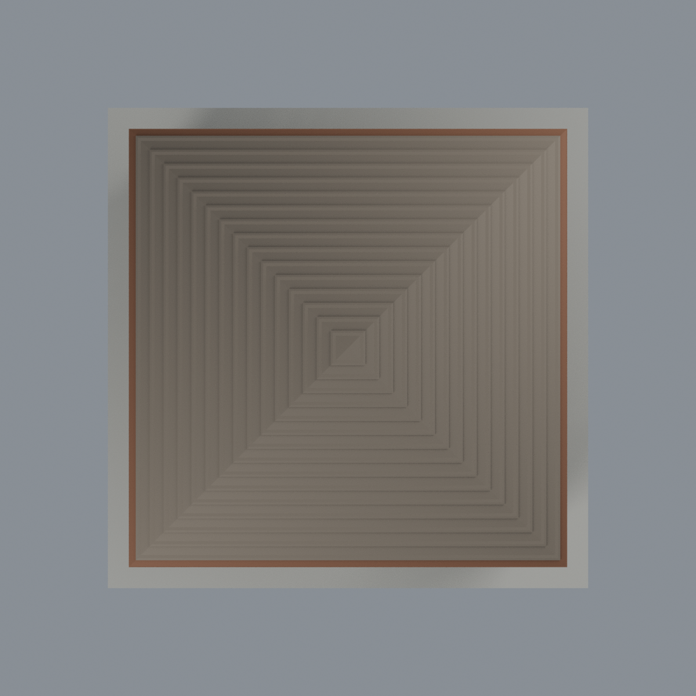
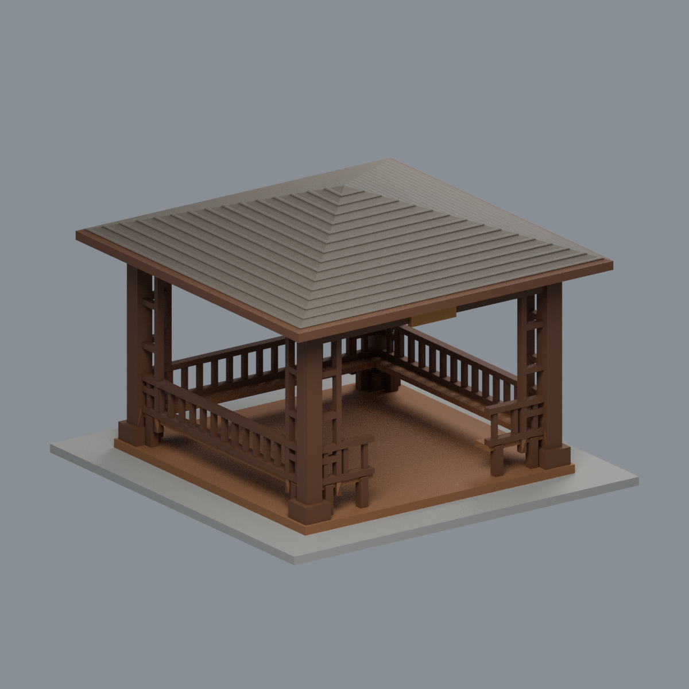

# 國立清華大學｜奕亭

## 模型預覽

| 模型預覽 | 模型預覽 | 模型預覽 |
| :---: | :---: | :---: |
|  |  |  |

依2010、2012、2013、2018歷史照片重建的完整簡化木亭；位於校本部南側奕園。不是整座奕園、不是南大校區，也不是2026現況測繪。

- [彩色可編輯 Blender](scene.blend)、[彩色3MF](model.3mf)、[單色STL](model.stl)
- [正面斜視](previews/front.png) · [背側推定面](previews/rear.png) · [正立面](previews/elevation.png) · [俯視](previews/top.png) · [左斜視](previews/left_oblique.png)
- [來源與推定界線](SOURCES.md) · [檢測與列印限制](QA.md)

| 模型預覽 | 模型預覽 | 模型預覽 |
| :---: | :---: | :---: |
| 背側推定面  | 正立面  | 俯視  |
| 左斜視  |  |  |

低四坡方屋頂、四角木柱、柱旁梯格、屋下屋架及側後長凳低欄。前方中央通道保持開放。後側欄格規律化為推定，沒有獨立後側全貌照片；不是修復級或全向實測複製品。

模型138×138×98 mm，屋頂126 mm、主柱外跨102 mm；只是比例化模型毫米，不對應已知實尺寸。灰色底板為人工連接展示底，不是測量鋪面。屋頂中央名義約3.2 mm垂直厚度（斜面與簷口不同）、低欄竿名義1.7 mm；不等於任何位置最小法向壁厚。

3MF/Blend各面配置五色展示材質；沒有宣稱多色擠出機映射。STL沒有顏色。Blend保留實際三角網格、可個別編輯材質，不附原始照片、文字腳本或外部貼圖。

## 重建
Python依 requirements.txt 安裝後執行 `python build_model.py`、`python qa_model.py`、`python check_features.py`。Blender：`blender -b -t 4 --python-exit-code 1 --python render_model.py`。交換測試 `verify_exchange.py` 需官方lib3mf Python binding，`BUILD_PYTHON` 可指定建模套件的Python。`verify_scene.py` 與 `verify_render.py` 以 Blender 同樣的 `--python-exit-code 1` 執行。所有預覽均來自同一交付網格，不是AI想像圖。

**沒有實際試印。** 屋簷、屋下斜撐、橫格、長凳都有懸空/橋接；請先用切片器選擇方向與支撐並檢查薄處，不能稱免支撐可印。歷史照片明暗差異與風化使材色只屬近似。
