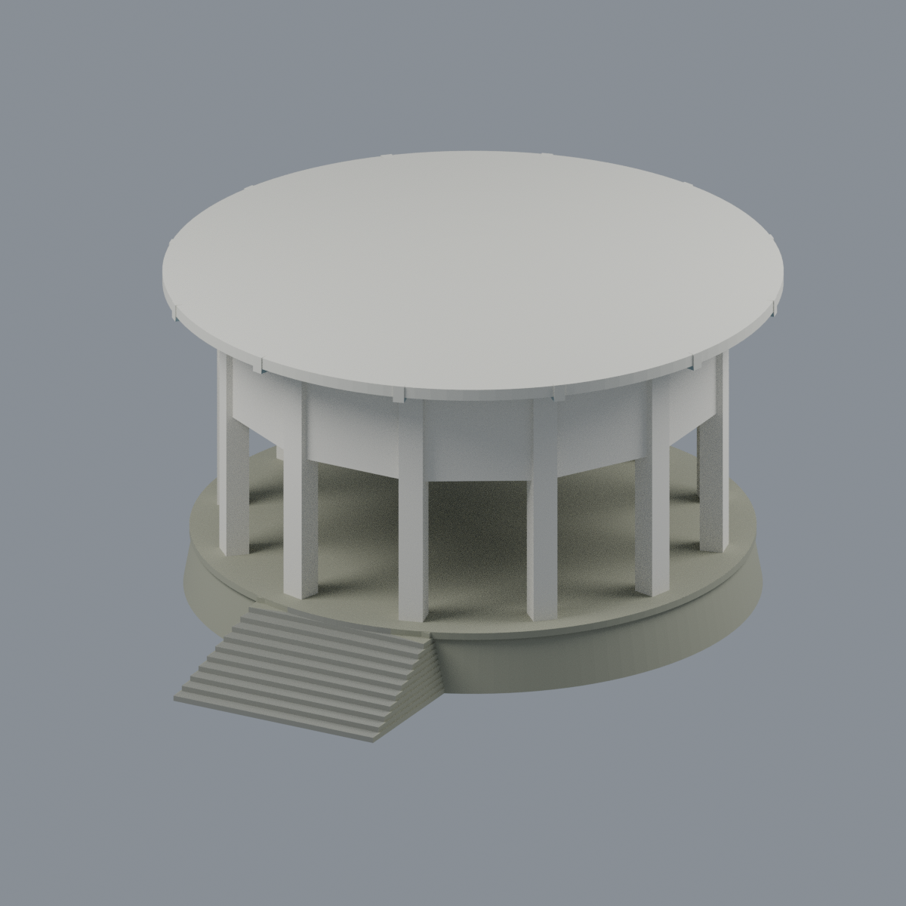

# 國立清華大學月涵亭

**2016 官方照片來源的全亭外觀近似模型，不是測繪復原，也不代表已核實的 2026 現況。**



- [可編輯彩色 Blender](scene.blend) · [彩色 3MF](model.3mf) · [單色 STL](model.stl)
- [正立面](previews/elevation.png) · [左前斜視](previews/left_oblique.png) · [推定背側](previews/rear.png) · [推定屋頂俯視](previews/top.png)
- [來源與建模界線](SOURCES.md) · [檢查及列印限制](QA.md) · [參數生成器](build_model.py)

## 建模範圍
以梅園月涵亭為單一完整建築物：圓形淺頂及挑簷、十二出口多邊內環、寬柱、深楣板、窄帶高窗、圓形地坪與前方簡化十一級階梯。並非梅亭、月涵堂或寄梅亭。官方書籍記載張昌華設計，1978 年 4 月 30 日完工。

模型尺寸 **120 × 140 × 67.6 mm**，是為觀察與製造檢查自訂的展示尺度，無實測比例。地坪以上至屋簷約 51 mm，柱寬約 4.8 mm。完整環圈依十二出口文字及內外照片規則重複；不是十二個立面各自實測。

前方外觀與相反方向室內照互補，**沒有建立背側外觀或空拍證據**。屋頂曲率、平緩中心帽、頂面細節、未見後側與規則柱距均屬近似。屋頂不是中式尖頂。薄高窗以 **1.6 mm 厚不透明藍灰背板**代替玻璃，這是保留視覺分區的列印適應，不具透明性，也不是實體原窗厚度。底下實心圓形地形座是人工展示支撐，不是原建築露明基座、地下結構或完整山坡。

不重建題字、詩文、校徽地坪、長椅、植栽、燈具及監視設備；不以假文字或校徽代替。顏色是近似展示材質，不是已設定的多噴頭切片。

## 使用
Blender 內是一個可直接編輯頂點及逐面材質的連通網格。以毫米為單位；材料面分組可另行編輯。3MF 保留逐面色彩；STL 沒有色彩。

```sh
python -m pip install -r requirements.txt
python build_model.py
python qa_model.py
PYTHONDONTWRITEBYTECODE=1 python check_features.py
blender -b --threads 6 --python-exit-code 1 --python render_model.py
```

3MF 交換測試另外需要 lib3mf；詳細證據見 `qa/`。CPU Cycles 48 samples；五張預覽皆來自交付模型，不是生成式建築照片。

**未實際列印；不宣稱免支撐。** 大面積淺屋頂下表面、十二道楣板及挑簷需先做切片支撐與方向評估。人工地形座較耗料，薄端點、階梯與翹曲風險不能只靠封閉網格判斷。
