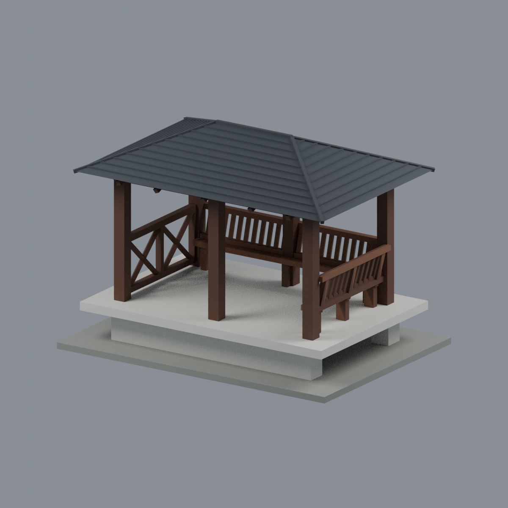
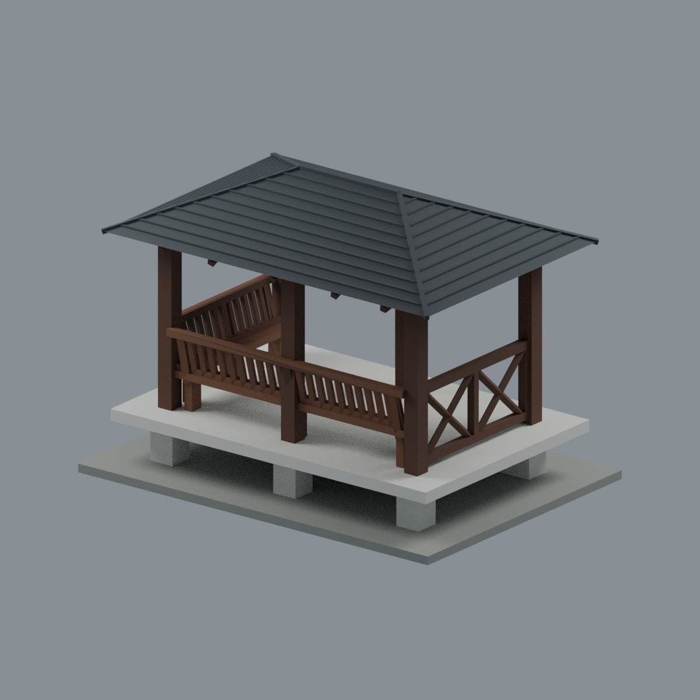
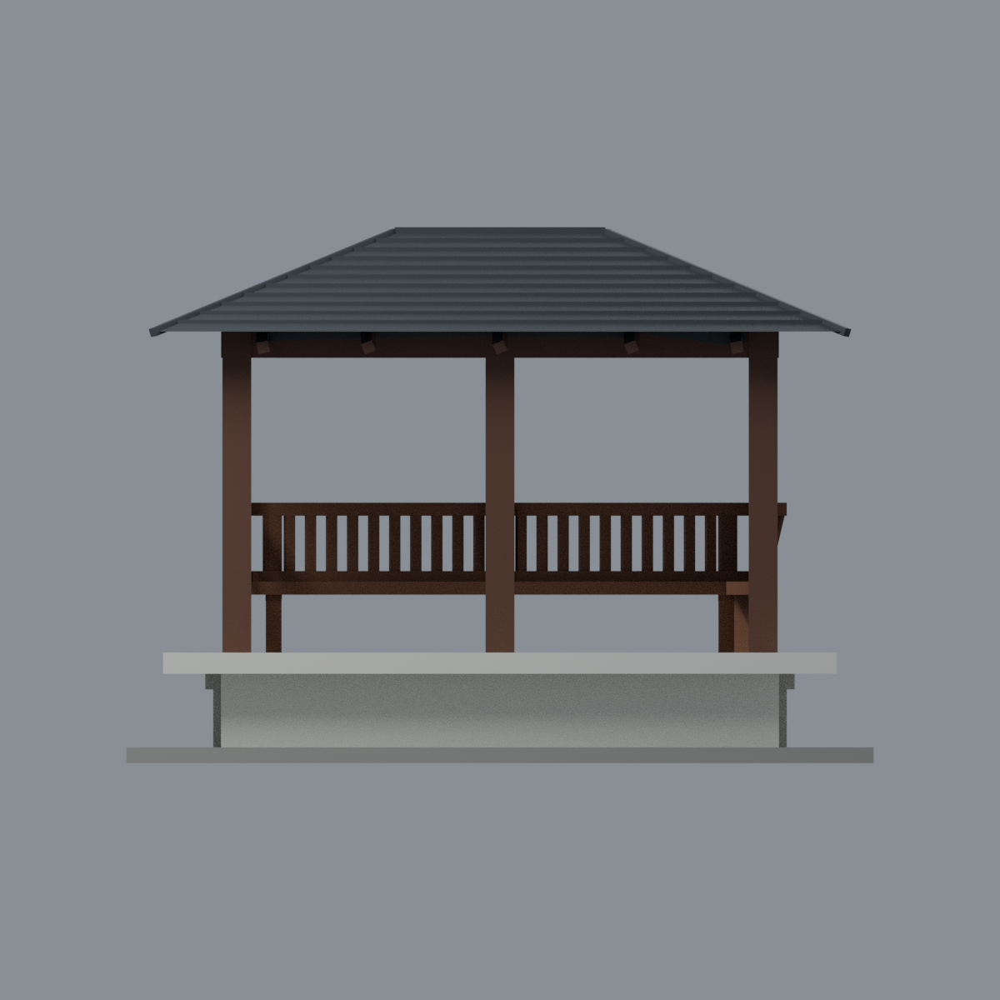
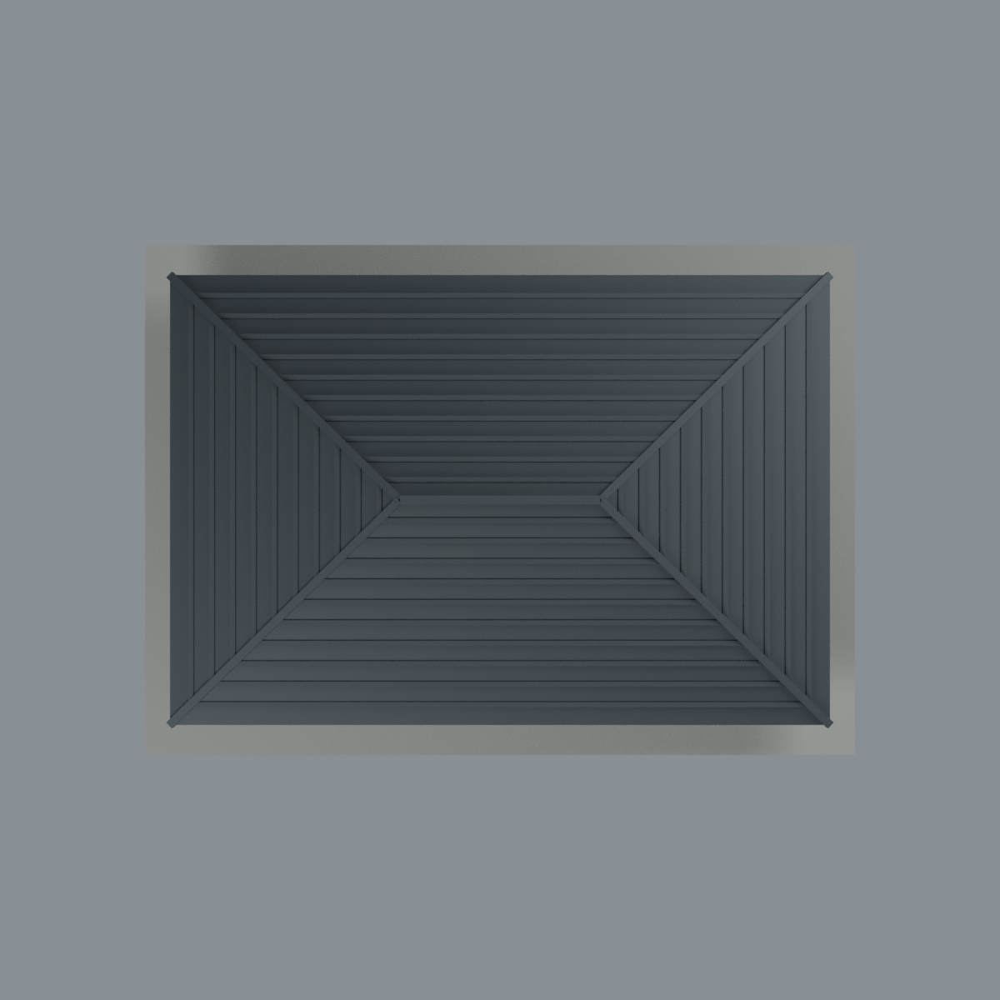
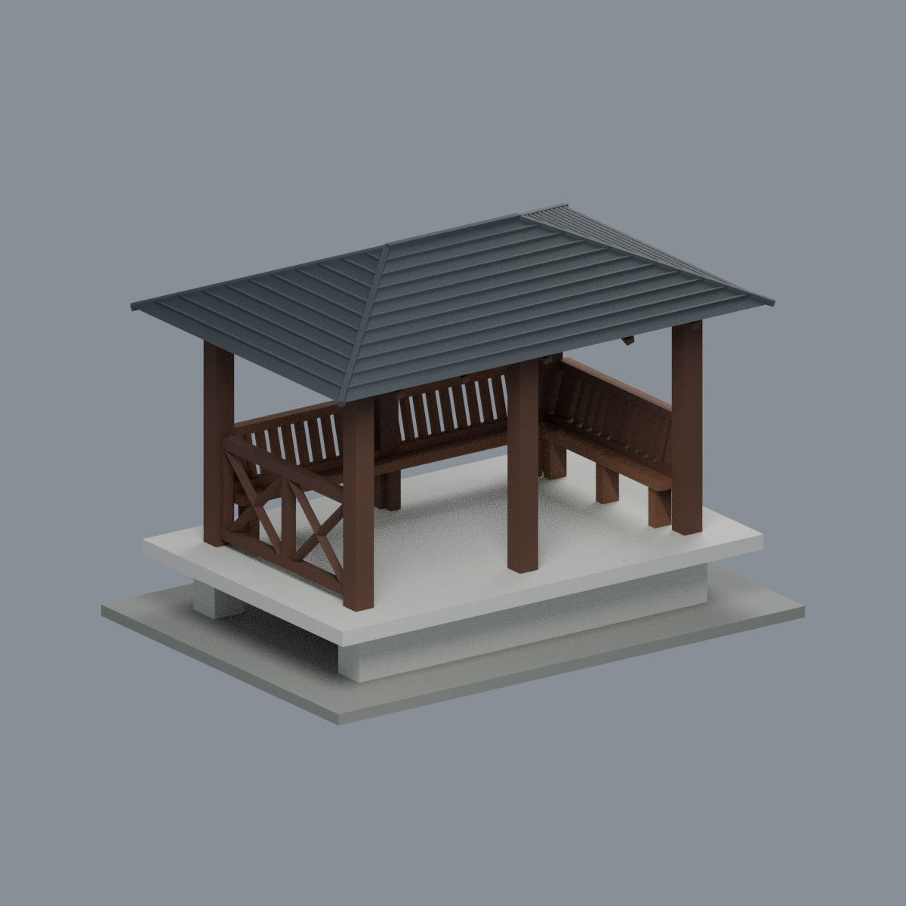

# 國立清華大學成功湖昱寧島涼亭

2023 實建外觀引導的完整簡化模型；不是 2022 山牆提案、舊西瓜亭或其他清華亭。尺寸為設計 mm，非實測比例。



| 陸側入口 | 湖側反向 | 正立面 | 俯視 | 側向 |
|---|---|---|---|---|
|  |  |  |  |  |

## 交付
- `scene.blend`：可編輯單網格與五種材質；`model.3mf`：逐三角面基礎色；`model.stl`：無色幾何。
- `build_model.py`、`render_model.py` 與驗證程式可重建；`mesh.json`、`palette.json` 保留明確幾何與配色。
- 四坡短脊、六柱兩跨、湖側三墩白平台、L 形斜背椅、對端斜紋欄，陸側入口開放。隱藏支撐與欄瓦數量簡化。
- [來源與限制](SOURCES.md)、[原始品質檢查與列印風險](QA.md)。來源照片不公開散布；未虛構銘牌文字。

## 重建
```sh
python -m pip install -r requirements.txt
python build_model.py
python qa_model.py
python check_features.py
blender -b -t 4 --python-exit-code 1 --python render_model.py
blender -b -t 4 --python-exit-code 1 --python verify_scene.py
blender -b -t 4 --python-exit-code 1 --python verify_render.py
```
`verify_exchange.py` 另需 lib3mf Python SDK，並以 `BUILD_PYTHON` 指定有 manifold3d 的解譯器。彩色材質不是印表機擠出頭對應；STL 不支援顏色。

**未實際試印，也不保證免支撐。** 屋頂下緣、懸挑平台、座椅及欄件需切片支撐與方向規劃。灰色連接底和陸側隱藏基礎是明示人工近似，不是水岸地形。
