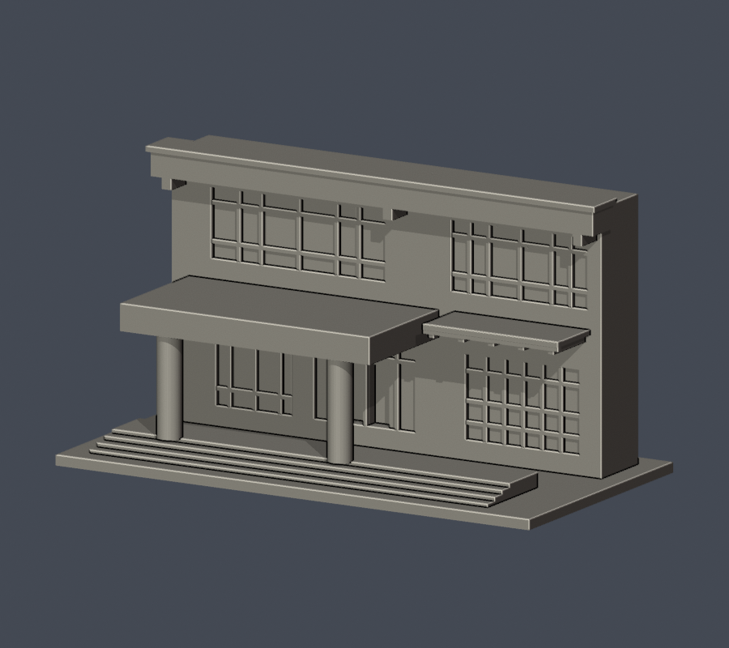
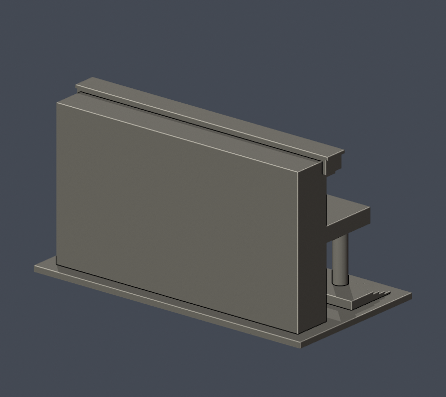
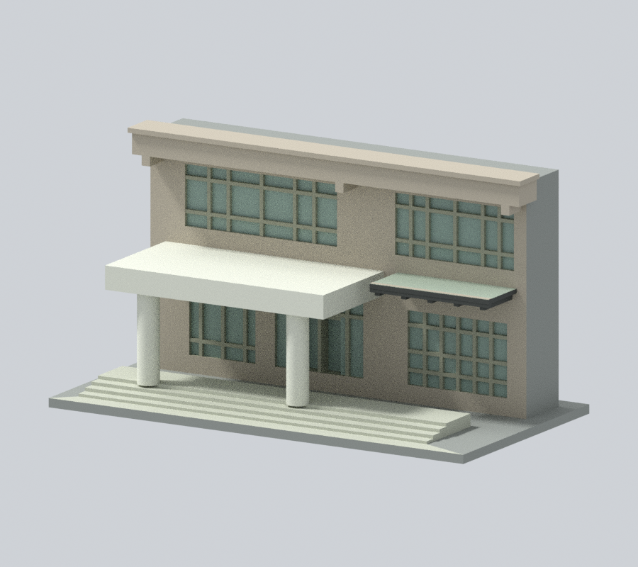
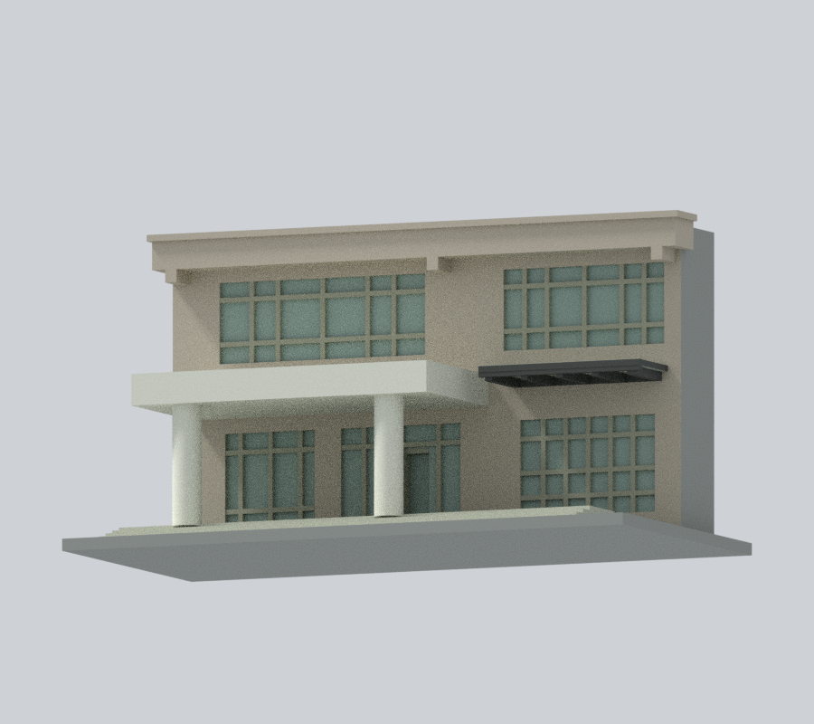
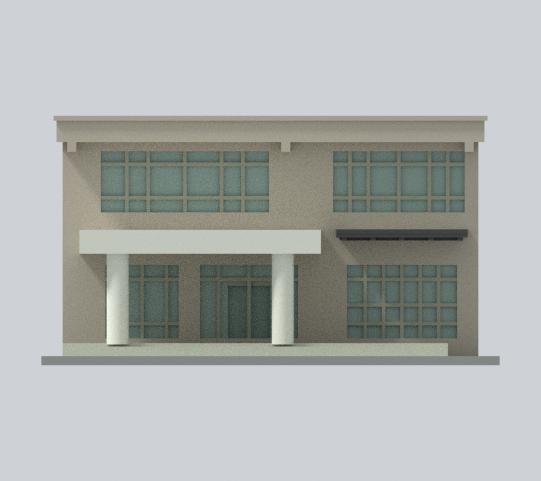
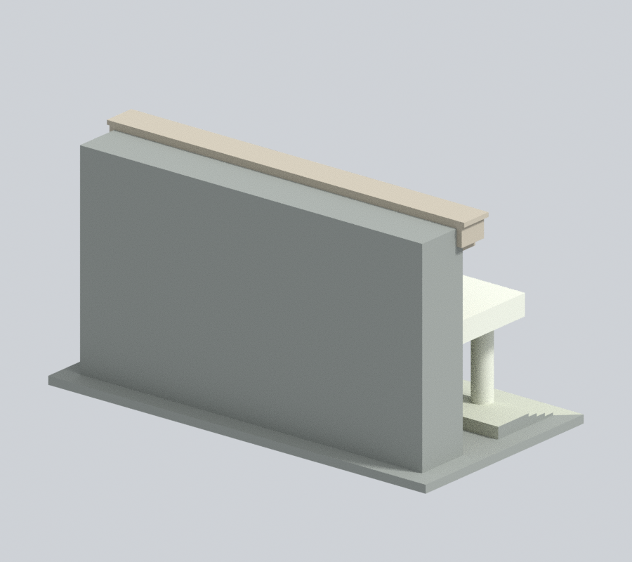
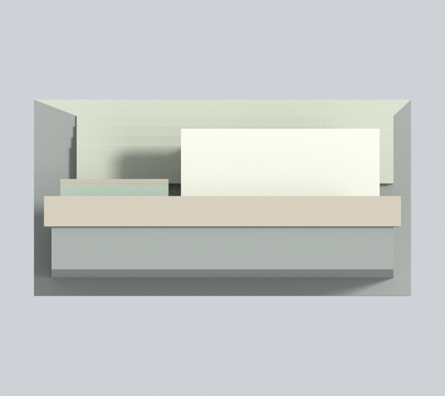
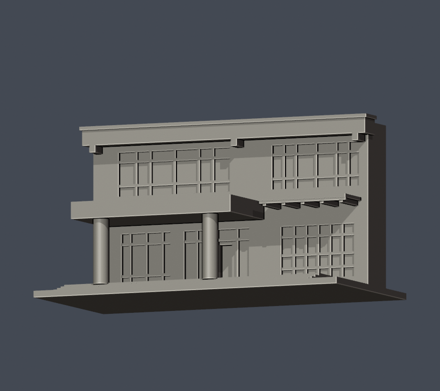
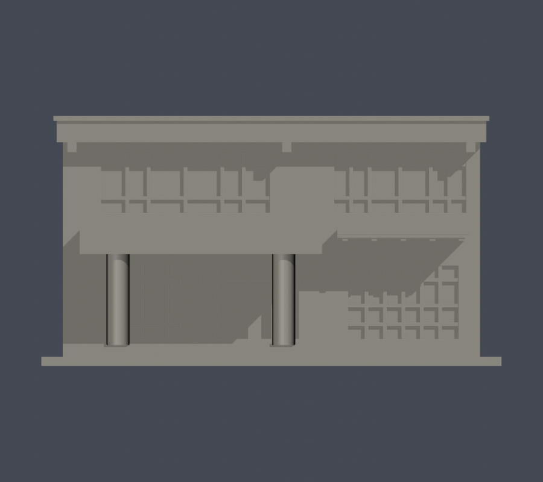
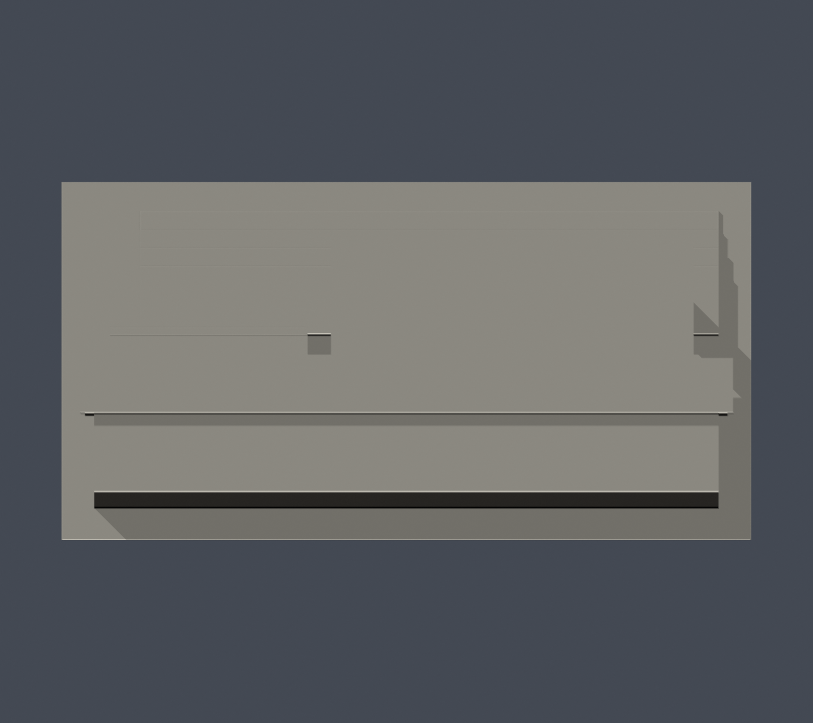

# 國立澎湖科技大學｜實驗大樓入口門廊暨前兩層立面段

## 模型預覽

| 模型預覽 | 模型預覽 | 模型預覽 |
| :---: | :---: | :---: |
| 正面<br> | 背面<br> |  |

### 新增照片近似彩色外觀

**原單色圖與原幾何全部保留**；下列彩圖另存，不替換首頁／學校的鎖定代表圖。依官方近景配色：淡米灰磁磚牆、近白門廊與兩圓柱、淡綠灰窗、偏暖銀灰框、深灰雨棚框。未知人工截斷側／背／頂面及平底座中性灰；沒有補造原模型省略的藍字、牌匾或細磁磚縫。

| 新彩色斜前 | 新彩色同來源低視角 | 新彩色正面 |
| :---: | :---: | :---: |
|  |  |  |
| 新彩色背面（人工終止面） | 新彩色上視（非全館屋頂） | 彩色下載 |
|  |  | [彩色 3MF](appearance.3mf) · [彩色 Blender](appearance.blend) |

[配色來源、限制與重建](APPEARANCE.md)。原 STL 不承載色彩；原 `scene.blend` 與五張原預覽未改，請另開 `appearance.blend` 或支援 3MF 材質的軟體查看新增配色。

**局部外觀模型，不是全館、不是整棟兩層樓。** 範圍僅入口兩圓柱深門廊、後方前兩層玻璃立面、右側雨棚及上方大挑梁。廣場照片另見更高退縮窗帶、山牆與斜屋頂；本件全部排除。背面 y=20 mm、左右及上邊界是人工截斷，不能讀成真實背立面或屋頂。


[STL](model.stl) · [可編輯Blender網格](scene.blend) · [同來源低視角](previews/source-angle.png) · [正立面](previews/elevation.png) · [頂視](previews/top.png)

| 模型預覽 | 模型預覽 | 模型預覽 |
| :---: | :---: | :---: |
| 同來源低視角<br> | 正立面<br> | 頂視<br> |

## 來源與建模範圍
- 官方門口近照與1F平面入口前緣兩個圓形柱位交叉核對，做2支主要圓柱；細門窗梃不計主柱。
- 上層2組大玻璃保留中寬側窄的分組；下層分成左玻璃、中央門與右玻璃3組。細分格加粗簡化，不聲稱每條原始窗梃的施工尺寸一致。
- 大型混凝土門廊頂板向前伸，兩柱間與後牆之間是真正開放空隙，不用淺凹面假裝深門廊。中央門洞比相鄰玻璃再向內退。
- 右側輕型雨棚保留挑出深度與下方支承梁；其外觀依拍攝日未知的官方照片，未確認2022整修後尺寸或狀態。小燈具、欄杆、校名字牌、植栽、冷氣與磁磚小縫省略。
- 上方大挑梁後方尚有高層，不能依低角度近照把挑梁當成整棟屋簷。此模型在挑梁處截斷，沒有虛構山牆或完整屋面。
- B1–5F六頁圖均核閱；左曲翼、右前翼、後側教室和5F退縮不同。後側照片下層被樹遮，不能把可見窗列規律填入未知側。
- 導覽頁2018-09-06更新，但照片拍攝日不詳。2022-09-15官方會議記載4/5F屋頂防水工程施工中；未以舊照冒充修後全館現況。

## 尺寸與列印
150 × 78 × 81.6 mm，含底座，單位毫米；各模型独立比例。進深與各部尺寸由照片估計並為列印連接加粗，不是測繪。底座朝下；門廊水平頂板、雨棚、挑梁及門窗上緣需在切片器檢查支撐／橋接。底座與柱、牆及各頂板有實體交疊，不靠零厚接點。

數位QA不等同實體試印、Cura／Prusa工具路徑或最小壁厚保證，不宣稱免支撐。

## 重建
Python 3.12與requirements.txt；Blender 4.3.2。自建基本體和布林運算，未下載第三方mesh。scene.blend為交付STL匯入後的可編修網格；所有PNG直接從交付STL渲染。

```sh
python build_model.py
blender -b -t 4 -P render_preview.py
python validate_model.py
python check_contour_validity.py
python check_thin_features.py
python check_recess_rays.py
```

## QA
- [validation.json](validation.json)：原STL法向與繞序、每邊兩面、頂點link單環、水密、正體積、單一表面殼、最大150 mm、獨立重建SHA與Blend幾何一致。
- [逐層輪廓](contour-validity-check.json)：z=0.071 mm起每0.2 mm，408層degree2閉合、每個及合成Polygon皆valid，invalid直接失敗。
- [薄件opening](thin-feature-check.json)：相同408層，以0.8 mm參考寬度篩查，最大面積損失0.0466%，無一層超過1%；不是全面壁厚證明。
- [13項原STL射線](recess-ray-check.json)：實際門廊空隙、兩柱、中央門再退縮、上層玻璃、右雨棚、挑梁高差與人工背截面。
- [範圍／特徵核对](scope-feature-check.json) · [來源](sources.json) · [方法及限制](QA.md)
