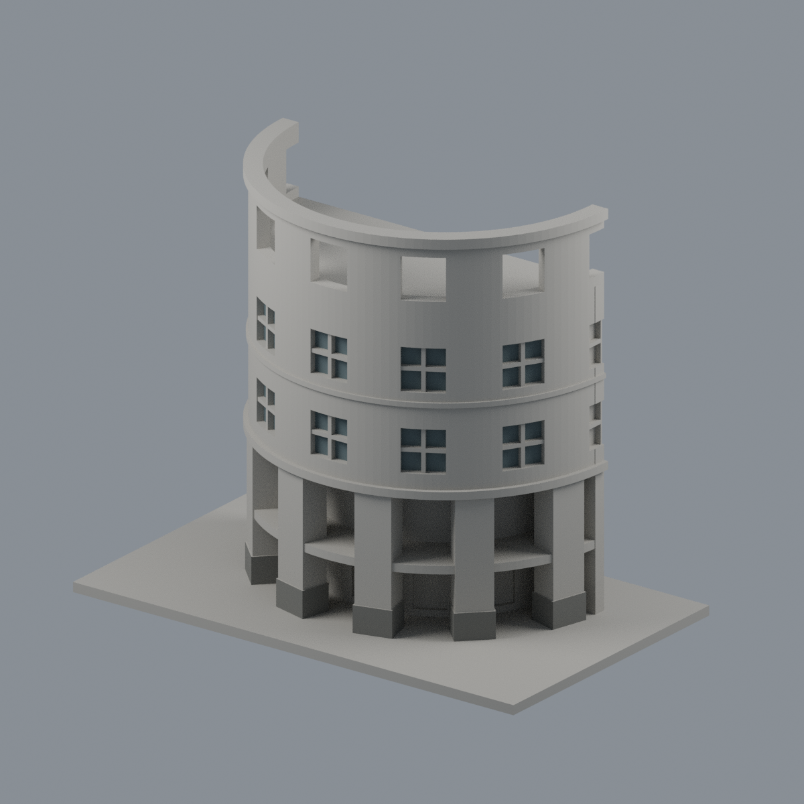
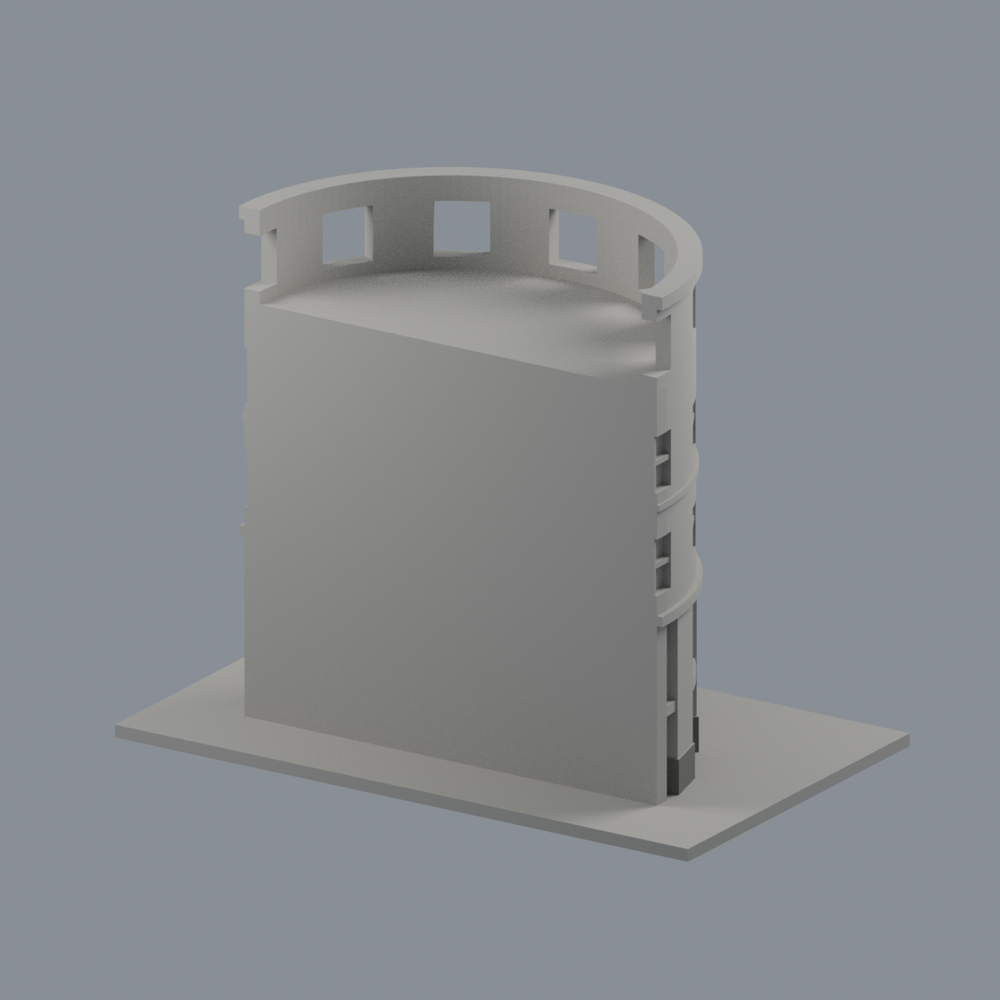
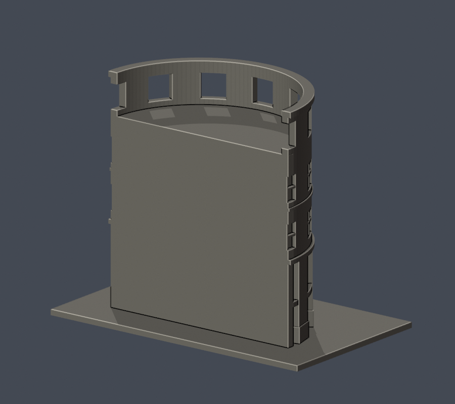
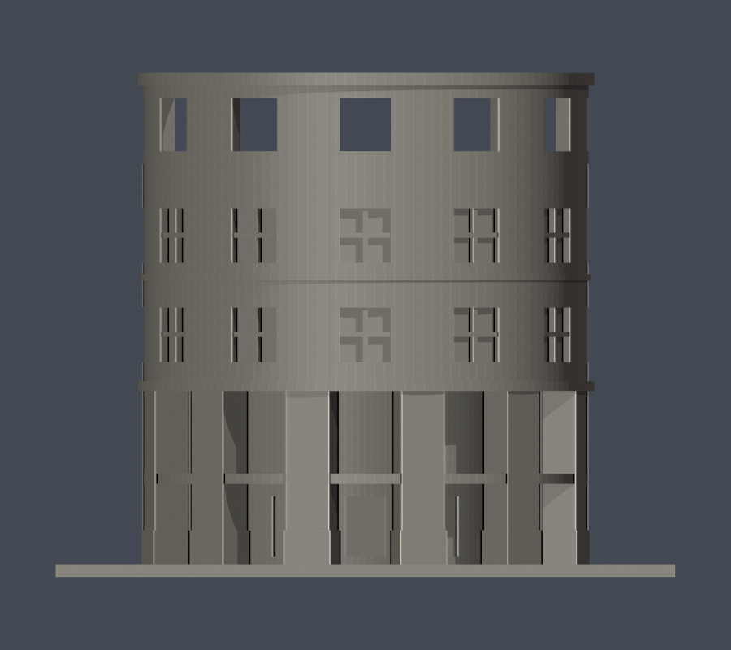

# 國立澎湖科技大學｜圖書資訊大樓圓弧入口前段

## 模型預覽

| 模型預覽 | 模型預覽 | 模型預覽 |
| :---: | :---: | :---: |
| 前段有限配色<br> | 人為截斷背面維持中性<br> |  |

## 圓弧入口前段有限配色（2026-10-22）

[配色五視角、來源與限制](appearance/README.md) · [表面色3MF](appearance/npu-library-rotunda-front-appearance.3mf) · [可編輯Blender](appearance/scene.blend)


僅五完整窗位×兩列的80個窗背原面，以及六個既有柱腳外側36面配色。原幾何未分出實景藍綠遮棚，連續簷線保持中性、不整圈染色；其餘4806面中性。局部身份、4922原三角面、全部STL bytes與歷史QA不變，不增套數，不擴成全館。官方照片拍攝日期未知，不代表2026現況。3MF是單網格表面色、不是分色封閉實體或切片G-code；支撐與橋接限制保留，未實體試印。官方照片不再散布。


**局部模型，不是全館。** 本件僅涵蓋向校內廣場突出的圓弧入口前段，後侧主館、樓梯塔、兩翼、連通廊道均不在範圍。背面 y=0 mm 為人為截斷素面，不是真實背立面。攝影日期未知的官方導覽照片、樓層配置圖與2026會議附件共同支持外觀；不宣稱2026全館最新現況或工程測繪。

| 模型預覽 | 模型預覽 | 模型預覽 |
| :---: | :---: | :---: |
| 正面<br> | 背面<br> |  |

[正立面](previews/elevation.png) · [頂視](previews/top.png) · [STL](model.stl) · [可編輯Blender網格](scene.blend)

| 模型預覽 | 模型預覽 | 模型預覽 |
| :---: | :---: | :---: |
| 正立面<br> | 頂視<br> |  |

## 依據與取捨
- 兩列玻璃窗以凹窗加加粗十字框表現，前弧每列7個窗位（5個完整窗＋直徑截面左右端各半窗，不是7個完整窗），最上列是全深開口，未填成玻璃或淺凹框。
- 官方四樓平面列示整圈12柱分布，前半6支大柱與上下兩層柱廊保留。門窗細框不算主柱。
- 圓弧柱廊向內退約17 mm；這是依照片比例估算的模型深度，並非真實丈量。
- 冠環高於內側屋面；屋面高程、退縮與厚度是依照片的近似估计，非有尺寸的工程圖。保留頂部開放空間，沒有捏造通至地面的內院。後側截斷面不加未知窗組。
- 2026-02-26校園規劃會議核准後側塔樓基地台看板／棚架方案，未取得竣工證據，且該塔不在本局部範圍。未將方案當成完工現況。
- 英文字、磁磚小縫、雨管、植栽及過細欄杆省略。窗框加粗至1.2 mm、實際牆體連接加深，避免零厚接觸。

## 列印
尺寸150 × 90 × 122 mm，含3 mm底座；毫米為單位，底座朝下。各建物獨立比例。模型有柱廊、水平門窗上緣和冠環開口，需自行於切片器確認支撐與橋接；建議先試切片局部。數位幾何檢查不是實體試印或Cura／Prusa工具路徑驗證，不保證免支撐或任意印表機都可印。

## 自主重建及檢查
Python 3.12，依 requirements.txt 安裝後執行：

```sh
python build_model.py
blender -b -t 4 -P render_preview.py
python validate_model.py
python check_contour_validity.py
python check_thin_features.py
python check_recess_rays.py
```

參數腳本自建基本體並以Manifold布林結合，未下載第三方模型。scene.blend為交付STL匯入的可編修網格；圖片亦直接由該STL渲染。Blender驗證版本4.3.2。

## QA
- [validation.json](validation.json)：原始STL法向、面繞序、非退化、每邊2面、vertex-link單環、水密、單一表面殼、正體積、150 mm上限、獨立重建SHA、Blend／STL幾何一致。
- [contour-validity-check.json](contour-validity-check.json)：從z=0.071 mm以0.2 mm逐層，610層節點degree2、閉合、每個Polygon和合成Polygon皆valid；invalid直接失敗，未修補。
- [thin-feature-check.json](thin-feature-check.json)：同樣610層以0.8 mm参考寬度opening篩查，最高面積損失0.2459%，無一層超過1%。此項不是全面最小壁厚或噴嘴路徑分析。
- [recess-ray-check.json](recess-ray-check.json)：9項原STL射線驗證柱廊退深、兩排凹窗、冠環透空、屋面與冠環高差、截斷背面。
- [QA方法](QA.md) · [來源](sources.json)。原始參考影像未再散布。

[窗柱同範圍計數](scope-count-check.json)：12全圓柱位只取前6柱，兩窗列每列5整窗＋2半窗，冠環相同；不把整圓數塞到半圓。
