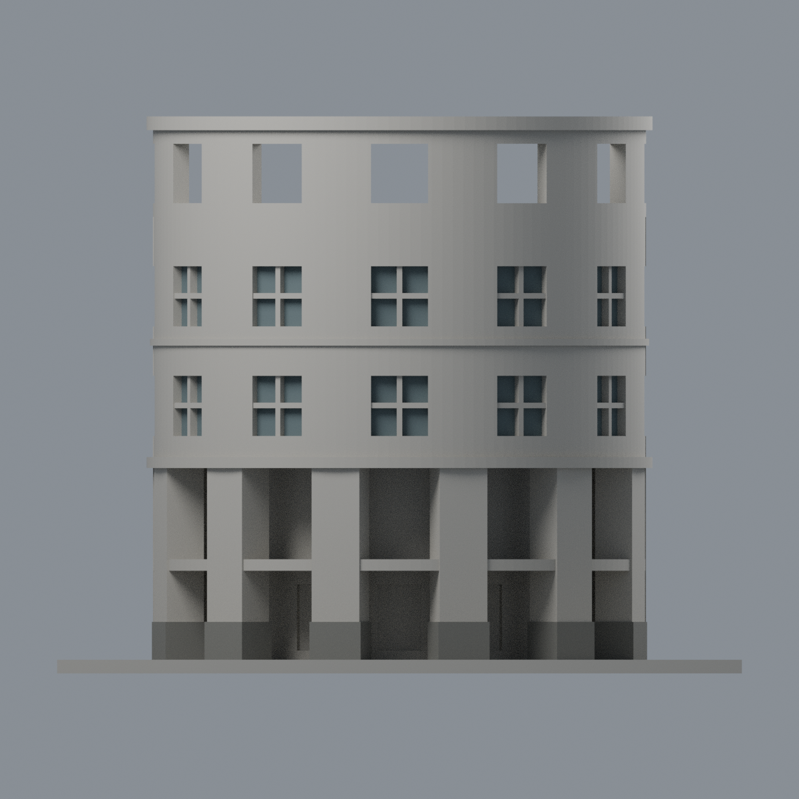
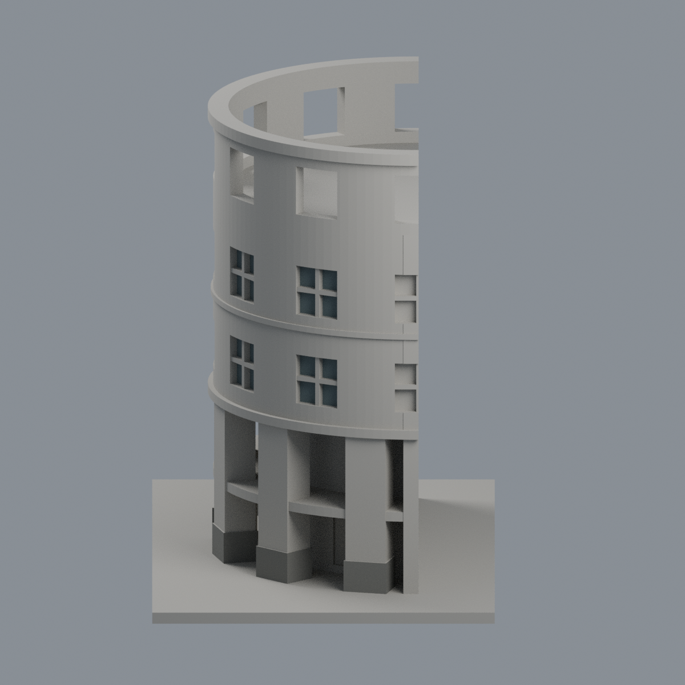

# 國立澎湖科技大學｜圖書資訊大樓圓弧入口前段有限配色

**既有局部模型，不是全館。** 同一模型的附加外觀層，不增加套數、不改首頁固定代表。150 × 90 × 122 mm；4922原三角面及面序、座標和原STL bytes不變。後塔、兩翼、樓梯塔、連通廊道不在本件範圍，y=0為人為截斷面而非真實背立面。

[表面色3MF](npu-library-rotunda-front-appearance.3mf) · [可編輯Blender](scene.blend) · [逐面表](face-materials.json) · [色表](palette.json) · [來源](SOURCES.md)

## 最小有據配色
- 五個完整窗位 × 兩列，只選凹入窗背共80個完整原面，低飽和灰藍為玻璃展示代理；照片內含窗簾、不同反射與細框，不表示精確室內、窗簾或透明玻璃。左右端半窗保留中性。
- 六個原本已加大的柱腳，只選外向與兩側的垂直原面共36面，中灰；排除內向面、頂部平台、底面與上柱，不以任意高度切面。
- 其餘4806面保留中性：原十字框與外皮未另推定精確材質。中性是未確證代理，不表示實景同色。
- **藍綠遮棚HOLD**：照片有柱間分段遮棚，但原幾何是連續樓板／簷線，未具分段及下斜邊界。故不切面、不整圈亂染。冠環頂排透空，不塗成玻璃；退縮低廊無真實門框，不當整面玻璃。
- 全部判界要求三頂點同在既有邊界；不使用重心色帶、不改幾何、不加照片貼圖或不存在細節。

## 五個實際網格視角
相機名稱不是地理方位；均由交付3MF與逐面材質渲染，非AI效果圖。

| 前斜視 | 後斜視 | 正立面 |
|---|---|---|
|  |  |  |

| 側視 | 頂視 |
|---|---|
|  |  |

## 可攜重建
將原model.stl置於appearance上層，依source/requirements.txt安裝依賴，Blender 4.3.2：

```
python appearance/source/build_appearance.py
python appearance/source/verify_exchange.py
python appearance/source/verify_material_boundaries.py
blender -b -t 4 --python-exit-code 1 -P appearance/source/render_appearance.py
blender -b -t 4 --python-exit-code 1 -P appearance/source/verify_scene.py
```

lib3mf strict零警告並實際改單色、存檔重開；Blender實際改材質、存檔重開，核其他材質與原幾何不變。SDK另存六位小數的誤差於QA明載，該測試暫存檔不交付。乾淨重建3MF／色表／逐面表／五PNG須byte一致，Blend只核語義一致，不宣稱二進位確定性。

## 原製造及史料限制
官方照片拍攝日期未知，頁面異動日期不是拍攝日，不宣稱2026現況。原模型尺寸、比例、退深17 mm、屋面高程及厚度皆近似估算，頂環與窗框為列印加粗代理，未做工程測繪。原610層閉合／多邊形有效性、0.8mm開運算薄篩及凹入射線QA歷史證據保留；本次僅配色，不重算製造QA。

底座朝下，柱廊、水平門窗上緣及冠環開口可能需支撐／橋接，先試切片局部。3MF僅單網格表面色，不是分色封閉實體、噴頭映射、切片工程或G-code。FFF GUI、材料路徑、支撐移除及實體試印未測，不保證免支撐或任意機器可印。

[逐檔雜湊](SHA256SUMS) · [權利說明](LICENSE-NOTICE.md)

原STL SHA256：e0ea088d1f0731101ec94be59c75105435bcfb5ba3c80fc0429eec612dbc6b3e
