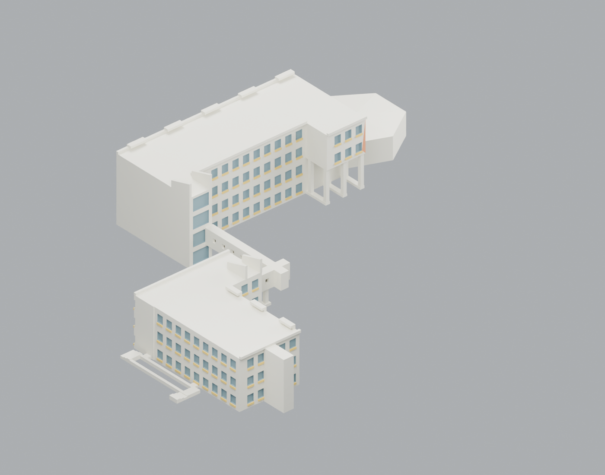
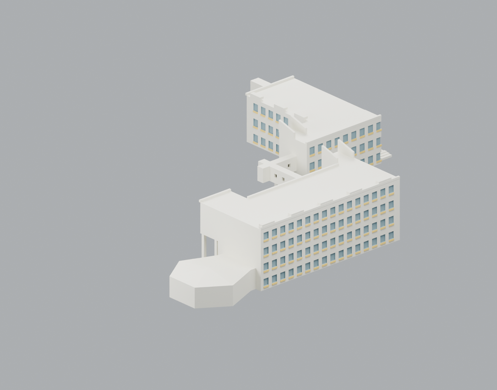
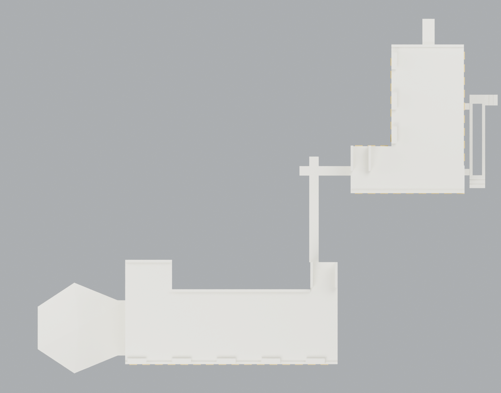
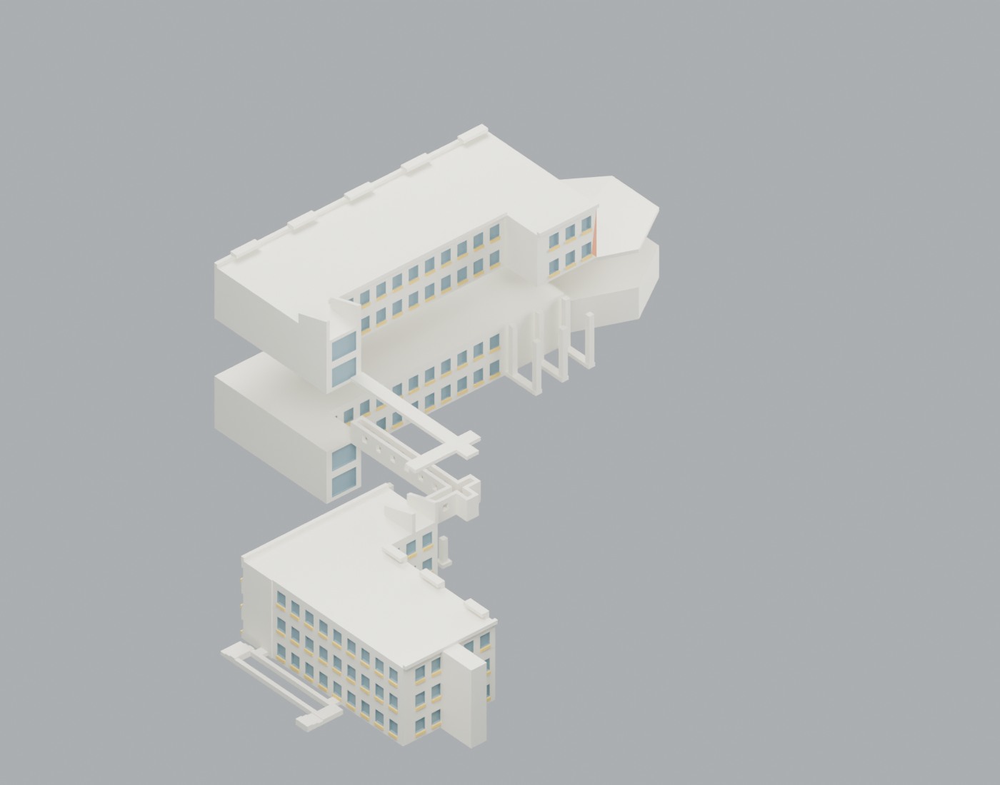

# 國立澎湖科技大學｜海洋科技大樓南北棟與二樓連廊

外觀研究／拆件列印候選。北棟4F、南棟3F、轉折二樓架空連廊與北端單層國際會議廳合為一包；這是有估計與製造簡化的外觀模型，未實印或試合。來源、幾何、裝配與檔案條件 GO；有界切片補核已完成，未取得無支撐實體製造放行。

| 背向 | 俯視 | 拆件 |
|---|---|---|
|  |  |  |

北棟入口上方3/4F突出翼保留下方兩層通空和六根模型柱；橋底9mm通空、不加整片院地底板。會議廳只有低主體和估計坡頂，沒有2/3F房間，4F不延伸。南側S1附屬只做低入口平台／回折坡道足跡／兩短階，沒有猜作通往2F的外梯。

組裝外框約216.60 × 167.20 × 43.00 mm；北棟主條100mm為圖面正規化基準，無完整尺寸鏈，未聲稱實測或固定真實比例。Blender 1 BU=1mm，scale_length=0.001 m/BU；[單位證據](qa/scene-unit-report.json)。8種實印STL、10片實物（柱件同檔印3次），另有只供檢查的組裝參考STL。

| 檔案 | 用途／印向 |
|---|---|
| [01北棟下體](models/01-north-lower.stl) | 正立；含單層會議廳外殼及入口柱 |
| [02北棟上體](models/02-north-upper.stl) | 正立，擴展足跡平貼床；裝回z18mm |
| [03南棟](models/03-south-body.stl) | 正立 |
| [04會議廳屋頂](models/04-hall-roof.stl) | 平底朝下，裝回z11mm |
| [05橋槽](models/05-bridge-tray.stl) | 開口朝上，平底朝下，裝回z9mm |
| [06橋蓋](models/06-bridge-lid.stl) | 平放，裝回z16.3mm |
| [07橋柱](models/07-bridge-pier.stl) | 正立×3；附著需brim條件 |
| [08南側低入口](models/08-south-low-access.stl) | 平底朝下；高程估計示意 |

[可編輯場景](scene.blend) · [原創生成碼](source/build_model.py) · [渲染碼](source/build_scene.py) · [完整裝配矩陣](assembly.json) · [來源](sources.json) · [來源／模型對照](qa/source-correspondence.md) · [估計界線](ESTIMATES.md) · [製造與裝配](MANUFACTURING.md) · [發布接續](INTEGRATION-NOTES.md)

米白外牆、灰藍窗、赭黃欄帶、橘紅入口色區依照片近似，場景材質與[可編輯色區](source/color-regions.json)保留。STL本身無色；四色預覽沒有驗證未決的四獨立噴頭機，也不代表四色可列印。診斷G-code僅留私人完整證據，不隨公開包配送；保留其SHA、實切紀錄與重切程式，不能直接送真機。

[製造QA](qa/MANUFACTURING_QA.md)涵蓋8,428三角形的全量自交／接觸、4,200頂點link、45裝配配對、622零件截面、9組裝配截面及9項算法控制。[實切片證據](qa/final_slice_evidence.json)逐件綁定最終STL；柱件補測3mm brim。原失敗、薄端截面、短懸挑與單一射線漏擊旗標仍保留，這是有條件候選；切片成功不能代替實印與試合。[完整性報告](qa/package-integrity.json)與[精確資產SHA](SHA256SUMS)供獨立複查。另見[獨立整合覆核](qa/independent-review/README.md)，保留三筆極小數值重疊、薄尖端、長屋緣／短眉簷缺承托與原始失敗。

來源原PDF與照片像素不含於此包。照片拍攝日未定；2018校圖是歷史配置，不能聲稱2026現況。室內家具、機電、未知翼與地下層、未知屋面設備、無法由光電文字推知的板數排列皆不建模。
