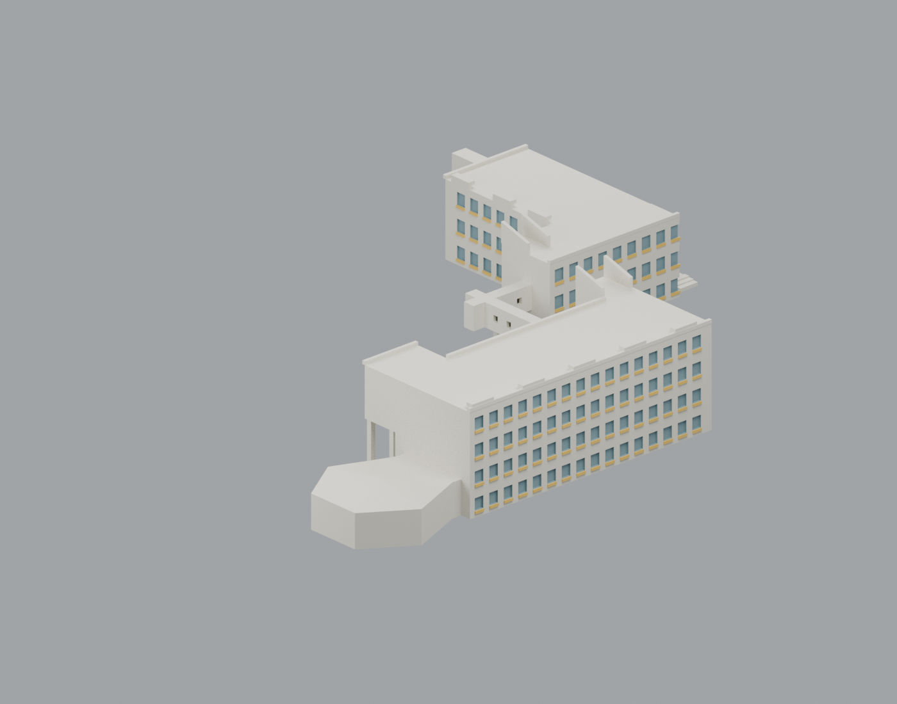
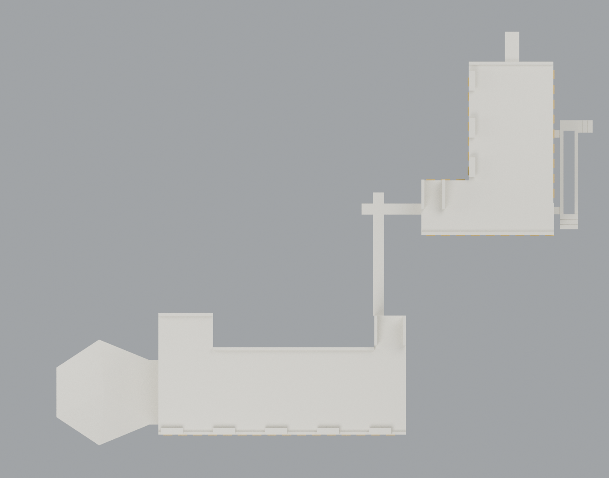
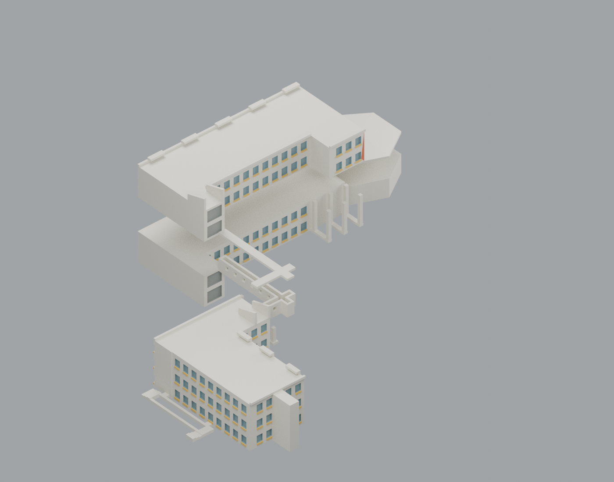

# 海科南北棟｜可編輯彩色外觀 3MF

此增量沿用已發布的 8 類 STL、10 件裝配與全部既有幾何。新增 5 個可編輯外觀材質：米白牆、藍灰一般窗、灰色梯塔玻璃、黃欄帶、橘紅入口。顏色數沒有四噴頭上限；照片近似也不是經校色取得的真實漆色。

| 模型預覽 | 模型預覽 | 模型預覽 |
| :---: | :---: | :---: |
|  |  |  |

| 背向 | 俯視 | 分件示意 |
|---|---|---|
|  |  |  |

## 選擇檔案

- [組裝外觀母版 3MF](npu-appearance-ASSEMBLED.3mf)：8 個閉合網格資源、10 個零件實例及原裝配矩陣；一個組裝群組，可在支援的編輯器中拆開。**這是組裝展示，不是排床，不可把整座直接列印。**
- [五材質 Blender 場景](scene.blend)：10 個可選零件、5 個獨立材質槽，無照片材質或外部圖片依賴。
- [調色盤](palette.json)：sRGB 值與觀察依據；[逐面材質索引](face-materials.json)可重建或逐面修改。
- 各零件 3MF 保持原 STL 的正立／平底印向，沒有機型或切片設定。柱件仍需製作 3 份。原[製造條件](../MANUFACTURING.md)及[切片限制](../qa/independent-review/README.md)繼續有效。

| 零件 3MF | 數量 |
|---|---|
| [01 北棟下體](parts/01-north-lower.3mf) | 1 |
| [02 北棟上體](parts/02-north-upper.3mf) | 1 |
| [03 南棟](parts/03-south-body.3mf) | 1 |
| [04 會議廳屋頂](parts/04-hall-roof.3mf) | 1 |
| [05 橋槽](parts/05-bridge-tray.3mf) | 1 |
| [06 橋蓋](parts/06-bridge-lid.3mf) | 1 |
| [07 橋柱](parts/07-bridge-pier.3mf) | 3 |
| [08 南側低入口](parts/08-south-low-access.3mf) | 1 |

## 顏色與幾何的界線

原始 431 個表面選區完整沿用，只將原本共用灰藍色的北棟梯塔玻璃另外保留為灰色身份；不增加房間、窗框、屋面設備或新網格。一般窗的藍色包含窗簾與反射影響，梯塔玻璃則呈較中性灰色，不能據此判定不同實體玻璃配方。未見屋面、接合面沿用米白預設，不宣稱查明其實際塗層。原模型沒有表達的凹口與色帶不以大面積猜補。室內照片僅核對用途，未把室內藝術裝飾加到外牆。

這些是完整閉合零件上的**表面材質**，不是每一顏色各自閉合的實體，也沒有四工具／五工具對應。Core 3MF 的 displaycolor 用於顯示；各軟體可能忽略逐面材質或採不同方式處理，不能由此保證多色 FFF 列印。格式依據：[3MF Consortium Core 規格](https://github.com/3MFConsortium/spec_core/blob/master/3MF%20Core%20Specification.md)。

若日後製作四工具版本，須另行決定色彩合併、分色實體／塗色資料、工具校準及支撐策略，不可覆蓋此外觀母版。此批不提供機器 profile 或 G-code，也沒有升格為無支撐可印。

## 編輯與重建

在 palette.json 修改色值後，以 Python 執行 appearance/source/build_appearance.py，可直接重用原 STL 數值生成 9 個 3MF；再以 Blender 執行 appearance/source/render_appearance.py 更新場景及 4 張預覽。程式不下載參考照片，不需要重建幾何或重切片。

[交換驗證](qa/exchange-validation.json)以獨立 XML 解析與 lib3mf 2.5.0 嚴格匯入核對 9 檔，零警告；所配送的 3MF 三角形頂點值／順序與原 STL 精確相同。SDK 調色再匯出的測試保留材質身份與面指派，但其預設 6 位小數序列化產生最大約 0.000003815 mm 座標差，該測試檔不配送。建議改調色盤後用本包生成器重建，勿假定任意軟體重存會逐位相同。組裝矩陣經 SDK 的 float32 讀取也有已量測微小差異，詳見同份報告。

[場景重開驗證](qa/scene-validation.json)確認新場景與原公開 scene.blend 的 10 件全部頂點、三角形索引及變換完全相同。Linux Blender 4.3.2 讀較新原場景會出現版本警告；原檔未改寫，新材質／預覽不宣稱與舊版本像素一致。[預覽紀錄](previews/render-manifest.json)保留實際版本、無損去除 metadata 與完整取景檢查。

已測的是 SDK 與數值交換，未測各款 GUI 匯入、噴頭映射、實際列印、黏結、試合或支撐清除。原 2D overlay 失敗、薄尖端、微量重疊、長沿邊缺承托等證據仍在[獨立整合覆核](../qa/independent-review/README.md)，沒有因新增顏色而消失。

來源沿用已公開的[來源清單](../sources.json)，五張外照和兩張室內照已重新實看並逐檔比對 SHA。照片拍攝日期未知，2018 校圖為歷史配置，不聲稱 2026 現況。原始照片與私人備份不隨包公開；此項不增加模型包數。
