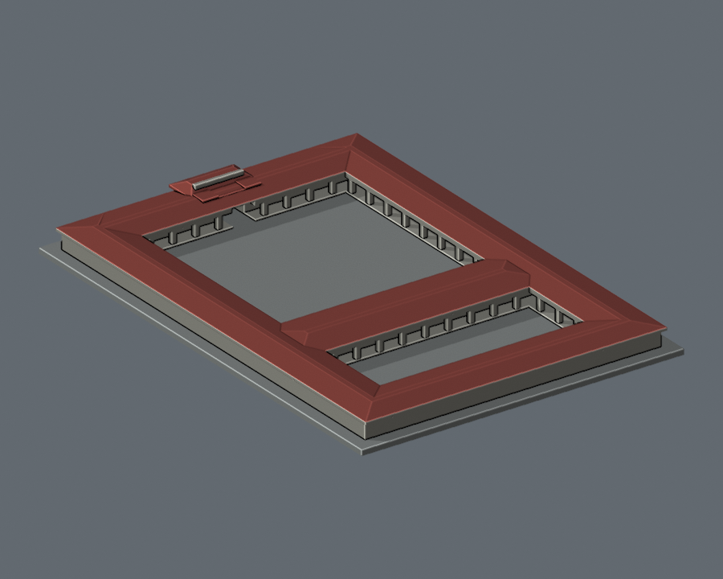

# 國立空中大學

本次完成蘆洲校本部「北院」完整主體低細節模型。以公開照片與配置圖自建，保存紅色防漏屋蓋、四翼及中央橫棟、前大後小雙庭院。不是全校完成，也不是精確現況或測繪模型。

[蘆洲校本部](蘆洲校本部/README.md)

| 建築模型 | 建築模型 | 建築模型 |
| :---: | :---: | :---: |
|  正面／背面 [北院｜紅色防漏坡屋蓋版](蘆洲校本部/buildings/nou-north-courtyard/README.md) |  **[國立空中大學・壽豐校區・教學大樓（2022 外觀參考）](壽豐校區/buildings/nou-shoufeng-teaching-2022/README.md)** |  |

以下原有調查結語僅指**蘆洲校本部**及該輪調查；不適用於下方新增的壽豐教學大樓。

教學大樓已查資料但核心三維形體仍不足，未做模型；其餘建物不在本件完成範圍。其他校區尚未在本輪完整調查。

[壽豐校區](壽豐校區/README.md) 新增獨立一套；與蘆洲北院及蘆洲教學大樓分開計算，不表示空大全校完成。
