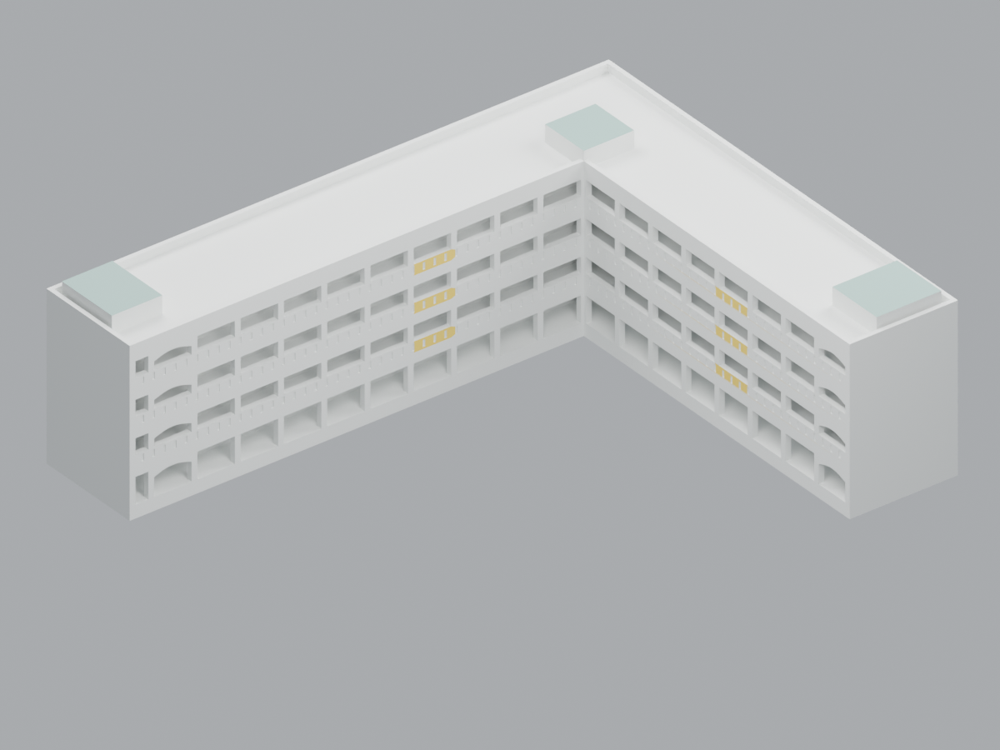
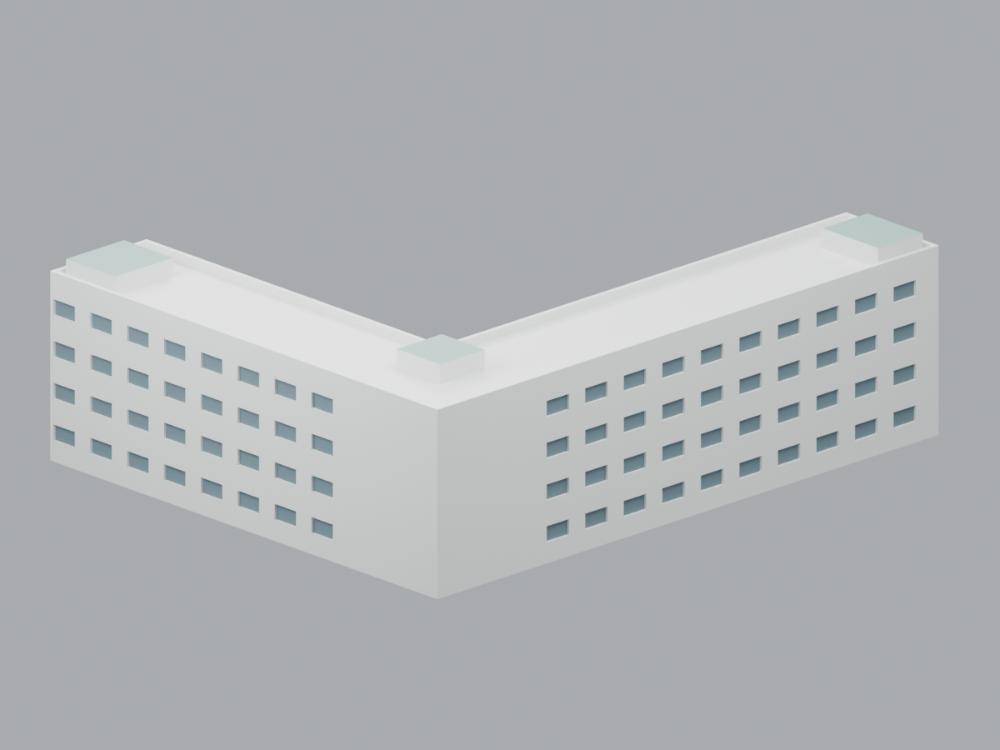

# 國立空中大學・壽豐校區・教學大樓（2022 外觀參考）

以官方照片為依據的原創簡化 3D 列印候選：約直角 L 形兩翼、地上四層、內院開放走廊、白色柱梁與局部黃欄板、端部拱形開口、平頂女兒牆及低矮屋突。主照右下角日期為 **2022-12-08 10:03**；其他斜照日期未知。尺寸為相對估計，不是測繪、現況 BIM、結構安全或 2026 年管理權的證明。

本次發布沿用固定候選 `347ab012d32f6fd7252cd5073e7966e79b12e2f0` 的模型；父任務獨立驗收為**模型條件 GO、無新增必修模型項**。既有 QA、殘差、失敗旗標及未試印限制仍有效，完整判定見 [RELEASE-NOTES.md](RELEASE-NOTES.md)。來源照片只供私人參考，公共包只存 URL 與文字觀察。

**Library 未上傳、未官方回下載、未驗證。** 使用者已取消額外備份作本次發布門檻；這不是備份成功聲明。原候選保持不變；公開歷史 QA／NO-GO 紀錄保留原測值、布林判定、失敗旗標與歷史 SHA，僅將私人執行路徑中性化，按其記錄時點解讀。

| 內院方向預覽 | 背面方向預覽 |
|:---:|:---:|
|  |  |

[俯視](previews/top.png) · [九件分解圖](previews/exploded.png) · [分層截面](qa/sections.png)

預覽及 QA 檔由本包程式產生；最終 QA 狀態與限制另見 [QA-SUMMARY.md](QA-SUMMARY.md)。場景配色只便於辨識，STL 不含顏色。

## 範圍與依據

- 只含壽豐教學大樓。排除旁側紅色營運中心與白色入口、SPA／觀光、餐飲、綜合、宿舍、壽豐會館及廚藝樓；不混入蘆洲北院或東華校區。
- 官方主卡記載 4 層、1989 年 8 月竣工、總樓地板 4842.58 平方公尺。這是總樓地板面積，不是建築足跡；除以四也不是足跡測量。
- 官方校圖支持 L 形與教學大樓／營運中心分開。校圖無比例尺或北箭頭，模型交角及比例只作近似。
- 屋突是局部高出女兒牆的低矮構件，不計作完整第五層；不加大型坡頂、未知大型附翼或屋面設備。
- 完整來源、日期與歸屬界線見 [SOURCES.md](SOURCES.md)；尺寸、背面與製造性修改見 [ESTIMATES-AND-SIMPLIFICATIONS.md](ESTIMATES-AND-SIMPLIFICATIONS.md)。

## 尺寸與九件列印方案

單位為 mm。L 形包絡長寬 156 × 126 mm、翼寬 30 mm，四層名義節距各 10 mm；最終 STL 與場景核對的組裝外形為 **156 × 126 × 48 mm**，最終以 [parameters.json](parameters.json) 和 [幾何報告](qa/geometry-report.json) 的實測為準。`approx. 1:400` 僅為名義展示尺度，沒有米制測量圖作為換算依據。

**請分別列印以下九件。`assembly-reference-do-not-print.stl` 只供看組裝形體，不可當作整體直接列印檔。**

| 順序 | STL | 列印方向及組裝位置 |
|---:|---|---|
| 01 | [01-floor1-lower-upright.stl](models/01-floor1-lower-upright.stl) | 正常朝上；1F lower，自帶 1.6 mm 樓板、7.2 mm 牆柱段，底下另整合 2 mm L 形底座 |
| 02 | [02-floor1-ceiling-inverted.stl](models/02-floor1-ceiling-inverted.stl) | 1F cap；倒置、以 1.2 mm 頂板平面貼床列印，完成後繞 X 軸翻回組裝方向；帶端部拱下緣 |
| 03 | [03-floor2-lower-upright.stl](models/03-floor2-lower-upright.stl) | 正常朝上；2F lower，自帶樓板與牆柱段 |
| 04 | [04-floor2-ceiling-inverted.stl](models/04-floor2-ceiling-inverted.stl) | 2F cap；頂板平面貼床倒置列印，完成後翻回組裝方向 |
| 05 | [05-floor3-lower-upright.stl](models/05-floor3-lower-upright.stl) | 正常朝上；3F lower，自帶樓板與牆柱段 |
| 06 | [06-floor3-ceiling-inverted.stl](models/06-floor3-ceiling-inverted.stl) | 3F cap；頂板平面貼床倒置列印，完成後翻回組裝方向 |
| 07 | [07-floor4-lower-upright.stl](models/07-floor4-lower-upright.stl) | 正常朝上；4F lower，自帶樓板與牆柱段 |
| 08 | [08-floor4-ceiling-inverted.stl](models/08-floor4-ceiling-inverted.stl) | 4F cap；頂板平面貼床倒置列印，完成後翻回組裝方向 |
| 09 | [09-roof-parapet-upright.stl](models/09-roof-parapet-upright.stl) | 正常朝上；平屋頂、女兒牆及低矮屋突 |

lower 與 cap 合成 10 mm 樓層節距。各 cap STL 已存為列印方向；不要先改成組裝方向再直接切片。各件外形、SHA-256 與組裝變換記於 [parameters.json](parameters.json)。

柱名義設計寬度 1.6 mm，欄槽掃過柱前緣處局部厚度為 1.3 mm；細欄杆以 1.5 mm 厚實欄牆與凹槽表達，凹槽後保留 1.2 mm 核心。背面窗為低細節淺凹估計。這些數值是製造性簡化，不能當作真實建築構件尺寸。

## 組裝與切片界線

各件採平面膠接，沒有定位銷、銷孔或已驗證的配合公差。按 01 至 09 次序先逐層乾合、確認 L 形方向與接觸面，再作必要修整和膠接；尚未實際試合。分件讓走廊在封合前可接近，仍須核對橋接、懸垂、薄壁與支撐可達性。不能只因切片完成就宣稱可穩定列印或易於拆支撐。

STL 應以毫米匯入。Blender 場景必須使用正確毫米單位，並與 STL 換算後的真實毫米尺寸一致；僅座標相同不足以證明單位正確。各件切片版本、設定、列印方向及統計見 [qa/slicer-summary.json](qa/slicer-summary.json)。本包的 G-code 只作 QA 證據，不是已適配讀者設備的機器就緒檔。

本候選尚未宣稱完成實體試印、拆支撐、乾合或膠接。縮放、變更噴嘴／層高／材料或切片設定後，須重新核對製造結果。

## 檔案與證據

- [models/](models/)：九個分件 STL；[assembly-reference-do-not-print.stl](models/assembly-reference-do-not-print.stl) 僅供檢視組裝形體。
- [scene.blend](scene.blend)：組裝與分解預覽場景；[previews/](previews/) 為實際輸出預覽。
- [source/build_model.py](source/build_model.py)：原創參數化幾何；[parameters.json](parameters.json) 記錄尺寸、每件 SHA-256 與組裝位置。
- [source/build_scene.py](source/build_scene.py)：場景與預覽產生程式。
- [source/qa_geometry.py](source/qa_geometry.py)：幾何與截面檢查程式；[qa/geometry-report.json](qa/geometry-report.json) 及 [qa/sections.png](qa/sections.png) 為其證據。
- [qa/slicer-summary.json](qa/slicer-summary.json)：九件真實切片的結果與限制；其狀態須依內容判讀，本說明不預先宣稱通過。
- [SOURCES.md](SOURCES.md)：外觀來源、排除範圍、年代與移交限制。
- [ESTIMATES-AND-SIMPLIFICATIONS.md](ESTIMATES-AND-SIMPLIFICATIONS.md)：相對估計與製造性簡化。

幾何、全量碰撞、截面、薄壁、接合與支撐可達性須逐項覆核，不能以單一 watertight 或成功匯出取代。若原檢查出現失敗旗標，保留原值並以後續證據另行說明，不改寫為無條件通過。

## 重建

幾何程式使用 Python、NumPy、trimesh、manifold3d 與 Shapely；場景與預覽使用 Blender。應使用本候選所記錄的相同版本環境，從本包目錄執行：

```sh
python source/build_model.py
blender --background --python source/build_scene.py
python source/qa_geometry.py
```

重建後應重新核對尺寸、單位、SHA、預覽與切片證據。上述命令不包含讀者設備的列印校準，也不代表現場復原或實體製造驗收。

發布副本的 metadata 與私人路徑清理綁定見 [PUBLICATION-METADATA.md](qa/PUBLICATION-METADATA.md) 與 [current-binding.json](qa/current-binding.json)。原候選測值與旗標沒有重算或改判；目前檔案 SHA 以 [PACKAGE-SHA256.json](PACKAGE-SHA256.json) 為準。
