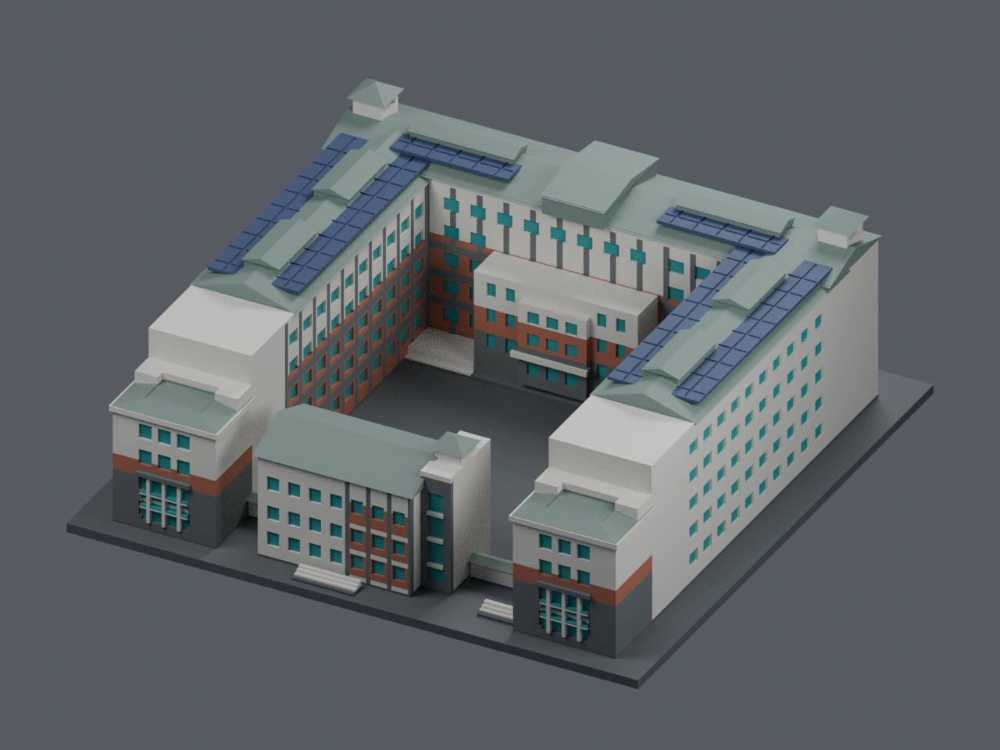
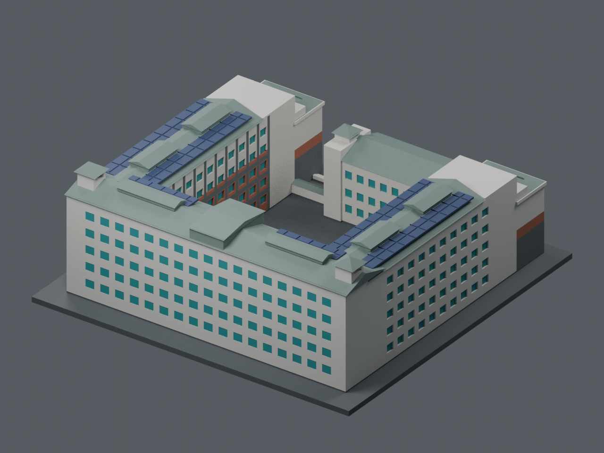

# 八甲校區 A1｜理工學院一館

依國立聯合大學公開校園地圖及外觀照片製作的近似建築模型，包含 A1a、A1b、A1c 所屬建築群。不是測繪模型，亦未做實體試印。

目前展示採[七材質外觀主版](appearance/README.zh-TW.md)，屋頂灰綠、太陽能板深藍與灰立面分開，不受四色工具數限制；可下載[通用七材質 3MF](appearance/a1-appearance-core.3mf)及[可編輯彩色場景](appearance/scene.blend)。[四色／四工具方案](multicolor/README.zh-TW.md)另作選配製造衍生版。原無支撐切片路線 **NO-GO**；開支撐僅完成生成比較，真機設定、支撐清除、黏結及試印未驗。

原始單色幾何預覽只保留作歷史／製造比對，不代表目前配色：[舊正面](previews/front.png) · [舊背面](previews/rear.png)。

## 外觀依據

以官方相簿照片 23、24 的空拍與正面視角交叉核對：三面主翼圍合中庭、前端較低的兩側量體、略偏左的前方入口棟、後方兩端塔亭、分段山牆屋頂。前方低棟及連廊形成 A1 的辨識特徵；與前方開放的 A2 二館不同。另參考照片 16–22、30 及校史竣工照。

- [官方建築相簿](https://secretary.nuu.edu.tw/p/132-1003-1097.php?Lang=zh-tw)
- [官方八甲校區地圖](https://www.nuu.edu.tw/p/426-1000-9.php?Lang=zh-tw)
- [校史建物清冊與竣工照](https://nuuarchives.nuu.edu.tw/p/16-1097-27990.php?Lang=zh-tw)
- 精確照片連結及檢視紀錄見 `manifest.json`。

公開可瀏覽不代表取得照片重製授權。本目錄僅附來源連結；上方圖片為既有模型幾何的七材質展示渲染，不是原始照片或 AI 想像圖。

## 檔案與列印

- `model.stl`：單一連通可列印網格，單位毫米
- `model.obj`：相同幾何的通用交換格式
- `build_model.py`：參數化重建程式，需要 Python、numpy、trimesh、manifold3d
- `scene.blend`：原始單色 STL 預覽場景（歷史／幾何比對；目前彩色場景在 `appearance/scene.blend`）；工作室地板及燈光不是模型零件
- `render_preview.py`：Blender 4.3 預覽程式
- `validation.json`：數位幾何檢查結果

尺寸約 150 × 148 × 57.1 mm，含 2.4 mm 底板；每棟獨立縮放至 150 mm，並非全校統一比例。底板朝下，建議從 0.4 mm 噴嘴、0.16–0.20 mm 層高、3 道外牆及 10–15% 填充開始。塔亭與屋簷有小型橋接／懸挑，請在切片器檢查，必要時添加局部支撐。列印參數屬起始建議，不能替代試印。

## 重建與重驗

安裝 `requirements.txt` 中的依賴後，執行 `python build_model.py`。再以 `python validate_model.py model.stl --output validation.json` 重驗，並執行 `blender -b -t 6 -P render_preview.py` 產生預覽。已重跑來源程式並確認 STL 雜湊一致。

## 簡化與精度限制

未取得可量測的平面圖、長寬與屋高。比例來自外觀判讀；被遮蔽的立面、窗位及地形採近似處理。窗戶為淺凹槽、大型前窗保留約 0.85 mm 窗格；太陽能板簡化為帶約 0.65 mm 淺刻線的屋面凸條；空調、招牌文字、欄杆、屋面細肋、樹木與線纜省略。連廊下方填實以降低支撐需求；屋頂塔亭開口及主要中庭仍保留。STL 無材質顏色。

數位檢查確認封閉水密、法向一致、單一連通實體、所有邊各接兩面、頂點連結有效、正體積、平整接地及尺寸。這不等同實體試印，也不保證所有切片器或材料皆無問題。
