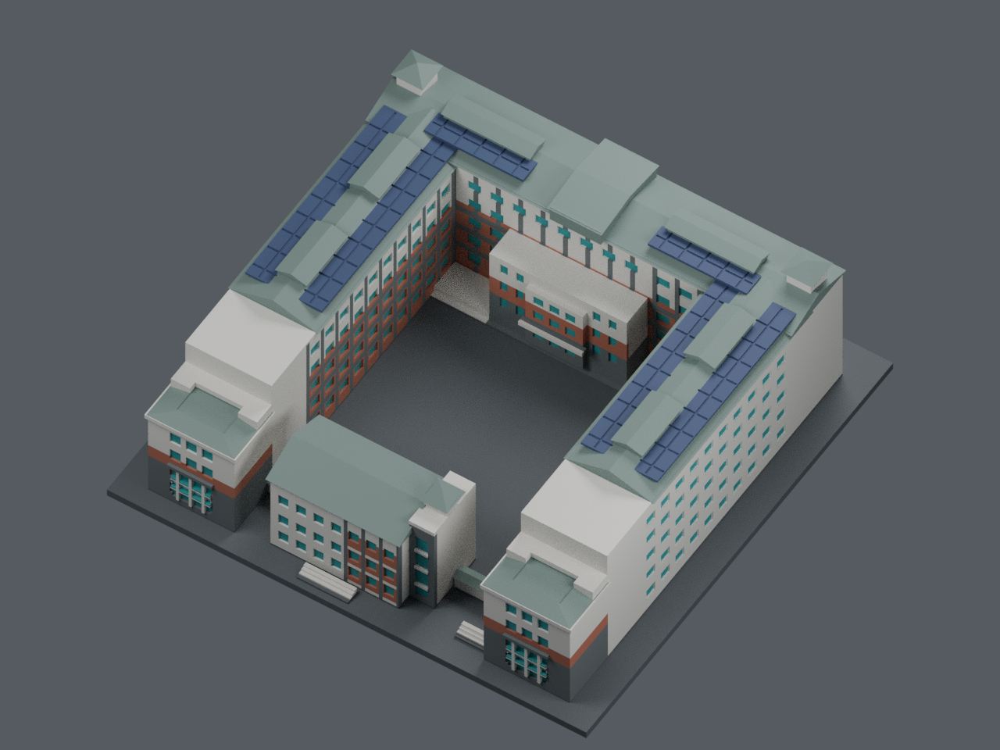

# A1 實照近似配色展示主版

展示與建模不受四色或印表機工具數限制。此版以已核實照支持的七個細材質身分，呈現米白牆／淺框、磚橘紅貼面、灰立面、灰綠屋面、深藍太陽能板、青綠玻璃與獨立深灰展示底板。八個語意網格保留，材質可繼續編輯、細分；七種是目前資料支持的分組，不是日後色數上限。

| 正面 | 背面 |
|---|---|
|  |  |



[通用七材質 3MF](a1-appearance-core.3mf) · [可編輯色表](palette.json) · [可編輯展示場景](scene.blend) · [來源與配色界線](../multicolor/COLOR-EVIDENCE.zh-TW.md) · [已公開細材質表](../multicolor/color-evidence.json) · [另選四色列印合併方案](../multicolor/README.zh-TW.md)

- 灰綠金屬外觀屋面、深藍／藍紫PV及灰立面分開顯示，沒有為四工具預算合為同色。
- 顏色是人工視覺選擇的 sRGB 近似值，無色卡、油漆規格或校準反射率。照片所標日期未核驗，不能當成2026全棟現況。未知面、玻璃反射／窗簾、細窗框色差仍有簡化。
- 底板是展示選擇，並非實地地坪色。原有外觀近似幾何與全部列印檔未變；本次沒有用配色重造未知建築細節。
- `scene.blend` 使用八個原語意網格、七個可編輯材質、毫米單位。來源 core 3MF 只提供既有幾何；本展示主版不按其中四工具材料表合併顯示。
- 原四色 PRINT 仍作獨立可選製造衍生版。展示材質數不等於已配置或驗證的噴頭數；本次未重切片、未試印。原無支撐 NO-GO、支撐清除、黏結及真機設定限制繼續適用。

## 重建與這次檢查

在模型根目錄執行：

```text
blender -b --factory-startup --python appearance/source/render_appearance.py -- --three-mf multicolor/a1-four-tool-core.3mf --output appearance --samples 64 --threads 6
```

此次使用Linux Blender 4.3.2，不宣稱與舊平台或其他版本逐像素相同。生成時及另行重開都檢查八區原 float32 幾何、三角形與場景變換；只改展示材質，原 3MF／STL／單色與四色場景均不回寫。PNG另外移除metadata並確認像素不變。實際結果及輸入雜湊見 `validation.json` 與 `render-geometry-check.json`。重建輸出後須重新清理PNG metadata，不能把重新渲染當作新的製造驗證。

## 通用可編輯外觀 3MF

`a1-appearance-core.3mf` 使用 3MF Core 的具名基礎材質／表面顏色，保留原始八區雙精度座標、三角形及組裝關係。八個 mesh resource 共用七種材質，以一個 assembly build item 匯入；沒有印表機設定、噴頭編號或 G-code。灰綠屋面、深藍 PV、灰立面與展示底板仍各自獨立，這七種並非日後色數上限。實際顯示及材質編輯介面取決於讀取軟體；本次測試為 lib3mf 2.5.0 嚴格匯入與腳本編輯，未驗 GUI。

- 這是外觀交換檔，不是已驗證的七噴頭列印專案。八區為同座標的語意分區，不應當成八件可各自平放列印後裝配的模型。
- Core 的 display color 不保證耗材顏色或機器工具映射。四色 [PRINT／EDITABLE](../multicolor/README.zh-TW.md) 保留作獨立選項；先前無支撐 NO-GO 與所有製造限制不變。
- 既有四個 PV／屋面交界細三角形在 float32 匯入時會退化，詳見原 [介面量化檢查](../multicolor/qa/prusaslicer-editable-r2/independent-interface-probe.json)。本檔保留雙精度原值及原三角形，未補洞、合併或重網格化；外觀中 PV 與屋面分成不同色，不表示已驗證不同噴頭間的實際接合或走線。
- 只修改 `palette.json` 的 sRGB 色值後重建，可保留原幾何；會改變新 3MF，不會自動更新 Blender 場景或預覽。若另改展示配色，須同步場景與圖片並重新核對來源。任意第三方軟體另存時可能轉成 float32 或截短小數，不能假設與原雙精度幾何逐值相同。

在模型根目錄執行：

```text
python appearance/source/build_exchange.py
python appearance/source/verify_exchange.py
blender -b --factory-startup --python appearance/source/verify_exchange_scene.py
```

建檔只用 Python 標準函式庫；交換驗證使用 NumPy 與 lib3mf。驗證確認：原 XML 座標字串／三角形索引／變換完全保留、重建 SHA256 相同、單色編輯不動其他色及幾何、八區 SDK 匯入有效且有向流形、七色指派一致，並另行重開原場景對照。SDK 的幾何讀值是 float32，這與 XML 雙精度逐值保留是不同檢查；四個已知退化旗標照實列出。結果見 [交換驗證](qa/exchange-validation.json) 與 [場景對照](qa/scene-exchange-validation.json)。原場景及三張已驗預覽沒有改動，因此未重渲染、未重切片。
