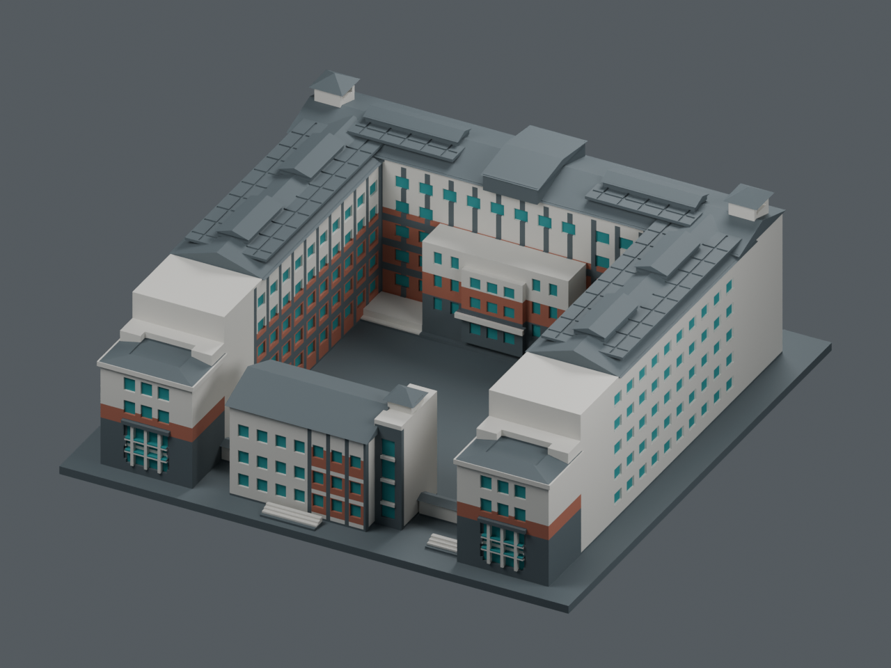

# A1 真實材料近似配色／四工具列印候選

這是國立聯合大學八甲 A1 理工學院一館的首套分色示範候選。獨立覆核結論為模型／分色檔案條件 GO；目前無支撐切片路線 NO-GO，支撐比較尚未達真機放行。原有 `../model.stl`、原 OBJ、生成器及單色場景均保留；此資料夾新增分色實體、四工具對應、可編輯場景與預覽。

原 STL SHA-256：`f25654284af62f9f454421da0dbb1a21bcd9b0645bbfc7c6deb2df3f327f0023`。來源主分支固定於 `4923f28803b51be6da8c4017f412be9592719c14`。

| 模型預覽 | 模型預覽 | 模型預覽 |
| :---: | :---: | :---: |
|  |  |  |

## 照片依據與四色取捨

已實看聯大官方相簿 16、22、23、24 與校史竣工照。相簿 EXIF 自述拍於 2025-03-10，未核驗相機原檔、時區、色卡或現行油漆；此處是照片支持的材料區域與視覺近似色，不是精準色號或 2026 現況認證。私用參考照片不放進公開包，詳見 [配色證據](COLOR-EVIDENCE.zh-TW.md) 與 [URL／材料表](color-evidence.json)。

| 邏輯工具 | 近似 sRGB | 四色用途與取捨 |
|---|---|---|
| 1 | `#D8D6CF` | 米白牆、淺柱梁與已有淺色窗格；銀灰窗框與亮牆的小色差合併。 |
| 2 | `#A96754` | 前端低棟中段磚橘紅腰帶、已見中庭側下部窗間區。不是全棟等高的細紅帶。 |
| 3 | `#566166` | 深灰立面、灰綠金屬屋面、藍紫太陽能板及展示底板合用一組。這些真實材料原本不同色，為四工具方案明示合併。 |
| 4 | `#248E91` | 青綠玻璃的實色表示；不模擬真正玻璃透光、反射或窗簾差異。 |

八個可編輯實體區域是 `light_frames`、`glass`、`pv`、`roof`、`dark_facade`、`plinth`、`brick`、`wall`；對應工具依序為 **1、4、3、3、3、3、2、1**。屋面、PV、基部等仍是獨立 parts，可在切片器更改工具，並非刪去細材料身分。四個工具不是八個工具，也不是 AMS／單噴頭換料設定。展示底板是既有模型構件，其深灰是展示選擇，不是對實地地坪材料的宣稱。

## 檔案與使用界線

- `a1-four-tool-PRINT.3mf`：主要 PrusaSlicer 列印候選，一個 A1 物件、四個實體色組、工具 1–4 及 generic 四實體工具參考設定。同耗材區域已聯集，減少不必要內界面。
- `a1-four-tool-prusaslicer.3mf`：EDITABLE 八區版本，保留細材質身分與工具映射；用於日後改色。同工具 PV／屋面界面的單精度退化警示仍明列，不冒充主要 PRINT 版的零退化結果。
- `a1-four-tool-core.3mf`：標準 core 幾何／顯示材質交換檔，八個子網格、一個 components 父物件與一個 build instance；**沒有通用的實體噴頭指定保證**。實際 Prusa 會把這種 components 結構拆成八個 objects；Prusa 使用上面的 native 檔。
- `parts/01-light-wall.stl` 等四檔：四工具的合併網格相容備援，保持原座標；STL 本身不保存顏色、工具或單位 metadata。以毫米匯入，並將四檔當成同一物件的 parts；不可分別落床、重新置中或排列。它們不是分開印好再拼接的組裝件。
- `scene.blend`：八個語意網格共用四個材質，毫米場景設定 `scale_length=0.001`。`previews/` 是此四工具合併方案，不是假裝仍有七種實際印色的參考圖。
- `color-manifest.json`：部件、工具、SHA、原 STL 身分；`source/` 保存可重建的材料選區與輸出程式。

PrusaSlicer 2.9.6 的實際命令列重開／再輸出及兩次有界切片結果見 [驗證摘要](qa/PRUSASLICER-REVIEW.zh-TW.md)。獨立覆核以固定主 PRINT 做了一次無支撐、一次開支撐診斷，四工具均有模型料道。診斷 G-code 僅留本機證據，不作公開交付或真機送印；GUI、真機路徑及實體試印仍未驗。這不是對其他切片器或尚未選定的四噴頭機型作兼容保證。

`generic-four-tool-REFERENCE.ini` 是檔案檢查佔位設定。噴嘴 0.4 mm、料徑 1.75 mm、零工具偏移、示意床面與層高均不是已知機型參數；不可當成真機送印設定。內嵌設定明示 `single_extruder_multi_material=0`。機型確定後仍須配置每個實體噴頭、有效床面、偏移、材料相容性、溫度、停泊／防撞、清料與支撐。

**不建議沿用佔位設定中的關閉支撐。** 無支撐診斷雖 exit 0，實際日誌有 `Floating bridge anchors, Long bridging extrusions` 及 `Consider enabling supports`，因此無支撐製造路線不放行。唯一一次開支撐比較產生 40,041 段支撐／介面正擠出料道，日誌未再出現該警告；這只確認支撐生成，未證明全區受托或可清除。比較使用目前模型工具作支撐，沒有獨立支撐材或第五工具。機型與材料確定後須重新切片，逐區檢查庭院、門廊／塔亭、窗洞及屋簷下的支撐可達性、移除與損件風險，並校準噴頭和驗證跨色黏結。

若獨立支撐耗材占用一個噴頭，四工具預算變成「三個模型主色＋一個支撐工具」。例如把 `glass` 改映工具 3，騰出工具 4 給支撐；原部件仍可編輯。四主色加獨立支撐不是此四工具機器可無條件同時容納的五工具方案。

## 幾何與製造檢查

分色以既有 STL 的實際 float32 外殼為母體，使用 `Mesh64`／`to_mesh64` 雙精度布林，沒有從照片重建或更換原外形。新增的是材料界面與三角化，不是窗框、植栽或其他外觀幾何。沿用原模型的簡化窗位與量體；未見的外立面、各面色帶精確位置及屋面細部不能稱已逐面核實。所有 axis 選區端點先對齊原 STL 的 float32 精度，避免十進位選區與既有窗邊幾乎共面、在切片器量化後產生非流形。

每個語意區均按封閉、法向、正體積檢查；各區可以含多個閉合小殼，例如玻璃有多個窗片。它們用同一模型、同一層協同列印，不是各自可站在床上的獨立組裝件。八區不以正體積重疊搶佔顏色；材料間保留共面接觸界面，聯集對原外殼的缺／多體積與外框尺寸均保存實數值於 `qa/`，不把浮點殘差說成精確有理數證明。

- `qa/core-reimport-validation.json`：重新讀回 3MF，逐區閉合、成對體積交集、聯集與原模型比較。主檔明寫 `unit="millimeter"`，原外框約 **150 × 148 × 57.099998 mm**。
- `qa/partition-validation.json`：材料分區與原母體的數值檢查。
- `qa/stl-compatibility-quantization.json`：四個備援 STL 的再讀與 float32 量化差異。它們不宣稱逐點等於雙精度 3MF；仍保持原外框，並逐檔驗閉合。
- `qa/scene-reopen-validation.json`：Blender 重新開啟、場景毫米設定、八區／四材質、無額外模型網格、三角形與 source-float32 對照、路徑檢查。Blender 場景也使用 float32 顯示，與雙精度列印檔的差保留於報告。

分區仍有製造限制：玻璃凹底後方的色材通常約 0.9 mm 以上；窄窗片最小包圍盒尺度約 0.825 mm，少數深灰色帶約 0.6 mm。包圍盒數值不是全域最小壁厚證明。獨立 QA 切片在一片約 0.825 mm 窗片檢出工具 4 的 8 段料道，另在一處約 0.6 mm 灰帶檢出工具 3 的 0.6 mm 寬 Arachne 料道；只支持這兩個指定部位，不涵蓋全部 422 個玻璃殼或所有細色帶。13 個指定層面的抽核與 Z8.1 截面原 39 個旗標及兩側敏感性診斷均保留於 [切片證據](qa/independent-slicing-review/README.zh-TW.md)。兩次皆有 285 個模型出料 Z、最高 Z57.0 mm，與原頂點相差約 0.10 mm；支撐版 354 個總出料 Z 包含支撐，不是 354 個模型層。

PV 刻線附近是原模型已有的薄細節；新色界面與屋緣 0.02 mm 選區 return 是近似材料分界，不是要獨立印出的 0.02 mm 薄壁。實際線寬、共擠界面、材料黏結、支撐和所有小色區是否保留，仍須以實際機型及噴嘴重新切片檢查；此處未宣稱全綠可印。

R1 曾在 Prusa float32 往返後出現磚紅區四重邊，已用材料邊界精度對齊修正，不改母體外殼。八區 EDITABLE R2 仍有 PV／屋面共四個極小三角面在 Prusa float32 表示中共線的保留警示，詳見 Prusa 獨立報告；不能用整體 `manifold=yes` 蓋過這些旗標。主要 PRINT 版將相同工具的區域作聯集，去除這些不必要的內界面；八區編輯檔與完整旗標仍保留。獨立覆核未提出新增幾何必修，檔案條件 GO；尚未作真機製造認證。

## 重建與官方文件

在原 A1 包保留不變時，以 `requirements.txt` 中的版本執行：

```text
python source/build_multicolor.py
python source/render_color_preview.py --three-mf a1-four-tool-core.3mf --fine-palette-reference //color-evidence.json#fine_material_identities --samples 48
```

渲染另外需要現有 Blender／`bpy`；程式只讀 3MF，保存 `.blend` 與 PNG，不回寫列印幾何。不要把生成 3MF 或 Blender 材質成功當成切片器工具映射已驗證。

已查官方資料：[3MF 規格](https://3mf.io/spec/)、[Core](https://github.com/3MFConsortium/spec_core/blob/master/3MF%20Core%20Specification.md)、[Prusa 多材料匯入](https://help.prusa3d.com/article/importing-multi-material-model_121191)、[工具／耗材指定](https://help.prusa3d.com/article/assigning-tools-colors-extruders_124811)、[parts 與 objects](https://help.prusa3d.com/article/split-to-objects-parts_1751)、[PrusaSlicer 2.9.6 3MF 原碼](https://github.com/prusa3d/PrusaSlicer/blob/version_2.9.6/src/libslic3r/Format/3mf.cpp)。Core 顯示顏色不等於列印工具；Prusa 專用 metadata 不等於每個切片器都能理解。
