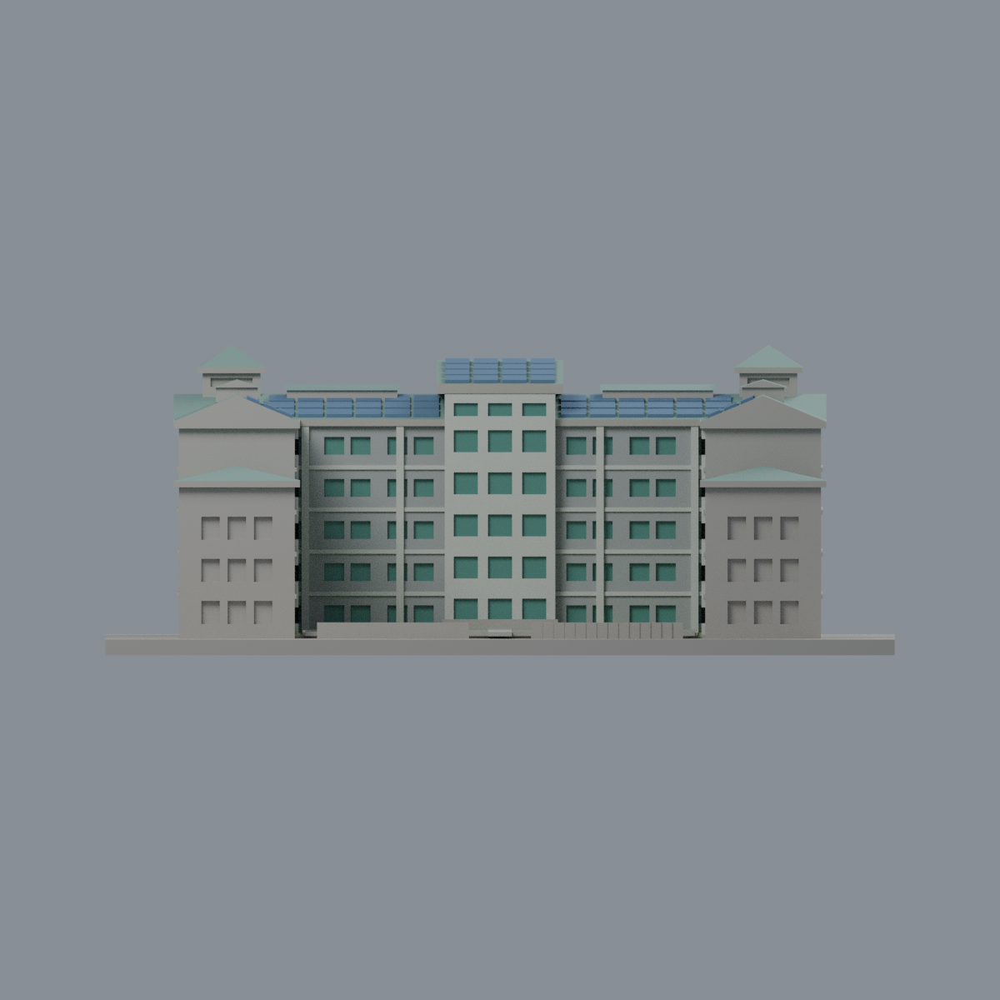
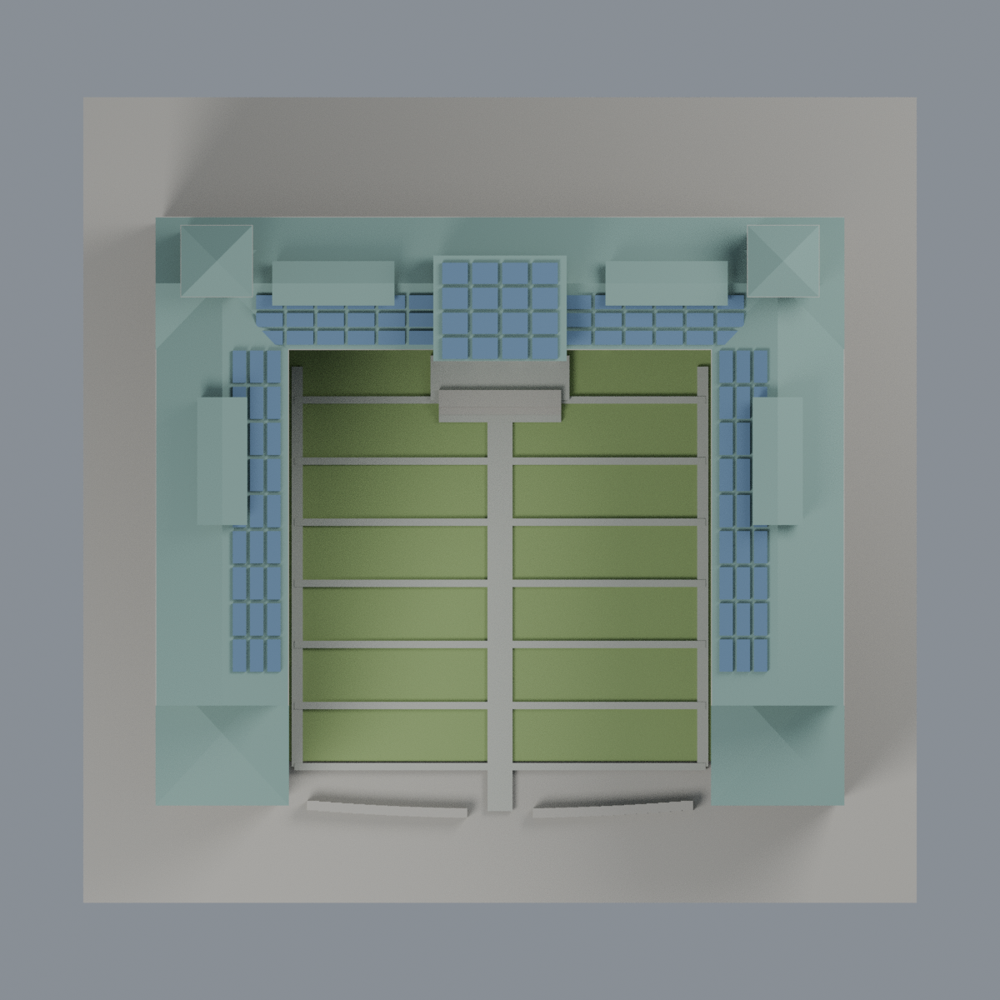

# 聯大八甲 A2 理工二館：八材質外觀版

沿用原 **13,828 三角面／6,892 頂點**，不改原 STL 位元、座標、面序或幾何；這是既有模型外觀改版，不增加模型包數。

| 正面 | 背面保持中性 |
|---|---|
|  |  |
|  |  |

[表面色 3MF](nuua2-appearance.3mf) · [可編輯 Blender](scene.blend) · [材質色表](palette.json) · [逐面指派與依據](face-materials.json) · [原 STL](../model.stl)

## 來源與配色邊界

親自核對官方 [理工二館相簿](https://secretary.nuu.edu.tw/p/132-1003-1097.php?Lang=zh-tw) 的 [照片 26](https://secretary.nuu.edu.tw/var/file/3/1003/gallery/97/1097/gallery_1097_7335666_26024.jpg)、[照片 27](https://secretary.nuu.edu.tw/var/file/3/1003/gallery/97/1097/gallery_1097_7051584_26024.jpg)，以及 [官方校史航照](https://nuuarchives.nuu.edu.tw/var/file/97/1097/img/828/06image045.jpg)。近照 EXIF DateTimeOriginal **2025-03-10 14:46:38／14:47:45**；航照未定年且尚無近照可見的光電板，只作屋面與中庭登錄佐證，不代表 2026 現況。EXIF 日期與時區未獨立核實；照片不隨包散布。

- 原 U 形中庭立面採灰色、原樓層帶與柱淺色，只有原本離散窗凹背採低彩度綠玻璃。真實建築的連續高窗、磚色與深灰實牆分帶未完整存在於原簡化網格，不能靠把整片實牆染玻璃或虛構磚帶補足。這是保守色彩代理，不是完整立面還原。
- 原中央入口窗格與樓梯窄窗保留既有尺寸及節奏；不新增玻璃塔、窗梃、招牌、雕塑、設備、樹木或字樣。窗凹背仍封實，不宣稱透明室內。
- 只對已登錄的原斜屋面採灰綠金屬色，原離散光電板表面藍灰；不把整片屋頂染成光電板。航照早於近照中光電板配置，不用它否定近照。
- 原中庭草坪的水平表面綠色，原加高步道灰色；不把模型底板或坡面當草地。庭院分格與建築比例仍是原近似幾何。
- 未見外側背面、前端外牆及無法可靠分離材質的交界中性；不延伸作整棟精準復原。原 STL／面序／座標不變，不增加模型數，不宣稱物理列印成功。

[原幾何與來源限制](../README.md) · [來源覆核](qa/source-review.json)

## 重建與核驗

安裝 [依賴](source/requirements.txt)，Blender 使用 4.3.2。由本資料夾上層提供原 model.stl：

1. `python appearance/source/build_appearance.py`
2. `python appearance/source/verify_exchange.py`
3. `blender -b -t 3 --python-exit-code 1 -P appearance/source/render_appearance.py`
4. `blender -b -t 3 --python-exit-code 1 -P appearance/source/verify_scene.py`

[獨立重建 ZIP](rebuild-source.zip)含原 STL、四支程式及依賴，不含第三方照片；不取代原建模腳本。[逐檔 SHA256](SHA256SUMS)

[交換／拓撲 QA](qa/exchange-validation.json)核對原座標與面序、全部面材質、單連通、有向水密邊、頂點 link 單環、正體積與零退化／重複面；lib3mf 嚴格讀取零警告，實際編輯單材質再存讀，其他材質及面指派不變。SDK 六位小數量化誤差另列。

[Blender 存讀與編輯](qa/scene-validation.json) · [渲染記錄](qa/render-manifest.json) · [獨立重建](qa/rebuild-validation.json)

## 製造限制照舊

尺寸仍為 150 × 145 × 58.2 mm；原 STL、建模程式、場景及歷史 QA 保留。原層檢與薄特徵檢查本次未重跑，不能由材質 QA 代替。

3MF 是同一網格的表面色，不是八個封閉分色實體、切片專案、噴頭映射或 G-code。切片 GUI、多材料路徑與實體列印未測；柱頭、屋簷、窗框及薄邊仍須評估材料、支撐及拆除風險，沒有保證可印或免支撐。
