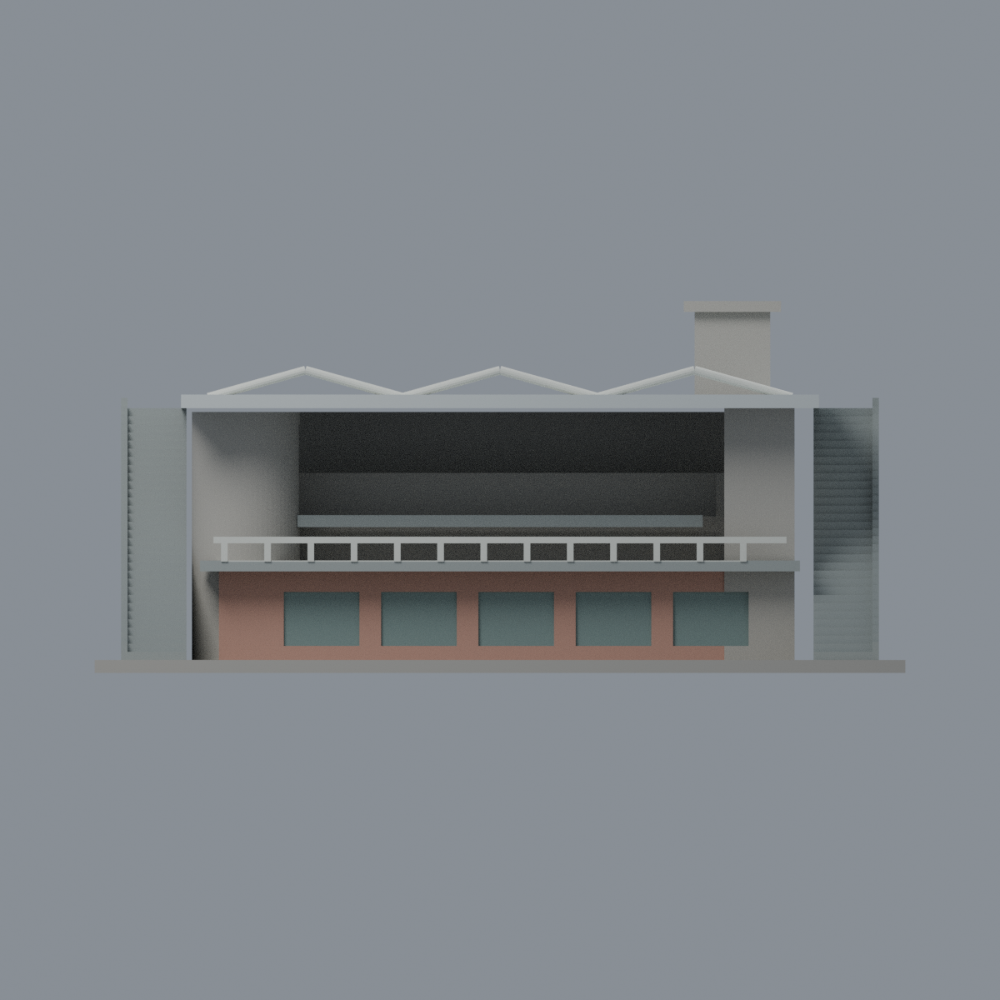
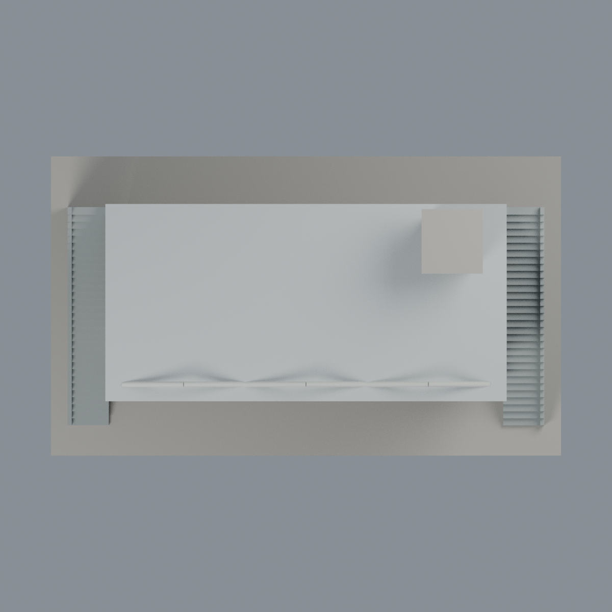

# 聯大八甲田徑運動場司令台：六材質外觀版

沿用原 **3,176 三角面／1,556 頂點**，不改原 STL 位元、座標、面序或幾何；這是既有模型外觀改版，不增加模型包數。

| 正面 | 背牆中性／棚同材料推估 |
|---|---|
|  |  |
|  |  |

[表面色 3MF](nuustand-appearance.3mf) · [可編輯 Blender](scene.blend) · [材質色表](palette.json) · [逐面指派與依據](face-materials.json) · [原 STL](../model.stl)

## 來源與配色邊界

親自核對官方 [八甲運動場相簿](https://secretary.nuu.edu.tw/p/132-1003-1093.php?Lang=zh-tw) 的司令台[照片 3](https://secretary.nuu.edu.tw/var/file/3/1003/gallery/93/1093/gallery_1093_8580456_44219.jpg)與[照片 4](https://secretary.nuu.edu.tw/var/file/3/1003/gallery/93/1093/gallery_1093_3655312_44219.jpg)完整影像。EXIF 拍攝時間列於來源 QA；日期與時區未獨立核實，非 2026 現況證明。照片 1 請求失敗，沒有把它列為已覆核來源；來源照片不隨包散布。

- 下層房間正面可分出的磚紋牆採淡桃紅代理色，原窗凹背灰綠；實景安全格網與窗簾未分幾何，不能聲稱完整窗面還原，不加貼圖。
- 金屬大棚銀灰、原三個上部桁架峰及原欄杆淡色；棚背屬同材料有界推估，不是 PV。欄杆沒有玻璃面域，不填透明面、不把空隙染綠。
- **原模型沒有紅椅子**，所以觀眾階梯與側階都保留灰混凝土，不把整塊台階染粉紅假裝椅子。原幾何也沒有完整後方橫百葉，不加黑色條紋或校徽。
- 兩端圓／方核心及屋上方塔的實景桃紅橫帶，沒有相應原面邊界，整個混色區保持中性，不用整高三角面畫斜帶。這是刻意保留的資料與幾何限制，並非完整實景配色。
- 平台／底座不加入跑道、草地或前景。未見背牆中性；棚背同材料推估如上。原 STL／面序／座標不變，不增加模型數，不宣稱物理列印成功。

[原幾何與歷史來源限制](../README.zh-TW.md) · [來源覆核](qa/source-review.json)

## 重建與核驗

安裝 [依賴](source/requirements.txt)，Blender 使用 4.3.2。由本資料夾上層提供原 model.stl：

1. `python appearance/source/build_appearance.py`
2. `python appearance/source/verify_exchange.py`
3. `blender -b -t 3 --python-exit-code 1 -P appearance/source/render_appearance.py`
4. `blender -b -t 3 --python-exit-code 1 -P appearance/source/verify_scene.py`

[獨立重建 ZIP](rebuild-source.zip)含原 STL、四支程式及依賴，不含第三方照片；不取代原建模腳本。[逐檔 SHA256](SHA256SUMS)

[交換／拓撲 QA](qa/exchange-validation.json)核對原座標與面序、全部面材質、單連通、有向水密邊、頂點 link 單環、正體積與零退化／重複面；lib3mf 嚴格讀取零警告，實際編輯單材質再存讀，其他材質及面指派不變。SDK 六位小數量化誤差另列。

[Blender 存讀與編輯](qa/scene-validation.json) · [渲染記錄](qa/render-manifest.json) · [獨立重建](qa/rebuild-validation.json)

## 製造限制照舊

尺寸仍為 150 × 88 × 68.8 mm；原 STL、建模程式、場景及歷史 QA 保留。原層檢與薄特徵檢查本次未重跑，不能由材質 QA 代替。

3MF 是同一網格的表面色，不是六個封閉分色實體、切片專案、噴頭映射或 G-code。切片 GUI、多材料路徑與實體列印未測；柱頭、屋簷、窗框及薄邊仍須評估材料、支撐及拆除風險，沒有保證可印或免支撐。
