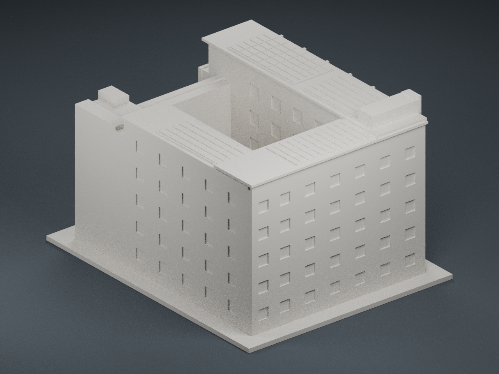

# 國立聯合大學八甲校區 B1 電機工程館

依校方公開照片製作的建築外觀近似模型。照片可讀到「電機工程學系」，並可辨認高低翼樓、前方大面積實牆、內縮連橋、開放中庭、側面直向遮陽肋及屋頂太陽能板。這是獨立的 B1，並非相連的 B2–B4。

## 實際模型預覽

以下為實際列印 STL 的前、後視角，並非原建築照片；後側外牆為保守近似。

## 模型範圍與尺寸

- 毫米單位；含底座尺寸約 **122 × 150 × 90.3 mm**。
- 此棟單獨以最長邊 150 mm 製作；不同館舍之間**不是共同縮尺**，不能直接拼成等比例校園。
- 未取得實測尺寸、建築平面圖或立面圖；樓層、間距及比例依照片估算，並非測繪模型。
- 前方定義為負 Y；較高、有遮陽肋的長翼樓位於負 X。

## 保留與簡化

保留六層高翼樓的上半部遮陽肋、下半部成組窗洞、後側狹長樓梯塔、前方大面積招牌實牆、內縮連橋及上層整片遮屏、遮屏下半部交叉斜撐浮雕、較低右側樓梯量體、露天中庭與屋頂光電板。

連橋內部縮成有實心背牆的淺凹槽，入口雨棚下方填實，地形改為平底座及簡化階梯。前方實牆的文字、欄杆、冷氣、車輛、樹木、線材及板下支架省略。屋頂板組用薄實心板和凹刻網格表達。後側及右側外牆缺少近距離清楚視角，僅用保守牆面及簡化窗列近似；不可視為該面之精確紀錄。STL 不含色彩。

## 列印參考

建議先以 0.4 mm 噴嘴、0.16–0.20 mm 層高、3 道外牆、10–15% 填充切片檢查。底座朝下；細肋寬約 1.5 mm，連橋立柱約 1.7 mm，屋頂網格寬 0.65 mm、深約 0.35 mm。

窗凹槽、入口棚緣與小陽台仍可能需要局部支撐，依切片預覽與機器能力決定。不要無條件視為免支撐；先檢查第一層、懸空區及薄牆。**只完成數位網格檢查，未實際試印。**

## 檔案

- `model.stl`：可切片的單一閉合實體。
- `model.obj`：同一幾何的通用格式。
- `scene.blend`：匯入實際 STL 的預覽場景；地面、燈光及相機不是列印模型。
- `previews/front.png`、`previews/rear.png`：實際 STL 的前後視角。
- `build_model.py`：參數化重建程式；`requirements.txt` 固定 Python 套件版本。
- `validate_model.py`、`validation.json`：水密、面朝向、單一連通體、邊及頂點拓樸、平底及尺寸檢查。
- `manifest.json`：來源網址、判讀及簡化範圍。

## 重建與驗證

使用 Python 3.12，先執行 `python -m pip install -r requirements.txt`，再執行 `python build_model.py`。執行 `python validate_model.py model.stl --longest-edge 150 --output validation.json` 驗證。Blender 4.3.2 預覽命令為 `blender -b -t 6 -P render_preview.py`。

驗證不能取代切片器檢查，也沒有獨立證明所有幾何自交皆不存在。重新輸出預覽時，應先重建並驗證 STL。

## 公開來源與影像權利

- [校方電機資訊學院照片相簿](https://secretary.nuu.edu.tw/p/132-1003-1098.php?Lang=zh-tw)：重點照片 18–21，其中 19 有系名字樣、20–21 有屋頂及中庭。
- [八甲校區官方地圖](https://www.nuu.edu.tw/p/426-1000-9.php?Lang=zh-tw)
- [校方教室代碼](https://nss.nuu.edu.tw/p/412-1037-5747.php)

個別照片網址列於 `manifest.json`。公開可瀏覽不代表原照片可以再散布，本套件不包含校方原始照片，也不替原照片假定授權。
