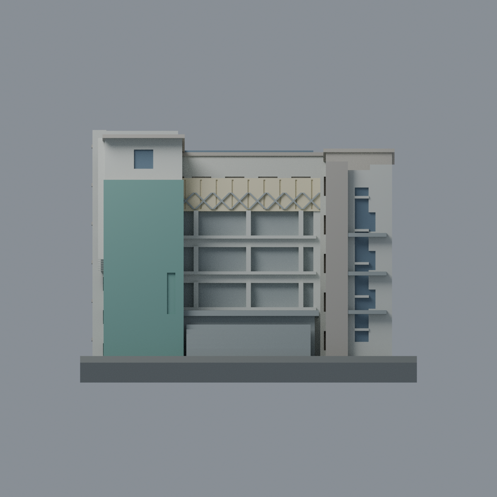
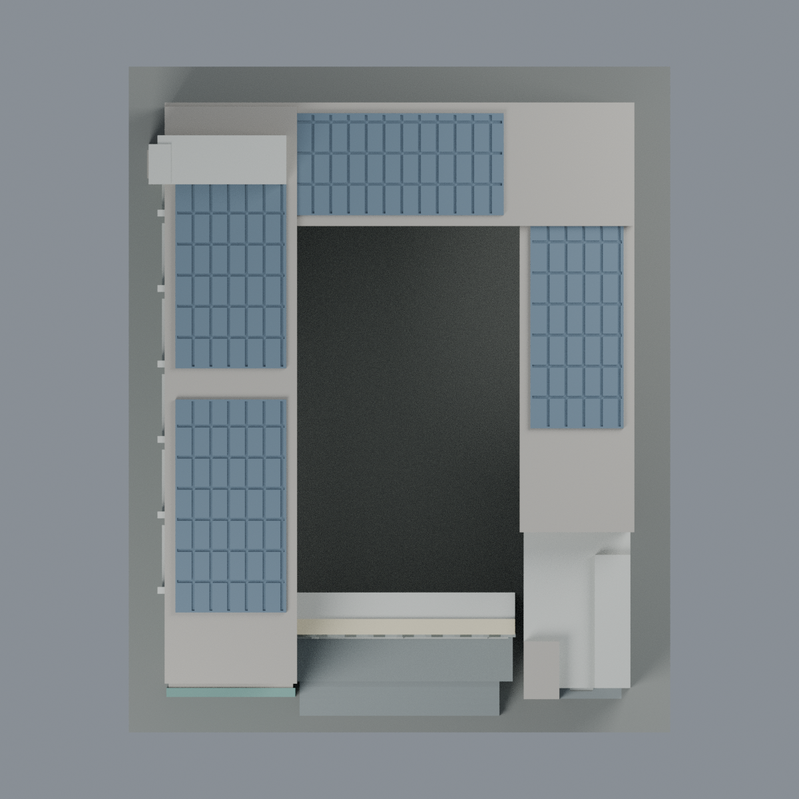

# 聯大八甲 B1 電機工程館：八材質外觀版

沿用原 **9,726 三角面／4,789 頂點**，不改原 STL 位元、座標、面序或幾何；這是既有模型外觀改版，不增加模型包數。

| 正面 | 背面保持中性 |
|---|---|
|  |  |
|  |  |

[表面色 3MF](nuub1-appearance.3mf) · [可編輯 Blender](scene.blend) · [材質色表](palette.json) · [逐面指派與依據](face-materials.json) · [原 STL](../model.stl)

## 來源與配色邊界

親自查看聯大官方 [理工一館相簿](https://secretary.nuu.edu.tw/p/132-1003-1098.php?Lang=zh-tw) 中 [第 19 張正面斜視](https://secretary.nuu.edu.tw/var/file/3/1003/gallery/98/1098/gallery_1098_9451294_26274.jpg) 及 [第 20 張俯視](https://secretary.nuu.edu.tw/var/file/3/1003/gallery/98/1098/gallery_1098_5051427_26274.jpg)。影像可辨「電機工程學系」且與既有 U 型量體、左翼六列翼板、中央上層交叉屏風及右前塔相符。內嵌日期為 **2025-03-10**；拍攝時區／日期未另行核實，不聲稱 2026 現況。第三方影像不隨包散布。

- 已見正面大面板採深鼠尾草綠、左翼低層採淺鼠尾草綠；上層翼板及右前塔近白色，凹灣使用較深灰。色值未校準，不烘焙樹影或冷氣設備。
- 上層橋屏風為淡奶油半透明面之不透明色代理，保留原刻槽及交叉浮凸，交叉條灰色。沒有增加透光材質、燈具、陰影紋理或額外框架。
- 屏風下方是開放走廊，不是玻璃帷幕；原封閉模型的走廊凹背採中性灰，不塗藍色。既有台階及為支撐而封實的入口台體仍是原幾何限制，不宣稱真實通透。
- 只有能在原網格辨識的窗凹背及右前垂直窗帶使用低彩度灰藍。左後高窄塔凹口採灰色，不把整條都稱為玻璃。庭院已見牆面淺色，但未可靠分離的窗背仍中性。
- 原屋頂四組淺薄太陽能板在俯視照片中有依據，保留原溝槽，僅用灰藍色代理反光面；不新增光伏板或設備。未見外側後牆／右長側、未登錄屋頂面保持中性。
- 原位置、層高、窗數、欄杆與小陽台並非逐項測繪；材質不能補足模型缺少的細節。原平面牌牆不添加金字、校徽或文字。全數三角形與原 STL 位元組不變；這是外觀改善，不是新增幾何或實體列印測試。

[原幾何與來源界線](../README.zh-TW.md) · [本次來源覆核](qa/source-review.json)

## 重建與核驗

安裝 [依賴](source/requirements.txt)，Blender 使用 4.3.2。由本資料夾上層提供原 model.stl：

1. `python appearance/source/build_appearance.py`
2. `python appearance/source/verify_exchange.py`
3. `blender -b -t 3 --python-exit-code 1 -P appearance/source/render_appearance.py`
4. `blender -b -t 3 --python-exit-code 1 -P appearance/source/verify_scene.py`

[獨立重建 ZIP](rebuild-source.zip)含原 STL、四支程式及依賴，不含第三方照片；不取代原建模腳本。[逐檔 SHA256](SHA256SUMS)

[交換／拓撲 QA](qa/exchange-validation.json)核對原座標與面序、全部面材質、單連通、有向水密邊、頂點 link 單環、正體積與零退化／重複面；lib3mf 嚴格讀取零警告，實際編輯單材質再存讀，其他材質及面指派不變。SDK 六位小數量化誤差另列。

[Blender 存讀與編輯](qa/scene-validation.json) · [渲染記錄](qa/render-manifest.json) · [獨立重建](qa/rebuild-validation.json)

## 製造限制照舊

尺寸仍為 122 × 150 × 90.3 mm；原 STL、建模程式、場景及歷史 QA 保留。原層檢與薄特徵檢查本次未重跑，不能由材質 QA 代替。

3MF 是同一網格的表面色，不是八個封閉分色實體、切片專案、噴頭映射或 G-code。切片 GUI、多材料路徑與實體列印未測；柱頭、屋簷、窗框及薄邊仍須評估材料、支撐及拆除風險，沒有保證可印或免支撐。
